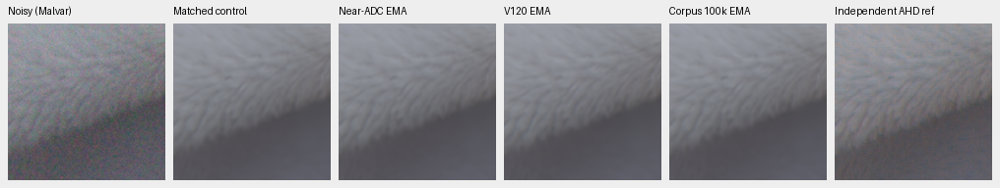
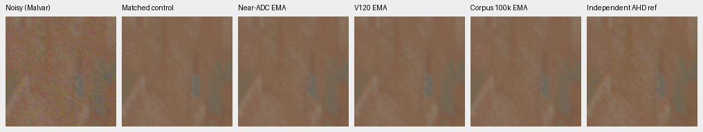

# Fixed camera panels for the matched near-ADC continuation

Near-ADC training gains **0.00279 dB** on the known-camera panel and
loses **0.00402 dB** on the unseen panel versus the matched control.
Both trained endpoints score below their Corpus 100k parent on both
panels. The nine native comparisons show similar detail and color at
normal display exposure. The separate faint-photo gain and saturated
magenta regression remain the clearest effects of this training change.
[Per-scene results and bound sources](results/near-adc-camera-audit-v1/publication.json) ·
[Near-ADC quality review](near-adc-bridge-training.md).

## Checkpoints and measurement

The two arms start from Corpus 100k EMA
`87b96f3c487b9edaf1c477742b6c38f2a82cc6b20a94716d51cc8cf46a17a760`.
Each completes 800 updates and 12,800 training examples. The recorded
training loops take 637.34 s for the control and 642.80 s for the
near-ADC arm. The sensor corruption on a subset of ADC-only examples
is the training intervention. The raw and EMA weights are saved in both
endpoints. The camera predictions use EMA and the original CPU IEEE FP32
inference policy, with camera noise conditioning from the fixed inputs.
[Training and data audit](near-adc-bridge-training.md#completed-training-audit).

| Model | Known CFA PSNR, dB | Unseen CFA PSNR, dB |
| --- | ---: | ---: |
| V120 EMA | 54.31272 | 54.00872 |
| Corpus 100k EMA | 54.33708 | 53.97826 |
| Matched control 800 EMA | 54.32990 | 53.97661 |
| Near-ADC 800 EMA | 54.33269 | 53.97259 |

The control checkpoint SHA256 is
`925a62a9e78af94469354752b8cd767c9e89e1dbe2785bfa5a841e46804a0346`.
The near-ADC checkpoint is
`42c5cc828c38d6c79aa40424735a05b428de01814010f0f3c6f8723117c6ec63`.
The audit verifies the saved prediction hashes and canonical Bayer input
fingerprints and recomputes the measured-CFA score for every crop. All
648 crop/model rows match exactly. The two panels contain 24 and 30
batches. Scoring uses a 32-pixel border and the measured CFA mask. The
reported means balance nine crops per capture, two captures per scene
and four or five scenes. The independent AHD RGB is a qualitative
reference.

The trained arm improves on the control in all four known scenes,
with a maximum gain of 0.00521 dB on D60-2. All five unseen scenes
decline, with the largest loss of 0.01455 dB on Coulicoco. Compared
with Corpus 100k, the trained arm loses 0.00438/0.00568 dB on the
known/unseen means. Compared with V120, it gains 0.01997 dB known
and loses 0.03614 dB unseen. The small mean changes and scene
variation leave the near-ADC gain specific to the lower-noise study.

## Native camera comparisons

The boards show the first crop of the first capture in each scene,
with a common unresized ROI `[176,176,160,160]` and display exposure
×1. The manifest records the original sensor coordinates, capture,
Bayer pattern, noise coefficients, WB and color transform. Lettering
and dark transitions look similar across the four predictions. The
finer texture on the tapestry and at the 7D-1 diagonal stays soft.
[Native images and provenance](images/near-adc-camera-audit-v1/manifest.json).

[Plates](images/near-adc-camera-audit-v1/known-2pilesofplates.png) ·
[D60-2](images/near-adc-camera-audit-v1/known-D60-2.png) ·
[Museum](images/near-adc-camera-audit-v1/known-MuseeL-CopteArch-C500D.png) ·
[Three apples](images/near-adc-camera-audit-v1/unseen-LucieB_3apples.png) ·
[Stick figurine](images/near-adc-camera-audit-v1/unseen-LucieB_stick_figurine.png) ·
[Top of Expedit](images/near-adc-camera-audit-v1/unseen-LucieB_top_of_Expedit.png) ·
[Coulicoco](images/near-adc-camera-audit-v1/unseen-LucieB_Coulicoco.png).

Both standing GFX100S families and exact-target synthetic comparisons
have their own native review. The fixed full427 photo collection is
running under the bound plan. [Standing GFX and matched exact-target crops](near-adc-bridge-training.md#standing-gfx-scenes) ·
[PSNR history](performance-history.md).
