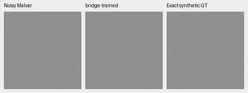
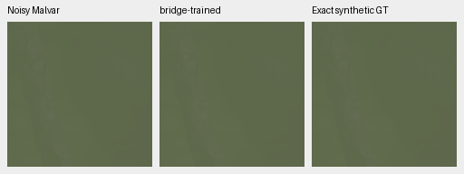
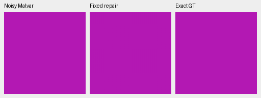
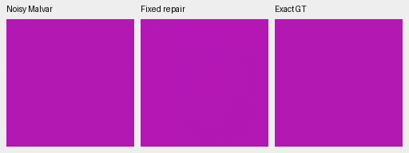

# Training across the near-ADC noise gap

The [86k noise audit](noisy-cfa-residual.md) found no positive training
prior below about 156 ADC codes RMS at full signal. On the held-out
near-ADC tests, small positive conditioning produced large flat-color
errors and attenuated weak detail. The bounded measurement correction
helped at the smallest tested prior. A matched continuation now tests
whether exposure to the missing noise range improves the learned
prediction itself.
[Locked recipes and live dispatch receipt](results/near-adc-bridge-training-v1/publication.json).

Both 800-update runs and the retained native review are complete.
The new arm loses 0.061 dB on the four-material ADC panel versus
its matched control. Both standing fences and the quiet sky look
close to the parent. The positive-noise study finds small photo gains
and substantially worse color bias on the reserved magenta field.
The existing RAW corrections repair most of that bias.
[Completed checkpoint and training audit](results/near-adc-bridge-training-v1/completed-training.json).

## Matched training

Both arms initialize all restoration weights from the
[completed 100k trajectory](full-corpus-long100k.md) EMA checkpoint.
Each arm uses fresh AdamW state and completed 800 updates
of 16 native 256×256 patches, or 12,800 example slots. The schedule uses
a 40-update warmup and peak learning rate of 0.000003. The architecture,
restoration loss, photo and RAW readers, random exposure, source order,
and validation protocol are shared.

A fresh seeded order draws from the same 90,778 eligible ordinary
photographs. The planned source schedule contains 4,325 unique ordinary
photo visits, 408 Commons batches, 192 native-synthetic batches and 200
measured paired batches. Photos that appear in multiple project runs
may still occur in this order. The original 100k trajectory and its
source order are separate.

The candidate resimulates about half of the original ADC-only examples in
the Commons and native-synthetic domains. Each replacement draws a
log-uniform full-signal standard deviation of 4–160 codes and a
log-uniform read-noise value of 0.7–1,500 electrons. With full-signal
variance `v` and read noise `e` in electrons, the shot coefficient is
the positive solution of `shot + (e * shot)^2 = v`. Read variance is
`(e * shot)^2`. The generator uses the recorded black level and samples
the original clean camera signal through the existing Poisson/read/ADC
operator. Exposure, CFA, WB, matrix and clean targets stay matched.
All original positive-noise and measured paired examples use their
original observations. Private GFX captures and their siblings stay
outside the existing training manifests.

The implementation is available through the training configuration
`near_adc_bridge_fraction`. Its range is 0 to 1, and the default is 0.
Resuming requires the same fraction. Profile choices and new sensor
draws use their own deterministic generators.
[Training integration](../src/demosaic/train.py) ·
[Sensor augmentation](../src/demosaic/near_adc_training.py).

## Executed data preflight

The first 32 native-size batches were read with the actual training
readers on CPU. Their 512 slots cover 14 Commons, 11 native and seven
paired batches. Independent regeneration exactly reproduces the 23
replacement Bayer observations. All untouched values and the clean
targets match, including the paired observations. Selected values
span the ranges recorded in the machine receipt. This stage exercises
the input pipeline before model initialization or training.
[Actual inputs and reproducibility](results/near-adc-bridge-training-v1/data-preflight.json).

The full reconstruction loss and backward pass were then exercised
on the lowest-noise and highest-read-noise admitted samples, using
the retained 86k EMA on CPU. Both losses and all 89 trainable
gradient tensors were finite. The smoke test took no optimizer
updates.
[Gradient smoke and executable receipt](results/near-adc-bridge-training-v1/gradient-smoke-publication.json).

## Completed training audit

| Arm | Retained checkpoint SHA256 | Training loop seconds |
| --- | --- | ---: |
| Control | `925a62a9e78af94469354752b8cd767c9e89e1dbe2785bfa5a841e46804a0346` | 637.34 |
| Near-ADC | `42c5cc828c38d6c79aa40424735a05b428de01814010f0f3c6f8723117c6ec63` | 642.80 |

Both checkpoints contain raw and EMA weights, complete Adam state
and CPU/CUDA/Python RNG state. Evaluation uses the EMA from each
checkpoint. The common parent is the immutable 100k EMA
`87b96f3c487b9edaf1c477742b6c38f2a82cc6b20a94716d51cc8cf46a17a760`.
Each run consumes 12,800 slots over 408 Commons, 192 native
simulation and 200 paired RAW batches. Its measured worker-loop
duration includes its validations and saves. The two runs share
bit-identical source/crop traces and camera metadata.

The near-ADC arm changes **483 of the original 980 ADC-only slots**,
330 Commons and 153 native simulation. Reconstructing the profile
draws gives 4.02–158.11 ADC codes full-signal RMS and 0.70–1,488.97
electrons read noise. Converting the measured normalized variance to
ADC codes includes the camera's sampled black level.
[Realized condition audit](results/near-adc-bridge-training-v1/training-audit.json) ·
[ADC units and profile selections](results/near-adc-bridge-training-v1/conditioning-units.json).

The initial launcher pointed outside the frozen working directory
and stopped before any training update. The corrected control
continued through a launch receipt collision. A stale path in the
following post-training audit briefly delayed evaluation. The
recovery bound both original completed checkpoints and started
the pending reviews.
[Launch recovery](results/near-adc-bridge-training-v1/launch-recovery.json) ·
[Completed endpoints and post-training recovery](results/near-adc-bridge-training-v1/completed-training.json).

## Quality review

The 110-case native review compares both 800-update EMAs with
matched 100k and V120 EMAs using CPU IEEE FP32. The audit checked
384 material rows, 240 band strata, 32 flat checks and all native
pixels on 26 boards and 22 triplets. It verified all 220 saved
V120/100k predictions. All 26 boards were actually viewed.
[Scoped native results and crops](results/near-adc-bridge-native-v1/publication.json).

| Fixed material means | V120 | 100k parent | Control | Near-ADC |
| --- | ---: | ---: | ---: | ---: |
| Ordinary sRGB, dB | 32.30426 | 32.33392 | 32.33420 | 32.33427 |
| Shadows sRGB, dB | 25.90197 | 25.96247 | 25.95906 | 25.96035 |
| Faint ADC sRGB, dB | 67.48067 | 68.05613 | 67.85194 | 67.79139 |

At zero-noise conditioning, the near-ADC arm has slightly lower
fine-band error than the equal-budget control on fur and wood,
with higher error on bark and grass. The worst selected gray/orange
mean color bias is 21.34 DN16 for the near-ADC arm, 20.01 for the
control, 23.28 for 100k and 15.08 for V120. The high-noise material
outputs remain close and fine fur and grass still look soft.
[Per-material, band and flat summary](results/near-adc-bridge-native-v1/native-summary.json).

### Native synthetic detail

These bark and fur triplets show noisy Malvar, near-ADC EMA and exact
constructed GT. Both use RGGB draw 0, native ROI `[48,48,160,160]`,
zero shot/read, ADC16 black 0.03 and exposure ×1.
[Source and display provenance](images/near-adc-bridge-native-v1/manifest.json).

[Bark with shared ×20 contrast](images/near-adc-bridge-native-v1/bark-contrast0p025-adc-RGGB-contrast20.png) ·
[Fur with shared ×20 contrast](images/near-adc-bridge-native-v1/raccoon-fur-contrast0p025-adc-RGGB-contrast20.png).

### Standing GFX scenes

The DSCF3879 sky remains quiet and the coarse chain-link crossings
remain coherent. Building hardware, cables and darker foliage stay
soft. Display exposure is ×4 with `.00128/6.5536e-6` shot/read.
DSCF3880 ISO100 AHD is the independent qualitative reference.
[Sky](images/near-adc-bridge-native-v1/main-overcast-sky.png) ·
[Building](images/near-adc-bridge-native-v1/main-building-detail.png) ·
[Foliage](images/near-adc-bridge-native-v1/main-foliage.png) ·
[Coarse fence](images/near-adc-bridge-native-v1/main-chain-link-fence.png).

On DSCF3842 the transferred profile retains stronger modulation
on the right. Both crops and profiles still show incomplete crossings
with subtle differences from the parent and no obvious new tint.
The processed cab display uses exposure ×16 and the DSCF3835 ISO100
AHD and both camera JPEGs as independent qualitative references.

| Cab profile | Shot/read | Native boards |
| --- | --- | --- |
| Nominal | `.00128/6.5536e-6` | [Left](images/near-adc-bridge-native-v1/mesh-nominal-fine-green-mesh-left.png) · [Right](images/near-adc-bridge-native-v1/mesh-nominal-fine-green-mesh-right.png) |
| Transferred DSCF3879 | `.0014635775921166604/1.0715704128646712e-6` | [Left](images/near-adc-bridge-native-v1/mesh-profile3879-fine-green-mesh-left.png) · [Right](images/near-adc-bridge-native-v1/mesh-profile3879-fine-green-mesh-right.png) |

### Positive-noise results

The completed panel uses 16 held-out photos, four CFA layouts and
four positive-noise priors. The same observations also bind the
existing V120 predictions. Replaying the scorer with V120 and the
fixed corrections reproduces all 768 initial photo scores and 288 flat/edge
rows exactly. There are eight exact flat/edge or palette controls
across the two sets. Ten positive-noise boards and two additional
color repair boards were viewed.
[Numerical results and native evidence](results/near-adc-bridge-positive-v1/publication.json).

| Noise and metric | V120 | 100k parent | Control | Near-ADC |
| --- | ---: | ---: | ---: | ---: |
| Small positive, sRGB PSNR | 66.5591 | 67.2522 | 67.2369 | 67.2638 |
| Small positive, weakest-band RMS DN16 | 2.8964 | 2.9287 | 2.9464 | 2.9411 |
| Intermediate, sRGB PSNR | 66.1395 | 66.5901 | 66.5961 | 66.5991 |
| Intermediate, weakest-band RMS DN16 | 4.1390 | 4.0034 | 3.9592 | 3.9698 |
| ISO6400, sRGB PSNR | 52.2183 | 52.2324 | 52.3225 | 52.3595 |
| ISO6400, weakest-band RMS DN16 | 9.6491 | 8.7741 | 9.1261 | 9.0879 |

At the smallest positive prior the candidate gains 0.02687 dB and
lowers weakest-band error by 0.0053 DN16 versus its control. At
ISO6400 both continuations improve overall PSNR and leave higher
weakest-band error than the 100k parent. The roof and steeple
contours look close under both 800-update branches. The ISO6400
outputs lose most of these faint structures.

At the smallest positive prior, the worst reserved magenta bias
increases from **28,798 to 34,629 DN16** versus the matched control.
V120 is at 179.30 DN16 and 100k is at 14,071.70. The worst candidate
case is GBRG. Its mean blue is 1.428 versus the target 0.900 in
normalized camera-linear units. At the intermediate prior the
candidate lowers the original yellow/gray control's worst flat
bias from 841 to 615 DN16, yet worsens the reserved palette peak
from 23,476 to 26,914 DN16. The small-positive quiet slanted-edge
error also rises from 622 to 683 DN16 versus the control.

### Existing measurement corrections

Replaying the [bounded near-ADC residual](noisy-cfa-residual.md)
and [coarse intermediate correction](coarse-adc-color.md) uses
their original thresholds. At the smallest positive prior the
candidate reaches **68.0196 dB** and **2.3495 DN16** weakest-band
RMS, versus the raw candidate's 67.2638 dB and 2.9411 DN16.
The corrected equal-budget control reaches 68.0038 dB and
2.3519 DN16. Most of the measured gain comes from the existing
measurement correction. It also reduces the candidate's worst
reserved bias to **141.10 DN16** at small positive and **1,003.29
DN16** at intermediate. Corrected control and V120 remain lower
on the smallest prior at 91.51 and 75.18 DN16. All 192 photo
prediction batches from the other three priors and all 24 GFX
predictions return their original values exactly.

The two triplets below use the same reserved GBRG magenta,
`[48,48,160,160]` native ROI, ADC16 black 0.03 and shared
exposure ×0.5 to expose red/blue bias before display clipping.
The small-positive shot/read are `1e-8/1e-10` and intermediate
`3.2e-7/1e-10`. The repaired column uses the near-ADC EMA from
the completed training audit above.
[Native provenance](images/near-adc-bridge-positive-v1/manifest.json).

[Small-positive raw comparison](images/near-adc-bridge-positive-v1/repair-exposure-half/small-positive-magenta-comparison.png) ·
[Intermediate raw comparison](images/near-adc-bridge-positive-v1/repair-exposure-half/intermediate-magenta-comparison.png).

The fixed camera audit and all nine native views are complete. The
near-ADC EMA gains 0.00279 dB known and loses 0.00402 dB unseen versus
matched control. Both arms trail their 100k parent on both panels.
The fixed 427-photo panel is collecting.
[Full camera comparison](near-adc-bridge-cameras.md).
[Benchmark restart receipt](results/primary-memory-resume-20261118-v1/publication.json).
[Parent native report](full-corpus-long100k.md) ·
[Comparable PSNR history](performance-history.md).
