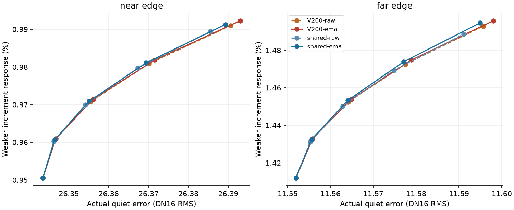
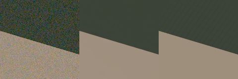
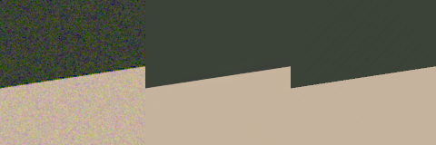

# Fresh-noise finite wires: the weaker direction remains attenuated

The new independent-noise panel completes the missing conditional-response check
for the [shared-edge training comparison](shared-edge-comparison.md). It contains
**384 fresh observations**, with zero, one and two finite wire directions, near
and far strong edges, all four Bayer layouts and two noise draws per condition.
**Shared-edge training gives small quiet gains without a clear gain in weaker
direction response.** The post-head's larger response goes mainly to the
stronger family.

This is a small constructed development panel, not a new broad camera benchmark.
No weights changed, no original photos were read, and both protected real-photo
families remain in the [completed full review](shared-edge-comparison.md).

## What is measured

Eight procedural sources have finite Gaussian wire families with unequal peak
amplitudes. Each clean scene has background-only, background plus strong wires,
and background plus both families. The weaker increment is the actual camera-RGB
difference between the latter two clean targets. Its measured response projects
`output(two directions) - output(one direction)` onto that increment. Recovering
only the common edge or stronger wires cannot substitute for this response.

Every role, repeat and CFA layout gets its own physical Poisson/read-noise draw,
16-bit ADC and black level 0.03. Methods share the resulting exact observations;
the roles themselves share **no sensor noise**. Native 512 geometry is rendered
at 2× resolution and area-reduced, with zero optical blur. Cameras, phases,
orientation, periods, widths and brightness vary by source. The far edge moves
outside the finite wire support while retaining the same wire geometry.

Nominal shot/read are **0.00128/6.5536e−6**. The weaker family has half the strong
family's peak amplitude; periods span 11–22 versus 7–11 native pixels. These are
controlled low-contrast Gaussian-wire targets, not unrestricted natural textures.

## Full-strength endpoint results

Response is projected amplitude as a percentage of the true increment. Error
is camera-RGB DN16 RMS. All values average CFA/repeat views inside each source
before averaging the eight sources.

| Placement / method | Strong response | Weaker response | Actual quiet error | Weaker increment error |
| --- | ---: | ---: | ---: | ---: |
| Near / V195 EMA anchor | 1.390% | 0.951% | 26.34348 | 31.26188 |
| Near / V200 EMA | 8.477% | 0.992% | 26.39302 | 31.40886 |
| Near / shared-edge EMA | 8.274% | 0.991% | 26.38932 | 31.39913 |
| Far / V195 EMA anchor | 6.876% | 1.412% | 11.55194 | 22.98115 |
| Far / V200 EMA | 24.181% | 1.496% | 11.59803 | 23.12785 |
| Far / shared-edge EMA | 23.695% | 1.495% | 11.59493 | 23.11900 |

Raw endpoints tell the same story: V200→shared weak response is 0.9910→0.9894%
near and 1.4929→1.4886% far. The paired source-bootstrap intervals for the EMA
weak-response differences include zero: **−0.00335 to +0.00112 percentage points
near**, **−0.00789 to +0.00438 points far**. EMA quiet RMS differences are
−0.00370 and −0.00310 DN16, with paired intervals entirely below zero.

Near-edge V200 EMA weak response itself has a wide descriptive interval,
**−0.179% to 2.150%**. Far response is **0.877% to 2.209%**. This eight-source
panel does not prove every weak signal is erased or isolate the cause of
attenuation. It does show that the new training recipe supplies no clear
conditional weaker-direction gain in these tested conditions.



Each curve scales the delivered correction above the identical V195 anchor by
0, 0.25, 0.5, 0.75 and 1. The y axes are deliberately zoomed around **1% response**;
exact incremental amplitude would be 100%. The curves nearly overlap at matched
actual quiet error. Matching correction RMS alone would not establish this
tradeoff. Raw and EMA endpoints are both retained in the source summaries.

Uncertainty uses 5,000 source-cluster percentile resamples. Four CFA layouts and
two noise draws are related views of each source, not 64 independent sources.
Two-draw output sample spread remains substantial: shared EMA full-image sample
standard-deviation RMS averages 21.95 DN16 near and 16.21 far. The two-draw mean's
weaker increment errors are 22.19 and 16.41 DN16. These are descriptive finite-draw
statistics, not exact conditional bias/variance or calibrated confidence.

## Native-pixel evidence

Noisy Malvar → **shared-edge EMA** → exact procedural GT. Each cell is 160×160
unchanged pixels from 512 context, ROI `[176,176,160,160]`, RGGB, repeat 0,
shot 0.00128/read 6.5536e−6 and display exposure 2/contrast 1. All methods use the
same source-specific WB/matrix and FP64 sRGB display. Sources 0 and 1 were chosen
by index before outcomes, with near and far counterparts retained.





All four matched five-column boards are noisy/V195 EMA/V200 EMA/shared EMA/GT:
[source0 near](images/near-edge-response-v1/source0-near-comparison.png) /
[far](images/near-edge-response-v1/source0-far-comparison.png),
[source1 near](images/near-edge-response-v1/source1-near-comparison.png) /
[far](images/near-edge-response-v1/source1-far-comparison.png).
Edges survive, but the faint GT wires are largely missing in ordinary views.

The amplified conditional-difference views below pool **four CFA layouts × two
draws**, separately for the one-/two-direction roles, then display the difference
at ×128 around neutral 0.18. They are diagnostics of mean response, **not single
denoised photographs**. Columns are V195/V200/shared-edge/exact weaker increment:
[near source0](images/near-edge-response-v1/weak-source0-near.png),
[near source1](images/near-edge-response-v1/weak-source1-near.png),
[far source0](images/near-edge-response-v1/weak-source0-far.png),
[far source1](images/near-edge-response-v1/weak-source1-far.png).
The model differences retain mottle, edge residuals and unwanted modulation;
they do not cleanly reproduce the weak target family.

Shared EMA checkpoint SHA256:
`ad5fd84ea9b07cc2fc9bf671384c98fe8de5ff3f8257e6a29e8fb11ea59e4a9d`.
Per-triplet metadata binds exact array/source/recipe/noise keys, camera transforms,
ROI and display exposure. [Complete provenance and source archives](results/near-edge-response-v1/publication.json).

## Signal strength and the next discrimination

A known-template sensor-pair calculation gives weaker-increment SNR median
**2.15 near / 2.79 far**, ranges 1.18–3.12 and 1.61–3.83. It uses exact hidden clean
sensor increments and nominal shot/read plus approximate ADC variance. This is
an oracle diagnostic: it does not show that an unknown wire can be located or
recovered safely. Low measurement SNR prevents attributing these results solely
to architectural incapacity.

The original difficult condition is retained. Two additional evaluations are
running sequentially with **identical clean targets** and lower nominal noise:
shot/read **0.00032/4.096e−7** and **0.00008/2.56e−8**. These are synthetic
noise/SNR interventions, not calibrated GFX profiles or literal matched camera
captures. They ask whether attenuation persists when evidence becomes clearer;
they do not replace the original condition or establish the overall goal.

The parent pipeline first reproduced the original native 512 batch bit-for-bit.
All 193 frozen anchor tensors match across the four endpoints. Shared computation
passed 9,437,184 exact full-forward delivery channel checks on the first RGGB
batch. The cache holds 128 batches/384 observations; 21 method/gain combinations
produce 2,688 metric rows. Inference changes neither weights nor global RNG.
The archived score's `new_source_images=0` means zero original-photo reads;
384 new procedural observations were explicitly constructed.

```bash
source scripts/env.sh
uv run python scripts/evaluate_edge_response.py prepare .cache/experiments/edge-new
uv run python scripts/evaluate_edge_response.py launch .cache/experiments/edge-new
# After numerical completion:
OPENBLAS_NUM_THREADS=1 PYTHONPATH=.:src:scripts uv run python scripts/report_edge_response.py \
  .cache/experiments/edge-new .cache/experiments/edge-new-analysis
```
