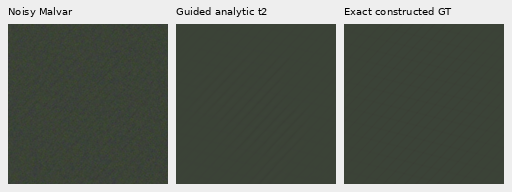
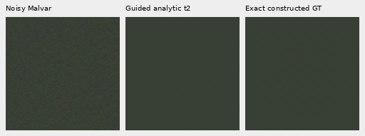
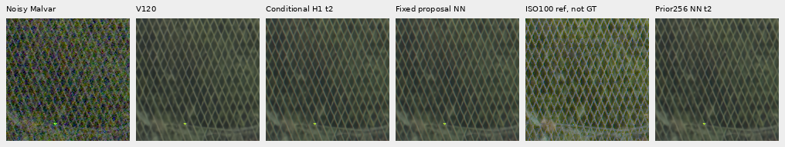
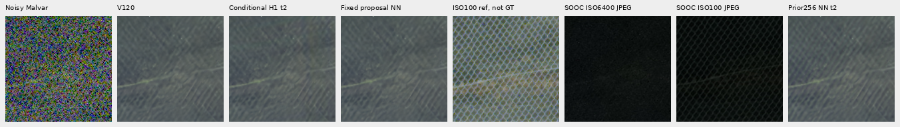

# Full source/CFA/noise review of neural-guided phase pooling

**Complete:1164 cases, independent audits and70 actually viewed native figures.**
The analytic guided option gives much stronger low-noise response and lower
full RGB error than the saved256 neural baseline, with higher mean weak-increment
error in all six noise/placement cells. The two-source
[pilot's](neural-guided-phase-pooling.md) increment-error gain does not persist
across the full panel. Fine real crossings and high-noise weak detail remain
unresolved. This is an available response/full-error tradeoff with explicit costs.

[Native100% viewer](images/neural-nuisance-guided-phase129-full-v1/native-viewer.html) ·
[75 exact archives,336 executed sources and actual viewing receipts](results/neural-nuisance-guided-phase129-full-v1/publication.json) ·
[Final independent publication check](results/closed-detail-reviews-verification-v1.json).

## Results and source variation

Each cell averages eight sources, four CFAs and two independent-noise repeats.
Errors are sensor-linear DN16; full RGB error averages all three roles.
Weak/strong response measures the known increment, not visual sharpness.

|400/far method|Weak response|Strong response|Quiet RMS|Weak-increment RMS|Full RGB RMS|
|---|---:|---:|---:|---:|---:|
|Saved256 NN|2.2992%|37.0324%|4.06128|10.07382|19.25076|
|Guided analytic, declared primary|9.3004%|68.2743%|4.07177|10.13482|18.99172|
|Guided NN, secondary|8.6441%|67.4125%|4.10815|10.43157|19.05841|

All eight primary source means improve both responses and full RGB error.
All eight quiet errors rise; seven weak-increment errors rise. Only source2
improves increment error. Source1 has the largest weak gain,+19.8113 percentage
points; source4 gains only0.0709 points. No400/far paired CFA/repeat view improves
weak response with both quiet and increment error non-increasing:0/64.
The most adverse weak-response view is source1/BGGR/repeat0,−3.4024 points;
the largest increment cost is source5/RGGB/repeat0,+0.71812 DN16.

|Prior/placement|256 weak → primary weak|256 strong → primary strong|Quiet Δ vs256|Increment Δ vs256|Full RGB Δ vs256|
|---|---:|---:|---:|---:|---:|
|400/near|3.3935% →3.4162%|17.4087% →18.6456%|−0.0271%|+0.3674%|−0.0662%|
|400/far|2.2992% →9.3004%|37.0324% →68.2743%|+0.2581%|+0.6055%|−1.3456%|
|1600/near|2.2079% →2.2035%|5.5293% →3.9271%|−0.0034%|+0.0398%|+0.1272%|
|1600/far|1.4344% →1.4778%|11.9780% →37.5134%|+0.0087%|+0.5553%|−1.1306%|
|6400/near|1.0369% →1.0391%|1.1129% →0.7159%|+0.0071%|+0.0330%|+0.0163%|
|6400/far|1.0220% →1.0317%|1.9682% →6.6289%|+0.0020%|+0.1392%|−0.3056%|

Versus the V143 parent, primary400/far quiet/increment errors rise
0.3158%/0.6605%. Exact empirical eight-source bootstrap2.5–97.5 percentiles
versus256 are weak response+2.6919 to+11.8578 percentage points,
increment+0.00304 to+0.11923 DN16 and full RGB−0.32614 to−0.19358 DN16.
They enumerate6435 count vectors representing16,777,216 ordered resamples,
with no random draws. They describe eight reused development geometries,
not population camera confidence. All secondary contrasts and individual
source/CFA/repeat tails remain in the archived summaries.

## Native comparisons

All70 figures were inspected through18 exact unresized contact sheets:48
source/prior/placement boards, all materials/protected contexts, retained and
maximum-correction building views, and two triplets for each nuisance arm.
400 views often gain one direction; weak crossings remain faint or missing.
1600 is source-dependent and6400 mostly lacks the fine families. Bark/fur
remain soft. Saved256 panels use identical source, coordinates and transforms.
Inherited board labels **Conditional H1 t2** and **Fixed proposal NN** mean
the current analytic and neural guided phase arms respectively;
**Prior256 NN t2** is the saved old baseline.

Noisy Malvar → primary guided analytic → exact constructed GT, native160 crops:

Sources1/7, far placement, RGGB/repeat0/role2, archive indices0024/0120.
ROI`[176,176,160,160]`, display exposure2/contrast1, archive WB/matrix and the
same display transform for every method; crop pixels never resized.
Conditioning400: shot`8e-5`, read`2.56e-8`. Parent V143 SHA256
`96d146d017c54196288c585f8b7eddcf030e8a235061049c31e985b9380b7ce4`.
Analytic configuration SHA256
`4e9278db8b97ee3d83cc1e4b72ec6686e98e561d39c4abe6b3ee516f222c47f3`.
A-only guide/V120 real-photo parent SHA256
`a9d9b6b4f974e24a6b11e5e740aab32314233a7f53c056cf37c7d2aac1c589fb`;
DINO SHA256`691963f0f796aac860d818d59d9d14287a4675612829fbe9467c7f5df8ce5b14`.
Publication metadata binds every prediction, archive, calibration and crop.

Both standing GFX families were actually reviewed: main DSCF3879/3880 sky,
building, foliage and coarse fence; cab DSCF3842/3835 both profiles, both ROIs
and both JPEGs. Some old256 cab ripples are smaller, but this broad-only method
still misses fine crossings. Building bands persist in both arms, including
the primary's maximum-correction and historical failure ROIs. ISO100/AHD/JPEG
references differ in aperture, exposure and motion; they are independent
qualitative references, **not exact GT**, and receive no pixelwise scoring.

## Frozen protocol and verification

The primary was declared before full results: analytic nuisance plus A-only
neural-guided pooling (`conditional-local-t2`) versus the completed256 neural
baseline. The renderer's inherited primary field remains`local-t2` for NN
labels. Both phase arms require genuine A-only neural guide fields. All six
raw-H1/analytic-phase/neural-phase global/local controls use threshold2.
This compares complete operating points, not a one-coefficient causal ablation.

The unchanged cohort has1152 finite roles: eight sources × two placements ×
four CFAs × two repeats × three roles × three original priors, plus12
materials/protected contexts. Geometry is Hann512/full-frame, shared A/B
partition, global competing-H1/background fit, native129/stride32/32-bin phase
kernel, own-colour A-only neural range guidance, physical square-root signal
coordinate, two-noise-unit bins and fixed range smoothing. RGB amplitudes stay
separate; full-input parent features never guide pooling. Identical fixed
operators project RAW and parent after scores. Support is uncalibrated.
The later fine-pair implementation is a separate study, absent from this run.

All2320 masked fields were adopted after actual input/mask/argument/checkpoint
checks: zero fresh root/DINO calls.48 pilot cases/288 threshold2 outputs were
adopted only after package/configuration and actual RAW/CFA/parent equality;
1116 corrections used the frozen package. All1164 closed before GT/reference
analysis. Four ADC cases bypass unchanged. No new sensor draw, RAW decode,
training admission or weight update occurred. Cache-only protected media and
siblings remain outside training; originals were untouched.

The independent full audit checks34,944 scalar fields,8064 absolute role rows
and252 adopted pilot role rows; maximum scalar discrepancy`6.11e-11`.
Background audit checks2320 fields/1,826,095,104 finite FP32 channels;
independent imputation maximum`1.86e-9`, no parent/GT/reference inputs.
Native audit checks4683 fields and36,249,600 RGB crop channels on116 prepared
boards, maximum finite discrepancy`2.22e-16`. All70 selected published figures
were actually viewed. The cross-study join checks1164 actual input/parent hashes,
exact parent metrics and1950 source-summary/bootstrap fields, maximum`2.84e-14`.
The new full CPU correction stage took8498.03s with two threads, excluding
adopted pilot computation and cached neural inference; this is not100MP timing.

Producer plan`9e30430e1b1f60d6965f8619c9673da219625639f8b1e6a05805007b315913b5`;
reviewer plan`a8a528a801f0fda55bc61de3d94c252103c8a2b37b3c94069755eb07f66b67ac`.
Roots are`.cache/experiments/neural-nuisance-guided-phase129-full-v1/` and
`.cache/experiments/neural-nuisance-guided-phase129-full-review-v1/`.
[Admission](results/guided-phase129-full-setup-v1/publication.json) and
[queue addendum](results/guided-phase129-full-setup-v1/publication-queue-v1.json)
remain byte-preserved. Final publication bundles2328 per-case receipts and
both executed source snapshots,166+170 files; it preserves the original
preparation and adds viewing receipts without rewriting machine history.
