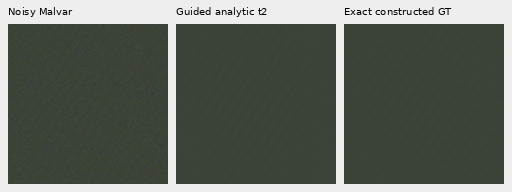
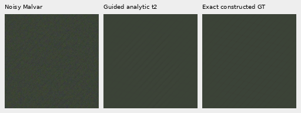
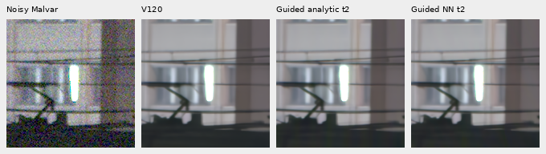
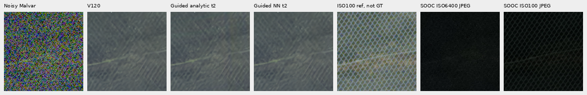

# Withheld neural guidance for compatible phase pooling

**Neural range guidance improves the analytic-nuisance phase operating point:
400/far weak response28.702%, mean weak-increment error−0.946% versus parent
with both sources improving, and much smaller building bands.** Quiet error is still+0.541%
versus parent; real fine crossings remain missing. The primary neural-nuisance
arm instead worsens increment error on both sources, despite lower quiet error.
V120 remains the general recommendation.

All48 cases, independent audits and actual review of38 figures are complete.
[Native viewer](images/neural-nuisance-guided-phase129-v1/native-viewer.html) ·
[178 exact archives, executed sources and viewing records](results/neural-nuisance-guided-phase129-v1/publication.json).
This is the same adaptive two-source RGGB/repeat0 development cohort, not
camera-generalization evidence. It follows the
[unguided phase result](global-background-phase-reconstruction.md).

|400 / far, local threshold2|Weak response|Strong response|Quiet RMS DN16|Weak-increment RMS DN16|Full RGB RMS DN16|
|---|---:|---:|---:|---:|---:|
|V143 parent|0.958%|33.783%|4.00857|11.78863|21.77841|
|Sinusoidal129 neural, global background|4.695%|51.780%|4.02489|11.78246|21.66418|
|Unguided analytic nuisance phase|28.558%|75.337%|4.04743|11.72513|21.39060|
|Guided analytic nuisance phase|28.702%|75.334%|4.03027|11.67713|21.38337|
|Unguided neural nuisance phase|27.390%|75.116%|4.10286|11.83984|21.41285|
|Guided neural nuisance phase|27.347%|75.072%|4.07847|12.14302|21.47066|

For analytic nuisance, guidance lowers quiet/increment RMS0.424%/0.409%
versus unguided phase, retaining both responses. Source0 increment error is
8.73517 versus parent's8.82672 and unguided8.88603; source1 is14.61909 versus
parent14.75054 and unguided14.56424. Both improve over parent; source1 loses
some of its previous gain. Weak responses are24.982%/32.421%. This is a useful
measured reconstruction alternative rather than a source1-only mean benefit.

The primary neural-nuisance arm has quiet+1.744% and increment+3.006% versus
parent. Source0 increment error rises8.82672→9.14959 and source1 rises
14.75054→15.13646. Its nearly unchanged response does not represent better
weak-detail fidelity. The analytic option still has more weak-orthogonal error
than parent11.38408→11.46572 DN16; the neural arm reaches11.93194.

|Prior / placement|Guided analytic weak response|Quiet error vs parent|Weak-increment error vs parent|
|---|---:|---:|---:|
|400 / near|3.558%|+0.0561%|+0.8013%|
|400 / far|28.702%|+0.5413%|−0.9458%|
|1600 / near|4.263%|≈0|+0.0373%|
|1600 / far|0.989%|+0.0213%|+0.5299%|
|6400 / near|0.407%|0|0|
|6400 / far|0.253%|0|+0.1455%|

High-noise weak reconstruction remains unresolved. Complete analytic/neural/
raw-H1 controls and fixed0/2/4 thresholds are in the
[quiet](images/neural-nuisance-guided-phase129-v1/plots/quiet-tradeoff.png) and
[increment](images/neural-nuisance-guided-phase129-v1/plots/increment-tradeoff.png)
curves. Threshold2 stays primary; no post-hoc bandwidth or threshold change.

First, an input-only diagnostic checked whether the previous frozen joint-fit
background caused large oblique-projection amplification. On168 actual color/
direction operators from both400/far constructed sources, building and nominal
cab, the largest noise-weighted residual operator norm is1.01549. Constructed
maxima stay below1.00014; building/cab actual parent-residual norm ratios change
by only a few parts per million under an orthogonal-null alternative. This
does not support large residual amplification as the main explanation here.
It does not rule out localized redistribution or background misspecification.
No GT/reference arrays, new neural inference or alternative output scores were
used in that diagnostic; its original frozen geometry matches exactly.

The new [kernel](../src/demosaic/guided_phase_aggregation.py) adds a range
coordinate to the existing phase/native-position histogram. Each color uses
its own channel of the corresponding A-only neural field, clipped0..1. For
shot coefficient`s`, read variance`r` and guide`z`, the coordinate is
`(sqrt(s*z+r)-sqrt(r))/s`, with `z/(2*sqrt(r))` when`s=0`.
One bin is approximately two sensor-noise standard deviations by the local
delta-method interpretation. This is a signal coordinate, **not** measured
neural uncertainty, calibrated compatibility or a false-detail guarantee.
The frozen plan's word “exact” describes evaluating the square-root formula;
its noise-unit interpretation remains approximate.

Linear range-bin assignment and fixed`[1,2,1]/4` smoothing give nonnegative
compatibility weights. The original32 phase bins, circular`[1,2,3,2,1]/9`
phase smoothing, native129 boxes/stride32, same-color grouping and edge-side
restriction stay fixed. A direct sparse measurement histogram at each query
avoids allocating a phase×range×native-image volume. Four-dimensional native
queries interpolate phase, range and query position. Phase-conditioned and
unconditioned averages use the same range weights; their difference remains
a signed detail operator. Constant per-color inputs are annihilated.

Both analytic-background and neural-background phase arms use this same A-only
neural guide. They retain the previous global background and competing-H1
fits, discovery frequencies, physical variance and local/global validation.
The raw-H1 controls retain their original unguided scores and delivery.
Parent correction uses the identical fixed guided operator only after all
scores; no full-input-parent feature guides pooling. Red and blue measurements
are never reconstructed from green or tied to its amplitude.

Use `restore_neural_nuisance(..., aggregation_config=PhaseAggregateConfig(
bins=32, window=129, query_stride=32), phase_guide=True,
reselect_frequencies=False)` with the previous Hann512/full-frame geometry and
two genuine A-only background fields. The unguided option remains the default.
The experimental guide supports at most512 bins at its fixed physical spacing;
zero-noise ADC bypass remains unchanged.
Choose `outputs[("conditional-local", 2.0)]` for the analytic nuisance option,
or `outputs[("local", 2.0)]` for the neural nuisance arm. **Both require the
withheld neural fields for guidance**; “analytic” names the nuisance basis,
not neural-free inference. Existing unguided and sinusoidal alternatives remain
available with their measured strengths and costs.

The same adaptive48 inputs use two constructed RGGB/repeat0 sources, three
priors, near/far placements, materials and both protected GFX families. Local
threshold2 is primary; fixed0/2/4 curves remain visible. All88 closed neural
fields are adopted with zero fresh neural/DINO forwards, RAW decodes, sensor
noise draws or learned-weight changes. All48 corrections closed before
new GT/reference quality analysis. This is a development ablation rather than
camera-generalization evidence; no threshold or bandwidth selection from new
quality outcomes was made.

Noisy Malvar → guided analytic-nuisance phase → exact constructed GT:

The neural-nuisance counterexamples also retain exact-GT triplets for
[source0](images/neural-nuisance-guided-phase129-v1/triplets/iso400-index0008-role2-triplet.png)
and [source1](images/neural-nuisance-guided-phase129-v1/triplets/iso400-index0024-role2-triplet.png).
All native160 crops use512-native400/far, ROI`[176,176,160,160]`, exposure2/
contrast1, shot/read`8e-5/2.56e-8`, saved per-source WB/matrix and recipe seed
202611160500. Pixels are never resized. Configuration/source SHA256:
`f840e67def227fbd3a3a5fb08aeb8bcb0f98a93c58ac64730baace0ebe9bae50`.
Procedural V143 parent:
`96d146d017c54196288c585f8b7eddcf030e8a235061049c31e985b9380b7ce4`.
Photographic V120 parent/frozen guide teacher:
`a9d9b6b4f974e24a6b11e5e740aab32314233a7f53c056cf37c7d2aac1c589fb`.
Official DINO backbone:
`691963f0f796aac860d818d59d9d14287a4675612829fbe9467c7f5df8ce5b14`.

DSCF3879/3880 sky/building/foliage/coarse fence and DSCF3842/3835 cab mesh,
both noise profiles/left-right ROIs/JPEGs remain included. Independent ISO100/
AHD references differ in aperture, exposure time and moving subjects; they
are qualitative, **not exact GT**, and receive no pixelwise scoring. Cached
media only; protected captures/JPEGs/siblings stay out of training and originals
remain read-only.

Analytic building maximum correction falls531.58→130.59 DN16, with114.31 at
the unchanged historical ROI`[76,260,160,160]`; the new maximum is
`[122,318,160,160]`. Severe purple/green bands are largely removed, with
remaining dark/color variation. Neural maximum falls75.18→55.20 at
`[75,317,160,160]`. These are changes from V120, **not real-reference errors**.
The quieter sinusoidal neural option still has a much smaller15.55 maximum.

[Unguided view at exactly the same coordinates](images/neural-nuisance-phase129-v1/stress/main-building-historical-failure.png).
Sky stays unchanged and foliage/bark/fur soft. Cab scene-wide maxima7.24/8.53
DN16 now land on bright foliage outside the fine-fence ROIs; they do not show
mesh recovery. Both fixed left/right views and noise profiles still miss fine
crossings against the independent reference and JPEGs.

The input audit verifies88 fields/70,778,880 finite FP32 values and withholding/
imputation identities. The independent output audit checks3819 fields/228
finite/114 material rows and14,131,200 encoded channels, maximum discrepancy
`2.89e-15`. All288 H1 control arrays match the unguided run exactly.116 tests
pass, including direct measurement-weight checks, all CFA withholding, constant-
guide parity, cross-object isolation and identical parent projection. All38
published figures were actually inspected in11 exact native contact sheets.
178 exact receipt archives and166 executed source files retain the evidence.
CPU correction takes384.33s versus629.08s unguided with two threads; the direct
query-histogram implementation also changes, so that timing is not a range-
guidance-only speed effect or a100MP benchmark.

The separate [additional fine-band comparison](fine-frequency-proposals.md)
now makes both cab directions more visible, with a purple/green periodic grid.
Its1600/far analytic gain is source1-driven, with unchanged quiet error and
slightly lower increment error;400/far stays unchanged. Building corrections
and neural1600 errors rise. This does not alter the broad-only experiment or
turn visibility into faithful mesh recovery.

Frozen plan:
`3735fe54cdb0136f9528b6c7859a2cc970c675051f50323cab6100aad8e89dcb`.
Root: `.cache/experiments/neural-nuisance-guided-phase129-pilot-v1/`.
The separate [full sinusoidal comparison](global-background-full-panel.md)
continues from its original sources and owners.
The [full guided follow-up](neural-guided-phase-full-panel.md) is now running
with the analytic-nuisance option declared primary, all cached fields and all
controls retained. Full quality remains pending.
