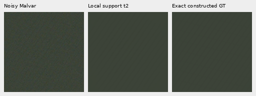
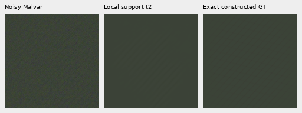
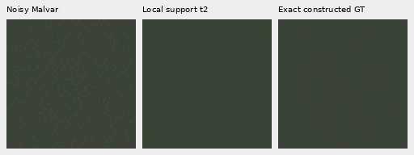
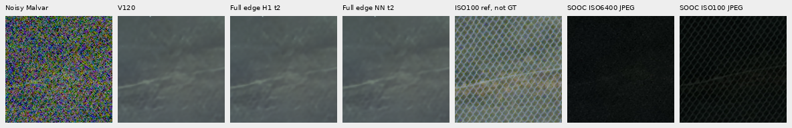

# Larger context fits the edge better but still misses weak detail

**Native512 discovery does not improve the preferred native256 fixed-proposal
neural-nuisance result.** Its400/far weak response falls2.690%→0.959%, almost
the parent's0.958%. Searching the complete edge-offset range fixes a real
background-model limitation but leaves weak response at0.957%. Keep native256
as the useful experimental operating point; V120 remains the general photo
recommendation. These are two-source development ablations, not independent
camera/generalization evidence.
The later [Hann-weighted discovery follow-up](neural-nuisance-hann512.md)
recovers2.702% far/400 weak response with lower weak-increment error than parent
and256 neural, at weaker strong response/higher full RGB error than256 neural.
That separately completed option addresses carrier discovery after this
edge-coverage fix; the original512 results below remain unchanged.

Both48-case studies are complete, independently audited and actually viewed:
[bounded512 gallery](images/neural-nuisance-context512-v1/native-viewer.html)
and [full-frame-edge512 gallery](images/neural-nuisance-full-edge512-v1/native-viewer.html).
Exact receipts, executed source snapshots and viewing records remain in their
[bounded publication](results/neural-nuisance-context512-v1/publication.json)
and [full-frame publication](results/neural-nuisance-full-edge512-v1/publication.json).

|400 / far, local threshold2|Weak response|Strong response|Quiet RMS DN16|Weak-increment RMS DN16|Full RGB RMS DN16|
|---|---:|---:|---:|---:|---:|
|V143 parent|0.958%|33.783%|4.00857|11.78863|21.77841|
|256 conditional analytic|3.686%|42.741%|4.03067|11.84346|21.70502|
|256 fixed-proposal NN|2.690%|41.168%|4.00751|11.82767|21.70476|
|512 bounded analytic|0.954%|—|4.04397|11.82213|—|
|512 bounded NN|0.959%|33.783%|4.01790|11.79154|21.78030|
|512 full-frame analytic|0.958%|35.263%|4.01008|11.79333|—|
|512 full-frame NN|0.957%|35.223%|4.01291|11.79723|21.76829|

The error reductions relative to the256 correction come with lost response.
Lower increment error near the parent does not demonstrate recovered structure.
The full-frame fit slightly improves total RGB error but does not reconstruct
the weak wire. Means balance the same two sources, RGGB/repeat0, with independent
noise across the background/strong-only/two-direction roles.

|Prior / placement|Parent weak|Bounded512 NN weak|Full-frame512 NN weak|Bounded quiet / increment DN16|Full-frame quiet / increment DN16|
|---|---:|---:|---:|---:|---:|
|400 / near|3.603%|3.603%|3.601%|7.00967 /13.52685|7.00887 /13.52190|
|400 / far|0.958%|0.959%|0.957%|4.01790 /11.79154|4.01291 /11.79723|
|1600 / near|4.270%|4.270%|4.270%|10.36307 /19.02173|10.36307 /19.02173|
|1600 / far|0.983%|0.979%|0.983%|5.55912 /15.54265|5.55153 /15.53937|
|6400 / near|0.407%|0.407%|0.407%|42.01893 /33.28739|42.01893 /33.28739|
|6400 / far|0.259%|0.259%|0.259%|13.75624 /24.69500|13.75699 /24.69560|

Each study retains all six global/local analytic/neural controls and fixed
thresholds0/2/4. The original increment-error plot clips its left labels/title;
its bytes are preserved and the tables above give the readable comparison.
No threshold was selected after examining these outcomes.

The geometry change uses native512 windows/stride256 while retaining the129
validation window, fixed analytic frequencies and shared global CFA partition.
Native256 material inputs fall back to256/stride128 based only on dimensions.
Both studies reuse the exact88 closed frozen-V120 nuisance fields: **zero new
model or DINO forwards**, no retraining, no target/reference information in
discovery or validation. The bounded arm keeps the old edge search. The second
arm changes only edge discovery to the optional full-frame search.

The old search starts at offsets±0.4 and three refinements extend its maximum
reach to±0.53125. The two far-frame true offsets are0.82424/0.82087. The new
[full-frame fitter](../src/demosaic/full_frame_edge.py) residualizes the affine
basis with QR, evaluates every distinct A-sensor projection threshold using
suffix sums, then refines the edge normal. It never reads B samples, parent
RGB, GT or reference pixels. `LocalWaveConfig(edge_search="full-frame")` and
the producer's `--geometry-window 512 --edge-search full-frame` expose this
ablation; the existing bounded256 default is preserved.

A post-hoc diagnostic reconstructs the actual A-only edge fits and verifies
frequencies exactly against both executed receipts. The full-frame fit locates
angles/offsets close to the known procedural geometry. Its B-background sensor
RMS drops1254–1256→120–122 DN16 for source0 and2364–2383→190–203 for source1.
These compare predictions with **noisy withheld sensor values**, not exact RGB
quality scores. The bounded fits select shared incorrect low frequencies;
cross-fold matching itself is not the cause of those matches. Full-frame
source0 finds a strong carrier but misses the weak one; source1 misses both.
Unweighted frequency discovery under spatially varying shot noise is a possible
remaining cause, not a demonstrated explanation or implemented remedy.
[Diagnostic receipt](results/neural-nuisance-full-edge512-v1/addendum-edge-discovery-diagnostic.json.gz).

Noisy Malvar → bounded512 NN → exact constructed GT, sources0/1:

The same coordinates and display transform, full-frame-edge512 NN:

All four native160 crops use512-native400/far two-direction frames, ROI
`[176,176,160,160]`, exposure2/contrast1, shot/read`8e-5/2.56e-8`, recipe
seed202611160500 and saved per-source WB/matrix. Source IDs0/1, exact arrays,
configuration hashes and display metadata are in each publication. Crop pixels
are never resized. Procedural parent V143 SHA256:
`96d146d017c54196288c585f8b7eddcf030e8a235061049c31e985b9380b7ce4`.
Photographic parent/frozen nuisance teacher V120:
`a9d9b6b4f974e24a6b11e5e740aab32314233a7f53c056cf37c7d2aac1c589fb`.
Official DINO backbone:
`691963f0f796aac860d818d59d9d14287a4675612829fbe9467c7f5df8ce5b14`.

Both galleries include DSCF3879/3880 sky/building/foliage/coarse fence and
DSCF3842/3835 fine cab mesh at both noise profiles, left/right ROIs and both
JPEGs. Sky remains quiet, foliage soft and fine crossings absent. The primary
building correction maximum is6.13/6.17 DN16 for bounded/full-frame NN; much
smaller added modulation accompanies near-parent abstention, without proving
real-photo fidelity. Extra analytic-max and historical-failure stress ROIs
remain visible. The real ISO100 captures differ in aperture, exposure time and
moving subjects; they are qualitative references, **not exact GT**, and receive
no pixelwise quality score. Protected media/JPEGs/siblings remain outside
training; only local caches are accessed, originals read-only.

Each independent audit checks3,819 metric fields,228 finite/114 material rows
and14,131,200 encoded RGB channels across44 boards, with maximum discrepancy
below`3.5e-15`. Separate nuisance-input audits check all88 fields/70,778,880
finite FP32 values and exact withheld-NaN/imputation fingerprints. All34
published figures per arm were actually inspected in ten contact sheets that
copy source pixels exactly without resizing; source PNGs remain available.
The145-test numerical suite covers brute-force edge-benefit agreement,
far-edge recovery across four CFAs/both sides, withheld-value invariance and
existing nuisance/control behavior. CPU corrections take220.15s/237.98s under
concurrent work; these are development timings, not100MP production benchmarks.

The separate [full eight-source256 review](neural-nuisance-full-panel.md)
continues with its original frozen implementation. Neither512 result changes
its source, predictions, plan or running process.
