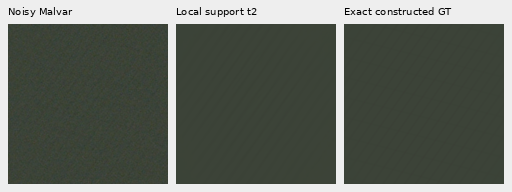
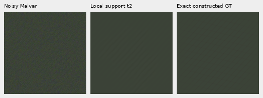
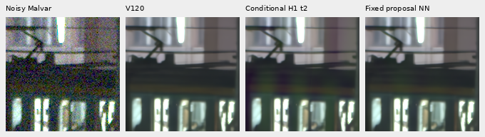
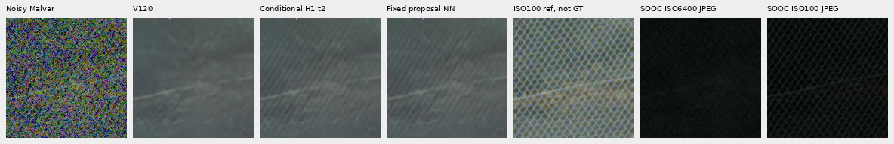

# Fixed proposals retain more weak response with lower added errors

**Holding analytic proposals fixed gives a useful quieter neural-nuisance
operating point.** At400/far, weak response is2.690% versus the V143 parent's
0.958%, with quiet RMS−0.026% and weak-increment RMS+0.331% versus that parent.
Against matched conditional analytic H1, weak response falls3.686%→2.690%,
while quiet/increment RMS improve0.574%/0.133%. Added building banding is much
smaller; fine real cab crossings remain missing. V120 remains the general
photographic recommendation.

The complete48-case audit/native review is published with
[all34 viewed figures](images/neural-nuisance-fixed-v1/native-viewer.html) and
[exact receipts/executed sources](results/neural-nuisance-fixed-v1/publication.json).
This is the preferred neural-nuisance variant for further weak-detail work;
the [frequency-reselection arm](neural-nuisance-reconstruction.md) remains an
explicit ablation. Both are implemented experimental choices, with their
measured gains and costs retained.
The completed [native512 context/complete-edge follow-ups](neural-nuisance-context512.md)
return near-parent0.96% weak response despite better far-background geometry;
native256 remains preferred. Their exact cached fields and all native views
are published separately.

| Prior / placement | Analytic weak response | Fixed-proposal neural response | Quiet RMS change | Weak-increment RMS change |
| --- | ---: | ---: | ---: | ---: |
|400 / near|3.667%|3.595%|−0.351%|−0.069%|
|400 / far|3.686%|2.690%|−0.574%|−0.133%|
|1600 / near|4.268%|4.264%|−0.124%|−0.062%|
|1600 / far|0.983%|0.974%|−0.826%|−0.330%|
|6400 / near|0.281%|0.407%|+0.037%|−0.149%|
|6400 / far|0.261%|0.249%|−0.353%|−0.142%|

Every change column compares fixed-proposal neural nuisance to conditional
analytic H1 at local threshold2. Means use two adaptively reused sources,
RGGB/repeat0, with the same global CFA partition. The older per-tile H1 pilot
is a different control. Fixed0/2/4 global/local curves are retained in the
[quiet-error](images/neural-nuisance-fixed-v1/plots/quiet-tradeoff.png) and
[increment-error](images/neural-nuisance-fixed-v1/plots/increment-tradeoff.png) plots.
No independent source-level confidence or camera generalization is claimed.

At400/far, source0 weak response changes3.005%→1.500% and source1
4.367%→3.880%; the latter drives most retained gain. Strong response falls
42.741%→41.168%. Full RGB RMS barely changes21.70502→21.70476 DN16. The
edge-only role's full RMS20.84632→20.83900 DN16 improves versus analytic H1
but remains above the parent's20.83797; quiet error alone does not establish
edge safety. All684 absolute role/error rows are retained. Higher-noise weak
structure stays largely missing.

Noisy Malvar → fixed-proposal neural nuisance localt2 → exact constructed GT.
These native160 crops use sources0/1,400/far two-direction roles from512-native
frames, ROI`[176,176,160,160]`, exposure2/contrast1, shot/read`8e-5/2.56e-8`.
Recipe seed202611160500 with distinct source IDs, saved per-source WB/matrix,
clipped-sRGB display and coordinates are identical. Crop pixels are never resized.

The [shared-partition protocol](neural-nuisance-reconstruction.md) supplies two
whole-context, own-color V120 nuisance fields, each seeing only its declared
discovery half of the sensor. Analytic tiles share that same partition, edge
geometry and analytic variance proxy. This follow-up changes only frequency
source: retain the analytic A-only H1 proposals, then fit the neural nuisance
and waves jointly per color and recompute held-out scores. Full-minus-null
delivery and the final parent projection are unchanged. The public
[restorer](../src/demosaic/neural_nuisance.py) selects this variant with
`reselect_frequencies=False`; the experiment producer uses
`--fixed-analytic-frequencies --background-cache <closed-collection.json>`.
Scores remain empirical, not calibrated confidence or a bound on final RGB error.

The new arm adopts the exact same88 closed background fields: **zero new model
or DINO forwards**. Independent input auditing again checks70,778,880 finite
FP32 values and exact withheld-NaN/imputation fingerprints. The
[control-isolation audit source](../scripts/compare_neural_nuisance_proposals.py)
verifies all576 analytic control files byte for byte and all412 analytic tile
records unchanged. Neural frequencies and cross-fold matches now equal analytic
ones exactly. All48 new corrections close before target/reference scoring.
The correction/native audit again checks3,819 fields,228 finite/114 material
rows and14,131,200 encoded channels; maximum discrepancy`2.8e-15`. An additional
11,520,000 matched/stress channels are checked, with exact-copy triplets.
The expanded numerical suite passes126 tests. CPU correction takes382.79s;
cache adoption5.68s, under concurrent V132 training. These are not production
100MP timing measurements.

Procedural parent V143 SHA256:
`96d146d017c54196288c585f8b7eddcf030e8a235061049c31e985b9380b7ce4`.
Photographic parent and frozen background teacher V120:
`a9d9b6b4f974e24a6b11e5e740aab32314233a7f53c056cf37c7d2aac1c589fb`.
Official DINO backbone:
`691963f0f796aac860d818d59d9d14287a4675612829fbe9467c7f5df8ce5b14`.
Original cache production checks all91 restoration tensors/backbone unchanged;
this arm reuses those exact fields without loading new learned weights.

At the analytic-control building maximum ROI`[83,326,160,160]`, added correction
RMS falls63.55→16.61 DN16. At the original aggregation-failure ROI
`[76,260,160,160]`, it falls52.79→15.60. The fixed-proposal neural arm's own
maximum is17.49 DN16 at`[80,305,160,160]`. That nonzero correction is a cost
relative to the reselection arm's exact-parent abstention; the view has much
less added analytic banding, without establishing pixelwise real-photo fidelity.
Exposure4/contrast1, shot/read`.00128/6.5536e-6`; the extra stress ROIs have no
reference. Sky stays exact parent; foliage remains soft.

Both cab profiles, left/right mesh ROIs and both JPEGs remain in the viewer.
Parallel modulation is stronger than the parent in nominal views, but missing
fine crossings remain unresolved versus the analytic control. The nominal
right ROI is`[426,189,160,160]`, exposure16/contrast1, shot/read
`.00128/6.5536e-6`. All panels share the saved display transform. The ISO100
reference differs in aperture, exposure time and moving subjects; it is
qualitative, **not exact GT**. Both protected families and all siblings remain
excluded from training; originals remain read-only and only local caches are used.

The comparison establishes that proposal reselection caused part of the first
arm's weak-response loss. It does not establish that the remaining loss has
one cause: nuisance competition, conditional validation, local support and
parent projection can still attenuate a retained candidate. A broader
source/CFA/noise review and untouched real scenes are needed to assess whether
this quieter operating point generalizes. The complete two-source result is
useful without treating it as a new general model recommendation.

The [complete source/CFA/repeat/noise review](neural-nuisance-full-panel.md)
is now running with the same variant and exact pilot-output adoption. Its
larger-cohort quality remains pending.
