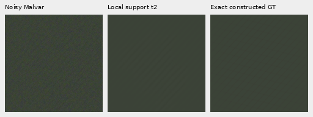
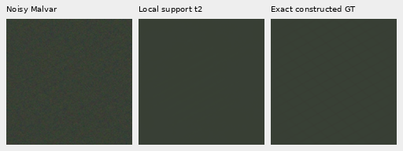
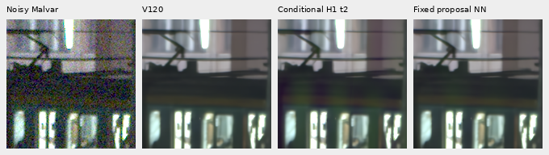
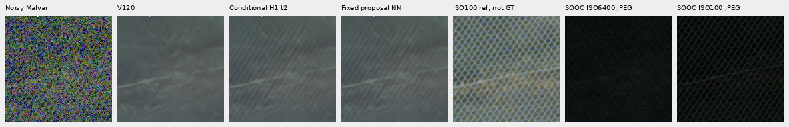

# Full neural-nuisance source/CFA/noise review

**The complete fixed-proposal neural-nuisance panel retains a quieter
correction than conditional analytic H1 in all six noise/placement cells.**
At400/far, weak response is2.299% versus analytic2.476% and parent1.826%.
Quiet/increment RMS improve0.485%/0.362% versus analytic, but remain
0.058%/0.055% above parent. Source1 drives much of the weak-response gain;
high-noise weak structure and fine real cab crossings remain missing. V120
remains the general recommendation.

All1164 cases, independent full-cohort/source-statistic audits and actual
inspection of68 selected figures are complete. [Native viewer](images/neural-nuisance-full-panel-v1/native-viewer.html) ·
[Exact receipts,4560 bundled case receipts and both source snapshots](results/neural-nuisance-full-panel-v1/publication.json).
The [original two-source pilot](neural-nuisance-fixed-proposals.md), subsequent
[Hann discovery](neural-nuisance-hann512.md) and
[local-amplitude ablation](spatial-carrier-amplitudes.md) remain separately
documented with their distinct gains and costs.

|400 / far, local threshold2|Weak response|Strong response|Quiet RMS DN16|Weak-increment RMS DN16|Full RGB RMS DN16|
|---|---:|---:|---:|---:|---:|
|V143 parent|1.826%|30.902%|4.05895|10.06832|19.30746|
|Conditional analytic H1|2.476%|39.217%|4.08107|10.11046|19.25081|
|Fixed-proposal neural nuisance|2.299%|37.032%|4.06128|10.07382|19.25076|

|Prior / placement|Parent weak|Analytic weak|Neural weak|Neural quiet vs analytic|Neural increment error vs analytic|
|---|---:|---:|---:|---:|---:|
|400 / near|3.400%|3.402%|3.394%|−0.272%|−0.167%|
|400 / far|1.826%|2.476%|2.299%|−0.485%|−0.362%|
|1600 / near|2.201%|2.207%|2.208%|−0.298%|−0.200%|
|1600 / far|1.472%|1.473%|1.434%|−0.476%|−0.296%|
|6400 / near|1.039%|1.049%|1.037%|−0.148%|−0.236%|
|6400 / far|1.032%|1.029%|1.022%|−0.378%|−0.367%|

Means balance all64 CFA/repeat views per cell: eight sources, eight views each.
Compared with parent, neural weak-increment error rises in all six cells;
quiet error rises in five, with only a0.0014% decrease at6400/far. The mean
response increase does not establish more faithful weak detail.

At400/far, neural versus analytic improves quiet error in63/64 views and weak
increment error in58/64, while weak response increases in only8/64. Every
source's quiet mean improves, seven source increment-error means improve,
and seven lose weak response. Against parent, weak response rises in28/64,
quiet error falls in14/64 and increment error falls in26/64; only4/64 improve
all three simultaneously. Source1 supplies+2.743 percentage points of response
within its own mean, while the overall paired mean is+0.473 points. Five
source means rise and three fall.

The exact eight-source empirical bootstrap gives neural-minus-parent response
percentiles`[−0.0083,+1.1806]` percentage points; it crosses zero. Neural-minus-
analytic quiet/increment differences are`−0.01978/−0.03663 DN16`, with
percentiles`[−0.02815,−0.01222]`/`[−0.05604,−0.01914]`. These describe the
eight reused development geometries, not calibrated camera-population
confidence. The input/source count is not inflated to64 independent scenes.

Noisy Malvar → fixed-proposal neural localt2 → exact constructed GT, source1
and a remaining source7 limitation:

Both native160 crops use512-native400/far two-direction frames, RGGB/repeat0,
ROI`[176,176,160,160]`, exposure2/contrast1, shot/read`8e-5/2.56e-8`, recipe
seed202611160500 and saved per-source WB/matrix. Crop pixels are never resized.
Configuration/source SHA256:
`9a2b3eafdfccdbd3fb587953e0976aa54f840125a596b7dc583e1a607fb9749d`.
Exact parent/teacher/backbone hashes and source/ROI/display metadata follow
below and remain in the publication.

All48 predeclared procedural native comparisons were actually inspected,
plus material/protected contexts and stress views. Strong slanted modulation
is most evident in sources1/2; high-noise outputs remain largely parent-like.
Bark/fur/foliage stay soft. Neural nuisance reduces added analytic building
bands, but nominal cab parallel modulation still lacks fine crossings and
the alternate profile retains incomplete mesh/false waves.

Independent full auditing checks34,944 scalar fields/2688 method-group rows,
8064 absolute-role rows and4836 summary/bootstrap fields. Maximum scalar
discrepancy is`6.08e-11`; all252 adopted pilot role rows agree within`2.61e-11`.
Native auditing checks4683 fields/116 generated boards/36,249,600 encoded
channels; the68 selected published figures were actually viewed in17 exact
unresized contact sheets. The independent background audit checks2320 fields/
1,826,095,104 finite FP32 channels, with explicit Gaussian-stencil discrepancy
at most`1.86e-9`; no parent/GT/reference arrays or neural replay in that audit.
Production makes exactly2232 new root/encoder calls, adopting88 pilot fields;
review/publication make zero. GPU-background/CPU-correction/full-scoring stages
take1120.37/7146.69/80.00s under concurrent work, not100MP timing benchmarks.
Original producer/reviewer processes finish normally without restart.

The frozen cohort contains1152 procedural roles:
8 source geometries ×2 edge placements ×4 Bayer layouts ×2 independent-noise
repeats ×3 present/absent roles ×3 original noise priors. All12 material and
standing real-photo contexts are retained, giving1164 cases. The full panel is
an existing development cohort, with synthetic geometries already examined in
the earlier analytic H1 study; it is not an untouched photographic test set.

The intervention is unchanged from the preferred pilot: whole-context A/B
neural backgrounds, one shared global sensor partition for all overlapping
tiles, analytic edge/variance proxies, fixed analytic H1 frequencies, own-color
neural nuisance, conditional held-out validation and full-minus-null delivery.
Six controls retain global/local support for raw-wave analytic H1, conditional
analytic H1 and conditional neural nuisance. The fixed threshold is2; the
pilot retains the0/2/4 curves. No fresh sensor corruption/source observation,
RAW decode, learned-weight update or training admission is involved.

The complete pilot's48 cases supply288 exact threshold2 outputs and88 exact
background fields. Their actual RAW/CFA/parent fingerprints, finite native
predictions and the entire package source snapshot match before adoption.
The remaining1116 cases require at most2232 fresh root/encoder forwards.
All2320 background fields and all1164 corrections closed before new full
GT/reference scoring. Four explicit zero-noise cases bypass the neural stage.
Stage reserves are48GiB RAM before neural loading,32GiB during execution and
96GiB free disk, with a six-hour stage deadline. The original training worker
is neither restarted nor signaled by this review.

Procedural parent: V143
`96d146d017c54196288c585f8b7eddcf030e8a235061049c31e985b9380b7ce4`.
Photographic parent/background teacher: V120
`a9d9b6b4f974e24a6b11e5e740aab32314233a7f53c056cf37c7d2aac1c589fb`.
Official DINO backbone:
`691963f0f796aac860d818d59d9d14287a4675612829fbe9467c7f5df8ce5b14`.
All three procedural parent bindings match the corrected full-panel lineage.
Fresh inference checks all91 restoration tensors and the backbone unchanged;
cache adoption checks actual input/mask/argument/field hashes.

The separately frozen [reviewer](../scripts/review_neural_nuisance_panel.py)
streams independent scalar checks over all2688 method/group rows and8064
absolute role rows. It reports all64 CFA/repeat views per noise/placement
cell, eight views within each source, paired source-cluster differences and exact empirical bootstrap
percentiles over8^8 ordered source resamples. These are descriptive conditional
statistics for eight development geometries, not calibrated camera-population
confidence. Its parameterized summary reproduces all previous full-H1 means,
contrasts and bootstrap fields exactly; the initial rehearsal's whole-wrapper
assertion failed only because the archived wrapper also stores its input rows.
Both attempts are preserved.

Native selection was fixed before results: all48 RGGB/repeat0 two-direction
source/prior/placement views, ROI`[176,176,160,160]`, exposure2/contrast1, plus
every material/protected context. The reviewer produces matched native160
comparisons, noisy/restored/exact-GT triplets and additional maximum-correction
real stress views. Actual viewing and publication are now complete.
DSCF3879/3880 sky/building/foliage/chain-link crops and DSCF3842/3835 left/right
cab mesh, both noise profiles and both JPEGs remain in the review. Independent
ISO100/AHD references differ in aperture/exposure/motion and are qualitative,
never exact GT or real-photo pixelwise scoring targets. All protected media and
siblings remain excluded from training; original files remain read-only and
the local caches are used.

Producer plan SHA256:
`acf7f881a2f23fae4250525a7bafc93d368304732e14fa348ff590bf136ff5ad`.
Review plan:
`e092e0eeed3997a4eac797e00d5e54bc08c4954a00104aac27c824e4c1b761e8`.
Execution roots are `.cache/experiments/neural-nuisance-full-panel-v1/` and
`.cache/experiments/neural-nuisance-full-review-v1/`. Existing pilot receipts,
predictions and published images remain unchanged.
