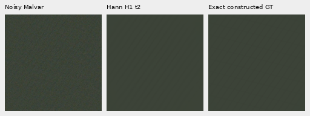
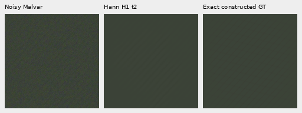
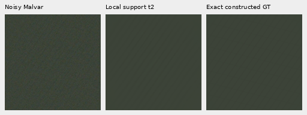
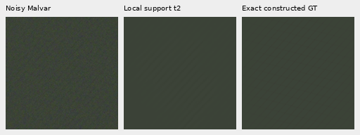
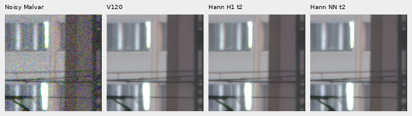
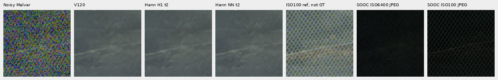

# Tapered carrier discovery lowers one weak-detail error

**The analytic Hann512 variant improves400/far weak response0.958%→2.702%
and lowers weak-increment RMS0.093% versus the parent.** Both development
sources improve that increment error. Quiet RMS rises0.0037%. Compared with
the preferred256 fixed-proposal neural option, it has lower weak-increment
error but weaker strong-family response and higher full RGB error. This is a
useful additional experimental operating point, with most weak detail still
missing. V120 remains the general photo recommendation.

The matched neural-nuisance Hann arm has2.304% weak response and lower added
building correction, with slightly higher synthetic errors than the analytic
arm. All48 cases, independent audits and actual viewing of36 figures are
complete. [Native gallery](images/neural-nuisance-hann512-v1/native-viewer.html) ·
[Exact receipts, diagnostics and executed sources](results/neural-nuisance-hann512-v1/publication.json).
These are two adaptively reused procedural sources, not independent camera
generalization or source-level significance evidence.

|400 / far, local threshold2|Weak response|Strong response|Quiet RMS DN16|Weak-increment RMS DN16|Full RGB RMS DN16|
|---|---:|---:|---:|---:|---:|
|V143 parent|0.958%|33.783%|4.00857|11.78863|21.77841|
|256 fixed-proposal neural|2.690%|41.168%|4.00751|11.82767|21.70476|
|512 full-frame, untapered neural|0.957%|35.223%|4.01291|11.79723|21.76829|
|512 Hann analytic|2.702%|37.587%|4.00872|11.77761|21.73732|
|512 Hann neural|2.304%|37.565%|4.01108|11.78409|21.73904|

The new analytic weak-increment RMS falls0.423% versus256 neural; full RGB
RMS rises0.150%. Weak response measures projected amplitude, not overall
fidelity. Even here, weak orthogonal-error RMS slightly increases11.38408→
11.38702 DN16 versus parent. The lower total increment error is small and
does not mean false texture is solved.

|Source|Parent weak response|Hann analytic response|Parent increment RMS|Hann analytic increment RMS|
|---|---:|---:|---:|---:|
|0|1.014%|2.635%|8.82672|8.81821|
|1|0.902%|2.770%|14.75054|14.73702|

The neural arm's source0 increment error instead rises8.82672→8.82914 DN16;
source1 improves14.75054→14.73903. Higher-noise and near-edge results remain
almost parent-like. At6400/near all three outputs coincide in these scalar
metrics. All six matched global/local controls and fixed0/2/4 thresholds remain
available in the [quiet](images/neural-nuisance-hann512-v1/plots/quiet-tradeoff.png)
and [increment](images/neural-nuisance-hann512-v1/plots/increment-tradeoff.png)
plots. Threshold0 recovers more low-prior response with larger quiet error;
threshold2 remains the declared comparison, without retrospective tuning.

The [preceding512 study](neural-nuisance-context512.md) fixed far-background
edge coverage but lost weak proposals. An A-only diagnostic now compares
inverse-variance conditional sinusoid discovery with the same method times a
standard pixel-centered separable Hann. Inverse-variance alone misses the weak
carrier in all four folds. Adding the fixed taper finds both carriers in both
folds for both sources, within0.8 native frequency bins. This does not isolate
every causal contribution: weighted nuisance projection, frequency-dependent
Gram normalization and weighted refinement also differ from the old FFT-power
ranking. Recipe frequencies are used only after selection to measure proposal
coverage; no template or GT RGB enters inference.

The [implementation](../src/demosaic/carrier_spectrum.py) estimates a shot/read
variance proxy from the A-green nuisance fit, multiplies inverse variance by
the fixed native Hann, and computes conditional cosine/sine least-squares
benefits. FFT sums retain the full two-column Gram energy and weighted nuisance
QR projection. Weights normalize over A only. Local refinement uses the same
weights. Edge geometry, color amplitude fits, physical validation variance,
conditional nulls and final parent projection remain unchanged. The two
nuisance arms share the exact analytic proposal bank.

Use `LocalWaveConfig(window=512, stride=256, edge_search="full-frame",
frequency_weighting="hann-inverse-variance")` for analytic discovery;
`restore_local_thresholds` supplies the analytic local correction. The nuisance
producer adds `--fixed-analytic-frequencies --geometry-window 512 --edge-search
full-frame --frequency-weighting hann-inverse-variance`. Uniform discovery
remains the default; the lower-strong-response Hann option is explicit.
Native256 materials use the dimension-only256 fallback. The new mode uses
all88 exact closed frozen-V120 nuisance fields, **zero new neural/DINO calls**,
no new sensor corruption/RAW decode or training. All48 corrections close before
new target/reference analysis.

Noisy Malvar → analytic Hann512 localt2 → exact constructed GT, sources0/1:

Matched neural-nuisance Hann512 outputs:

All four native160 crops use512-native400/far two-direction frames, ROI
`[176,176,160,160]`, exposure2/contrast1, shot/read`8e-5/2.56e-8`, procedural
recipe seed202611160500 and saved per-source WB/matrix. Pixels are never
resized; noisy/GT cells match the independently audited triplets exactly.
The model/configuration hash is
`3a84f6b0f546e630f128e280dc06bf7b481abfde4fed434b76ce324546eda954`.
Procedural parent V143:
`96d146d017c54196288c585f8b7eddcf030e8a235061049c31e985b9380b7ce4`.
Photographic parent/frozen teacher V120:
`a9d9b6b4f974e24a6b11e5e740aab32314233a7f53c056cf37c7d2aac1c589fb`.
Official DINO backbone:
`691963f0f796aac860d818d59d9d14287a4675612829fbe9467c7f5df8ce5b14`.

Both standing GFX families remain fully represented: DSCF3879/3880 sky,
building, foliage and chain-link fence; DSCF3842/3835 fine cab mesh, both
profiles/ROIs and both JPEGs. Sky is quiet, foliage soft, and fine cab crossings
still absent. The neural arm's maximum building correction is1.95 DN16 at
`[26,352,160,160]`; the analytic maximum is16.61 at`[95,204,160,160]`. The
retained prior-failure ROI`[76,260,160,160]` has13.82 DN16 analytic correction.
These quantify change from V120, not error against a real GT. Primary and
extra stress views show no clear new broad building bands, without establishing
fine-detail fidelity. Independent ISO100 captures differ in aperture, exposure
time and moving subjects; references are qualitative, **not exact GT**, and
are never pixelwise scored. Protected media/JPEGs/siblings stay outside
training; local caches only, originals read-only.

Independent auditing checks3,819 metric fields/228 finite/114 material rows and
14,131,200 encoded channels, maximum discrepancy`3.56e-15`. The nuisance-input
audit checks88 fields/70,778,880 finite FP32 values and exact NaN/imputation
fingerprints before correction. Additional matched/stress and analytic-triplet
pixel checks are retained. All36 source figures were actually viewed in eleven
exact unresized contact sheets. The147-test numerical suite passes, including
independent explicit weighted-LS agreement and all four CFA withholding checks.
Twelve frozen256/512/Hann discovery comparisons reproduce exactly. Initial
fixture, tile-coordinate and prelaunch schema mistakes remain archived with
their corrected results. CPU correction takes162.37s under concurrent work,
not a100MP production benchmark.

The [full eight-source256 study](neural-nuisance-full-panel.md) keeps its frozen
source and original running process. This Hann pilot supplies a useful new
weak-increment-error option, while broad weak-detail recovery remains open.
