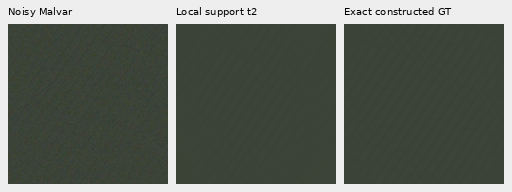
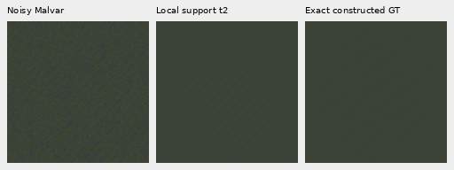
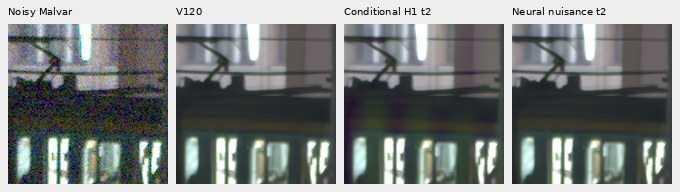
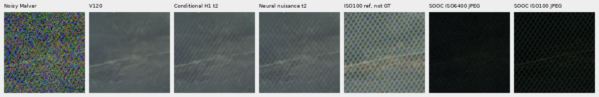

# Neural nuisance reduces added errors but loses weak recovery

**The completed48-case pilot reduces some false corrections without improving
weak-detail recovery.** At400/far, conditional analytic H1→neural nuisance
changes weak response3.686%→0.900%, quiet RMS−0.493% and weak-increment
RMS+0.028%. The V143 parent's weak response is0.958%. Both sources lose the
analytic gain. The neural arm returns V120 exactly on the whole building
context, avoiding its analytic control's added ripple; fine cab crossings
remain missing. V120 remains the general photographic recommendation.

All predictions, independent audits and actual native review are complete.
[Native viewer](images/neural-nuisance-v1/native-viewer.html) ·
[Exact receipts, executed sources and viewing record](results/neural-nuisance-v1/publication.json).
The earlier [two-context diagnostic](withheld-neural-background.md) correctly
motivated a richer background test; better sensor-background prediction alone
does not establish delivered weak-detail fidelity.

| Prior / placement | Analytic weak response | Neural weak response | Quiet RMS change | Weak-increment RMS change |
| --- | ---: | ---: | ---: | ---: |
|400 / near|3.667%|3.611%|−0.373%|+0.043%|
|400 / far|3.686%|0.900%|−0.493%|+0.028%|
|1600 / near|4.268%|4.266%|−0.127%|−0.196%|
|1600 / far|0.983%|0.955%|−1.075%|−0.181%|
|6400 / near|0.281%|0.407%|+0.035%|−0.153%|
|6400 / far|0.261%|0.261%|−0.349%|−0.201%|

These are means over two adaptively reused sources, with local threshold2 and
one **global shared CFA split** for both arms. They are not the historical
per-tile H1 masks: the older pilot's2.80% weak response is not this control.
Strong400/far response also falls42.741%→41.320%, while400/near rises
21.986%→23.801%. Full400/far RGB RMS falls only21.7050→21.6969 DN16; the
increment/quiet/absolute-role measures expose its mixed behavior. Separate
edge-only400/far full RMS20.8463→20.8380 DN16 returns to the exact parent's
error. Quiet improvements often reflect abstention, rather than new detail.
All fixed0/2/4 and global/local curves remain in the
[quiet-error](images/neural-nuisance-v1/plots/quiet-tradeoff.png) and
[increment-error](images/neural-nuisance-v1/plots/increment-tradeoff.png) plots.

Noisy Malvar → neural-nuisance localt2 → exact constructed GT. Both native160
triplets use ROI`[176,176,160,160]` from the512-native400/far two-direction
roles, exposure2/contrast1, shot/read`8e-5/2.56e-8`. Saved per-source WB/matrix,
clipped-sRGB display and coordinates are identical; no crop pixels are resized.
Sources0/1 use the recorded recipe seed202611160500 with distinct source IDs.
Parent/teacher hashes
appear below and in every source receipt.

The building's analytic maximum-correction ROI`[83,326,160,160]` has63.55 DN16
added RMS; the neural arm adds0. At the previously published aggregation
failure ROI`[76,260,160,160]`, this new analytic control adds52.79 DN16 and the
neural arm again adds0. These supplementary views preserve the old failure
location even though a maximum over the zero neural correction selects the
first corner. Exposure4/contrast1, shot/read`.00128/6.5536e-6`; no reference
or pixelwise real-photo score at either extra ROI.

The neural background reduces the building's unweighted tile/fold/color
standardized sensor MSE29.82→6.12 with the **same analytic variance proxies**.
Cross-fold direction matches fall13→0, so all six neural global/local outputs
at thresholds0/2/4 equal V120 exactly. Sky also remains exact V120. These
overlapping-tile diagnostics are neither independent replications nor RGB
quality scores. Foliage stays soft. Coarse fence/cab modulation changes, with
more regular nominal-right cab response, but the fine second direction and
reference-like crossings are still absent in both profiles.

The cab uses the standing right ROI`[426,189,160,160]`, exposure16/contrast1,
nominal shot/read`.00128/6.5536e-6`; see source metadata for independent
reference ROI and JPEG pixel bindings. The ISO100 view differs in aperture,
exposure time and moving subjects; it is **not exact GT**. Both left/right
ROIs, both profiles and both JPEGs are retained in the viewer. Bark/fur camera
PSNR changes are tiny: neural versus analytic+0.000010/+0.000312 dB; native
appearance is almost unchanged. All four ADC cases bypass correction exactly.

The [implementation](../src/demosaic/neural_nuisance.py) uses frozen V120
backgrounds computed from half the sensor samples, with the other half filled
using only same-phase discovery measurements. One whole-context CFA partition
is shared by the neural input and every overlapping analytic tile. Reverse the
partition for a second independent proposal. The actual neural arguments must
remain identical when all withheld observations are replaced by NaNs.

Each tile fits one own-color neural coordinate alongside the existing
edge/affine nuisance. Frequencies are selected again from that residual, then
the two H1 directions and nuisance are fitted jointly per color. Sensor-white
clipping applies only to the neural coordinate; negative read values remain.
The analytic control shares the same discovery partition, A-only edge geometry,
analytic noise proxy, cardinality matching, validation windows and fixed
thresholds0/2/4. Neural context size is part of the intervention; this does not
isolate the effect of adding one scalar basis function.

The primary comparison uses **conditional analytic H1 versus conditional neural
nuisance, local threshold2**. Each delivers the unique full-minus-null
prediction, projected against the full-input parent only after scoring. A
neural nuisance can correlate strongly with a sinusoid, making its raw fitted
coefficient ambiguous. The conditional prediction is the component tested by
held-out validation. A separate analytic raw-sinusoid arm measures the delivery
change. Residual wave Gram eigenvalues are diagnostic, not calibrated support
probabilities or an extra tuned gate. The final parent uses the full input;
withholding does not make the final restoration an independent estimator.

The frozen48-case development cohort contains36 finite-wire roles from two
sources, near/far placement, RGGB/repeat0 and the original400/1600/6400 priors;
the other12 contexts retain the material and both standing GFX families,
profiles, ROIs and JPEGs. These sources have been adaptively reused. All88
whole-context background fields and all48 corrections must close before new
GT/reference scoring. Four explicit shot=read=0 controls bypass the neural
background and return the parent exactly. No source/RAW decode, fresh sensor
observation, optimizer update or training admission is involved.

The procedural full-input parent is V143, checkpoint SHA256
`96d146d017c54196288c585f8b7eddcf030e8a235061049c31e985b9380b7ce4`.
The photographic parent and all withheld background teachers are V120,
`a9d9b6b4f974e24a6b11e5e740aab32314233a7f53c056cf37c7d2aac1c589fb`.
The official DINO backbone hash is
`691963f0f796aac860d818d59d9d14287a4675612829fbe9467c7f5df8ce5b14`.
The producer checks all91 restoration tensors and the backbone before/after
inference, and counts fresh model/encoder calls. A closed background cache can
be reused only with matching physical-input, mask, argument and checkpoint
bindings.

The review reports weak/strong response together with quiet, increment and
absolute role errors, fixed threshold curves and bad real crops. Both protected
real-photo families and their siblings remain outside training; their ISO100
and independently demosaiced references are qualitative, never exact GT or
pixelwise scoring targets. All34 published figures were actually viewed:
22 matched comparisons, six new-arm stress crops, two supplementary building
stress crops, two exact-GT triplets and two plots.

All88 background fields have now closed in156.70s including load/verification,
with exactly88 root and88 encoder forwards and all91 restoration/backbone
tensors unchanged. This concurrent run is not a speed benchmark. An independent
CPU audit checks70,778,880 finite FP32 output values, all physical/argument
fingerprints and actual withheld-NaN invariance. Its independently implemented
finite Gaussian stencil matches every masked neural input exactly. It loads
no target/reference/parent RGB and performs no neural inference. CPU correction
takes536.69s under concurrent V132 training, with zero additional neural calls.
The independent correction audit checks3,819 metric fields,228 finite rows,
114 material rows and14,131,200 encoded RGB channels across44 base boards;
maximum scalar discrepancy is`3.0e-15`. The publication additionally checks
11,520,000 matched/stress channels, with exact-copy triplets. The118-test
numerical suite covers actual NaN withholding, every CFA layout, exact analytic
controls, parent identity and full-minus-null prediction equivalence.

A post-inference recipe-frequency diagnostic finds two weak-fundamental
cross-fold matches across the two400/far scenes for analytic H1 and none for
neural nuisance, using the existing1.5-native-bin radius. One neural source0
frequency is just outside it at1.519 bins; this is a descriptive coverage check,
not a new significance threshold or proof of why the weak direction is lost.
The selected neural waves mostly retain residual Gram eigenvalues near1, so
simple coefficient-collinearity collapse is not a sufficient explanation.
The next discriminator should **hold analytic proposals fixed while fitting
the neural nuisance**, reusing the closed88-field cache. That separates proposal
loss from conditional fitting/validation without replaying the neural model.
This separately frozen48-case ablation is now running, with a declared maximum
of zero new model/encoder calls and the same matched analytic controls. The
expanded withholding/conditional-delivery suite passes126 tests. Its quality
results remain pending.
