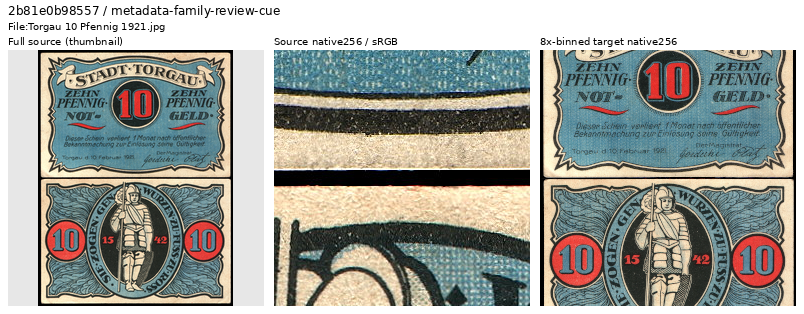
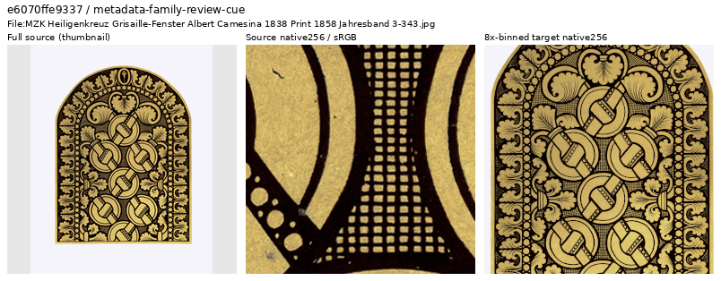
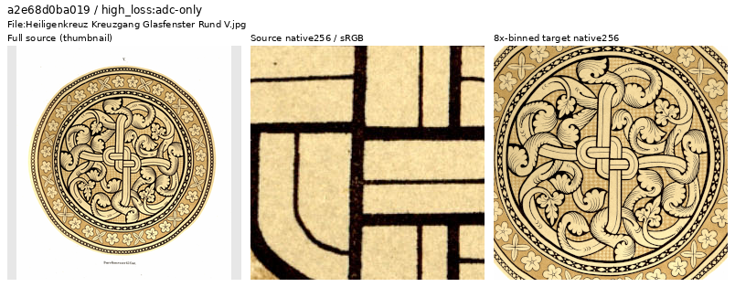
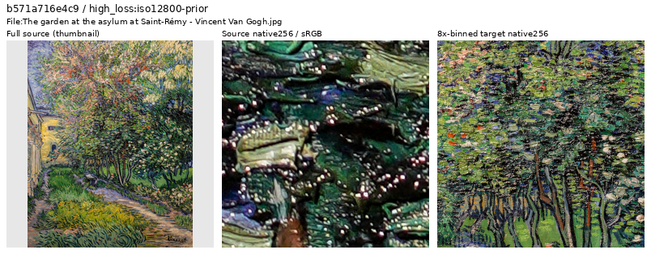
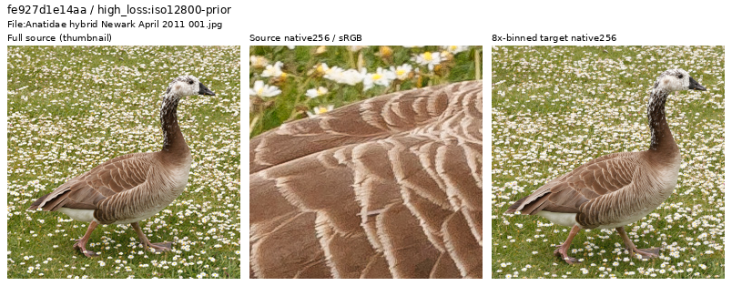

# High-loss source review

**The latest family follow-up inspects 45 additional sources and withholds 44
flat banknote layouts and one historical drawing, preparing a future cohort of
90,802 training photos.** The preceding loss-ranked pass retained 108 of 123
sources and withheld 15. Every active source in both original global top256
difficulty lists has a visual decision. This is data curation, with no measured
model-quality gain yet.
Current V117/V118 retain their frozen 90,864 membership and matched recipes.
[Current quality work](band-loss-training.md).

[Latest family decisions, coverage and future manifests](results/reproduction-family-review-v1.json) ·
[Actual six-ROI reader checks](results/reproduction-family-ROI-reader-v1.json) ·
[Preserved top256 loss-tail review](results/source-tail-top256-review-v1.json).

## Selection and actual viewing

Current training logs contain batch-average losses and input hashes. They do
not identify each photograph's loss. The completed historical V43 screen already
has per-source scores for all 88,508 earlier eligible sources, so this review
reuses those instead of assigning a current batch's loss to individual images.
The preceding loss-ranked pass selected every then-unreviewed active source
through global rank 256: 67 ADC candidates at ranks 160–256 and 69 ISO12800-prior candidates at
ranks 161–256. Their overlap yields 123 distinct sources, skipping the earlier 600
decisions. These original reference-white scores are review cues, not current
sensor-valid training losses or automatic quality labels.

That pass's 21 sheets and 123 source contexts were actually viewed, including
246 native 256px source/8×-binned target cells. One ambiguous sepia window design also had
an unchanged native1024 crop inspected and its primary Commons revision checked.
Only whole-source context thumbnails are resized. JPEG originals and complete 4×
caches pass their recorded hashes; source files and cache pixels are preserved.
There is no new neural inference, RAW decode, noise generation or optimizer update.

Each inspection strip shows a resized whole-source context, an unchanged native
256px source crop and an unchanged native256 area8 target, at display×1. These
are source-quality views, without a noisy observation or restored model output.

## Follow-up of recurring source families

The latest pass searches titles, author, credit and attribution in the prepared
90,847-source cohort. Its explicit case-insensitive cues cover banknote language
(`banknote`, `Geldschein`, `Notgeld`, `Pfennig`/`Pfg`, `Papiergeld`, `Rentenmark`)
and historical window-drawing credits (Camesina, relevant yearbook/atlas terms).
After skipping the earlier 723 decisions, these rules nominate 45 sources:
44 banknote entries and one window drawing. Four notes are found through author
metadata rather than title words.

All eight sheets, 45 whole-source contexts and 90 native256 source/area8-target
cells were actually inspected. Every candidate is a flat reproduction under the
reviewed criteria. Metadata nominates sources; the actual visual decision
determines membership. The future cohort has zero unreviewed active matches of
these declared rules. Other aliases or missing metadata can escape them, so this
does not establish exhaustive detection of every document in the corpus.

This Torgau example has two flat printed note faces as the entire composition.
Source: [reproduced by Palauenc05](https://commons.wikimedia.org/wiki/File:Torgau_10_Pfennig_1921.jpg),
public domain. [Metadata](images/source-family-20261025-v1/banknote-layout-withhold.json).

The additional window plate has inked ornamental linework and paper-like texture;
its retained source metadata names Albert Camesina and the historical yearbook.
Source: [Albert Camesina](https://commons.wikimedia.org/wiki/File:MZK_Heiligenkreuz_Grisaille-Fenster_Albert_Camesina_1838_Print_1858_Jahresband_3-343.jpg),
public domain. [Metadata](images/source-family-20261025-v1/window-drawing-withhold.json).

## Preceding loss-ranked decisions

The preceding pass's 15 withholds comprise 13 flat banknote layouts, one
full-frame painting reproduction and one historical window drawing. These are photographic-target
membership decisions; no scanner, camera or assembly method is inferred.

The sepia window is a drawing reproduction, distinct from the many retained
photographs of actual stained glass. Its native1024 view shows inked linework
and paper-like texture. The [primary Commons revision](https://commons.wikimedia.org/w/index.php?title=File%3AHeiligenkreuz_Kreuzgang_Glasfenster_Rund_V.jpg&oldid=761863964)
identifies Albert Camesina's drawings from 1858/1859 and the 1859 yearbook.
Public domain. [Source/ROI/decision metadata](images/source-tail-top256-20261025-v1/drawing-reproduction-withhold.json).

The flat Van Gogh reproduction presents painted brushstrokes as the entire
target scene. Photographed murals, relief, mosaics and decorated objects with
visible physical materials remain eligible.
Source: [Vincent van Gogh, reproduction uploaded by GoldenArtists](https://commons.wikimedia.org/wiki/File:The_garden_at_the_asylum_at_Saint-R%C3%A9my_-_Vincent_Van_Gogh.jpg),
public domain. [Metadata](images/source-tail-top256-20261025-v1/painting-reproduction-withhold.json).

## Retained hard photographs

That pass's 108 retained photos include fine feathers and fur, dew-covered
spiderwebs, grass, foliage, leaf litter, masonry, wood, optical mineral sections and real
stained glass. These preserve difficult fine and low-contrast structures.
Physical lettering, artwork, reflective gilt, white/black backgrounds and
unusual mineral colors are judged in their photographic context. Native grain,
halos or focus variation do not automatically invalidate a coherent binned
target. This pass does not add a new blur-based exclusion rule or remove hard
photos merely to lower training loss.
Bird source: [King of Hearts](https://commons.wikimedia.org/wiki/File:Anatidae_hybrid_Newark_April_2011_001.jpg),
[CC BY-SA4.0](https://creativecommons.org/licenses/by-sa/4.0/); modified by cropping,
binning and inspection layout. [Metadata](images/source-tail-top256-20261025-v1/retained-feather-detail.json).

## Prepared data and limits

The cumulative earlier-pool ledger now covers 768 sources: 675 retained, 89
withheld and four original `exclude` labels. The separate arrival review
retains its 153-source native-coverage count; these are different review scopes.

The latest 4×/8× manifests remove exactly 45 declared training rows from the
previously prepared 90,847-source cohort. Every other literal row and its order
are preserved, including 2,303 validation,
2,255 test and all previously excluded/reserved rows. Source metadata and active
IDs agree between scales. No new cache pixels are written. The same six ROI
objects are rebound to the new manifest; the actual pure-NumPy catalogue reader
checks all cache/ROI/native-target hashes, geometry and dtype with no Torch import.

The [preceding 123-source receipt](results/source-tail-top256-review-v1.json) and
[its six-ROI checks](results/source-tail-top256-ROI-reader-v1.json) preserve the
90,847-source intermediate cohort and its decisions. The earlier 30-source pass
retained 28 and withheld a banknote and a specialized
cell visualization, producing that 90,862-source intermediate cohort. Its
[original receipt](results/next-source-tail-review-v1.json),
[six-ROI checks](results/next-source-tail-ROI-reader-v1.json) and
[banknote](images/source-tail-20261025-v1/banknote-withhold.json),
[cell](images/source-tail-20261025-v1/microscopy-visualization-withhold.json) and
[real-window](images/source-tail-20261025-v1/retained-photographed-window.json)
inspection assets remain unchanged. The cell withhold was a specialized-domain
choice; its rendering/reconstruction method was not established.

These targeted membership decisions do not estimate the corpus defect rate or
demonstrate a restoration improvement. The prepared data is available after the
original loss-pair review; current jobs, models and historical receipts retain
their original bytes.
