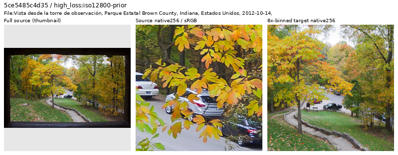
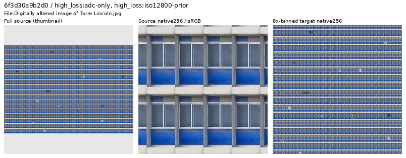
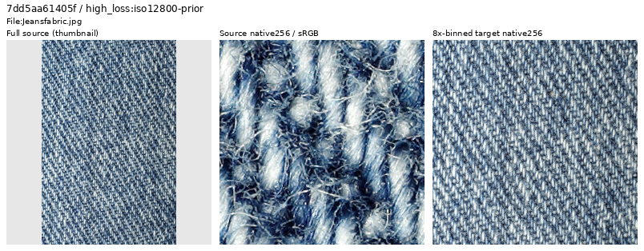
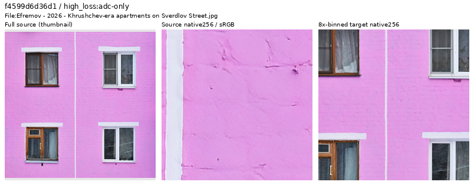

# High-loss source review

**The latest loss-ranked pass inspects 290 additional sources, retains 279 and
withholds 11, preparing a future cohort of 90,791 training photos.** Every active
source in both original global top512 difficulty lists now has a visual decision.
The new withholds cover four unreliable clean-photo targets and seven
reproduction/composite/visualization targets. Model quality on the prepared
corpus remains unmeasured.
Current V117/V118 retain their frozen 90,864 membership and matched recipes.
[Current quality work](band-loss-training.md).

[Latest decisions, coverage and future manifests](results/source-tail-top512-review-v1.json) ·
[Actual six-ROI reader checks](results/source-tail-top512-ROI-reader-v1.json) ·
[Original source-sampler compatibility](results/source-tail-top512-sampling-reference-v1.json).

## Selection and actual viewing

Current training logs contain batch-average losses and input hashes. They do
not identify each photograph's loss. The completed historical V43 screen already
has per-source scores for all 88,508 earlier eligible sources, so this review
reuses those instead of assigning a current batch's loss to individual images.
The latest pass selects every remaining unreviewed active source through global
rank 512: 166 ADC and 189 ISO12800-prior candidates, each at ranks 258–512. Their
overlap yields 290 distinct sources, skipping the earlier 768 decisions.
All 467 ADC and 473 high-noise top512 entries still active in the parent cohort
are now covered. These original reference-white scores are review cues, not current
sensor-valid training losses or automatic quality labels.

All 49 sheets and 290 source contexts were actually viewed, including 580 native
256px source/8×-binned target cells. Five ambiguous cases also had unchanged
native1024 crops inspected. Primary Commons revisions resolve two source-domain
questions; both currently uploaded image hashes match the reviewed cached files.
Only whole-source context thumbnails are resized. JPEG originals and complete 4×
caches pass their recorded hashes; source files and cache pixels are preserved.
There is no new neural inference, RAW decode, noise generation or optimizer update.

Each inspection strip shows a resized whole-source context, an unchanged native
256px source crop and an unchanged native256 area8 target, at display×1. These
are source-quality views, without a noisy observation or restored model output.

## Current decisions and native examples

The four clean-photo withholds have pervasive outlined/flattened woodland
texture (two scenes), coarse granular/edge-emphasized texture across several
materials (one scene), or patch-like autumn foliage with strongly traced
boundaries (one scene). Larger native views and the actual binned targets support
these conservative supervision decisions. No particular processing tool is inferred.



The [unchanged native1024 source crop](images/source-tail-top512-20261025-v1/flattened-foliage-native1024.png)
shows the broad patch-like texture and outlines across leaves and other surfaces.
Source: [Diego Delso, Brown County observation tower view](https://commons.wikimedia.org/wiki/File:Vista_desde_la_torre_de_observaci%C3%B3n,_Parque_Estatal_Brown_County,_Indiana,_Estados_Unidos,_2012-10-14,_DD_06.jpg),
[CC BY-SA3.0](https://creativecommons.org/licenses/by-sa/3.0/); modified by cropping,
binning and display/layout conversion. [Metadata](images/source-tail-top512-20261025-v1/flattened-foliage-withhold.json).

The seven domain withholds comprise one banknote layout, two map/information
layouts, one pointillist painting reproduction, one photographic portrait collage,
one tiled facade construction and one cellular 3D visualization. Flat target
composition determines the document/reproduction decisions; capture method is
not inferred. Physical signs, murals, mosaics and decorated objects with coherent
material and scene context remain eligible.



The retained [primary facade revision](https://commons.wikimedia.org/w/index.php?title=File%3ADigitally+altered+image+of+Torre+Lincoln.jpg&oldid=1281145699)
describes constructing the facade by tiling window images. The
[cell revision](https://commons.wikimedia.org/w/index.php?title=File%3AFibroblastid+%28BPAE%29.jpg&oldid=1252008600)
describes a software-built 3D model of fluorescently stained cell organelles.
These clarify the actual source domain rather than relying on a title alone.
Facade source: Wilfredor, [CC BY-SA4.0](https://creativecommons.org/licenses/by-sa/4.0/);
modified by cropping, binning and inspection layout.
[Source/provenance/decision metadata](images/source-tail-top512-20261025-v1/tiled-facade-withhold.json).

The 279 retained sources preserve difficult thin lines, textiles, bark, grain,
feathers, foggy branches, grass, foliage, masonry, real glass and saturated lights.
Native grain that largely disappears after binning and natural defocus or motion
do not automatically disqualify a source. Optical specimen detail also remains
eligible when the photographic material and target are coherent.



The weave and fine fibers are useful detail despite high source difficulty.
Source: [Thegreenj, Jeansfabric](https://commons.wikimedia.org/wiki/File:Jeansfabric.jpg),
[CC BY-SA3.0](https://creativecommons.org/licenses/by-sa/3.0/); modified by cropping,
binning and inspection layout. [Metadata](images/source-tail-top512-20261025-v1/retained-fine-denim.json).



Faint painted brick joints and surface irregularities remain clean useful texture.
Source: [Юрий Д.К., Efremov apartments](https://commons.wikimedia.org/wiki/File:Efremov_-_2026_-_Khrushchev-era_apartments_on_Sverdlov_Street.jpg),
[CC BY4.0](https://creativecommons.org/licenses/by/4.0/); modified by cropping,
binning and inspection layout. [Metadata](images/source-tail-top512-20261025-v1/retained-weak-brick.json).

<details>
<summary>Preceding source-family and top256 reviews</summary>

## Follow-up of recurring source families

The preceding family pass searches titles, author, credit and attribution in the prepared
90,847-source cohort. Its explicit case-insensitive cues cover banknote language
(`banknote`, `Geldschein`, `Notgeld`, `Pfennig`/`Pfg`, `Papiergeld`, `Rentenmark`)
and historical window-drawing credits (Camesina, relevant yearbook/atlas terms).
After skipping the earlier 723 decisions, these rules nominate 45 sources:
44 banknote entries and one window drawing. Four notes are found through author
metadata rather than title words.

All eight sheets, 45 whole-source contexts and 90 native256 source/area8-target
cells were actually inspected. Every candidate is a flat reproduction under the
reviewed criteria. Metadata nominates sources; the actual visual decision
determines membership. The future cohort has zero unreviewed active matches of
these declared rules. Other aliases or missing metadata can escape them, so this
does not establish exhaustive detection of every document in the corpus.


This Torgau example has two flat printed note faces as the entire composition.
Source: [reproduced by Palauenc05](https://commons.wikimedia.org/wiki/File:Torgau_10_Pfennig_1921.jpg),
public domain. [Metadata](images/source-family-20261025-v1/banknote-layout-withhold.json).


The additional window plate has inked ornamental linework and paper-like texture;
its retained source metadata names Albert Camesina and the historical yearbook.
Source: [Albert Camesina](https://commons.wikimedia.org/wiki/File:MZK_Heiligenkreuz_Grisaille-Fenster_Albert_Camesina_1838_Print_1858_Jahresband_3-343.jpg),
public domain. [Metadata](images/source-family-20261025-v1/window-drawing-withhold.json).

## Preceding loss-ranked decisions

The preceding pass's 15 withholds comprise 13 flat banknote layouts, one
full-frame painting reproduction and one historical window drawing. These are photographic-target
membership decisions; no scanner, camera or assembly method is inferred.


The sepia window is a drawing reproduction, distinct from the many retained
photographs of actual stained glass. Its native1024 view shows inked linework
and paper-like texture. The [primary Commons revision](https://commons.wikimedia.org/w/index.php?title=File%3AHeiligenkreuz_Kreuzgang_Glasfenster_Rund_V.jpg&oldid=761863964)
identifies Albert Camesina's drawings from 1858/1859 and the 1859 yearbook.
Public domain. [Source/ROI/decision metadata](images/source-tail-top256-20261025-v1/drawing-reproduction-withhold.json).


The flat Van Gogh reproduction presents painted brushstrokes as the entire
target scene. Photographed murals, relief, mosaics and decorated objects with
visible physical materials remain eligible.
Source: [Vincent van Gogh, reproduction uploaded by GoldenArtists](https://commons.wikimedia.org/wiki/File:The_garden_at_the_asylum_at_Saint-R%C3%A9my_-_Vincent_Van_Gogh.jpg),
public domain. [Metadata](images/source-tail-top256-20261025-v1/painting-reproduction-withhold.json).

## Retained hard photographs


That pass's 108 retained photos include fine feathers and fur, dew-covered
spiderwebs, grass, foliage, leaf litter, masonry, wood, optical mineral sections and real
stained glass. These preserve difficult fine and low-contrast structures.
Physical lettering, artwork, reflective gilt, white/black backgrounds and
unusual mineral colors are judged in their photographic context. Native grain,
halos or focus variation do not automatically invalidate a coherent binned
target. This pass does not add a new blur-based exclusion rule or remove hard
photos merely to lower training loss.
Bird source: [King of Hearts](https://commons.wikimedia.org/wiki/File:Anatidae_hybrid_Newark_April_2011_001.jpg),
[CC BY-SA4.0](https://creativecommons.org/licenses/by-sa/4.0/); modified by cropping,
binning and inspection layout. [Metadata](images/source-tail-top256-20261025-v1/retained-feather-detail.json).

</details>

## Prepared data and limits

### Preserve draws for a matched curation comparison

The preceding 90,802-source sampling study removes 62 rows from the current
90,864-source cohort, changing integer source indices. At seed64 over a
prospective 20,000-update schedule, ordinary
sampling from the filtered manifest changes 98,605 of 112,330 photo source
draws. This would change every Commons batch, far beyond the excluded photos.

The optional `photo_sampling_reference_manifest` preserves the original ordered
source list for sampling, then retries an excluded identity before any image is
loaded. The active corpus must be an exact source/metadata/cache-path subset of
that reference. Ordinary photographic sampling remains uniform over eligible
sources. Reviewed ROI overrides occur before retries, preserving their geometry
RNG even when the nominal source was excluded.

| Sampling for the prepared 90,802-source cohort | Changed photo source draws | Affected Commons batches |
| --- | ---: | ---: |
| Filtered manifest indices | 98,605 | 10,032 |
| Original reference with exclusion retries | 53 | 52 |

These are prospective source choices at the original seed/quotas, rather than
completed training or measured quality. The actual sampler's counts match all
112,330 scheduled photo draws. A separate real augmented-reader check exercises
93 native256 indices: all 93 default targets match the frozen V117 reader;
40 unchanged future targets remain exact and all 53 excluded-photo draws are
replaced. It covers the six ROIs and four nominal excluded sources overridden
by an ROI. All 26,148,864 compared FP32 clean values match, and the future reader
opens no excluded cache. [Schedule, real-reader evidence and 45 passing tests](results/source-preserving-curation-v1.json).

The latest 90,791-source cohort also passes the actual source-reference
constructor: all active metadata/cache paths are an exact subset of the original
90,864 identities, and all 73 excluded identities route to eligible rows without
opening images. [Current compatibility receipt](results/source-tail-top512-sampling-reference-v1.json).
The complete schedule/native-reader counts above retain their 90,802 membership
scope; they are not reattributed to this newer cohort.

For a future matched recipe using the latest manifest and rebound six-ROI
catalogue, the reference fields remain:

```yaml
photo_sampling_reference_manifest: /mnt/external/demosaic/commons-source-tail-reviewed-20261023-v2/manifest4.jsonl
photo_sampling_reference_sha256: 4175378ca100351eca4669220892d4d4e8db9c47133016206c7c0eadd7ab427e
```

The trainer snapshots those reference bytes, records the hash and rejects a
changed or disabled reference on resume. The recipe controller includes the
reference as a frozen input. Omitting it retains existing sampling. Current
V117/V118 keep their original recipes and executed sources; this optional mode
is ready for a later curation comparison after their quality review.

### Latest prepared cohort

The cumulative earlier-pool ledger now covers 1,058 sources: 954 retained, 100
withheld and four original `exclude` labels. The separate arrival review
retains its 153-source native-coverage count; these are different review scopes.

The latest 4×/8× manifests remove exactly 11 declared training rows from the
previously prepared 90,802-source cohort. Every other literal row and its order
are preserved, including 2,303 validation,
2,255 test and all previously excluded/reserved rows. Source metadata and active
IDs agree between scales. No new cache pixels are written. The same six ROI
objects are rebound to the new manifest; the actual pure-NumPy catalogue reader
checks all cache/ROI/native-target hashes, geometry and dtype with no Torch import.

The [preceding family receipt](results/reproduction-family-review-v1.json) and
[six-ROI reader checks](results/reproduction-family-ROI-reader-v1.json) preserve
the 90,802-source intermediate cohort and its 45 withholds. The
[preceding 123-source receipt](results/source-tail-top256-review-v1.json) and
[its six-ROI checks](results/source-tail-top256-ROI-reader-v1.json) preserve the
90,847-source intermediate cohort and its decisions. The earlier 30-source pass
retained 28 and withheld a banknote and a specialized
cell visualization, producing that 90,862-source intermediate cohort. Its
[original receipt](results/next-source-tail-review-v1.json),
[six-ROI checks](results/next-source-tail-ROI-reader-v1.json) and
[banknote](images/source-tail-20261025-v1/banknote-withhold.json),
[cell](images/source-tail-20261025-v1/microscopy-visualization-withhold.json) and
[real-window](images/source-tail-20261025-v1/retained-photographed-window.json)
inspection assets remain unchanged. The cell withhold was a specialized-domain
choice; its rendering/reconstruction method was not established.

These targeted membership decisions do not estimate the corpus defect rate or
demonstrate a restoration improvement. The prepared data is available after the
original loss-pair review; current jobs, models and historical receipts retain
their original bytes.
