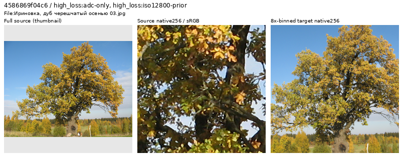
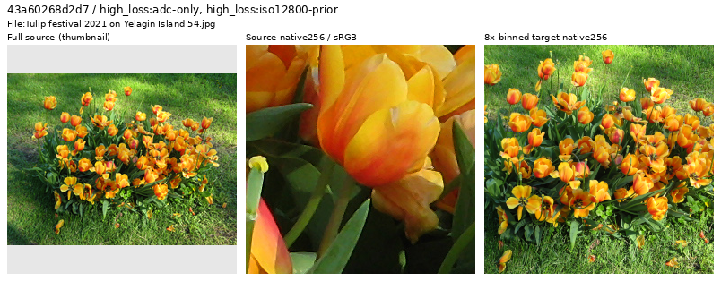
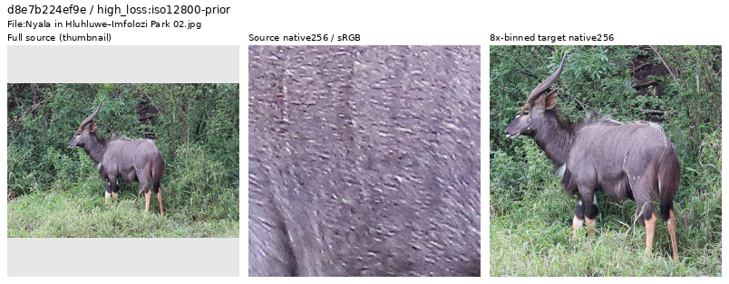
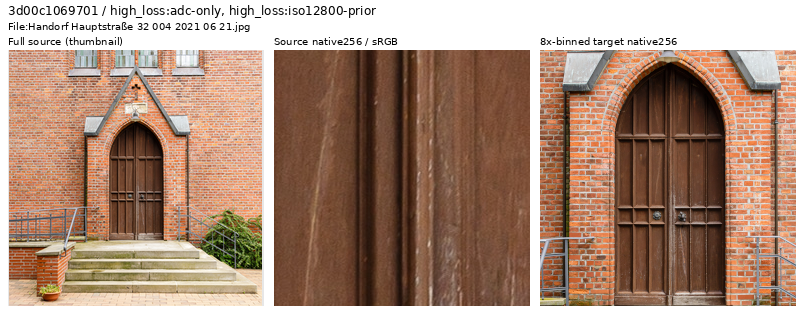

# High-loss source review

**The current Small-model loss review retains all28 selected sources** after
native source/target inspection and four larger checks. It adds no exclusions
to the running trials. [Current losses, examples and scope](current-source-loss-review.md).

The preceding corpus-cleanup pass reviews336 additional sources:332 retained and
four withheld. The selected V121 cohort has **90,787 training sources**. Every
still-active source through rank 768 in both original difficulty lists now has
a visual decision. V119 used its frozen **90,791-source** experiment from
V115 Small; its [complete quality review](v119-quality.md) is published. These
four new withholds are selected for V121, queued after the V120 paired32 control,
with no change to V119/V120 membership. Both new arms passed implementation
checks; their endpoint quality remains pending.
[Controlled trials and actual launch evidence](paired32-weak-detail-training.md).

[Decisions, coverage and coupled manifests](results/source-tail-top768-review-v1.json) ·
[Six-ROI and source-reference constructors](results/source-tail-top768-readers-v1.json) ·
[Actual augmented clean-reader check](results/source-tail-top768-augmented-reader-v1.json).

## Selection and actual viewing

Earlier training logs contain batch-average losses, without individual-photo
losses. New V120/V121 [source diagnostics](source-loss-diagnostics.md) now trace
detached per-draw losses from existing predictions; they do not retroactively
change this completed source review. The historical V43 screen provides per-source reference-white
scores for 88,508 earlier sources. These nominate inspection candidates; they
are not current V119 training losses or automatic quality labels.

After the preceding 1,058 decisions, the remaining active candidates through
global rank 768 yield 336 distinct sources. All 714 ADC-only and 715 high-noise
entries still active in the parent 90,791-source cohort are covered. The two
lists overlap; their counts are not independent photographs.

All **56 sheets, 336 source contexts and 672 native256 source/target cells** were
actually viewed. Six ambiguous photographs also received native1024 inspection.
Original JPEG SHA1, complete 4× cache SHA256 and scored crop bindings were
verified. Originals and cache pixels remain unchanged.

Each inspection strip contains a resized whole-source thumbnail, an unchanged
native256 source crop and an unchanged native256 area8 target. Targets use
linear area2 from the 4× cache, followed by sRGB display at exposure ×1; originals
are ICC-managed to sRGB. Only context thumbnails are resized. Source and binned
target crops cover different fields of view. These are source-quality views,
without noisy observations or restored model outputs.

## Withheld targets

Two photographs have pervasive faceted or flattened tonal patches and strongly
traced boundaries across foliage, bark, petals or leaves. The larger native
views support image-specific judgments that their fine texture is unreliable
clean supervision. No particular processing algorithm is inferred, and the
decisions do not exclude an author, camera or source family.



[Unchanged native1024 foliage view](images/source-tail-top768-20261025-v1/faceted-foliage-native1024.png) ·
[Source, scored ROI and decision](images/source-tail-top768-20261025-v1/faceted-foliage-withhold.json).
Source: [Екатерина Борисова, autumn oak in Irinovka](https://commons.wikimedia.org/wiki/File:%D0%98%D1%80%D0%B8%D0%BD%D0%BE%D0%B2%D0%BA%D0%B0,_%D0%B4%D1%83%D0%B1_%D1%87%D0%B5%D1%80%D0%B5%D1%88%D1%87%D0%B0%D1%82%D1%8B%D0%B9_%D0%BE%D1%81%D0%B5%D0%BD%D1%8C%D1%8E_03.jpg),
[CC BY-SA4.0](https://creativecommons.org/licenses/by-sa/4.0/); modified by
cropping, binning, context-thumbnail creation and display/layout conversion.



[Unchanged native1024 tulip view](images/source-tail-top768-20261025-v1/faceted-tulips-native1024.png) ·
[Source, scored ROI and decision](images/source-tail-top768-20261025-v1/faceted-tulips-withhold.json).
Source: [Екатерина Борисова, Tulip festival 2021 on Yelagin Island 54](https://commons.wikimedia.org/wiki/File:Tulip_festival_2021_on_Yelagin_Island_54.jpg),
[CC BY-SA4.0](https://creativecommons.org/licenses/by-sa/4.0/); modified by
cropping, binning, context-thumbnail creation and display/layout conversion.

The other two withholds are a full-frame schematic ridge/river map with a
legend, and an information-document layout dominated by text, a map and inset
reproductions. Their scored targets lack useful photographic material context.
Capture method is not inferred. Physical signs, murals and decorated objects
with coherent scene/material context remain eligible.

[Map inspection](images/source-tail-top768-20261025-v1/schematic-map-withhold.png) ·
[Map metadata](images/source-tail-top768-20261025-v1/schematic-map-withhold.json).
Source: [Tadeáš Gregor, Ridges of Tien Shan](https://commons.wikimedia.org/wiki/File:Ridges_of_Tien_Shan.jpg),
[CC BY-SA4.0](https://creativecommons.org/licenses/by-sa/4.0/); modified by
cropping, binning, context-thumbnail creation and display/layout conversion.
All four source IDs and reasons appear in the [decision receipt](results/source-tail-top768-review-v1.json).

## Retained difficult and low-contrast detail

The 332 retained sources include thin reeds, twigs, wires, fences, textiles,
fur, pale feathers, stone, lichen, saturated lights and photographed stained
glass. Real optical specimen detail and physical artwork remain eligible when
the source and binned target are coherent. High loss, native grain, saturated
color and natural focus variation alone do not identify a bad photograph.

Four of the six ambiguous photographs were retained after larger inspection:
spring trees, a flowered building, backlit flowers and gray nyala fur. Fine
blossoms, filaments, stems, masonry and directional hair become clearer at the
larger scale. The initial small views would have supported overly broad removal.



The [unchanged native1024 fur view](images/source-tail-top768-20261025-v1/retained-gray-fur-native1024.png)
shows coherent short hair, longer mane hairs and gradual shading.
Source: [Bernard Gagnon, Nyala in Hluhluwe–Imfolozi Park 02](https://commons.wikimedia.org/wiki/File:Nyala_in_Hluhluwe%E2%80%93Imfolozi_Park_02.jpg),
[CC BY-SA4.0](https://creativecommons.org/licenses/by-sa/4.0/); modified by
cropping, binning, context-thumbnail creation and display/layout conversion.
[Source/ROI/decision metadata](images/source-tail-top768-20261025-v1/retained-weak-gray-fur.json).



The door retains faint grain, scratches, brickwork and fine railing structure.
Source: [Friedrich Haag, Handorf Hauptstraße 32](https://commons.wikimedia.org/wiki/File:Handorf_Hauptstra%C3%9Fe_32_004_2021_06_21.jpg),
[CC BY-SA4.0](https://creativecommons.org/licenses/by-sa/4.0/); modified by
cropping, binning, context-thumbnail creation and display/layout conversion.
[Source/ROI/decision metadata](images/source-tail-top768-20261025-v1/retained-weak-wood.json).

These sources remain eligible under ordinary sampling. This review adds no new
ROI quota and does not change V119's existing six examples. A separate
[weak photographic material bank](weak-photographic-targets.md) prepares eight
other measured low-contrast contexts while preserving the original six. V121
selects it after implementation checks; endpoint quality remains unmeasured.
The region bank itself does not change source membership.

## Future data and reader checks

The cumulative earlier-pool ledger covers **1,394 sources: 1,286 retained,
104 withheld and four original `exclude` labels**. The arrival review's
153-source native-coverage count is a separate scope.

The new coupled 4×/8× manifests remove exactly four training rows from 90,791.
All other literal row bytes and order are preserved, including the **2,303
validation and 2,255 test** records and all excluded/reserved rows. Active IDs
and source/cache metadata agree across scales. No source or cache pixels are
rewritten. The original six ROI objects and native targets are unchanged;
only their catalogue's manifest binding changes.

Prepared files live under
`.cache/current-quality-20261023-v1/next-source-tail-top768-v1/future-cohort-v1/`:

| File | SHA256 |
| --- | --- |
| `manifest4.jsonl` | `2868a417375c41f0e4429313ee31da2378a80d1055b71e34d527879d52157ca8` |
| `manifest8.jsonl` | `9b282d3ac7ac19aab818e36bfe0b1d2344edccde93326783577267e083349a53` |
| `six-ROI-catalogue-v1.json` | `68c6673172f80ffbc9c3412a5f7a947e537ecb02d542c9d5c1ffb7ed001863fb` |

The actual `ReviewedPhotoROIs` constructor verifies all six cache/crop/native
FP32 target hashes, geometry and dtype. `PhotoSamplingReference` accepts the
original immutable 90,864-source reference and routes all 77 excluded identities
to eligible future sources before opening an image. It preserves source-choice
RNG for unaffected draws and applies ROI overrides before exclusion retries.
For a future matched recipe, retain:

```yaml
photo_sampling_reference_manifest: /mnt/external/demosaic/commons-source-tail-reviewed-20261023-v2/manifest4.jsonl
photo_sampling_reference_sha256: 4175378ca100351eca4669220892d4d4e8db9c47133016206c7c0eadd7ab427e
```

A separate actual clean-data reader check uses seed 65 and V119's data options
against the parent 90,791 and future 90,787 manifests. Metadata search selects
one draw for each of the four new excluded IDs, all six original ROIs, four
ordinary photos and two procedural samples. All **16 parent/future pairs** are
actually read at native256. The four excluded-source draws open eligible
replacement caches; the other 12 have identical cache calls and FP32 pixels.
Every future target is finite: **3,145,728 FP32 values**, including **2,359,296
unchanged values**. The future reader opens no excluded or held-out cache.
Global Python/NumPy/Torch RNG states remain unchanged and CUDA is uninitialized.

The targeted indices are selected by metadata search through index 512382;
this is not an executed 20k training schedule. The constructor receipt retains
its earlier, narrower scope; the additive actual-reader receipt records the
subsequent augmented-pixel check. No neural inference, new noise observations,
RAW decoding or optimizer updates occur in either reader check. V121 now selects
these inputs after discarded CPU/CUDA updates, with its full run queued after
V120. Neither a corpus defect rate nor a restoration gain follows from this
targeted review; endpoint quality is still pending.

## Preserved preceding evidence

V119's original 90,791-source manifests and executed recipe stay frozen.
Its [290-source/top512 review](results/source-tail-top512-review-v1.json),
[six-ROI checks](results/source-tail-top512-ROI-reader-v1.json) and
[107-target schedule/reader proof](results/cleaned90791-source-reader-preflight-v1.json)
remain unchanged. That source-preserving preflight covers all 67 affected draws
and 40 unchanged targets at seed 64 over its prospective 20k schedule. These are
separate earlier checks, not counts from the new seed 65 targeted test.

Earlier [45-source family](results/reproduction-family-review-v1.json),
[123-source/top256](results/source-tail-top256-review-v1.json),
[30-source](results/next-source-tail-review-v1.json) and
[source-preserving sampler](results/source-preserving-curation-v1.json) receipts,
assets and intermediate cohorts remain preserved. V114/V115/V117/V118 retain
90,864-source inputs. Historical choices are in the timestamped [diary](../diary/index.md);
current model choices and remaining weaknesses are in [current quality training](quality-first-training.md).
