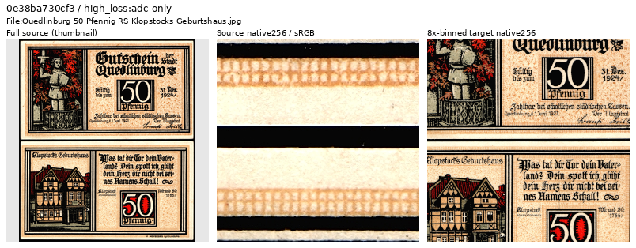
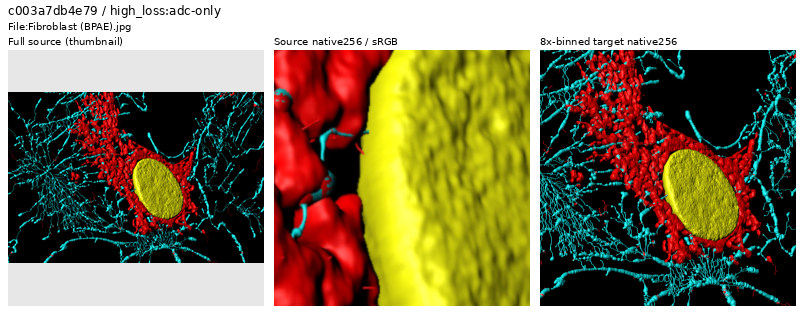
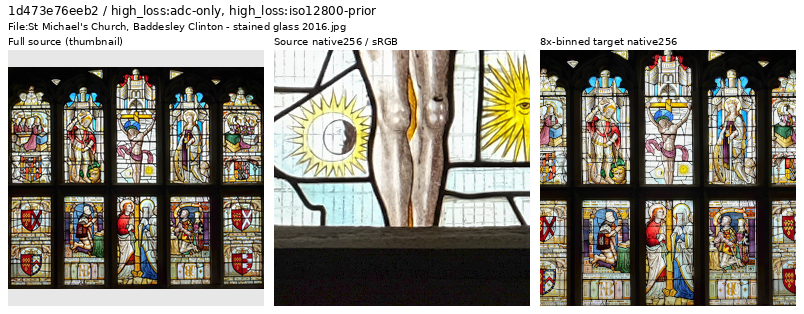

# Next high-loss source-tail review

**Thirty additional active sources were inspected: 28 retained and two withheld
from a prepared next cohort of 90,862 training sources.** This is data curation,
with no new model-quality claim. Current V117/V118 retain their frozen90,864
membership and matched recipes. [Current quality work](band-loss-training.md).

[Complete review, source decisions and future manifests](results/next-source-tail-review-v1.json) ·
[Actual six-ROI reader checks](results/next-source-tail-ROI-reader-v1.json).

## Selection and actual viewing

Current training logs contain batch-average losses and input hashes. They do
not identify each photograph's loss. The completed historical V43 screen already
has per-source scores for all 88,508 earlier eligible sources, so this review
reuses those instead of assigning a current batch's loss to individual images.
It uses the next 16 unreviewed active IDs per ADC/high-noise list: global ranks
129–159/129–160, with overlap yielding 30 distinct sources. The earlier 570
decisions are skipped. These original reference-white scores are review cues,
not current sensor-valid training losses or automatic quality labels.

All five sheets and 30 source contexts were actually viewed, including 60 native
256px source/8×-binned target cells. Four additional native1024 source views
cover the banknote, cell visualization, mineral section and grackle. Only the
whole-source context thumbnails are resized. JPEG originals and complete4×
caches pass their recorded hashes; source files and cache pixels are preserved.
There is no new neural inference, RAW decode, noise generation or optimizer update.

## Withheld document and visualization

Each inspection strip shows a resized whole-source context, an unchanged native
256px source crop and an unchanged native256 area8 target, at display×1. These
are source-quality views, without a noisy observation or restored model output.

The flat banknote/document layout is dominated by printed illustrations and
lettering, consistent with earlier banknote withholds. This is a target-pool
membership decision; no scanner, camera or assembly method is inferred.
Source: [City of Quedlinburg, reproduced by Palauenc05](https://commons.wikimedia.org/wiki/File:Quedlinburg_50_Pfennig_RS_Klopstocks_Geburtshaus.jpg),
public domain. [Source/ROI/decision metadata](images/source-tail-20261025-v1/banknote-withhold.json).

The cell image has solid false-color surface-like structures and black fields
dominating both native1024 and binned views. It is withheld from the ordinary
photographic clean-target pool as a specialized visualization. The author page
identifies confocal/fluorescence microscopy; it does **not** establish its
rendering/reconstruction method, which is not asserted here. This is not a
blanket microscopy or unusual-color exclusion.
Source: [Heiti Paves](https://commons.wikimedia.org/wiki/File:Fibroblast_%28BPAE%29.jpg),
[CC BY-SA3.0](https://creativecommons.org/licenses/by-sa/3.0/); modified by cropping,
binning and inspection layout. [Source/ROI/decision metadata](images/source-tail-20261025-v1/microscopy-visualization-withhold.json).

## Retained hard photographs

Real stained glass retains material texture and illumination; it is kept rather
than treating illustrated subject matter as a document reproduction. Other
retained subjects include foliage, lettering stencils, CPU pins, sparks, wet
stone, mosaics, sculpture and decorated/glazed objects. The grackle's native
halos/grain do not invalidate its coherent binned target. Optical mineral
thin sections remain useful material images, supported by author descriptions
and their native views. High loss, saturation and white/black backgrounds alone
do not justify removing them.
Window source: [DeFacto](https://commons.wikimedia.org/wiki/File:St_Michael%27s_Church,_Baddesley_Clinton_-_stained_glass_2016.jpg),
[CC BY-SA4.0](https://creativecommons.org/licenses/by-sa/4.0/); modified by cropping,
binning and inspection layout. [Metadata](images/source-tail-20261025-v1/retained-photographed-window.json).

## Prepared data and limits

The cumulative earlier-pool ledger now covers600 sources:567 retained,29
withheld and four original `exclude` labels. The separate arrival review
retains its153-source native-coverage count; these are different review scopes.

The next4×/8× manifests remove exactly the two declared training rows. Every
other literal row and its order are preserved, including2,303 validation,
2,255 test and all previously excluded/reserved rows. Source metadata and active
IDs agree between scales. No new cache pixels are written. The same six ROI
objects are rebound to the new manifest; the actual pure-NumPy catalogue reader
checks all cache/ROI/native-target hashes, geometry and dtype with no Torch import.

These are two specific membership decisions, not an estimated corpus defect
rate or a demonstrated restoration improvement. The prepared next data is
available after the original loss-pair review; current jobs, models and all
historical receipts retain their original bytes.
