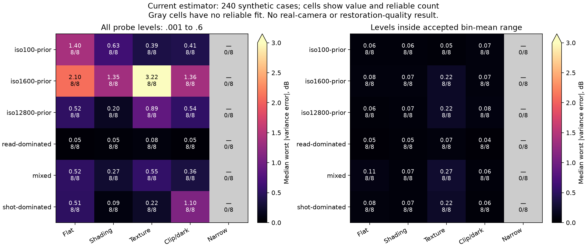

# Noise estimates: good fits can extrapolate poorly into deep shadows

The current estimator performs well at tested intensities within its accepted
fit range in a new **240-case synthetic check**. All 192 accepted fits stay within
**0.441 dB** of the known variance at those tested levels. However, **55/192**
exceed 1 dB somewhere across the wider probe range; every flagged case's largest
error is at intensity **0.001**, outside its fitted bin means. The worst reaches
7.042 dB. All 48 narrow-range cases are rejected.

**Keep the current estimator and frozen model conditioning unchanged.** This
identifies a limitation in interpreting its internal `reliable` flag; it does
not establish that the GFX coefficients are wrong or that a different estimator
improves photographs.

[Complete protocol, hashes, scalar checks and retained GFX support](results/noise-calibration-synthetic-stress.json).
[Group CSV](results/noise-calibration-synthetic-group-summary.csv).
[Exportable figure](figures/noise-calibration-fit-support.svg).



Cells show the median, across accepted draws, of each draw's worst absolute
variance error at the tested levels; the second line is the accepted count.
Gray cells have no accepted fit. The two panels use identical case sets but
different probe-level masks. They are descriptive summaries, not confidence
intervals or new restoration scores. The figure was actually viewed.

## Motivation and scope

[RPG-VST, July 2026](https://arxiv.org/abs/2607.24291) studies robust CFA-wise
Poisson–Gaussian fitting and input-only selection using a stabilized variance
diagnostic. It motivates checking conditioning errors. Our estimator already
uses Haar texture rejection and binned medians, so this experiment evaluates
its own behavior before considering a replacement. No RPG-VST code, weights
or reported restoration results are reproduced here.

The current estimator and neural pipeline source remain unchanged. This CPU-only
probe uses six known Poisson/read profiles, five artificial scene conditions and
eight local-RNG draws per group. Scenes contain broad flat colored fields,
affine shading, sparse fine texture, clipped/dark fields or a narrow gray range.
The six profiles include the existing ISO100/1600/12800 priors, read-dominated,
mixed and shot-dominated cases. Each image is a native 1024×1024 Bayer field;
ADC16/black .03 and the existing noise generator are explicit.

The estimator uses its original 32-pixel phase patches, maximum 4,096 patches
and bootstrap seed 42. The variance probes are fixed at
`.001,.005,.02,.08,.2,.6`; the 1 dB flag is declared before execution. The
comparison is `10log10((estimated_shot*x+estimated_read)/(true_shot*x+true_read))`
for the known **pre-ADC** law. Inside-range checks retain only tested levels
between the minimum and maximum accepted bin means. They do not cover every
continuous intensity or certify calibration throughout that interval.

Noisy inputs and clean arrays are retained. Independent checks cover all **280
arrays** and **1,632 scalar fields**, recomputing moments in Torch64 and variance
ratios with Python arithmetic; maximum discrepancy is `8.74e-14`. Moment
diagnostics restrict clean signal to `(.03,.85)` while retaining ADC behavior;
the legacy `uncensored_interior_samples` field counts that mask. A module
docstring was clarified after execution; an AST comparison verifies identical
executed numerical code. No parameters, rejection threshold or fit were tuned
after viewing results.

## What the extrapolation failure means

The worst case is the broad-flat ISO100-prior draw with seed 5. Accepted bin means
span `.033643` to `.793760`. Its largest tested inside-range error is .111 dB,
but extrapolating to `.001` produces +7.042 dB variance error. A small read-term
error can barely affect brighter measurements while dominating the faintest
signals. A stable fit over observed intensities therefore does not establish
the read floor needed for all deep shadows.

Eight draws per group and artificial fields do not establish real-camera
calibration or general uncertainty coverage. Full-range probe errors include
extrapolation outside the image's accepted fitting statistics. Individual
shot/read coefficient errors are not interchangeable with variance error or
restored quality. Dedicated flat/dark measurements remain stronger evidence.

## Standing GFX: descriptive support check

The retained DSCF3879 fit has accepted bin means **.007338 to .085891**. Its
unchanged conditioning is shot `.0014635775921166604` and read variance
`.0000010715704128646712`. Existing bootstrap intervals are
shot `[.001387398,.001554247]` and read variance
`[1.86218e-8,2.19451e-6]`; these are fit diagnostics, not a measured calibration.

The table counts observed means of 256 disjoint 32×32 CFA-phase patches in each
saved 512-pixel context. It uses the noisy inputs only, not the ISO100 reference
or model predictions. Sampling and rejection differ from the estimator's own
accepted patches; these are descriptive counts.

| Retained context | Below minimum fit-bin mean | Above maximum | Total phase patches |
| --- | ---: | ---: | ---: |
| Sky | 0 | 0 | 256 |
| Building | 6 | 8 | 256 |
| Foliage | 104 | 0 | 256 |
| Chain-link fence | 30 | 0 | 256 |

An independent `math.fsum` calculation reproduces all 1,024 patch means and
all counts exactly. Within-range does not prove correct calibration;
outside-range does not prove an incorrect variance model. The synthetic error
rate cannot be assigned to these GFX patches. No RAW was decoded, profile refit,
reference scored or inference rerun for this description. The standing scene
and siblings remain outside training.

This motivates a separate conditioning-sensitivity or measured-calibration check
if final real-photo quality remains poor. It does not change the current V67
original-10k comparison, add training or select different noise settings from
the standing reference. The requested quality and speed goals remain open.

```bash
source scripts/env.sh
CUDA_VISIBLE_DEVICES='' OMP_NUM_THREADS=2 OPENBLAS_NUM_THREADS=2 \
  uv run --no-sync python scripts/probe_noise_calibration.py \
  --output /mnt/external/demosaic/benchmarks/CHOOSE-NEW-NOISE-PROBE
CUDA_VISIBLE_DEVICES='' OMP_NUM_THREADS=2 OPENBLAS_NUM_THREADS=2 \
  uv run --no-sync python scripts/audit_noise_calibration_probe.py \
  --root /mnt/external/demosaic/benchmarks/CHOOSE-NEW-NOISE-PROBE \
  --output /mnt/external/demosaic/benchmarks/CHOOSE-NEW-NOISE-PROBE/independent-audit
```
