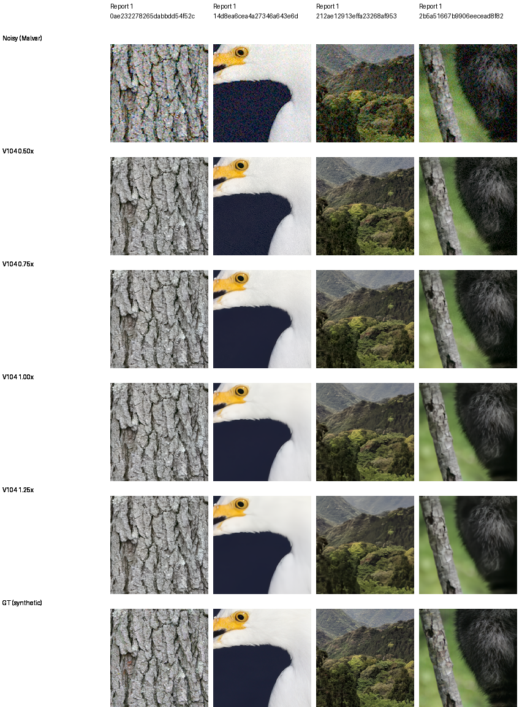
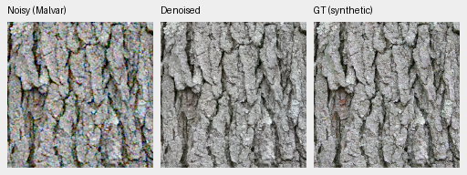
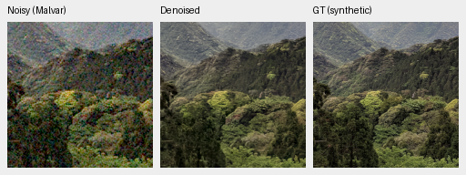
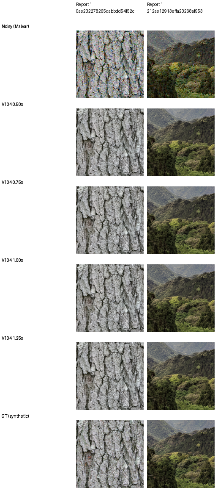
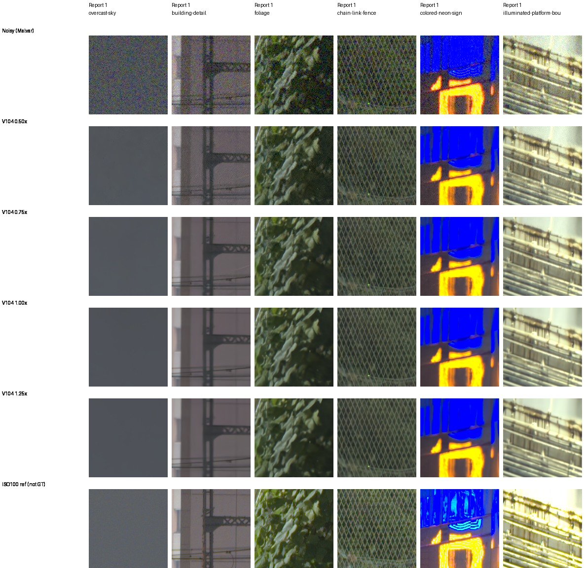

# Noise conditioning and fine detail

**Current model: [V114](v114-v115-quality.md).** The conditioning measurements below hold V104 fixed; they do not establish a V114 conditioning sweep.

**Use suitable physical shot/read priors with V104.** Lower conditioning retains
more structure and grain in these fixed examples, with lower high-noise PSNR.
It is a useful denoising/detail control, with no demonstrated general quality
win from the alternative strengths. V114 is the current positive-noise/training
baseline. These V104 measurements do not establish an alternative conditioning
recommendation for V114.

This current-model check holds the V104 final20000 EMA and all observations
fixed. Factors .50/.75/1.00/1.25 multiply the supplied shot coefficient,
read-noise variance and input variance map. They are **variance factors**, so
.50× corresponds to approximately .707× standard deviation. Actual noise,
exposure, CFA, WB, matrix and target pixels stay unchanged. These are declared
conditioning mismatches evaluated on one checkpoint, without retraining or
new noise draws.

## Fixed photographic results

Four previously selected held-out contexts: bark, egret, forest canopy and fur.
They use native256 contexts from 8×-binned Commons targets, RGGB, scored240
interiors, CPU IEEE FP32 and the same original observations under ADC-only,
ISO100 and ISO12800 priors. These are selected development contexts rather
than a full427 result or training-seed comparison.

| Conditioning | ISO100 PSNR | ISO12800 PSNR | ISO12800 SSIM | ISO12800 gradient MAE |
| --- | ---: | ---: | ---: | ---: |
| 0.50× | 40.79216 | 31.07231 | 0.846694 | 0.027845 |
| 0.75× | 40.80141 | 33.08845 | 0.916710 | 0.021317 |
| 1.00× | 40.80494 | 33.49300 | 0.924289 | 0.020291 |
| 1.25× | 40.80539 | 33.34016 | 0.917849 | 0.020663 |

At ISO12800, .50/.75/1.25× lose **2.42068/.40455/.15284dB** respectively;
each loses PSNR on all four sources. At ISO100 the changes are small, including
+.00045dB at1.25×. ADC-only predictions are byte-identical across all strengths,
as zero coefficients remain zero.

The twelve original V104 scores and native PNGs replay exactly. All 91 EMA
tensors, the official frozen encoder, weights/configuration/parameter IDs,
inputs and per-forward Torch RNG are checked. The run makes48 actual
DINO-backed forwards. Independent NumPy64 WB/matrix/gamma/MSE arithmetic
checks every saved linear/rendered PSNR and all source means. All144 source
triplet panels rerender exactly.
[Completed execution, independent audit and actual native review](results/V104-conditioning-probe-CPU-v1.json).

## Native comparisons

Columns are the four fixed contexts; rows are noisy Malvar, .50×, .75×,
**1.00×**, 1.25× and exact synthetic GT. Each cell is an unchanged160×160 crop
at the 8×-binned evaluation resolution, with shared coordinates and display
exposure ×1. Lower conditioning retains more fine canopy/fur structure and
visible grain, particularly on the smooth feather/background areas. Higher
conditioning smooths additional structure.

[16 high-noise triplets and full source/ROI/checkpoint/actual-noise/effective-conditioning/display metadata](images/conditioning-v104/iso12800-prior/manifest.json).

Two small triplets at .75× conditioning: noisy → V104 → exact synthetic GT.
Their actual observation noise remains the original ISO12800 prior.

Low-noise bark/canopy remain close:

[Eight low-noise triplets and metadata](images/conditioning-v104/iso100-prior/manifest.json) ·
[Source credits and original material selection](heldout-detail.md).
All36 synthetic board cells were viewed at original resolution.

## Detail versus off-target structure

The same predefined descriptive frequency measurement used in the earlier
V101 study is applied to retained V104 predictions: mean-subtracted240px
sRGB luminance, a separable Hann window and radial band1/16–1/4 cycles/pixel.
Projected gain measures real GT/prediction cross-energy divided by GT energy.
Residual RMS is orthogonal to that projected GT band and includes noise and
restoration error.

| ISO12800 conditioning | Mean GT-projected band gain | Off-target band RMS |
| --- | ---: | ---: |
| 0.50× | 0.98760 | 0.004955 |
| 0.75× | 0.97664 | 0.004428 |
| 1.00× | 0.96509 | 0.004276 |
| 1.25× | 0.95352 | 0.004265 |

Lower conditioning preserves additional GT-correlated band structure and
additional error. Sharpening and chance correlation from a single noise draw
can contribute to gain; this does not establish that every retained feature
is real. RMS includes the Hann window without power compensation, and is not
whole-image sensor-noise RMS. Full definitions and per-source values accompany
the linked execution receipt.

## Real GFX contexts

All six standing regions use the previously cached packed Bayer/reference
arrays: no RAW decoding or source-HDD access. These are **512px context
restorations**, separate from complete102MP blends. Original coordinates,
shared +2EV display and independent ISO100 f/5.6 reference stay fixed. That
capture differs in aperture, time and moving subjects; **it is not GT**, and
no pixelwise reference score ranks these variants.

At .50×, walls, foliage and fence backgrounds retain more structure and grain;
.75× produces a milder change. The sky remains mostly smooth, with more specks
at .50×. Higher conditioning softens foliage. Fence strands stay coherent and
fine illuminated-sign structure remains soft.

[All24 triplets and source/ROI/checkpoint/input-estimate/effective-conditioning/display metadata](images/conditioning-v104/gfx/manifest.json) ·
[Actual24 forwards, float/display audit and36 viewed native cells](results/V104-GFX-conditioning-CPU-v1.json).
The CPU1× baseline differs from the original CUDA FP32 contexts by at most
1.91e-6 camera units and one RGB8 code. This numerical parity is recorded
without claiming byte-exact CPU/CUDA output. All strength comparisons above
share the new CPU implementation and display transform.

A same-capture sky consistency check uses disjoint2×2 Haar coefficients within
each Bayer phase, normalized by the supplied profile's predicted variance.
Robust normalized standard deviations range **.9919–1.0154**, corresponding to
variance factors .984–1.031. This offers little indication of a factor-two
variance overestimate in that sky patch. It is a local check of an already
input-fitted profile, **not independent camera calibration**; scene texture,
correlation and limited brightness range constrain interpretation. It uses no
model output or ISO100 reference. The full definition and arrays are bound in
the GFX receipt. No automatic prior or production-default change follows.

## Which path responds to conditioning?

In V104's stabilized RGB configuration, explicit shot/read profiles control the
variance-stabilizing transform and CNN noise channel. The internal variance
map is replaced by a normalized proxy; optional map-dependent refinement heads
are disabled. Scaling the map alone therefore does not provide the equivalent
strength control. Set both physical shot/read coefficients deliberately.
[Implementation](../src/demosaic/pretrained_rgb.py).

The [earlier V101 investigation](v101-conditioning-study.md) retains its numerical
path interventions and DINO-preview counterchecks. Those measurements localize
the earlier strength response mainly to the CNN noise channel; they are
separate from the current V104 scores. The current quality work addresses
faint-detail supervision with the [matched V111/V112 loss-scale trial](loss-scale-training.md).

V104 checkpoint SHA256:
`8a3a7d94f2b1465cbdddbeec201fb37a2f69b12c74f9298527a94e3a7bbf6300`.
[Current model choices](current-model.md) · [Complete GFX comparisons](gfx-qualitative.md).
