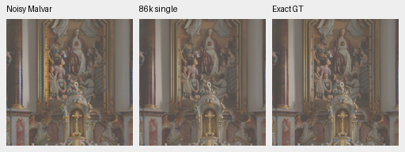
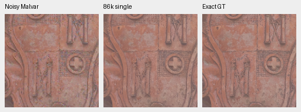

# Measured Bayer residuals just above the ADC limit

In the first four held-out photographs, adding a noise-weighted Bayer
residual to the 86k EMA lowers weakest-band error from **3.65 to 2.49
DN16** at the smallest positive-noise prior. It raises weakest-band
error at the other three priors. On exact flat colors, the same
correction only partly repairs a much larger bright-yellow bias.
[Evidence and frozen study inputs](results/noisy-cfa-residual-preflight-v1/publication.json).

## Method and scope

This study uses the V120 and 86k EMA checkpoints from the
[86k ADC and noise review](full-corpus-long86k-adc.md). The latter
has SHA256 `17a93ce546ee1c3282374b4a020c713251becbf919414966bb7a58f306b5c555`.
For each model, subtract its predicted measured color from the observed
Bayer sample. Estimate the sensor standard deviation from the supplied
shot/read coefficients and the estimated measured signal, with an
ADC variance floor. Drop samples within two estimated standard
deviations of either clipping endpoint. Weight the remaining residual
by `w / (w + sigma)`, in DN16, and use WB-aware Malvar to transfer the
correction to native RGB. The split arm averages the residual over a
packed 7×7 neighborhood, lifts that part with same-color bilinear
interpolation, and lifts the remainder with Malvar.

The four prior development materials select a shared single-lift
width of 4 DN16 and split widths of 4 fine and 2 coarse DN16. Selection
minimizes the equal mean of relative linear RGB and fine-band squared
errors over both models and all 48 retained inputs. This is an
empirical correction fitted on the available model residuals.
The held-out RAW draw and model prediction share the actual sensor input.

The evaluation plan selects 16 separate photographs from the existing
427-photo faint panel, using locked source-group hashes and excluding
the 64 previously inspected photographs. Each source retains the
original 2.5%-contrast clean target at exposure 1 and has independent
simulated shot/read noise for every CFA and profile. The 80 plan inputs
cover 64 photo B4 calls and 16 fresh B4 flat/edge controls. The input audit
replays the exact sensor values and confirms zero overlap between the
16 photo IDs and the 90,778-source training manifest.

## First held-out group

All four CFA layouts and four profiles are complete for the first
four-source group from the second shard. Weakest-band values use the
existing 16-pixel DCT, 1/8–1/3 cycles/pixel, and the original source's
weakest valid contrast bin. Three of these four sources contribute
to that bin. PSNR uses all four sources. These are simulated
faint targets rather than standard full427 or camera scores.

| Shot/read | 86k raw sRGB PSNR | 86k single sRGB PSNR | Raw weakest RMS DN16 | Single weakest RMS DN16 | Split weakest RMS DN16 |
| --- | ---: | ---: | ---: | ---: | ---: |
| `1e-8/1e-10` | 66.936 | 67.683 | 3.653 | 2.486 | 2.490 |
| `3.2e-7/1e-10` | 66.192 | 66.377 | 5.114 | 5.749 | 5.750 |
| `2e-5/1.6e-9` | 59.968 | 59.977 | 8.481 | 9.465 | 9.467 |
| `.00128/6.5536e-6` | 52.777 | 52.786 | 10.740 | 11.510 | 11.512 |

V120 with the same single lift attains 2.438 DN16 at the smallest
prior. The added split gives very similar weakest-band scores. The
first two native triplets show noisy Malvar, 86k single lift and exact
contrast-reduced GT. Both are native 160×160 RGGB crops at
`[48,48,160,160]`, with exposure ×1 and contrast ×20 centered on the
shared reference mean. Fine contours in the carved trim and red
engraving become a little clearer. The noisy view shows more color
aliasing. Some of the exact target's fine contours remain soft.
[Pixel and input provenance](images/noisy-cfa-residual-preflight-v1/manifest.json).

## Exact flat and edge controls

Three exact constant colors and a slanted blurred step cover every CFA
and noise prior. With the smallest prior, the 86k EMA's worst flat bias
is **7,428.72 DN16** on bright-yellow RGGB. The single lift reduces it to
**4,643.18 DN16**. The spatially centered flat error falls from 390.35
to 243.65 DN16. At the next prior the worst bias is **7,879.99 DN16**
on bright-yellow GBRG and remains **7,118.65 DN16** after correction.
At ISO100 and ISO6400, worst raw bias is 98.72 and 73.27 DN16 respectively.
The saturated display makes the first color shifts look considerably
smaller than their camera-linear values. Near the slanted edge, the
single lift reduces 86k boundary RMS at the two lowest priors and
slightly increases quiet-region error at ISO100 and ISO6400.
[Smallest-prior yellow](images/noisy-cfa-residual-preflight-v1/null-adverse/small-positive-bright-yellow-comparison.png) ·
[Intermediate yellow](images/noisy-cfa-residual-preflight-v1/null-adverse/intermediate-bright-yellow-comparison.png) ·
[Slanted edge](images/noisy-cfa-residual-preflight-v1/null/intermediate-slanted-edge-comparison.png).

The 86k training ledger binds 344 condition files and all 1,376,000
target slots. There are 103,205 ADC-only slots. The lowest positive
full-signal noise is **155.95 ADC codes RMS** among those slots, and
none has positive noise at or below eight codes. The two lowest
evaluation priors are about 6.39 and 35.97 full-signal codes RMS.
They probe the gap between the executed zero-noise examples and the
lowest executed positive-noise profile.
[Actual training coverage](results/noisy-cfa-residual-preflight-v1/training-noise-audit.json).

## Changing only the noise conditioning

The crossed replay holds all five forward inputs fixed when changing
shot/read conditioning. It tests the same tiny-noise input and an ADC
encoding of the exact same target. Both inputs use the same variance
tensor, camera coefficients and Bayer order for the conditioning
comparison. The 86k weights remain fixed.

| Bright-yellow input | RGGB positive conditioning | RGGB zero conditioning | GBRG positive conditioning | GBRG zero conditioning |
| --- | ---: | ---: | ---: | ---: |
| Tiny positive corruption | 7,429 | 10.6 | 7,111 | 170 |
| ADC encoding | 7,406 | 10.6 | 7,112 | 152 |

All values are worst camera-channel mean error in DN16. The large color
error follows the selected conditioning in both layouts. The
variance-stabilized model uses different transforms and variance
proxies for zero and positive priors, so the intervention changes that
complete conditioning path. The zero-conditioned render removes the
visible shift on both layouts, with residual error on GBRG.
[RGGB replay](images/noisy-cfa-residual-preflight-v1/conditioning/yellow-RGGB-comparison.png) ·
[GBRG replay](images/noisy-cfa-residual-preflight-v1/conditioning/yellow-GBRG-comparison.png).

A separate exploratory replay keeps the positive model conditioning.
Where the measured residual exceeds four estimated standard
deviations, it adds the excess to the weighted correction, with
an eight-code full-signal noise limit. On the small-positive nulls,
this brings the worst 86k flat bias to **87.67 DN16** and worst centered
RMS to **58.08 DN16**. Those same controls motivated the excess term.
[Bounded-residual crop](images/noisy-cfa-residual-preflight-v1/interval/yellow-large-disagreement-comparison.png).

## Both standing GFX100S comparisons

Applying the two lifted corrections unconditionally changes the
native 86k overcast sky by about 3.7 DN16 camera-RGB RMS. The sky still
looks smooth, with a slight grain change. The coarse fence retains the
same crossings, and the foliage and small building hardware stay
soft. In both cab crops, both profiles still miss most fine
intersections. Changes in the cab measure 3.1–4.0 DN16 RMS. The
comparison preserves the main sky/building/foliage/fence crop
coordinates, exposure ×4 and shot/read `.00128/6.5536e-6`. Both cab
ROIs retain exposure ×16, nominal conditioning and the transferred
`.0014635775921166604/1.0715704128646712e-6` profile. DSCF3880 and
DSCF3835 ISO100 and the camera JPEGs are separate qualitative
references with different acquisition settings.

[Sky](images/noisy-cfa-residual-preflight-v1/gfx/main-overcast-sky.png) ·
[Building](images/noisy-cfa-residual-preflight-v1/gfx/main-building-detail.png) ·
[Foliage](images/noisy-cfa-residual-preflight-v1/gfx/main-foliage.png) ·
[Coarse fence](images/noisy-cfa-residual-preflight-v1/gfx/main-chain-link-fence.png).

| Cab conditioning | Native comparisons |
| --- | --- |
| Nominal | [Left](images/noisy-cfa-residual-preflight-v1/gfx/mesh-nominal-fine-green-mesh-left.png) · [Right](images/noisy-cfa-residual-preflight-v1/gfx/mesh-nominal-fine-green-mesh-right.png) |
| DSCF3879 profile | [Left](images/noisy-cfa-residual-preflight-v1/gfx/mesh-profile3879-fine-green-mesh-left.png) · [Right](images/noisy-cfa-residual-preflight-v1/gfx/mesh-profile3879-fine-green-mesh-right.png) |

The broader 16-source analysis and a prospective check on the 12 photos
outside the first viewed group remain pending. The latter restricts
the single lift to priors with full-signal sigma at most eight ADC
codes. The four viewed photos informed that restriction. A paired
zero-conditioning replay for those same 12 other photos has also
started, with their sensor inputs held fixed at the smallest positive
prior. The
calibrated zero-noise projection remains the earlier opt-in path.
V120 remains the general inference recommendation.
