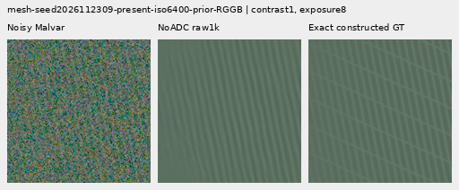
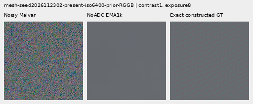
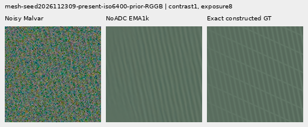
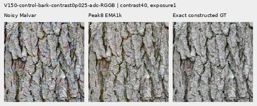
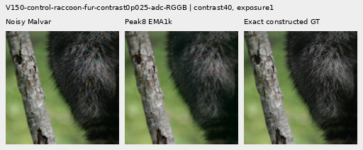

# V151: noisy supervision helps modestly; peak weighting closes support

Removing ADC-only supervised gradients improves the native matrix head's mean
weak noisy-mesh response over V143: **3.76–7.22% relative**,
with present-scene RMS lower by .19–.23%. Native 512 noisy-flat full RMS falls
**.10–.16%**. These are useful narrow gains, but response is still only
2.28–2.36% of the exact constructed signal. **No convincing new ISO6400 cab-mesh
wires or noisy organic texture appear in the native comparisons.** Exact quiet
regions beside strong patterns remain worse than V143.

The bounded clean-spectrum peak weight does not improve noisy recovery. Its
mesh support nearly closes and final noisy mesh output stays almost at V143.
Removing ADC supervision also gives up most of V150's ADC photographic gain.
Use noisy-only, 16 DN, peak bonus zero as the next noisy-head training control;
retain [V150's supervised 16 DN result](objective-floor-training.md) as the stronger
ADC photo comparator. [Current inference choices](current-model.md) retain their
measured uses; no general replacement or inference integration follows here.

All three fresh heads complete 1,000 updates. All six fixed final raw/EMA
endpoints are scored on 822 cases, independently audited, and actually viewed
in 84 native figures. The 16 DN control reproduces V150's complete trace,
raw/EMA/Adam state and **all 1,644 control prediction arrays exactly**.

## Weak meshes and actual blank error

Errors are mean per-observation RMS in unclipped camera RGB ×65535. Response
projects onto exact plane-detrended procedural texture; ideal is 1. The 256
present observations are 64 recipes across four CFAs, not independent scenes.
Added correction energy is a footprint; actual blank error is reported beside it.

| Method | Present full RMS | Response | Actual blank RMS | Blank spatial RMS | Added blank RMS |
| --- | ---: | ---: | ---: | ---: | ---: |
|V143|9.111243|0.02202090|5.523323|5.343113|0.00000000|
|16 DN raw|9.118656|0.02108287|5.528714|5.348694|0.32536863|
|16 DN EMA|9.119190|0.02102105|5.529539|5.349550|0.34414822|
|NoADC raw|9.090038|0.02361132|5.524396|5.344220|0.30090071|
|NoADC EMA|9.094019|0.02284971|5.521850|5.341595|0.28951747|
|Peak8 raw|9.111243|0.02202090|5.523324|5.343113|0.00007074|
|Peak8 EMA|9.111243|0.02202090|5.523323|5.343113|0.00005299|
|Existing periodic detail|8.586126|0.07089755|5.523328|5.343118|0.00063557|

NoADC raw has the higher response, but its actual blank RMS rises .019%.
NoADC EMA has the smaller response gain and lowers actual blank RMS .027%.
Absent-mesh RMS is essentially unchanged for raw and .039% lower for EMA.
The paired observations do not establish calibrated detection or broad flat safety.
The existing explicit periodic `detail` option remains stronger on selected
meshes, with incomplete orientations, support seams/spill and weak nonperiodic gain.

## Noisy flats and faint/dark photographs

Each native flat group has 24 observations. Full-field block32 measures coarse
error; crop-only numbers can miss a regression elsewhere in the field.

|Flat test|V143|16 DN raw|16 DN EMA|NoADC raw|NoADC EMA|Peak8 raw|Peak8 EMA|
| --- | ---: | ---: | ---: | ---: | ---: | ---: | ---: |
|Native512 ISO6400 full RMS|18.546808|18.538353|18.538148|18.528288|18.519647|18.546808|18.546808|
|Native512 ISO6400 spatial RMS|18.235130|18.226503|18.226310|18.216253|18.207427|18.235131|18.235130|
|Native512 ISO6400 block32 RMS|13.440561|13.441310|13.441351|13.441084|13.440601|13.440562|13.440562|
|Native512 ISO12800 full RMS|24.071890|24.061140|24.060518|24.045198|24.032722|24.071890|24.071890|
|Native512 ISO12800 spatial RMS|23.596861|23.585813|23.585165|23.569561|23.556746|23.596861|23.596861|
|Native512 ISO12800 block32 RMS|17.932544|17.932308|17.932251|17.931834|17.931704|17.932544|17.932544|
|Older native256 ISO12800 full RMS|27.233548|27.198124|27.195500|27.205031|27.188432|27.233547|27.233547|
|Older native256 ISO12800 spatial RMS|26.017191|25.979517|25.976780|25.987255|25.969563|26.017189|26.017190|
|Older native256 ISO12800 block32 RMS|19.539875|19.541654|19.541865|19.538363|19.538921|19.539873|19.539874|

NoADC improves fine-scale/full noisy-flat error more than the control. Large
colored mottle remains visible. Native512 ISO6400 block32 error still rises
slightly; ISO12800 block32 falls slightly. These tiny coarse changes do not
resolve the sky/flat objective. All 48 constant ADC inputs remain exactly at
their parents under all six endpoints (288 exact predictions).

Photo groups each contain 32 observations. The reported relative band error
uses a native DCT16 luma annulus at 1/8–1/3 cycles/pixel; lower is better.

|Photo test|V143|16 DN raw|16 DN EMA|NoADC raw|NoADC EMA|Peak8 raw|Peak8 EMA|
| --- | ---: | ---: | ---: | ---: | ---: | ---: | ---: |
|Retained512 faint full RMS|33.963754|33.965641|33.965875|33.961754|33.963319|33.963754|33.963754|
|Retained512 faint band error|0.824639|0.824839|0.824860|0.824602|0.824726|0.824639|0.824639|
|Retained512 faint band response|0.298560|0.297808|0.297744|0.298248|0.297886|0.298560|0.298560|
|Retained512 dark full RMS|29.097715|29.096548|29.096512|29.094260|29.095017|29.097715|29.097715|
|Retained512 dark band error|0.661447|0.661470|0.661473|0.661397|0.661430|0.661447|0.661447|
|Retained512 dark band response|0.531446|0.530974|0.530935|0.531073|0.530863|0.531446|0.531446|
|Organic384 faint full RMS|37.469061|37.474048|37.474866|37.468482|37.473348|37.469061|37.469061|
|Organic384 faint band error|0.924117|0.924532|0.924567|0.924289|0.924463|0.924117|0.924117|
|Organic384 faint band response|0.150701|0.149756|0.149684|0.150213|0.149819|0.150701|0.150701|
|Organic384 dark full RMS|33.685796|33.684882|33.684969|33.683572|33.685074|33.685796|33.685796|
|Organic384 dark band error|0.781612|0.781662|0.781663|0.781638|0.781653|0.781612|0.781612|
|Organic384 dark band response|0.398945|0.398334|0.398285|0.398467|0.398212|0.398945|0.398945|

NoADC raw lowers full RMS in all four noisy photo groups by .0015–.0119%.
Retained faint/dark band errors improve slightly, but organic faint/dark band
errors remain worse than V143. All four groups' band responses remain below
V143. EMA is mixed, including worse organic-faint full RMS. Native feather,
moth, grass/bark and bird/branch texture stay soft; these small error gains do
not establish useful new natural texture. Peak8 noisy band results stay almost
at the parent.

## Strong patterns and exact quiet regions

There are 16 observations per prior: four strong patterns across four CFAs.
The exact quiet 160px ROI and whole image are both measured.

| Prior | Method | Whole RMS | Quiet RMS | Quiet spatial RMS |
| --- | --- | ---: | ---: | ---: |
|ISO6400|V143|27.105631|3.898845|3.268502|
|ISO6400|16 DN raw|27.030722|3.915195|3.286329|
|ISO6400|16 DN EMA|27.028074|3.916322|3.287536|
|ISO6400|NoADC raw|27.042380|3.913870|3.285032|
|ISO6400|NoADC EMA|27.047239|3.906230|3.275941|
|ISO6400|Peak8 raw|27.105629|3.898845|3.268502|
|ISO6400|Peak8 EMA|27.105630|3.898845|3.268502|
|ISO12800|V143|36.747466|6.152652|5.341833|
|ISO12800|16 DN raw|36.618027|6.170318|5.361792|
|ISO12800|16 DN EMA|36.611625|6.172389|5.364230|
|ISO12800|NoADC raw|36.593953|6.164208|5.355044|
|ISO12800|NoADC EMA|36.615460|6.162118|5.352656|
|ISO12800|Peak8 raw|36.747466|6.152652|5.341833|
|ISO12800|Peak8 EMA|36.747466|6.152652|5.341833|

NoADC's strong-pattern whole RMS improves .215–.418% versus V143, while exact
quiet RMS still worsens .154–.385%. EMA reduces that quiet regression versus
the control, but does not remove it. Native diagnostic 40× views retain the
large colored blobs. Main real sky stays near the parent; its independent
ISO100 reference is qualitative and never pixelwise scored.

## ADC tradeoffs retained in the review

The eight ADC photo cases are two held-out Commons targets across four CFAs.
Targets scale channel-mean deviations by .025; shot/read are zero, black .03,
and input quantization is 16-bit. Sixteen analytic sloped512 cases cover four
level/tint/slope recipes across four CFAs. Both have exact constructed targets.

|ADC test|V143|16 DN raw|16 DN EMA|NoADC raw|NoADC EMA|Peak8 raw|Peak8 EMA|
| --- | ---: | ---: | ---: | ---: | ---: | ---: | ---: |
|Photo full RMS|18.149871|17.595055|17.594917|18.108684|18.110733|18.030462|18.034756|
|Photo band error|0.101855|0.097070|0.097059|0.101627|0.101647|0.101079|0.101112|
|Photo band response|0.968329|0.971985|0.971979|0.968329|0.968312|0.968851|0.968830|
|Sloped512 full RMS|3.771369|3.693495|3.695260|3.764842|3.765513|3.760841|3.761396|
|Sloped512 spatial RMS|3.397249|3.338252|3.339646|3.390132|3.390805|3.386734|3.387154|
|Sloped512 block32 RMS|0.574652|0.736708|0.735840|0.576346|0.575769|0.583693|0.582876|
|Sloped512 crop block32 RMS|0.088145|0.087866|0.087868|0.088139|0.088139|0.088145|0.088145|
|Sloped512 worst absolute DC|11.176981|11.094792|11.101879|11.176543|11.178324|11.161282|11.163042|

NoADC photo full RMS improves only .216–.227% versus V143, compared with the
control's 3.057–3.058%. Peak8 improves .634–.658%, also much less than the control.
Both candidates retain smaller ADC band gains. On sloped fields, NoADC gives
up most full/spatial improvement but cuts the control's roughly 28% coarse
regression to .19–.29%. Peak8 coarse error still rises 1.43–1.57%. Central
crops look smooth; the full-field coarse measurements remain necessary.

## Native 100% comparisons and standing real scenes

All 84 figures were inspected at original detail in 21 unscaled sheets.
Every crop cell is 160×160 original pixels, with identical coordinates and
display transforms across methods. The [manifest](images/v151-noisy-objective-v1/manifest-v1.json)
records exact source/ROI, checkpoint hash, conditioning, exposure, anchor and
contrast. The 36 triplets repeat existing board cells, not observations.

NoADC raw/EMA, two fixed noisy mesh crops each: **noisy → restored → exact
constructed GT**. Native512 RGGB, ROI `[176,176,160,160]`, shot .00128,
read 6.5536e-6, exposure 8, contrast 1. Seeds end 2302/2309. The first stays
nearly flat and the second retains one family without restoring the crossings.

Peak8 raw/EMA, ADC bark and fur: **quantized input → restored → exact
constructed GT**. Native256, ROI `[48,48,160,160]`, exposure 1, shared contrast
40 about target channel means; shot/read zero, black .03. Bark: Derek Ramsey
(Ram-Man), CC BY-SA2.5, source SHA1 `0ae232278265dabbdd54f52c34045a3d03323aa7`.
Fur: Korall, CC BY3.0, SHA1 `2b5a51667b9906eecead8f82e08c7ba11750f8c6`.
These are synthetic ADC inputs, not exact GT for real high-ISO captures.

Fine bark/fur texture remains present, with small edge/color changes at 40×;
these ADC error gains do not produce a large visible restoration.

Standing DSCF3879 ISO6400/DSCF3880 ISO100 views retain
[sky](images/v151-noisy-objective-v1/comparison-05.png),
[building](images/v151-noisy-objective-v1/comparison-06.png),
[foliage](images/v151-noisy-objective-v1/comparison-07.png) and
[chain-link fence](images/v151-noisy-objective-v1/comparison-08.png), exposure 4.
The DSCF3842/3835 fine cab mesh retains both windows under
[nominal left](images/v151-noisy-objective-v1/comparison-09.png),
[nominal right](images/v151-noisy-objective-v1/comparison-10.png),
[profile3879 left](images/v151-noisy-objective-v1/comparison-11.png) and
[profile3879 right](images/v151-noisy-objective-v1/comparison-12.png) priors.
Native768 context, ROIs `[206,229,160,160]` / `[426,189,160,160]`, exposure 16,
contrast 1. Both SOOC JPEGs remain native unboosted sRGB8. Independent
ISO100/AHD/JPEG references differ in aperture, shutter, processing and motion:
**qualitative references, not exact GT**, never pixelwise scored. No convincing
new fine cab wires appear. All captures, JPEGs and siblings stay out of training;
original media remains read-only and `/mnt/dataz` is untouched.

## Matched training and interpretation

The [recipe](../configs/quality-v143-noisy-objective-v151.yaml) has three identical
fresh 31,409-parameter native matrix heads; all twelve initial tensors match.
All 85 neural/inference files, physical inputs, V143 parents, band/bound,
local support, data/geometry/domain weights, seed, LR/schedule/clipping and EMA
remain fixed. Each head adopts the same 1,000 cached V148 batches/4,000 old
observations. Photos retain native256 contexts and procedures native512,
bin4→geometry→area2, 90,782-photo/27-region eligibility and validation exclusions.
This adaptive reused quality cohort is not fresh independent evidence.

| Arm | Loss floor | ADC-only total-loss multiplier | Noisy coefficient-MSE weight |
| --- | ---: | ---: | --- |
|16 DN control|16 DN|1|1|
|NoADC|16 DN|0|1|
|Peak8|16 DN|0|`1+7*r/(1+r)`|

Here `r` is summed clean four-phase FFT power divided by the summed floored
frame-noise proxy. It is a training-only target statistic, not calibrated SNR,
probability or a flat guarantee. Weights stay in [1,8], without renormalization.
Zero clean spectra retain unit weight within supervised noisy batches. ADC
loss removal is a separate intervention. Targets never enter forward, and all
ADC cases execute every head without an inference bypass.

Both candidates have 882 supervised batches/3,528 observations, versus
1,000/4,000 for control. On 118 ADC-only batches their gradients are exactly
zero, but all 1,000 AdamW and EMA updates still execute: existing moments and
weight decay coast, preserving optimizer/LR clocks. Peak weighting executes
on 882 noisy batches. Original RGB pixel/gradient Charbonnier and pre-gate
coefficient MSE remain; Peak8 changes only the coefficient weight versus NoADC.

The [recorded routing](results/v151-noisy-objective-v1/training-routing.json)
confirms all 118 zero-loss/zero-norm candidate steps. Noisy-only has no noisy
steps over the clip threshold; Peak8 has one. Capped squared norm sums are
routing proxies, not Adam displacement or causal quality evidence.

The [archived support/proposal reductions](results/v151-noisy-objective-v1/proposal-support.json)
show mesh mean support .162/.167 for control, .440/.424 for NoADC, and
2.06e-6/1.61e-6 for Peak8. Present and absent mesh means are almost identical;
the larger NoADC mean does not establish spatial selectivity. Pre-support
proposal coefficient RMS is 2.43e-5/2.46e-5, 1.14e-5/1.03e-5 and
1.68e-5/1.68e-5 respectively. Peak8's near-parent output accompanies nearly
closed support, rather than demonstrated noisy-detail recovery. NoADC improves
the mean mesh/flat tradeoff, but quiet-region and natural-detail errors still
require a better estimator/routing mechanism. Blindly opening the gate remains
unsupported by the earlier [actual gate/proposal probe](late-spectral-detail.md).

## Audits and preserved evidence

Thirteen objective tests pass in 1.39 s: independent NumPy complex values and
gradients over four CFAs and ADC/high-noise conditions, exact legacy 16 DN
value/gradient reproduction, unit weights for constant targets, and Adam motion
with zero gradients. Compatibility uses 56 actual function evaluations on 28
cached contexts. Three discarded ten-update CUDA checks include genuine 8+2 restoration;
all twelve tensors receive finite nonzero gradients over the prefix. Production
starts fresh and completes all 36 finite Adam states at step 1,000, with peak
allocated CUDA 4.08 GiB; endpoint review peaks at 1.32 GiB.

The [final evidence](results/v151-noisy-objective-final-v1.json) preserves 19
byte-exact receipt copies and 84 native PNGs. Independent metrics verify
54,246 scalar checks and 656 Decimal reductions;
maximum difference 5.12e-13. Display/PNG checks cover
42,470,400 RGB channels. All nine primary owners are terminal.
The [preparation evidence](results/v151-noisy-objective-preparation-v1.json)
retains its original active 324-row snapshot, checkpoint 250 audit, tests and
frozen source texts byte-exact. No worker was replaced or restarted.

Tracked head work: 56 compatibility evaluations + 30 discarded smoke updates +
3,000 production updates + 4,932 quality calls = **8,018**, excluding unit tests.
All training/review arrays and parents are adopted: **zero new parent/DINO calls
or stochastic noise draws**, no RAW decode or original-media access. Model and
RNG hashes remain unchanged during review. All endpoint checkpoint hashes are
in the manifest; paired training checkpoint SHA256 is
`7246994392b881ed64a33f19c7a065ea20fb5be24d1362b7d0d569526fabb2ab`.

The useful noisy-only result becomes the next noisy-training control, while
V150 retains its ADC strengths. The requested convincing fine cab mesh and
clean-flat recovery remain unmet. See the
[local-time diary](../diary/2026-11-03-16-00-12-v151-noisy-objective-trial.md).
