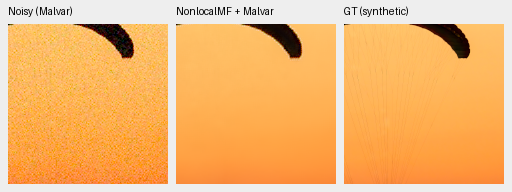
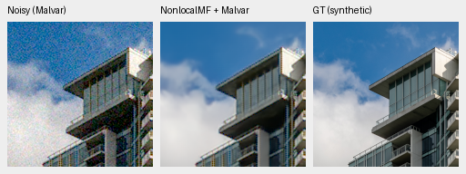

# A recent RAW denoiser: genuine weights and a small CPU comparison

Current architecture and recommendations: [current model guide](current-model.md).
The versioned study below retains its measured results and original protocol.

The authors' released Nonlocal Match-Filter runs on our two saved photographic
observations through its actual native CPU operator. Fine fabric cords and
cloud wisps remain soft. This is a preliminary comparison of **RAW denoising
followed by independent Malvar demosaicing**, with no paper-score reproduction,
real-camera result or promoted model.
[Complete acquisition, weights, operator checks, observations and crops](results/nonlocal-matchfilter-cpu-probe.json).

The follow-up [optional evaluator and standing GFX review](nonlocal-reference-integration.md)
now reproduces these CPU outputs exactly and adds the four fixed real regions,
including foliage and fence. GPU numerical checks remain pending.

[Sánchez-Beeckman and Buades, April 2026](https://arxiv.org/abs/2604.17453)
propose learned nonlocal matching and filtering for RAW-to-RAW denoising.
The [official implementation](https://github.com/MIA-UIB/nonlocal-matchfilter)
provides source, a released checkpoint and native sampling operators. This is
a useful recent comparator; a denoiser cascade has a different reconstruction
objective from this project's joint RGB output.

## Actual execution and protocol

All 59 cached source files match their canonical Git blobs at revision
`6df6a79ce128a7741af88ff0f3e9794f9b5e03d4`.
The original 183,578,760-byte release checkpoint matches its publisher SHA256:
`b31bc8e21022389b0b209a9d1e6649485ed4dacc552b7ea04612df5f7515fcf2`.
A restricted weights-only load maps configuration classes to inert data objects;
no upstream Lightning or OmegaConf constructors execute. All 141 network tensors
strictly match the upstream model and survive a pure-tensor export unchanged.
The checkpoint records step 1,150,000, rather than our 10,000-step schedule.
Different data, losses and training budgets prevent architectural attribution.

The RAW recipe uses eight inputs, four outputs, width 32, neighborhoods
25/15/9 and search distance 9. Its 15,282,866 network parameters are genuine
released values. The upstream NumPy packing definitions verify all four CFA
channel permutations and round trips. For RGGB, authors' RGBG order is
TL/TR/BR/BL, rather than this project's TL/TR/BL/BR phase order.

The input is sensor-normalized RAW clipped to [0,1] as in the authors' training,
followed by four standard-deviation maps
`sqrt(max(shot * clipped_noisy + read, 0))`. These use the noisy input only.
Outputs are clipped as in upstream testing, returned to phase order, then
demosaiced with this project's WB-aware Malvar. There is no output-gain fit,
GT-dependent calibration, new noise realization or upstream OpenCV renderer.
The two inputs clip 1,176/786 negative sensor samples; neither clips above white.

Execution uses CPU FP32, batch 1 and two threads. The native CPU extension is
built from unchanged dependency revision
`ba6c21d34effcb3c3903237704ab58388b86d006` against Torch 2.14.1.
Zero-offset outputs exactly match unfold for 3×3, 3×5 and 5×5 neighborhoods.
Independent fractional-offset sampling and input/offset-gradient checks agree
to 1.33e-15/7.11e-15 in FP64. These checks establish CPU behavior for the tested
cases; CUDA execution and CPU/GPU equivalence still need validation.

The unchanged native sources also compile and import successfully for GB10
`sm_121` with the installed Torch/CUDA 13 toolchain. Compilation uses one CPU
worker in a separate external directory; no CUDA context or kernel executes.
This removes the initial build obstacle while preserving the active environment.
It does not establish GPU numerical agreement or performance.

## Two selected native ROIs

These numbers describe **two selected 160px ROIs**, not the 427-photo benchmark.
Original comparator predictions are reused only after their full hashes and
identical saved inputs verify. Every method uses the same CPU observation and
display transform. The differing training histories are not a controlled
architecture ablation. No confidence interval is meaningful for this selection.

| Method | Fabric sRGB PSNR | SSIM | Building sRGB PSNR | SSIM |
| --- | ---: | ---: | ---: | ---: |
| Original no context, 3k | 40.35606 | .966551 | 34.70924 | .957645 |
| Original no context, 10k | 25.02112 | .960554 | 35.12317 | .960134 |
| Original DINO-S, 3k | 39.41851 | .966061 | 34.49771 | .956429 |
| Original DINO-S, 10k | 31.19559 | .964812 | 35.00911 | .958718 |
| Nonlocal Match-Filter + Malvar | 36.46060 | .962941 | 29.79466 | .922898 |

The [original 10k fabric color regression](fresh-color-mean-diagnostic.md)
explains why that checkpoint's selected score is especially poor. The new
cascade retains a closer warm color but does not recover the thin cords.
Its building output has clean edges with soft fine features and cloud texture.
These observations neither establish a universal ranking nor reject the
architecture on real RAW photographs.

Noisy Malvar → released RAW denoiser + Malvar → exact simulated GT. Panels are
native 160×160, without resizing, sharpening or per-method display adjustments.
Source tiles are 256×256 from the original 8× linear-light Commons caches.
Both use RGGB, shot .00256, read variance .0000262144, ADC16/black .03,
WB [2,1,1.5], fixed protocol matrix and display exposure ×1.
The exact targets belong to the simulation; they are not measured clean RAW.

Fabric, binned-source tile [189,3,256,256], ROI [237,51,160,160]:

Building, binned-source tile [195,89,256,256], ROI [243,137,160,160]:

The receipt records the original checkpoint hash, source/cache identity,
serialized observation SHA, ROI, conditioning, WB/matrix and display exposure.
Both PNGs were actually viewed. All eight saved float arrays pass full
hash/shape/dtype/finite checks. Six native panels rerender byte exactly; noisy
and GT pixels match the parent comparisons. Independent NumPy64 camera/display
PSNR differs by at most 2.32e-6 dB from the float32 metric implementation.

Photographs: [Roy Egloff](https://commons.wikimedia.org/wiki/File:CH.VD.Villeneuve_2007-08-25_Vertigo-Swiss-Riviera_2392_3x2-R_4K.jpg)
and [Dietmar Rabich](https://commons.wikimedia.org/wiki/File:Vancouver_(BC,_Canada),_Coal_Harbour_Seaside_Park,_Blick_in_den_Himmel_--_2022_--_2158.jpg),
[CC BY-SA 4.0](https://creativecommons.org/licenses/by-sa/4.0/), modified by
binning, crop, noise simulation, restoration and rendering. Derived photographs
retain that license. Upstream MIT source and the sampling dependency's embedded
notices remain beside their cached originals; no weights are added to Git.

## Remaining comparison work

The released curated-source metadata lists 493 entries, including 114 RawNIND
scene IDs, but does not supply `gt/train` versus `gt/val` membership. A simple
case-insensitive scene-ID comparison finds no exact match among our four known
and five unseen development scenes. This does not exclude alternate names or
similar views, establish unseen-camera status for this baseline, or make the
protected-final panel eligible. No paired/final scene was scored here.

Next verify native CUDA numerics and the complete RAW/noise contract on the GB10,
then evaluate photographic, analytic and real development panels with accurately
labeled cascade outputs and references. GPU numerical work waits for the owned
V58 workflow to exit. The active environment and training run are unchanged;
all preparation artifacts are in authorized external storage. The two CPU
forwards are neither a full-frame speed benchmark nor evidence for the 10-second
target. V43 was the README reference for this study.
