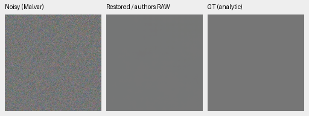
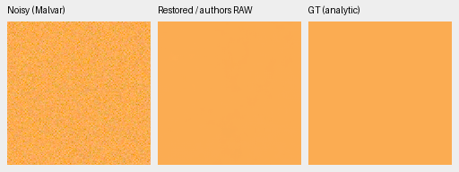
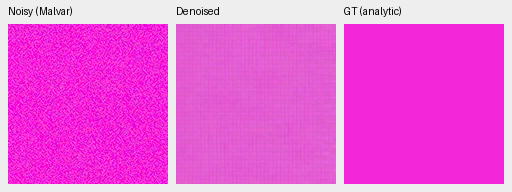

# Released RAW reference: warm accuracy and a magenta flat-field failure

The genuine Nonlocal Match-Filter RAW denoiser plus independent Malvar stays
close on the selected neutral and warm uniform fields. A selected magenta
(cyclic-GBR) field develops a substantial color error and a visible repeated
grid despite its exact target being spatially uniform. This is a **CPU FP32
saved-input diagnostic**, not proof of a CUDA-color failure, broad model ranking
or the training cause. [Complete observations, predictions and audit](results/nonlocal-reference-colored-flats.json).

These are the same 32 saved observations used in the
[mature checkpoint diagnosis](mature-color-flat-review.md): four fixed colors,
two conditions and four CFAs, with one draw per case. The palette was chosen
after the original fabric failure, not as an independent color benchmark.
The reference has different training history and is a RAW denoiser followed by
Malvar rather than our joint camera-RGB reconstruction model.

## Camera-RGB mean errors

Each value is the maximum absolute channel-mean error over all four CFAs,
measured on ROI[48,48,160,160] in normalized camera RGB. ADC-only retains 16-bit
quantization/black=.03 but shot=read=0. The synthetic high-noise protocol prior
uses shot=.00256 and read variance=.0000262144.

| Condition | Neutral | Warm | Cyclic GBR | Cyclic BRG |
| --- | ---: | ---: | ---: | ---: |
| adc-only | 0.000570 | 0.000663 | 0.054120 | 0.000312 |
| iso12800-prior | 0.000565 | 0.001155 | 0.070875 | 0.000762 |

The cyclic-GBR error occurs with ADC-only input too. Neutral success and a
clean-looking warm field therefore miss this selected saturated-color failure.
The values summarize four CFA cases; they are not uncertainty intervals.

## Native noisy / denoised / exact-GT crops

Each panel is native 160×160, with no resizing. All three displayed cases are
RGGB under the high-noise condition above, shared WB[2,1,1.5], recorded camera
matrix, ROI[48,48,160,160] and display exposure×1. Left: noisy WB-aware Malvar.
Middle: released RAW reference plus Malvar. Right: exact uniform analytic GT.
These are 8-bit sRGB previews; arithmetic uses retained full float32 predictions.
No new noise draws, output calibration or target-dependent correction occurs.

neutral

fabric-mean

fabric-cyclic-gbr

The neutral and warm previews remain visually close to their targets. The
magenta prediction has a visible periodic pattern and changed saturation; the
GT is exactly constant. The third triplet was rendered from the already saved
prediction to expose this failure, without another inference or degradation.

## Provenance and verification

Original released checkpoint SHA256:
`b31bc8e21022389b0b209a9d1e6649485ed4dacc552b7ea04612df5f7515fcf2`.
The loader's strict tensor/source/compiled-dependency checks and unchanged input
conventions are documented in the [reference integration](nonlocal-reference-integration.md).
The same CPU implementation had matched the genuine author-network pilot.
Its separate two-photo CPU/CUDA preflight does not establish colored-field
CUDA equality.

All 32 observation hashes and full 256px float predictions pass checks.
Independent Torch64 reconstruction of 192 NumPy64 metric fields differs by at
most 2.23e-16. All three PNGs were actually viewed; all nine native image panels
rerender byte exactly. No CUDA context or source RAW decoding was needed.
[Evaluator](../scripts/evaluate_saved_color_flats.py) and
[generic saved-array auditor](../scripts/audit_saved_color_flats.py); the executed
auditor source and checksum are retained beside its receipt. No weights,
training recipe, README working model or protected-final scoring changed.
