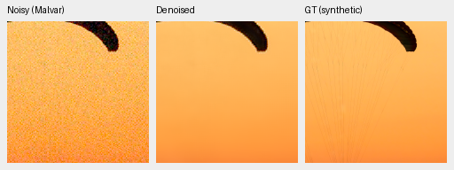
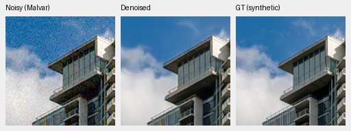
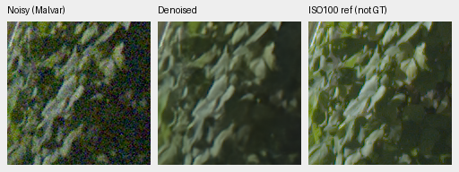
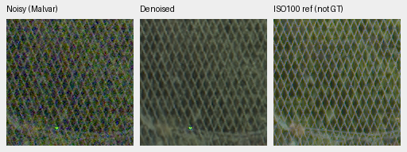

# Released RAW reference: complete development and real-photo comparison

The genuine Nonlocal Match-Filter RAW denoiser plus independent Malvar reaches
**30.07108 dB / .914082 SSIM** on 427 synthetic-noise photos, below V43 and our
mature models. Its paired-real means are slightly higher, but source intervals
cross zero against V43 and mature ConvNeXt. Fine fabric/foliage remains soft,
fence grain/detail differs, and a [selected magenta flat](nonlocal-reference-colored-flats.md)
shows a color shift and repeated grid on CPU. **Keep V43 as the working model;
retain the released method as an optional reference. No broad winner or SOTA
claim follows.**

[Complete scores, case comparisons, integrity audit and 64 native crop receipts](results/nonlocal-reference-full-review.json).
[Loader and genuine CPU/CUDA validation](nonlocal-reference-integration.md).
[Completed ConvNeXt comparison](dino-convnext-pyramid-v58-10k-review.md).

## Genuine reference and comparison scope

Released checkpoint SHA256:
`b31bc8e21022389b0b209a9d1e6649485ed4dacc552b7ea04612df5f7515fcf2`.
All 141 released tensors  / 15,282,866 parameters load strictly with the authors'
pinned source and genuine native dependencies. It accepts clipped normalized
RAW plus input-only shot/read standard-deviation maps, predicts clipped RAW,
and uses independent WB-aware Malvar for RGB. No fitted output gain or GT-based
correction is added. This is a cascade, not our joint camera-RGB architecture.
It stays IEEE FP32 with native batch 1, including inside enclosing autocast.

The new run scores the reference, two input-calibrated RawNIND variants and
three classical methods on the original 427+16 sources/seven conditions / four CFAs,
known4 (8 pairs / 72 crops) and our held-out-camera development5 (10 pairs / 90 crops).
The same prepared observations, source/ROI identities and noise/display
protocol apply. V43 and mature no-context/S/B/ConvNeXt scores are reused from
saved complete case logs, with source/checkpoint/report hashes retained.
Photo outer batch 2; new real outer batch 4 versus saved V43 real batch2. Our
saved neural inference is FP16, the released RAW network is FP32/nativeB1.
The genuine-weight preflight and all 509 tests passed before this full run.

External NIND metadata lists publisher IDs without exact train/validation
membership. No exact current development ID matches were found, but aliases,
training overlap and unknown-sensor status remain unproven. **“Unseen” means
held out of our training, not demonstrated unseen by the external model.**
Training budgets and histories differ. These are development comparisons;
protected-final 16-scene scoring remains closed.

## Paired-real and synthetic-noise results

| Panel | Model | Measured-CFA PSNR | AHD RGB PSNR | AHD SSIM |
| --- | --- | ---: | ---: | ---: |
| Known | Released RAW reference + Malvar | 54.24601 | 40.05031 | 0.932014 |
| Known | Retained V43 | 54.23332 | 40.05105 | 0.930848 |
| Known | No context10k | 54.19996 | 40.00884 | 0.931271 |
| Known | ConvNeXt10k | 54.22488 | 40.02138 | 0.931460 |
| Known | RawNIND global CFA-LS | 54.06860 | 39.67805 | 0.928811 |
| Known | RawNIND channel CFA-LS | 54.08474 | 39.71710 | 0.928831 |
| Unseen | Released RAW reference + Malvar | 53.85252 | 38.74839 | 0.922517 |
| Unseen | Retained V43 | 53.80606 | 38.59078 | 0.921579 |
| Unseen | No context10k | 53.83974 | 38.55027 | 0.921084 |
| Unseen | ConvNeXt10k | 53.80108 | 38.59689 | 0.921469 |
| Unseen | RawNIND global CFA-LS | 53.56220 | 38.14484 | 0.918380 |
| Unseen | RawNIND channel CFA-LS | 53.76822 | 38.56191 | 0.922127 |

Measured clean CFA after common integer alignment/calibration is primary.
Independent LibRaw AHD RGB is auxiliary, **not exact RGB GT**. RawNIND uses
publisher global-ADC normalization and gains fitted only from the noisy CFA.

| Model | 427-photo PSNR | SSIM | 16-procedural PSNR | SSIM |
| --- | ---: | ---: | ---: | ---: |
| Released RAW reference + Malvar | 30.07108 | 0.914082 | 27.80969 | 0.879232 |
| Retained V43 | 34.89934 | 0.957126 | 33.28537 | 0.966604 |
| No context10k | 35.55039 | 0.961097 | 34.01121 | 0.970106 |
| ViT-S10k | 35.40609 | 0.960561 | 33.90517 | 0.970858 |
| ViT-B10k | 35.48886 | 0.960941 | 34.10212 | 0.970409 |
| ConvNeXt10k | 35.54954 | 0.961229 | 34.15831 | 0.970347 |
| RawNIND global CFA-LS | 26.69578 | 0.790028 | 24.97426 | 0.720411 |
| RawNIND channel CFA-LS | 26.68357 | 0.789899 | 24.98568 | 0.720500 |

| Difference, dB [95% source interval] | Known primary | Our unseen primary | Photo sRGB | Procedural sRGB |
| --- | --- | --- | --- | --- |
| Released reference − Retained V43 | +0.01269 [-0.17773, +0.28294] | +0.04646 [-0.22715, +0.33486] | -4.82826 [-4.94240, -4.71074] | -5.47569 [-6.46234, -4.35644] |
| Released reference − No context10k | +0.04605 [-0.10754, +0.21528] | +0.01278 [-0.21375, +0.25148] | -5.47931 [-5.63268, -5.33622] | -6.20153 [-7.19978, -4.98285] |
| Released reference − ViT-S10k | +0.03403 [-0.07249, +0.15802] | +0.06662 [-0.13617, +0.29139] | -5.33501 [-5.49913, -5.18645] | -6.09549 [-7.12163, -4.92481] |
| Released reference − ViT-B10k | +0.04751 [-0.11608, +0.21297] | +0.07488 [-0.15149, +0.30996] | -5.41777 [-5.57504, -5.26089] | -6.29243 [-7.28736, -5.13573] |
| Released reference − ConvNeXt10k | +0.02113 [-0.13480, +0.18254] | +0.05144 [-0.14456, +0.27967] | -5.47845 [-5.63813, -5.33455] | -6.34863 [-7.30530, -5.38798] |

Intervals use 1,000 paired source/scene resamples, seed 42; they do not quantify
training-seed uncertainty. The released model's small positive paired means
have wide intervals, while its large synthetic-domain deficit is clear in this
protocol. Neither establishes broad real-photo superiority. All 60 saved-score
comparisons and every summary metric remain in the receipt.

## Native exact-GT photo triplets

Native 160×160 panels at the 8×-binned evaluation resolution, without resizing.
Noisy WB-aware Malvar → restored → exact simulated clean target. Fixed
ROI[48,48,160,160], RGGB, shot=.00256/read variance=.0000262144, ADC16/black.03,
WB[2,1,1.5], recorded matrix, display exposure×1. Exact source/cache/checkpoint/
noise/ROI records accompany each crop. PNGs are 8-bit previews; scores use
unquantized predictions. Saved V43's noisy and GT native panels are verified
byte-identical to the new reference triplets.

Fabric color close to GT, fine cords smoothed away. Building outline restored but softer than GT; fine cloud wisps lost. Consistent with earlier genuine CPU pilot, not proof of full benchmark quality or broad superiority.

Sources: [Roy Egloff](https://commons.wikimedia.org/wiki/File:CH.VD.Villeneuve_2007-08-25_Vertigo-Swiss-Riviera_2392_3x2-R_4K.jpg)
and [Dietmar Rabich](https://commons.wikimedia.org/wiki/File:Vancouver_(BC,_Canada),_Coal_Harbour_Seaside_Park,_Blick_in_den_Himmel_--_2022_--_2158.jpg),
[CC BY-SA4.0](https://creativecommons.org/licenses/by-sa/4.0/). Modified by binning,
crop, noise simulation and restoration; previews retain that license. Paired
scenes: Benoit Brummer and Christophe De Vleeschouwer,
[RawNIND](https://doi.org/10.14428/DVN/DEQCIM), individual credits in receipts.

### Fabric: exact simulated target

Released RAW reference + Malvar

RawNIND channel CFA-LS

Saved working V43, identical noisy/GT native panels

### Building and sky: exact simulated target

Released RAW reference + Malvar

RawNIND channel CFA-LS

Saved working V43, identical noisy/GT native panels

## Analytic and colored fields

The GPU analytic panel covers 1,344 cases (448 observations for V43, released
reference and Malvar); native examples are in the gallery.
Both V43 and Nonlocal almost erase the dark carrier. The brighter weak carrier is faint in both, with low-frequency variation; amplitude remains visibly below analytic GT. Both neutral flats look smooth; saturated-color accuracy needs the separate colored-field checks.

The separate [CPU colored-field diagnostic](nonlocal-reference-colored-flats.md)
replays the same 32 saved fields as the mature-model diagnosis. Neutral and warm
errors stay small, but the cyclic-GBR magenta field has maximum channel-mean
errors .05412 ADC-only / .07087 high-noise and a visible repeated grid. This
exposes a failure missed by neutral fields. It is selected CPU evidence, not a
representative hue sweep or a colored-field CUDA comparison.

## Standing GFX and three cached cameras

Full 101.996 MP output of cached DSCF3879 ISO6400 uses shot=.0014635775921166604,
read variance=1.0715704128646712e-6 from its input-only Haar estimate. Shared
WB[1.513245033,1,2.215231788] and display×4 (+2EV) apply to all methods. The
DSCF3880 ISO100 f/5.6 reference is 3m38s later with different exposure/aperture
and moving subjects; it is **not GT**, a fitted target or a pixelwise score.
Both captures and siblings stay outside training; originals remain read-only.

All16 new full-frame crop PNGs viewed. V43 fence wires are smoother/more regular than Nonlocal; Nonlocal retains more residual grain. RawNIND fence is more blurred. Fine foliage/truss remain soft in V43 and Nonlocal; separate ISO100 reference has different exposure/aperture/motion and is not GT. No broad real-photo winner.

### GFX foliage: separate ISO100 reference

Retained V43

Released RAW reference + Malvar

RawNIND channel CFA-LS

### GFX chain-link-fence: separate ISO100 reference

Retained V43

Released RAW reference + Malvar

RawNIND channel CFA-LS

All24 new triplets viewed. Q2 dark broad texture is similarly smoothed in V43/Nonlocal/RawNIND; no decisive detail gain. Sony panel grain is reduced and already-soft window outlines remain soft. GF50R Nonlocal retains more grain in stone than V43 while both preserve more fine surface variation than RawNIND; no exact GT is available.
RawNIND comparator panels in the Q2/a7RII/GF50R gallery are explicitly not GT.
The shared selected 512px contexts and 160px ROIs remain fixed, with input-only
conditioning and common per-capture display exposure recorded in each receipt.

## Numerical replay, integrity and speed

Independent arithmetic rebuilds all 75,396 new synthetic/paired score rows and
180 paired comparison intervals to 7.11e-15. The separate bridge recomputes60
paired source comparisons with the saved V43/fresh neural case logs. Shared
control coverage and nullable support match exactly. **62,419 of 62,830 control
rows match in every metric; 411 rows have tiny floating-point differences.**
The largest drift is 7.63e-6 dB PSNR, 2.39e-7 SSIM, 7.46e-9 chromaMAE and 1.50e-8
gradientMAE. Every difference is explicitly retained and at most 4 float32 ULPs.
That bound was chosen after the exact-replay check exposed the drift; it is
post-hoc numerical agreement, not exact replay or proof of its cause. Metadata,
observation keys, source/calibration identities and metric supports are checked.

All 64 PNG / 29 F32 contexts and 8 full RGB16 TIFF files pass independent complete hash,
shape/dtype/geometry/coordinate/transform checks. Common noisy/reference panels
and three-camera restored panels between both comparator triplets agree exactly.
All four methods' linear/sRGB TIFFs are 8746×11662 RGB/uint16, with sRGB ICC tags
and more than 256 sampled output codes. This verifies encoding/integrity, not
exhaustive visual inspection of every full-frame pixel.

The visual review opened 52 new PNGs. Another 12 RawNIND controls have identical
whole-file hashes to previously viewed published triplets. All 64 native sets
are covered explicitly; this is not a claim of 64 newly opened images.

| Method | One full 102 MP inference, seconds | Peak CUDA GB |
| --- | ---: | ---: |
| Retained V43 | 33.25 | 1.901 |
| RawNIND global CFA-LS | 17.55 | 1.554 |
| RawNIND channel CFA-LS | 17.45 | 1.554 |
| Released RAW reference + Malvar | 213.28 | 1.693 |

Native 512px tiles / 64px overlap / outer batch 4; V43 neural FP16, physical/RawNIND/Nonlocal
FP32. Nonlocal calls internally use batch 1. Timings exclude RAW decode/TIFF
encoding and are single passes in a shared-machine workflow, not a repeated
speed sweep. The released cascade's 213.28s is far above the 10-second target.
Quality and speed requirements for our final model remain unfulfilled.

## Complete native gallery

| Panel / source | Native triplets |
| --- | --- |
| known / 2pilesofplates | [Released RAW reference + Malvar](images/nonlocal-full-NL-known-2pilesofplates.png), [RawNIND global CFA-LS](images/fresh-dino-10k-raw-global-known-2pilesofplates.png), [RawNIND channel CFA-LS](images/fresh-dino-10k-raw-channel-known-2pilesofplates.png) |
| known / 7D-1 | [Released RAW reference + Malvar](images/nonlocal-full-NL-known-7D-1.png), [RawNIND global CFA-LS](images/fresh-dino-10k-raw-global-known-7D-1.png), [RawNIND channel CFA-LS](images/fresh-dino-10k-raw-channel-known-7D-1.png) |
| unseen / LucieB_3apples | [Released RAW reference + Malvar](images/nonlocal-full-NL-unseen-LucieB_3apples.png), [RawNIND global CFA-LS](images/fresh-dino-10k-raw-global-unseen-LucieB_3apples.png), [RawNIND channel CFA-LS](images/fresh-dino-10k-raw-channel-unseen-LucieB_3apples.png) |
| unseen / LucieB_Coulicoco | [Released RAW reference + Malvar](images/nonlocal-full-NL-unseen-LucieB_Coulicoco.png), [RawNIND global CFA-LS](images/fresh-dino-10k-raw-global-unseen-LucieB_Coulicoco.png), [RawNIND channel CFA-LS](images/fresh-dino-10k-raw-channel-unseen-LucieB_Coulicoco.png) |
| full427 / 0014aa4e075b1827f91ef8a02069e1e318f040ba | [Released RAW reference + Malvar](images/nonlocal-full-NL-full427-0014aa4e.png), [RawNIND global CFA-LS](images/fresh-dino-10k-raw-global-full427-0014aa4e.png), [RawNIND channel CFA-LS](images/fresh-dino-10k-raw-channel-full427-0014aa4e.png) |
| full427 / 002fc6eeadf637e81d5a327f117b79abb86becd9 | [Released RAW reference + Malvar](images/nonlocal-full-NL-full427-002fc6ee.png), [RawNIND global CFA-LS](images/fresh-dino-10k-raw-global-full427-002fc6ee.png), [RawNIND channel CFA-LS](images/fresh-dino-10k-raw-channel-full427-002fc6ee.png) |
| analytic / carrier-l0.01-c0.1-p8-draw0 | [Retained V43](images/nonlocal-full-V43-analytic-carrier-l0-01-c0-1-p8-draw0.png), [Released RAW reference + Malvar](images/nonlocal-full-NL-analytic-carrier-l0-01-c0-1-p8-draw0.png) |
| analytic / carrier-l0.18-c0.02-p16-draw0 | [Retained V43](images/nonlocal-full-V43-analytic-carrier-l0-18-c0-02-p16-draw0.png), [Released RAW reference + Malvar](images/nonlocal-full-NL-analytic-carrier-l0-18-c0-02-p16-draw0.png) |
| analytic / flat-l0.18-draw0 | [Retained V43](images/nonlocal-full-V43-analytic-flat-l0-18-draw0.png), [Released RAW reference + Malvar](images/nonlocal-full-NL-analytic-flat-l0-18-draw0.png) |
| gfx / overcast-sky | [Retained V43](images/nonlocal-full-V43-gfx-overcast-sky.png), [RawNIND global CFA-LS](images/nonlocal-full-raw-global-gfx-overcast-sky.png), [RawNIND channel CFA-LS](images/nonlocal-full-raw-channel-gfx-overcast-sky.png), [Released RAW reference + Malvar](images/nonlocal-full-NL-gfx-overcast-sky.png) |
| gfx / building-detail | [Retained V43](images/nonlocal-full-V43-gfx-building-detail.png), [RawNIND global CFA-LS](images/nonlocal-full-raw-global-gfx-building-detail.png), [RawNIND channel CFA-LS](images/nonlocal-full-raw-channel-gfx-building-detail.png), [Released RAW reference + Malvar](images/nonlocal-full-NL-gfx-building-detail.png) |
| gfx / foliage | [Retained V43](images/nonlocal-full-V43-gfx-foliage.png), [RawNIND global CFA-LS](images/nonlocal-full-raw-global-gfx-foliage.png), [RawNIND channel CFA-LS](images/nonlocal-full-raw-channel-gfx-foliage.png), [Released RAW reference + Malvar](images/nonlocal-full-NL-gfx-foliage.png) |
| gfx / chain-link-fence | [Retained V43](images/nonlocal-full-V43-gfx-chain-link-fence.png), [RawNIND global CFA-LS](images/nonlocal-full-raw-global-gfx-chain-link-fence.png), [RawNIND channel CFA-LS](images/nonlocal-full-raw-channel-gfx-chain-link-fence.png), [Released RAW reference + Malvar](images/nonlocal-full-NL-gfx-chain-link-fence.png) |
| three-camera / LEICA Q2-upper-left-raw-global | [Retained V43](images/nonlocal-full-V43-three-camera-LEICA-Q2-upper-left-raw-global.png), [Released RAW reference + Malvar](images/nonlocal-full-NL-three-camera-LEICA-Q2-upper-left-raw-global.png) |
| three-camera / LEICA Q2-upper-left-raw-channel | [Retained V43](images/nonlocal-full-V43-three-camera-LEICA-Q2-upper-left-raw-channel.png), [Released RAW reference + Malvar](images/nonlocal-full-NL-three-camera-LEICA-Q2-upper-left-raw-channel.png) |
| three-camera / LEICA Q2-lower-right-raw-global | [Retained V43](images/nonlocal-full-V43-three-camera-LEICA-Q2-lower-right-raw-global.png), [Released RAW reference + Malvar](images/nonlocal-full-NL-three-camera-LEICA-Q2-lower-right-raw-global.png) |
| three-camera / LEICA Q2-lower-right-raw-channel | [Retained V43](images/nonlocal-full-V43-three-camera-LEICA-Q2-lower-right-raw-channel.png), [Released RAW reference + Malvar](images/nonlocal-full-NL-three-camera-LEICA-Q2-lower-right-raw-channel.png) |
| three-camera / ILCE-7RM2-upper-left-raw-global | [Retained V43](images/nonlocal-full-V43-three-camera-ILCE-7RM2-upper-left-raw-global.png), [Released RAW reference + Malvar](images/nonlocal-full-NL-three-camera-ILCE-7RM2-upper-left-raw-global.png) |
| three-camera / ILCE-7RM2-upper-left-raw-channel | [Retained V43](images/nonlocal-full-V43-three-camera-ILCE-7RM2-upper-left-raw-channel.png), [Released RAW reference + Malvar](images/nonlocal-full-NL-three-camera-ILCE-7RM2-upper-left-raw-channel.png) |
| three-camera / ILCE-7RM2-lower-right-raw-global | [Retained V43](images/nonlocal-full-V43-three-camera-ILCE-7RM2-lower-right-raw-global.png), [Released RAW reference + Malvar](images/nonlocal-full-NL-three-camera-ILCE-7RM2-lower-right-raw-global.png) |
| three-camera / ILCE-7RM2-lower-right-raw-channel | [Retained V43](images/nonlocal-full-V43-three-camera-ILCE-7RM2-lower-right-raw-channel.png), [Released RAW reference + Malvar](images/nonlocal-full-NL-three-camera-ILCE-7RM2-lower-right-raw-channel.png) |
| three-camera / GFX 50R-upper-left-raw-global | [Retained V43](images/nonlocal-full-V43-three-camera-GFX-50R-upper-left-raw-global.png), [Released RAW reference + Malvar](images/nonlocal-full-NL-three-camera-GFX-50R-upper-left-raw-global.png) |
| three-camera / GFX 50R-upper-left-raw-channel | [Retained V43](images/nonlocal-full-V43-three-camera-GFX-50R-upper-left-raw-channel.png), [Released RAW reference + Malvar](images/nonlocal-full-NL-three-camera-GFX-50R-upper-left-raw-channel.png) |
| three-camera / GFX 50R-lower-right-raw-global | [Retained V43](images/nonlocal-full-V43-three-camera-GFX-50R-lower-right-raw-global.png), [Released RAW reference + Malvar](images/nonlocal-full-NL-three-camera-GFX-50R-lower-right-raw-global.png) |
| three-camera / GFX 50R-lower-right-raw-channel | [Retained V43](images/nonlocal-full-V43-three-camera-GFX-50R-lower-right-raw-channel.png), [Released RAW reference + Malvar](images/nonlocal-full-NL-three-camera-GFX-50R-lower-right-raw-channel.png) |
