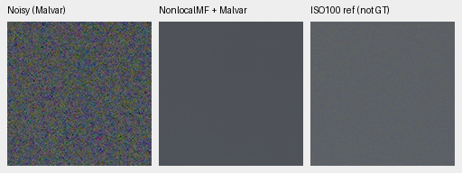
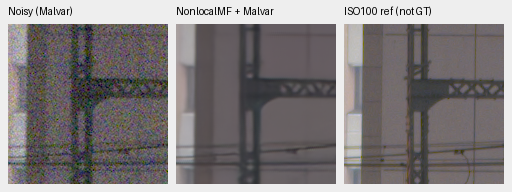
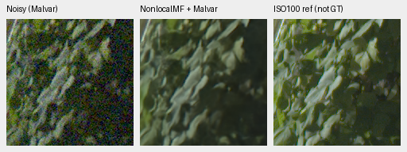
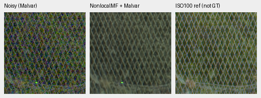
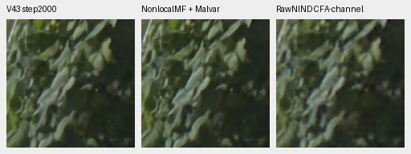
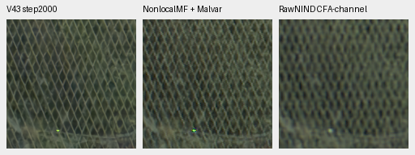

# Optional recent RAW reference and standing GFX comparison

Current architecture and recommendations: [current model guide](current-model.md).
The versioned study below retains its measured results and original protocol.

The genuine Nonlocal Match-Filter reference is callable from the photographic,
paired-RAW, analytic and GFX evaluators. Its CPU outputs reproduce the earlier
[two-photo probe](nonlocal-matchfilter-cpu-probe.md) bit for bit. The new standing
GFX crops show a different grain/detail tradeoff, without establishing a broad
winner over the V43 reference used in this study.
[Complete loader, test, preflight and native-review evidence](results/nonlocal-reference-integration-cpu.json).

This remains the authors' released **RAW denoiser followed by independent Malvar**,
with the same checkpoint SHA256
`b31bc8e21022389b0b209a9d1e6649485ed4dacc552b7ea04612df5f7515fcf2`.
It is not another trained joint RGB model. No output gains or reference fitting
are added. Source/license/build provenance is in the earlier probe and receipt.

## Callable evaluator

[The optional loader](../src/demosaic/nonlocal_reference.py) verifies source and
weight hashes, strictly loads all 141 released tensors, and imports the actual
compiled dependencies. The previously unused PatchMatch import now resolves
to its genuine pinned implementation; no import declaration or numerical
substitute is needed. Nothing installs into the active environment at inference.
The existing external cache includes the verified sources, weights, build
drivers and receipts. This option is off unless explicitly requested.

All four Bayer patterns map TL/TR/BL/BR to the authors' RGBG convention and back.
Input RAW is clipped to [0,1], with standard-deviation maps computed only from
that input and the declared shot/read coefficients. Output clipping and
independent WB-aware Malvar match the verified pilot. Computation stays IEEE
FP32, including under an enclosing autocast context. Native network calls use
batch 1; a mixed-CFA outer batch matches serial calls exactly. The wrapper
retains adjacent 16-bit code values and requires explicit noise conditioning.

`--nonlocal-reference DIRECTORY` is available in `demosaic quality`,
`scripts/evaluate_paired_raw.py`, `scripts/evaluate_texture_candidates.py` and
`scripts/report_raw_pair.py`, plus `scripts/compare_raw_crops.py` for the other
cached personal cameras. The paired evaluator API also accepts
`nonlocal_reference=DIRECTORY` with `device="cpu"`.

A bounded CPU check on this machine uses the prepared cache:

```bash
source scripts/env.sh
uv run --no-sync demosaic quality /mnt/external/demosaic/models/v43-step2000.pt \
  --manifest /mnt/external/demosaic/evaluation/manifests/common-8192-44732-val-v1.jsonl \
  --nonlocal-reference /mnt/external/demosaic/references/nonlocal-matchfilter/availability-20261016-v1 \
  --device cpu --precision float32 --limit 2 --synthetic-count 0 \
  --output /mnt/external/demosaic/evaluation/nonlocal-reference-user-check
```

The completed mechanical preflight covers two photographic sources across all
seven conditions/four CFAs, plus two selected crops from one registered real
development pair. It verifies evaluator loading and traceability; those subsets
are not a full427 or representative paired-camera comparison. The full CPU
suite passed 500 tests with eight CUDA skips. After adding the CUDA stream
restriction, all 12 targeted CPU contract tests pass with one CUDA test skipped.
The final callable again reproduces both earlier full 256px predictions exactly.

The [completed actual CUDA preflight](results/nonlocal-reference-cuda-preflight.json)
now verifies the genuine native operator and author network on GB10 after the
V58 owner's successful exit. All 509 CUDA-enabled tests pass without skips in
82.18 seconds. Three operator neighborhoods have exact CPU/CUDA forward values;
maximum input/offset gradient differences are 3.34e-6 / 9.54e-7. The two saved
native 256px photo predictions differ from the genuine CPU network by at most
1.26e-6, within the predeclared atol/rtol 1e-4. Independent saved-array checks
rebuild both maximum differences exactly. Enclosing FP16 and BF16 autocast
predictions are bit-exact to the wrapper's FP32 output. This is engineering
validation on two observations, not representative quality or speed evidence.

The pinned CUDA sampling kernels launch on stream 0; the wrapper's nondefault
stream rejection is actually exercised. The
[preflight driver](../scripts/preflight_nonlocal_reference.py) had also exercised
live-owner rejection before CUDA initialization or output creation.

The [source-pinned full workflow](results/nonlocal-reference-full-launch.json)
has completed in detached `06e6133`. Controller 1016386 verified V58's actual
exit, passed all tests/preflight, completed every planned panel and exited
successfully. The [complete reference review](nonlocal-reference-full-review.md)
now includes independent score/control checks, all selected native comparisons
and full RGB16 integrity. Paired-real means are slightly higher but uncertain;
synthetic-photo scores are lower, detail remains soft, and the
[colored-field CPU diagnostic](nonlocal-reference-colored-flats.md) exposes a
magenta grid/color failure. V43 was the reference for this experiment.
No training, current recipe or protected-final scoring changes.

The same two high-noise synthetic observations retain exact simulated GT.
These native triplets are reproduced unchanged by the callable: RGGB,
shot .00256/read variance .0000262144, WB[2,1,1.5], original matrix and
display×1. The source, binned-source ROI, checkpoint hash and input SHA are
recorded in the linked pilot and receipt.


## Same four GFX regions, no source-RAW decode

These runs reuse the eight verified noisy/reference arrays from the
[standing GFX CPU contexts](gfx-none10k-cpu-context-review.md). Each restored
context is 512×512 and each displayed panel 160×160 at native 100% scale. No
resize, warp, sharpening, per-method exposure or new coordinate selection occurs.
All noisy and independent-reference panel pixels match the parent exactly.

DSCF3879 is ISO6400/f1.7/1/240s; DSCF3880 is ISO100/f5.6/3s, captured 3m38s later.
The last panel is an independently AHD-demosaiced, separately exposed qualitative
reference, **not GT**. Aperture, motion, lighting and framing still differ.
No pixelwise reference score is calculated. Both captures and siblings remain
outside training; their source files are untouched.

Shared display exposure×4/+2EV, WB[1.513245033,1,2.215231788] and the original
GFX matrix apply to every method. Input-only Haar conditioning remains
shot `.0014635775921166604`, read variance `.0000010715704128646712`.

| Region | Noisy ROI[x,y,w,h] | Independent-reference ROI |
| --- | --- | --- |
| Sky | [5800,1400,160,160] | [5800,1400,160,160] |
| Building/truss | [5790,2690,160,160] | [5791,2690,160,160] |
| Foliage | [8890,5570,160,160] | [8890,5570,160,160] |
| Chain-link fence | [2240,6000,160,160] | [2241,6000,160,160] |

Noisy Malvar → Nonlocal Match-Filter + Malvar → separate ISO100 reference:









The sky becomes uniform, while fine truss structure remains soft. Foliage has
varying edge detail and remains softer than the separate reference. In the fence,
the new reference retains more grain and less regular wires than V43; RawNIND's
mesh is more blurred. These are qualitative observations on this scene.

Supplementary rows below contain **three restored methods**, with no GT panel:
V43 step2000 → Nonlocal Match-Filter + Malvar → RawNIND with input-only per-channel
CFA-LS calibration. They copy the parent method pixels exactly.





All six new PNGs were actually viewed. Four full float32 context predictions
pass SHA/dtype/shape/finite checks; all 18 displayed panels rerender or copy their
recorded parent pixels exactly. Three additional preflight PNGs were viewed.
No CUDA context was initialized. This check supplies no new 102MP output, seam
assessment, full-frame speed result, protected-final score or model promotion.
