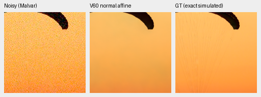
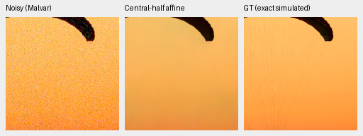
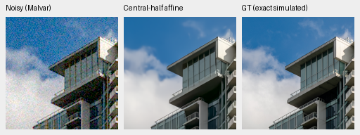
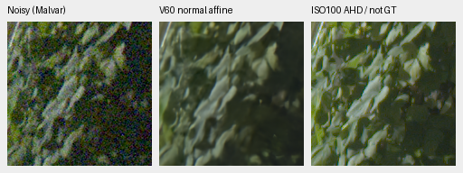
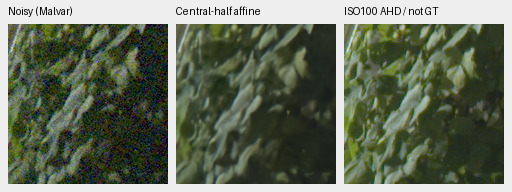
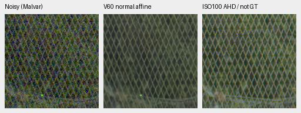
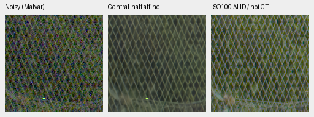

# Normalization dependence and an opt-in training augmentation

The [original20k control error decomposition](control-original20k-error-decomposition.md)
adds a concrete follow-up target: mean color bias accounts for88.36% of the
selected fabric example's added camera-RGB MSE, and coarse spatial error accounts
for another10.53%. The [completed two-arm20k review](long-commons-v63-v64-original20k-review.md)
also retains saturated-color bias and weak-texture failures. This does not
establish normalization as their cause or show that the opt-in augmentation
improves quality. Its GPU quality comparison remains pending.

Selected mature V60 predictions depend strongly on the region used to calculate
their affine feature coordinates. With identical RAW, dimensions, noise profile,
CFA, WB/matrix, DINO preview and weights, using central-half statistics shifts the
fabric ROI's red-channel mean by −.01130 and lowers its border-trimmed photo PSNR
by 2.106 dB. The building and standing GFX examples change much less. This is a
learned-coordinate dependency; it does not establish the cause of all soft detail.
[Executed eight-pair diagnosis, independent arithmetic and sixteen actual native views](results/affine-context-CPU-v1.json).

The new `normalization_augmentation: center-half-mix-v1` training option exposes
the model to both coordinate choices while retaining the original observation
and target. CPU checks use genuine V60/DINO weights; the
[completed production-size CUDA preflight and matched V68/V69 trial](normalization-trial-v68-v69.md)
use the genuine V63 original20k EMA. Trained quality is pending. The original
V63/V64 schedules/reports remain preserved; the new trial changes only training
normalization within its matched arms.

## Isolated diagnostic

The existing [physical round-trip check](physical-frontend-color-check.md) found
small arithmetic error without the CNN. This experiment instead rebuilds the
normalized RGB, noise map, measured-CFA coordinates and physical anchors with
offset/span calculated on the central half of the already transformed RGB
canvas. The full image and DINO input remain fixed. It measures the interaction
with learned reconstruction. This is not actual smaller-field-of-view inference.

Both coordinate choices use the existing min/max and eight-sigma floor formula.
The fixed intervention was declared before inference, without target/reference
fitting or a footprint sweep. Central statistics can put full-context normalized
features outside [0,1]: at most .1221% here. That is a feature-coordinate change,
without new RAW clipping. It limits any interpretation as an alternative policy.

| Saved observation | ROI camera-RGB RMS change | Maximum channel-mean change | Exact-target sRGB PSNR, original → central |
| --- | ---: | ---: | --- |
| Fabric photograph | .007803 | .011298 | 33.03371 → 30.92785 |
| Building photograph | .0000426 | .00000338 | 35.67939 → 35.67964 |
| Uniform orange | .006718 | .010898 | 27.80115 → 29.14532 |
| Uniform magenta | .001026 | .001539 | 32.99239 → 33.43128 |
| GFX sky | .0000421 | .0000431 | Independent reference, no score |
| GFX building | .0000943 | .0000531 | Independent reference, no score |
| GFX foliage | .0000161 | .00000759 | Independent reference, no score |
| GFX fence | .000394 | .0000812 | Independent reference, no score |

Each PSNR uses the full native 256 observation with an eight-pixel border trim;
delta statistics use the separate native 160 ROI. No aggregate ranking is made
from these selected examples. For fabric, transformed offset/span change from
−7.0749/37.7209 to −6.5195/35.1674. A favorable shift on a uniform color does not
justify changing photographic inference normalization.

All sixteen forwards use CPU FP32/contiguous/B1/two threads. Every fresh baseline
equals its retained prediction bitwise. Actual model/DINO state and Torch RNG
stay unchanged; the temporary hook is restored. Direct cropped-feature checks
match exactly. Independent NumPy checks cover forty camera-delta scalars,
forty-eight affine-statistic scalars and sixteen PSNR values; maximum differences
are 9.02e−16, 2.43e−12 and .0000107 dB. The centered GAT formula is independent;
the MHC rasterizer and direct feature-crop comparison reuse production code.

## Native photographic and real-camera views

Checkpoint SHA256:
`1e9812afcfaa5322593c9d2c2314fa0d8ae5458c4e116be0f516c992c880b47e`.
Photo ROI `[48,48,160,160]`, RGGB, shot=.00256/read variance=.0000262144,
WB `[2,1,1.5]`, original protocol matrix, display ×1/0EV. Each panel is native
160×160, never resized. Noisy Malvar → method → exact saved simulated GT;
PNGs are 8-bit previews. Source/ROI/checkpoint/noise/display metadata accompany
all sixteen images in the receipt.

Fabric, ordinary then central-half coordinates:





Building, ordinary then central-half coordinates:




Sources: [Roy Egloff](https://commons.wikimedia.org/wiki/File:CH.VD.Villeneuve_2007-08-25_Vertigo-Swiss-Riviera_2392_3x2-R_4K.jpg)
and [Dietmar Rabich](https://commons.wikimedia.org/wiki/File:Vancouver_(BC,_Canada),_Coal_Harbour_Seaside_Park,_Blick_in_den_Himmel_--_2022_--_2158.jpg),
[CC BY-SA4.0](https://creativecommons.org/licenses/by-sa/4.0/), modified by binning,
crop, simulated noise and restoration. Missing fabric cords and softened clouds
remain. The uniform-color views still show coarse variation.

GFX comparisons use cached 512 contexts and native 160 sensor ROIs: foliage
`[8890,5570,160,160]`, fence `[2240,6000,160,160]` with reference x2241. Shared
display ×4/+2EV, shot=.0014635775921166604/read variance=.0000010715704128646712;
full WB/matrix/source hashes are in the receipt. DSCF3879 ISO6400/f1.7 versus
independently AHD-demosaiced DSCF3880 ISO100/f5.6, 3m38s later: aperture and motion
differ, so the last panel is a qualitative reference, **not GT**. No RAW decode,
cold-drive read or real-reference scoring is performed.

Foliage, ordinary then central-half coordinates:





Fence, ordinary then central-half coordinates:





These look nearly unchanged and remain soft. The diagnostic identifies a
selected color-stability issue, without a demonstrated real-detail repair.

## Training option and verification

```yaml
normalization_augmentation: center-half-mix-v1
```

The default is `none`. The option requires stabilized, physically anchored,
full-resolution pretrained RGB training, without a RAW-kernel head. For each
global step and image position, a SHAKE256 bit stream keyed by seed/step chooses
central-half statistics with probability one half. The choice consumes no Python,
Torch or CUDA RNG. Unselected images retain their original coordinates. RAW,
variance, CFA, target and DINO preview are unchanged, with one neural forward.
The selected-domain loader and 4×→geometry/PSF→area2 path remain the same.

The mask is an explicit training-forward argument, recorded at training log steps and
rejected in evaluation mode. No persistent parameters/buffers or model-config
fields are added; ordinary checkpoint inference uses the original full-context
normalization. Resume rejects a changed training policy. The option permits
learning coordinate robustness; it does not guarantee invariant predictions.

The genuine-parent CPU check uses four discarded updates in each arm, B1/native
64/FP32/workers0, an unchanged planned 4k horizon, original Commons/native128/
paired32 data and genuine frozen DINO. Actual masks select the first Commons,
native and paired updates and leave the second Commons update unselected.
Policy-off and policy-on input hashes match at all four updates. Both augmented
4-update and 2+2 resumed runs match model/EMA/AdamW/RNG/best exactly, with finite
91 model/91 EMA/89 optimizer states. Original-parent default/zero-mask forwards
and retained original CPU pixels match bitwise before updates. All 89 model and
EMA parameter tensors update in each fixture. Independent saved-state replay
also checks unchanged control/augmentation RNG and a finite ordinary EMA-loader
prediction. The complete CPU suite passes 579 tests, with 9 CUDA tests skipped.
[Actual preflight, independent artifact audit and test receipt](results/normalization-augmentation-preparation.json).
These small checks are engineering evidence, not trained quality.

Reproduce with a new output directory:

```bash
source scripts/env.sh
CUDA_VISIBLE_DEVICES='' HF_HUB_OFFLINE=1 uv run --no-sync python \
  scripts/preflight_normalization_augmentation.py \
  --config configs/dino-convnext-wide-long-control-full20k-b16-v63.yaml \
  --initialize /mnt/external/demosaic/models/dino-convnext-palette-wide-b16-v60-step4000.pt \
  --output /mnt/external/demosaic/benchmarks/CHOOSE-NEW-NORMALIZATION-CHECK
```

The matched quality trial retains a control and must review exact-target
photos, colors, paired data and native real crops. GPU/BF16 engineering checks
have now passed; a full trained-quality review remains before promotion.
