# Normalization first1k: all81 native crop triplets

[Performance report](normalization-v68-v69-first1k-review.md) · [Full metadata and hashes](results/normalization-v68-v69-first1k-review.json).

All81 originals were actually viewed. Each panel is160×160, one image pixel per PNG pixel, with no resizing. Open original PNGs at100%. Noisy/restored/reference coordinates and display transforms match across methods. Exact configured GT applies only to simulated/analytic cases; AHD, ISO100 and RawNIND are labeled qualitative/approximate. Source attribution and licenses are in the performance report and metadata.

## full427 / 0014aa4e075b1827f91ef8a02069e1e318f040ba

V63 parent20k; checkpoint SHA256`ed70952dd33c5d7da39199bf1306b58b579862920fb0cccd6b222f19871bc9b5`.

Metadata: `{"source_id":"0014aa4e075b1827f91ef8a02069e1e318f040ba","source":{"title":"File:CH.VD.Villeneuve 2007-08-25 Vertigo-Swiss-Riviera 2392 3x2-R 4K.jpg","page_url":"https://commons.wikimedia.org/wiki/File:CH.VD.Villeneuve_2007-08-25_Vertigo-Swiss-Riviera_2392_3x2-R_4K.jpg","original_url":"https://upload.wikimedia.org/wikipedia/commons/f/fa/CH.VD.Villeneuve_2007-08-25_Vertigo-Swiss-Riviera_2392_3x2-R_4K.jpg?utm_source=commons.wikimedia.org&utm_campaign=imageinfo&utm_content=original","author":"Roy Egloff","license":"CC BY-SA 4.0","license_url":"https://creativecommons.org/licenses/by-sa/4.0","attribution":null,"credit":"Own work","sha1":"0014aa4e075b1827f91ef8a02069e1e318f040ba","sha1_hex":"0014aa4e075b1827f91ef8a02069e1e318f040ba","download_path":"images/00/14/0014aa4e075b1827f91ef8a02069e1e318f040ba.jpg","width":3888,"height":2592,"id":"0014aa4e075b1827f91ef8a02069e1e318f040ba","split":"val","bin_factor":8,"color_space":"linear-sRGB","dtype":"uint16","cache":"/mnt/external/demosaic/commons-v1/images/00/0014aa4e075b1827f91ef8a02069e1e318f040ba.npy","shape":[324,486,3],"cache_sha256":"ee304db7fa1347a65afe4b127012c924580305c99c3aedfa3508255800970be8"},"condition":{"name":"iso12800-prior","shot":0.00256,"read":2.62144e-05,"exposure":1.0},"display_exposure":1.0,"reference":"Exact synthetic clean target"}`.

V68 control1k; checkpoint SHA256`456a5fb245bc807d91470cbb067e137ea48ace8eb5796a3d6ad9218573d9ad0c`.

Metadata: `{"source_id":"0014aa4e075b1827f91ef8a02069e1e318f040ba","source":{"title":"File:CH.VD.Villeneuve 2007-08-25 Vertigo-Swiss-Riviera 2392 3x2-R 4K.jpg","page_url":"https://commons.wikimedia.org/wiki/File:CH.VD.Villeneuve_2007-08-25_Vertigo-Swiss-Riviera_2392_3x2-R_4K.jpg","original_url":"https://upload.wikimedia.org/wikipedia/commons/f/fa/CH.VD.Villeneuve_2007-08-25_Vertigo-Swiss-Riviera_2392_3x2-R_4K.jpg?utm_source=commons.wikimedia.org&utm_campaign=imageinfo&utm_content=original","author":"Roy Egloff","license":"CC BY-SA 4.0","license_url":"https://creativecommons.org/licenses/by-sa/4.0","attribution":null,"credit":"Own work","sha1":"0014aa4e075b1827f91ef8a02069e1e318f040ba","sha1_hex":"0014aa4e075b1827f91ef8a02069e1e318f040ba","download_path":"images/00/14/0014aa4e075b1827f91ef8a02069e1e318f040ba.jpg","width":3888,"height":2592,"id":"0014aa4e075b1827f91ef8a02069e1e318f040ba","split":"val","bin_factor":8,"color_space":"linear-sRGB","dtype":"uint16","cache":"/mnt/external/demosaic/commons-v1/images/00/0014aa4e075b1827f91ef8a02069e1e318f040ba.npy","shape":[324,486,3],"cache_sha256":"ee304db7fa1347a65afe4b127012c924580305c99c3aedfa3508255800970be8"},"condition":{"name":"iso12800-prior","shot":0.00256,"read":2.62144e-05,"exposure":1.0},"display_exposure":1.0,"reference":"Exact synthetic clean target"}`.

V69 augmented1k; checkpoint SHA256`6f34be8b2cc4fbba1116b4ed17bbafe41d5526da928238d194b6355b9b8b665c`.

Metadata: `{"source_id":"0014aa4e075b1827f91ef8a02069e1e318f040ba","source":{"title":"File:CH.VD.Villeneuve 2007-08-25 Vertigo-Swiss-Riviera 2392 3x2-R 4K.jpg","page_url":"https://commons.wikimedia.org/wiki/File:CH.VD.Villeneuve_2007-08-25_Vertigo-Swiss-Riviera_2392_3x2-R_4K.jpg","original_url":"https://upload.wikimedia.org/wikipedia/commons/f/fa/CH.VD.Villeneuve_2007-08-25_Vertigo-Swiss-Riviera_2392_3x2-R_4K.jpg?utm_source=commons.wikimedia.org&utm_campaign=imageinfo&utm_content=original","author":"Roy Egloff","license":"CC BY-SA 4.0","license_url":"https://creativecommons.org/licenses/by-sa/4.0","attribution":null,"credit":"Own work","sha1":"0014aa4e075b1827f91ef8a02069e1e318f040ba","sha1_hex":"0014aa4e075b1827f91ef8a02069e1e318f040ba","download_path":"images/00/14/0014aa4e075b1827f91ef8a02069e1e318f040ba.jpg","width":3888,"height":2592,"id":"0014aa4e075b1827f91ef8a02069e1e318f040ba","split":"val","bin_factor":8,"color_space":"linear-sRGB","dtype":"uint16","cache":"/mnt/external/demosaic/commons-v1/images/00/0014aa4e075b1827f91ef8a02069e1e318f040ba.npy","shape":[324,486,3],"cache_sha256":"ee304db7fa1347a65afe4b127012c924580305c99c3aedfa3508255800970be8"},"condition":{"name":"iso12800-prior","shot":0.00256,"read":2.62144e-05,"exposure":1.0},"display_exposure":1.0,"reference":"Exact synthetic clean target"}`.

## full427 / 002fc6eeadf637e81d5a327f117b79abb86becd9

V63 parent20k; checkpoint SHA256`ed70952dd33c5d7da39199bf1306b58b579862920fb0cccd6b222f19871bc9b5`.

Metadata: `{"source_id":"002fc6eeadf637e81d5a327f117b79abb86becd9","source":{"title":"File:Vancouver (BC, Canada), Coal Harbour Seaside Park, Blick in den Himmel -- 2022 -- 2158.jpg","page_url":"https://commons.wikimedia.org/wiki/File:Vancouver_(BC,_Canada),_Coal_Harbour_Seaside_Park,_Blick_in_den_Himmel_--_2022_--_2158.jpg","original_url":"https://upload.wikimedia.org/wikipedia/commons/7/71/Vancouver_%28BC%2C_Canada%29%2C_Coal_Harbour_Seaside_Park%2C_Blick_in_den_Himmel_--_2022_--_2158.jpg?utm_source=commons.wikimedia.org&utm_campaign=imageinfo&utm_content=original","author":"Dietmar Rabich","license":"CC BY-SA 4.0","license_url":"https://creativecommons.org/licenses/by-sa/4.0","attribution":"Dietmar Rabich","credit":"Own work","sha1":"002fc6eeadf637e81d5a327f117b79abb86becd9","sha1_hex":"002fc6eeadf637e81d5a327f117b79abb86becd9","download_path":"images/00/2f/002fc6eeadf637e81d5a327f117b79abb86becd9.jpg","width":3809,"height":2857,"id":"002fc6eeadf637e81d5a327f117b79abb86becd9","split":"val","bin_factor":8,"color_space":"linear-sRGB","dtype":"uint16","cache":"/mnt/external/demosaic/commons-v1/images/00/002fc6eeadf637e81d5a327f117b79abb86becd9.npy","shape":[357,476,3],"cache_sha256":"0b5ccc2387535e14754b2fcb4236c5298c1e0a18c45d354047404e74e7a607bf"},"condition":{"name":"iso12800-prior","shot":0.00256,"read":2.62144e-05,"exposure":1.0},"display_exposure":1.0,"reference":"Exact synthetic clean target"}`.

V68 control1k; checkpoint SHA256`456a5fb245bc807d91470cbb067e137ea48ace8eb5796a3d6ad9218573d9ad0c`.

Metadata: `{"source_id":"002fc6eeadf637e81d5a327f117b79abb86becd9","source":{"title":"File:Vancouver (BC, Canada), Coal Harbour Seaside Park, Blick in den Himmel -- 2022 -- 2158.jpg","page_url":"https://commons.wikimedia.org/wiki/File:Vancouver_(BC,_Canada),_Coal_Harbour_Seaside_Park,_Blick_in_den_Himmel_--_2022_--_2158.jpg","original_url":"https://upload.wikimedia.org/wikipedia/commons/7/71/Vancouver_%28BC%2C_Canada%29%2C_Coal_Harbour_Seaside_Park%2C_Blick_in_den_Himmel_--_2022_--_2158.jpg?utm_source=commons.wikimedia.org&utm_campaign=imageinfo&utm_content=original","author":"Dietmar Rabich","license":"CC BY-SA 4.0","license_url":"https://creativecommons.org/licenses/by-sa/4.0","attribution":"Dietmar Rabich","credit":"Own work","sha1":"002fc6eeadf637e81d5a327f117b79abb86becd9","sha1_hex":"002fc6eeadf637e81d5a327f117b79abb86becd9","download_path":"images/00/2f/002fc6eeadf637e81d5a327f117b79abb86becd9.jpg","width":3809,"height":2857,"id":"002fc6eeadf637e81d5a327f117b79abb86becd9","split":"val","bin_factor":8,"color_space":"linear-sRGB","dtype":"uint16","cache":"/mnt/external/demosaic/commons-v1/images/00/002fc6eeadf637e81d5a327f117b79abb86becd9.npy","shape":[357,476,3],"cache_sha256":"0b5ccc2387535e14754b2fcb4236c5298c1e0a18c45d354047404e74e7a607bf"},"condition":{"name":"iso12800-prior","shot":0.00256,"read":2.62144e-05,"exposure":1.0},"display_exposure":1.0,"reference":"Exact synthetic clean target"}`.

V69 augmented1k; checkpoint SHA256`6f34be8b2cc4fbba1116b4ed17bbafe41d5526da928238d194b6355b9b8b665c`.

Metadata: `{"source_id":"002fc6eeadf637e81d5a327f117b79abb86becd9","source":{"title":"File:Vancouver (BC, Canada), Coal Harbour Seaside Park, Blick in den Himmel -- 2022 -- 2158.jpg","page_url":"https://commons.wikimedia.org/wiki/File:Vancouver_(BC,_Canada),_Coal_Harbour_Seaside_Park,_Blick_in_den_Himmel_--_2022_--_2158.jpg","original_url":"https://upload.wikimedia.org/wikipedia/commons/7/71/Vancouver_%28BC%2C_Canada%29%2C_Coal_Harbour_Seaside_Park%2C_Blick_in_den_Himmel_--_2022_--_2158.jpg?utm_source=commons.wikimedia.org&utm_campaign=imageinfo&utm_content=original","author":"Dietmar Rabich","license":"CC BY-SA 4.0","license_url":"https://creativecommons.org/licenses/by-sa/4.0","attribution":"Dietmar Rabich","credit":"Own work","sha1":"002fc6eeadf637e81d5a327f117b79abb86becd9","sha1_hex":"002fc6eeadf637e81d5a327f117b79abb86becd9","download_path":"images/00/2f/002fc6eeadf637e81d5a327f117b79abb86becd9.jpg","width":3809,"height":2857,"id":"002fc6eeadf637e81d5a327f117b79abb86becd9","split":"val","bin_factor":8,"color_space":"linear-sRGB","dtype":"uint16","cache":"/mnt/external/demosaic/commons-v1/images/00/002fc6eeadf637e81d5a327f117b79abb86becd9.npy","shape":[357,476,3],"cache_sha256":"0b5ccc2387535e14754b2fcb4236c5298c1e0a18c45d354047404e74e7a607bf"},"condition":{"name":"iso12800-prior","shot":0.00256,"read":2.62144e-05,"exposure":1.0},"display_exposure":1.0,"reference":"Exact synthetic clean target"}`.

## known / 2pilesofplates

V63 parent20k; checkpoint SHA256`ed70952dd33c5d7da39199bf1306b58b579862920fb0cccd6b222f19871bc9b5`.

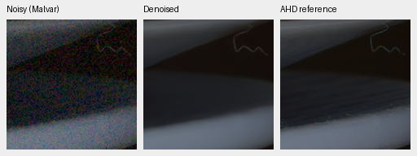

Metadata: `{"scene":"2pilesofplates","conditioning":{"shot":0.001425164014313677,"read":1.570807341075873e-06,"method":"input-only-Haar-fit","estimate":{"shot":0.001425164014313677,"read":1.570807341075873e-06,"reliable":true,"reason":"fit","candidate_patches":4096,"accepted_patches":3066,"intensity_span":0.11289423820562661,"reference_intensity":0.04300604201853275,"reference_variance":6.10495189903304e-05,"shot_interval":[0.001401216475477223,0.001451191419994426],"read_interval":[7.1832378857234e-07,2.0128426680637594e-06],"bins":[{"mean":0.009904302656650543,"variance":1.575388159835711e-05,"patches":192},{"mean":0.015269115101546049,"variance":2.3452917957911268e-05,"patches":192},{"mean":0.019404741004109383,"variance":2.85378464468522e-05,"patches":192},{"mean":0.024549812078475952,"variance":3.709991869982332e-05,"patches":192},{"mean":0.02950599230825901,"variance":4.5091836000210606e-05,"patches":192},{"mean":0.033303260803222656,"variance":4.973154682375025e-05,"patches":192},{"mean":0.037457238882780075,"variance":5.3862695494899526e-05,"patches":192},{"mean":0.04108747839927673,"variance":5.9306823459337465e-05,"patches":192},{"mean":0.04504532553255558,"variance":6.301554094534367e-05,"patches":192},{"mean":0.05010216683149338,"variance":7.077066402416676e-05,"patches":192},{"mean":0.061802107840776443,"variance":9.140941256191581e-05,"patches":191},{"mean":0.07137370854616165,"variance":0.00010577607463346794,"patches":191},{"mean":0.079582080245018,"variance":0.00011791579163400456,"patches":191},{"mean":0.08843494206666946,"variance":0.00012957565195392817,"patches":191},{"mean":0.09782949090003967,"variance":0.00014059861132409424,"patches":191},{"mean":0.15633051097393036,"variance":0.00022209645248949528,"patches":191}]}},"display_exposure":1.0,"reference":"Registered low-noise RAW, auxiliary LibRaw AHD RGB; primary scores use measured CFA"}`.

V68 control1k; checkpoint SHA256`456a5fb245bc807d91470cbb067e137ea48ace8eb5796a3d6ad9218573d9ad0c`.

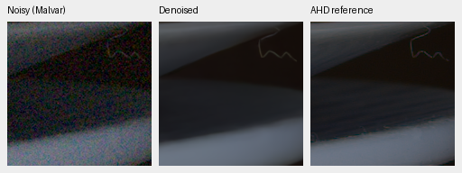

Metadata: `{"scene":"2pilesofplates","conditioning":{"shot":0.001425164014313677,"read":1.570807341075873e-06,"method":"input-only-Haar-fit","estimate":{"shot":0.001425164014313677,"read":1.570807341075873e-06,"reliable":true,"reason":"fit","candidate_patches":4096,"accepted_patches":3066,"intensity_span":0.11289423820562661,"reference_intensity":0.04300604201853275,"reference_variance":6.10495189903304e-05,"shot_interval":[0.001401216475477223,0.001451191419994426],"read_interval":[7.1832378857234e-07,2.0128426680637594e-06],"bins":[{"mean":0.009904302656650543,"variance":1.575388159835711e-05,"patches":192},{"mean":0.015269115101546049,"variance":2.3452917957911268e-05,"patches":192},{"mean":0.019404741004109383,"variance":2.85378464468522e-05,"patches":192},{"mean":0.024549812078475952,"variance":3.709991869982332e-05,"patches":192},{"mean":0.02950599230825901,"variance":4.5091836000210606e-05,"patches":192},{"mean":0.033303260803222656,"variance":4.973154682375025e-05,"patches":192},{"mean":0.037457238882780075,"variance":5.3862695494899526e-05,"patches":192},{"mean":0.04108747839927673,"variance":5.9306823459337465e-05,"patches":192},{"mean":0.04504532553255558,"variance":6.301554094534367e-05,"patches":192},{"mean":0.05010216683149338,"variance":7.077066402416676e-05,"patches":192},{"mean":0.061802107840776443,"variance":9.140941256191581e-05,"patches":191},{"mean":0.07137370854616165,"variance":0.00010577607463346794,"patches":191},{"mean":0.079582080245018,"variance":0.00011791579163400456,"patches":191},{"mean":0.08843494206666946,"variance":0.00012957565195392817,"patches":191},{"mean":0.09782949090003967,"variance":0.00014059861132409424,"patches":191},{"mean":0.15633051097393036,"variance":0.00022209645248949528,"patches":191}]}},"display_exposure":1.0,"reference":"Registered low-noise RAW, auxiliary LibRaw AHD RGB; primary scores use measured CFA"}`.

V69 augmented1k; checkpoint SHA256`6f34be8b2cc4fbba1116b4ed17bbafe41d5526da928238d194b6355b9b8b665c`.

Metadata: `{"scene":"2pilesofplates","conditioning":{"shot":0.001425164014313677,"read":1.570807341075873e-06,"method":"input-only-Haar-fit","estimate":{"shot":0.001425164014313677,"read":1.570807341075873e-06,"reliable":true,"reason":"fit","candidate_patches":4096,"accepted_patches":3066,"intensity_span":0.11289423820562661,"reference_intensity":0.04300604201853275,"reference_variance":6.10495189903304e-05,"shot_interval":[0.001401216475477223,0.001451191419994426],"read_interval":[7.1832378857234e-07,2.0128426680637594e-06],"bins":[{"mean":0.009904302656650543,"variance":1.575388159835711e-05,"patches":192},{"mean":0.015269115101546049,"variance":2.3452917957911268e-05,"patches":192},{"mean":0.019404741004109383,"variance":2.85378464468522e-05,"patches":192},{"mean":0.024549812078475952,"variance":3.709991869982332e-05,"patches":192},{"mean":0.02950599230825901,"variance":4.5091836000210606e-05,"patches":192},{"mean":0.033303260803222656,"variance":4.973154682375025e-05,"patches":192},{"mean":0.037457238882780075,"variance":5.3862695494899526e-05,"patches":192},{"mean":0.04108747839927673,"variance":5.9306823459337465e-05,"patches":192},{"mean":0.04504532553255558,"variance":6.301554094534367e-05,"patches":192},{"mean":0.05010216683149338,"variance":7.077066402416676e-05,"patches":192},{"mean":0.061802107840776443,"variance":9.140941256191581e-05,"patches":191},{"mean":0.07137370854616165,"variance":0.00010577607463346794,"patches":191},{"mean":0.079582080245018,"variance":0.00011791579163400456,"patches":191},{"mean":0.08843494206666946,"variance":0.00012957565195392817,"patches":191},{"mean":0.09782949090003967,"variance":0.00014059861132409424,"patches":191},{"mean":0.15633051097393036,"variance":0.00022209645248949528,"patches":191}]}},"display_exposure":1.0,"reference":"Registered low-noise RAW, auxiliary LibRaw AHD RGB; primary scores use measured CFA"}`.

## known / 7D-1

V63 parent20k; checkpoint SHA256`ed70952dd33c5d7da39199bf1306b58b579862920fb0cccd6b222f19871bc9b5`.

Metadata: `{"scene":"7D-1","conditioning":{"shot":0.004811973071234885,"read":6.621451009845082e-05,"method":"input-only-Haar-fit","estimate":{"shot":0.004811973071234885,"read":6.621451009845082e-05,"reliable":true,"reason":"fit","candidate_patches":4096,"accepted_patches":1453,"intensity_span":0.27435737997293463,"reference_intensity":0.12920920550823212,"reference_variance":0.0006928789662197232,"shot_interval":[0.0044978704529584825,0.005009805981911022],"read_interval":[4.824885318210063e-05,0.00011607347588089777],"bins":[{"mean":0.0434560552239418,"variance":0.00025572895538061857,"patches":91},{"mean":0.05798434466123581,"variance":0.0003326775331515819,"patches":91},{"mean":0.06499770283699036,"variance":0.0003967982775066048,"patches":91},{"mean":0.0739697515964508,"variance":0.0004433743597473949,"patches":91},{"mean":0.0837249606847763,"variance":0.0004850530531257391,"patches":91},{"mean":0.0951637476682663,"variance":0.0005445044371299446,"patches":91},{"mean":0.10861015319824219,"variance":0.00060031667817384,"patches":91},{"mean":0.12333296239376068,"variance":0.0006808409816585481,"patches":91},{"mean":0.13387498259544373,"variance":0.0007385513745248318,"patches":91},{"mean":0.14330899715423584,"variance":0.0007729700300842524,"patches":91},{"mean":0.15605947375297546,"variance":0.0008342682849615812,"patches":91},{"mean":0.16992981731891632,"variance":0.0008656613063067198,"patches":91},{"mean":0.19597478210926056,"variance":0.000990415341220796,"patches":91},{"mean":0.2349516674876213,"variance":0.0011563157313503325,"patches":90},{"mean":0.2859645336866379,"variance":0.0013906416133977473,"patches":90},{"mean":0.3511311560869217,"variance":0.001681389519944787,"patches":90}]}},"display_exposure":1.0,"reference":"Registered low-noise RAW, auxiliary LibRaw AHD RGB; primary scores use measured CFA"}`.

V68 control1k; checkpoint SHA256`456a5fb245bc807d91470cbb067e137ea48ace8eb5796a3d6ad9218573d9ad0c`.

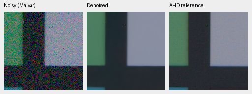

Metadata: `{"scene":"7D-1","conditioning":{"shot":0.004811973071234885,"read":6.621451009845082e-05,"method":"input-only-Haar-fit","estimate":{"shot":0.004811973071234885,"read":6.621451009845082e-05,"reliable":true,"reason":"fit","candidate_patches":4096,"accepted_patches":1453,"intensity_span":0.27435737997293463,"reference_intensity":0.12920920550823212,"reference_variance":0.0006928789662197232,"shot_interval":[0.0044978704529584825,0.005009805981911022],"read_interval":[4.824885318210063e-05,0.00011607347588089777],"bins":[{"mean":0.0434560552239418,"variance":0.00025572895538061857,"patches":91},{"mean":0.05798434466123581,"variance":0.0003326775331515819,"patches":91},{"mean":0.06499770283699036,"variance":0.0003967982775066048,"patches":91},{"mean":0.0739697515964508,"variance":0.0004433743597473949,"patches":91},{"mean":0.0837249606847763,"variance":0.0004850530531257391,"patches":91},{"mean":0.0951637476682663,"variance":0.0005445044371299446,"patches":91},{"mean":0.10861015319824219,"variance":0.00060031667817384,"patches":91},{"mean":0.12333296239376068,"variance":0.0006808409816585481,"patches":91},{"mean":0.13387498259544373,"variance":0.0007385513745248318,"patches":91},{"mean":0.14330899715423584,"variance":0.0007729700300842524,"patches":91},{"mean":0.15605947375297546,"variance":0.0008342682849615812,"patches":91},{"mean":0.16992981731891632,"variance":0.0008656613063067198,"patches":91},{"mean":0.19597478210926056,"variance":0.000990415341220796,"patches":91},{"mean":0.2349516674876213,"variance":0.0011563157313503325,"patches":90},{"mean":0.2859645336866379,"variance":0.0013906416133977473,"patches":90},{"mean":0.3511311560869217,"variance":0.001681389519944787,"patches":90}]}},"display_exposure":1.0,"reference":"Registered low-noise RAW, auxiliary LibRaw AHD RGB; primary scores use measured CFA"}`.

V69 augmented1k; checkpoint SHA256`6f34be8b2cc4fbba1116b4ed17bbafe41d5526da928238d194b6355b9b8b665c`.

Metadata: `{"scene":"7D-1","conditioning":{"shot":0.004811973071234885,"read":6.621451009845082e-05,"method":"input-only-Haar-fit","estimate":{"shot":0.004811973071234885,"read":6.621451009845082e-05,"reliable":true,"reason":"fit","candidate_patches":4096,"accepted_patches":1453,"intensity_span":0.27435737997293463,"reference_intensity":0.12920920550823212,"reference_variance":0.0006928789662197232,"shot_interval":[0.0044978704529584825,0.005009805981911022],"read_interval":[4.824885318210063e-05,0.00011607347588089777],"bins":[{"mean":0.0434560552239418,"variance":0.00025572895538061857,"patches":91},{"mean":0.05798434466123581,"variance":0.0003326775331515819,"patches":91},{"mean":0.06499770283699036,"variance":0.0003967982775066048,"patches":91},{"mean":0.0739697515964508,"variance":0.0004433743597473949,"patches":91},{"mean":0.0837249606847763,"variance":0.0004850530531257391,"patches":91},{"mean":0.0951637476682663,"variance":0.0005445044371299446,"patches":91},{"mean":0.10861015319824219,"variance":0.00060031667817384,"patches":91},{"mean":0.12333296239376068,"variance":0.0006808409816585481,"patches":91},{"mean":0.13387498259544373,"variance":0.0007385513745248318,"patches":91},{"mean":0.14330899715423584,"variance":0.0007729700300842524,"patches":91},{"mean":0.15605947375297546,"variance":0.0008342682849615812,"patches":91},{"mean":0.16992981731891632,"variance":0.0008656613063067198,"patches":91},{"mean":0.19597478210926056,"variance":0.000990415341220796,"patches":91},{"mean":0.2349516674876213,"variance":0.0011563157313503325,"patches":90},{"mean":0.2859645336866379,"variance":0.0013906416133977473,"patches":90},{"mean":0.3511311560869217,"variance":0.001681389519944787,"patches":90}]}},"display_exposure":1.0,"reference":"Registered low-noise RAW, auxiliary LibRaw AHD RGB; primary scores use measured CFA"}`.

## unseen / LucieB_3apples

V63 parent20k; checkpoint SHA256`ed70952dd33c5d7da39199bf1306b58b579862920fb0cccd6b222f19871bc9b5`.

Metadata: `{"scene":"LucieB_3apples","conditioning":{"shot":0.0023020145669588325,"read":5.020910101285205e-05,"method":"input-only-Haar-fit","estimate":{"shot":0.0023020145669588325,"read":5.020910101285205e-05,"reliable":true,"reason":"fit","candidate_patches":4096,"accepted_patches":2179,"intensity_span":0.26184514854103325,"reference_intensity":0.06364081054925919,"reference_variance":0.00020263275655452162,"shot_interval":[0.0021055881961980273,0.002529057494860391],"read_interval":[3.950000272599639e-05,6.403357839379571e-05],"bins":[{"mean":0.024905603379011154,"variance":9.725704148877412e-05,"patches":137},{"mean":0.028337951749563217,"variance":0.00011527248716447502,"patches":137},{"mean":0.03277125954627991,"variance":0.0001205114385811612,"patches":137},{"mean":0.037343623116612434,"variance":0.00013657450472237542,"patches":136},{"mean":0.042015191167593,"variance":0.00015514064580202103,"patches":136},{"mean":0.048172976821660995,"variance":0.0001670044002821669,"patches":136},{"mean":0.05408396199345589,"variance":0.00017970892076846212,"patches":136},{"mean":0.06046304479241371,"variance":0.00019921286730095744,"patches":136},{"mean":0.06593036651611328,"variance":0.00020608177146641538,"patches":136},{"mean":0.07145505398511887,"variance":0.00022196234203875065,"patches":136},{"mean":0.07783377543091774,"variance":0.00023936464276630431,"patches":136},{"mean":0.08975507318973541,"variance":0.000266207498498261,"patches":136},{"mean":0.10335686802864075,"variance":0.0002986309555126354,"patches":136},{"mean":0.1205376461148262,"variance":0.0003312686749268323,"patches":136},{"mean":0.23012421280145645,"variance":0.0005683678318746388,"patches":136},{"mean":0.31927336752414703,"variance":0.0006947826768737286,"patches":136}]}},"display_exposure":1.0,"reference":"Registered low-noise RAW, auxiliary LibRaw AHD RGB; primary scores use measured CFA"}`.

V68 control1k; checkpoint SHA256`456a5fb245bc807d91470cbb067e137ea48ace8eb5796a3d6ad9218573d9ad0c`.

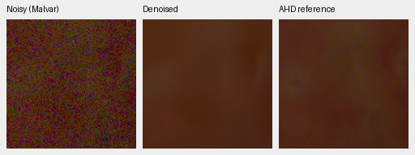

Metadata: `{"scene":"LucieB_3apples","conditioning":{"shot":0.0023020145669588325,"read":5.020910101285205e-05,"method":"input-only-Haar-fit","estimate":{"shot":0.0023020145669588325,"read":5.020910101285205e-05,"reliable":true,"reason":"fit","candidate_patches":4096,"accepted_patches":2179,"intensity_span":0.26184514854103325,"reference_intensity":0.06364081054925919,"reference_variance":0.00020263275655452162,"shot_interval":[0.0021055881961980273,0.002529057494860391],"read_interval":[3.950000272599639e-05,6.403357839379571e-05],"bins":[{"mean":0.024905603379011154,"variance":9.725704148877412e-05,"patches":137},{"mean":0.028337951749563217,"variance":0.00011527248716447502,"patches":137},{"mean":0.03277125954627991,"variance":0.0001205114385811612,"patches":137},{"mean":0.037343623116612434,"variance":0.00013657450472237542,"patches":136},{"mean":0.042015191167593,"variance":0.00015514064580202103,"patches":136},{"mean":0.048172976821660995,"variance":0.0001670044002821669,"patches":136},{"mean":0.05408396199345589,"variance":0.00017970892076846212,"patches":136},{"mean":0.06046304479241371,"variance":0.00019921286730095744,"patches":136},{"mean":0.06593036651611328,"variance":0.00020608177146641538,"patches":136},{"mean":0.07145505398511887,"variance":0.00022196234203875065,"patches":136},{"mean":0.07783377543091774,"variance":0.00023936464276630431,"patches":136},{"mean":0.08975507318973541,"variance":0.000266207498498261,"patches":136},{"mean":0.10335686802864075,"variance":0.0002986309555126354,"patches":136},{"mean":0.1205376461148262,"variance":0.0003312686749268323,"patches":136},{"mean":0.23012421280145645,"variance":0.0005683678318746388,"patches":136},{"mean":0.31927336752414703,"variance":0.0006947826768737286,"patches":136}]}},"display_exposure":1.0,"reference":"Registered low-noise RAW, auxiliary LibRaw AHD RGB; primary scores use measured CFA"}`.

V69 augmented1k; checkpoint SHA256`6f34be8b2cc4fbba1116b4ed17bbafe41d5526da928238d194b6355b9b8b665c`.

Metadata: `{"scene":"LucieB_3apples","conditioning":{"shot":0.0023020145669588325,"read":5.020910101285205e-05,"method":"input-only-Haar-fit","estimate":{"shot":0.0023020145669588325,"read":5.020910101285205e-05,"reliable":true,"reason":"fit","candidate_patches":4096,"accepted_patches":2179,"intensity_span":0.26184514854103325,"reference_intensity":0.06364081054925919,"reference_variance":0.00020263275655452162,"shot_interval":[0.0021055881961980273,0.002529057494860391],"read_interval":[3.950000272599639e-05,6.403357839379571e-05],"bins":[{"mean":0.024905603379011154,"variance":9.725704148877412e-05,"patches":137},{"mean":0.028337951749563217,"variance":0.00011527248716447502,"patches":137},{"mean":0.03277125954627991,"variance":0.0001205114385811612,"patches":137},{"mean":0.037343623116612434,"variance":0.00013657450472237542,"patches":136},{"mean":0.042015191167593,"variance":0.00015514064580202103,"patches":136},{"mean":0.048172976821660995,"variance":0.0001670044002821669,"patches":136},{"mean":0.05408396199345589,"variance":0.00017970892076846212,"patches":136},{"mean":0.06046304479241371,"variance":0.00019921286730095744,"patches":136},{"mean":0.06593036651611328,"variance":0.00020608177146641538,"patches":136},{"mean":0.07145505398511887,"variance":0.00022196234203875065,"patches":136},{"mean":0.07783377543091774,"variance":0.00023936464276630431,"patches":136},{"mean":0.08975507318973541,"variance":0.000266207498498261,"patches":136},{"mean":0.10335686802864075,"variance":0.0002986309555126354,"patches":136},{"mean":0.1205376461148262,"variance":0.0003312686749268323,"patches":136},{"mean":0.23012421280145645,"variance":0.0005683678318746388,"patches":136},{"mean":0.31927336752414703,"variance":0.0006947826768737286,"patches":136}]}},"display_exposure":1.0,"reference":"Registered low-noise RAW, auxiliary LibRaw AHD RGB; primary scores use measured CFA"}`.

## unseen / LucieB_Coulicoco

V63 parent20k; checkpoint SHA256`ed70952dd33c5d7da39199bf1306b58b579862920fb0cccd6b222f19871bc9b5`.

Metadata: `{"scene":"LucieB_Coulicoco","conditioning":{"shot":0.0023482592096665538,"read":0.00017038157420448983,"method":"input-only-Haar-fit","estimate":{"shot":0.0023482592096665538,"read":0.00017038157420448983,"reliable":true,"reason":"fit","candidate_patches":4096,"accepted_patches":1199,"intensity_span":0.06260512955486772,"reference_intensity":0.06184215098619461,"reference_variance":0.0003241711820010096,"shot_interval":[0.0017713892032946148,0.003107752589990377],"read_interval":[0.000130196057114057,0.00021017072927938582],"bins":[{"mean":0.037331704050302505,"variance":0.00024029890482779592,"patches":75},{"mean":0.0426618754863739,"variance":0.0002583925670478493,"patches":75},{"mean":0.04648628085851669,"variance":0.00027513832901604474,"patches":75},{"mean":0.049039408564567566,"variance":0.00028016348369419575,"patches":75},{"mean":0.05116194486618042,"variance":0.0002882984990719706,"patches":75},{"mean":0.05317879468202591,"variance":0.0003091453108936548,"patches":75},{"mean":0.0560268759727478,"variance":0.000310206669382751,"patches":75},{"mean":0.06038716062903404,"variance":0.0003285295970272273,"patches":75},{"mean":0.06320273876190186,"variance":0.00033291729050688446,"patches":75},{"mean":0.06547649204730988,"variance":0.00033622721093706787,"patches":75},{"mean":0.06830255687236786,"variance":0.00034963031066581607,"patches":75},{"mean":0.07187666743993759,"variance":0.0003632954030763358,"patches":75},{"mean":0.07532474398612976,"variance":0.0003655982727650553,"patches":75},{"mean":0.081906259059906,"variance":0.0003507589572109282,"patches":75},{"mean":0.09307220578193665,"variance":0.00036906631430611014,"patches":75},{"mean":0.10986495018005371,"variance":0.00039619908784516156,"patches":74}]}},"display_exposure":1.0,"reference":"Registered low-noise RAW, auxiliary LibRaw AHD RGB; primary scores use measured CFA"}`.

V68 control1k; checkpoint SHA256`456a5fb245bc807d91470cbb067e137ea48ace8eb5796a3d6ad9218573d9ad0c`.

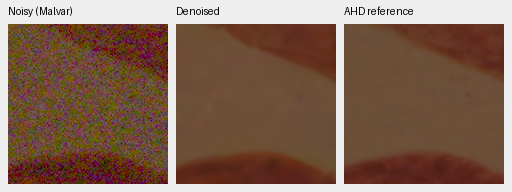

Metadata: `{"scene":"LucieB_Coulicoco","conditioning":{"shot":0.0023482592096665538,"read":0.00017038157420448983,"method":"input-only-Haar-fit","estimate":{"shot":0.0023482592096665538,"read":0.00017038157420448983,"reliable":true,"reason":"fit","candidate_patches":4096,"accepted_patches":1199,"intensity_span":0.06260512955486772,"reference_intensity":0.06184215098619461,"reference_variance":0.0003241711820010096,"shot_interval":[0.0017713892032946148,0.003107752589990377],"read_interval":[0.000130196057114057,0.00021017072927938582],"bins":[{"mean":0.037331704050302505,"variance":0.00024029890482779592,"patches":75},{"mean":0.0426618754863739,"variance":0.0002583925670478493,"patches":75},{"mean":0.04648628085851669,"variance":0.00027513832901604474,"patches":75},{"mean":0.049039408564567566,"variance":0.00028016348369419575,"patches":75},{"mean":0.05116194486618042,"variance":0.0002882984990719706,"patches":75},{"mean":0.05317879468202591,"variance":0.0003091453108936548,"patches":75},{"mean":0.0560268759727478,"variance":0.000310206669382751,"patches":75},{"mean":0.06038716062903404,"variance":0.0003285295970272273,"patches":75},{"mean":0.06320273876190186,"variance":0.00033291729050688446,"patches":75},{"mean":0.06547649204730988,"variance":0.00033622721093706787,"patches":75},{"mean":0.06830255687236786,"variance":0.00034963031066581607,"patches":75},{"mean":0.07187666743993759,"variance":0.0003632954030763358,"patches":75},{"mean":0.07532474398612976,"variance":0.0003655982727650553,"patches":75},{"mean":0.081906259059906,"variance":0.0003507589572109282,"patches":75},{"mean":0.09307220578193665,"variance":0.00036906631430611014,"patches":75},{"mean":0.10986495018005371,"variance":0.00039619908784516156,"patches":74}]}},"display_exposure":1.0,"reference":"Registered low-noise RAW, auxiliary LibRaw AHD RGB; primary scores use measured CFA"}`.

V69 augmented1k; checkpoint SHA256`6f34be8b2cc4fbba1116b4ed17bbafe41d5526da928238d194b6355b9b8b665c`.

Metadata: `{"scene":"LucieB_Coulicoco","conditioning":{"shot":0.0023482592096665538,"read":0.00017038157420448983,"method":"input-only-Haar-fit","estimate":{"shot":0.0023482592096665538,"read":0.00017038157420448983,"reliable":true,"reason":"fit","candidate_patches":4096,"accepted_patches":1199,"intensity_span":0.06260512955486772,"reference_intensity":0.06184215098619461,"reference_variance":0.0003241711820010096,"shot_interval":[0.0017713892032946148,0.003107752589990377],"read_interval":[0.000130196057114057,0.00021017072927938582],"bins":[{"mean":0.037331704050302505,"variance":0.00024029890482779592,"patches":75},{"mean":0.0426618754863739,"variance":0.0002583925670478493,"patches":75},{"mean":0.04648628085851669,"variance":0.00027513832901604474,"patches":75},{"mean":0.049039408564567566,"variance":0.00028016348369419575,"patches":75},{"mean":0.05116194486618042,"variance":0.0002882984990719706,"patches":75},{"mean":0.05317879468202591,"variance":0.0003091453108936548,"patches":75},{"mean":0.0560268759727478,"variance":0.000310206669382751,"patches":75},{"mean":0.06038716062903404,"variance":0.0003285295970272273,"patches":75},{"mean":0.06320273876190186,"variance":0.00033291729050688446,"patches":75},{"mean":0.06547649204730988,"variance":0.00033622721093706787,"patches":75},{"mean":0.06830255687236786,"variance":0.00034963031066581607,"patches":75},{"mean":0.07187666743993759,"variance":0.0003632954030763358,"patches":75},{"mean":0.07532474398612976,"variance":0.0003655982727650553,"patches":75},{"mean":0.081906259059906,"variance":0.0003507589572109282,"patches":75},{"mean":0.09307220578193665,"variance":0.00036906631430611014,"patches":75},{"mean":0.10986495018005371,"variance":0.00039619908784516156,"patches":74}]}},"display_exposure":1.0,"reference":"Registered low-noise RAW, auxiliary LibRaw AHD RGB; primary scores use measured CFA"}`.

## analytic / carrier-l0.01-c0.1-p8-draw0

V63 parent20k; checkpoint SHA256`ed70952dd33c5d7da39199bf1306b58b579862920fb0cccd6b222f19871bc9b5`.

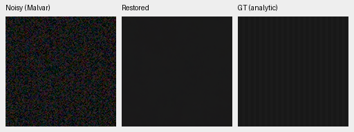

Metadata: `{"source_id":"carrier-l0.01-c0.1-p8-draw0","source":{"kind":"carrier","level":0.01,"contrast":0.1,"period":8,"seed":20261016},"condition":{"name":"iso12800-prior","shot":0.00256,"read":2.62144e-05,"exposure":1.0},"display_exposure":1,"reference":"Exact analytic clean target; no real capture or fitted inference calibration."}`.

V68 control1k; checkpoint SHA256`456a5fb245bc807d91470cbb067e137ea48ace8eb5796a3d6ad9218573d9ad0c`.

Metadata: `{"source_id":"carrier-l0.01-c0.1-p8-draw0","source":{"kind":"carrier","level":0.01,"contrast":0.1,"period":8,"seed":20261016},"condition":{"name":"iso12800-prior","shot":0.00256,"read":2.62144e-05,"exposure":1.0},"display_exposure":1,"reference":"Exact analytic clean target; no real capture or fitted inference calibration."}`.

V69 augmented1k; checkpoint SHA256`6f34be8b2cc4fbba1116b4ed17bbafe41d5526da928238d194b6355b9b8b665c`.

Metadata: `{"source_id":"carrier-l0.01-c0.1-p8-draw0","source":{"kind":"carrier","level":0.01,"contrast":0.1,"period":8,"seed":20261016},"condition":{"name":"iso12800-prior","shot":0.00256,"read":2.62144e-05,"exposure":1.0},"display_exposure":1,"reference":"Exact analytic clean target; no real capture or fitted inference calibration."}`.

## analytic / carrier-l0.18-c0.02-p16-draw0

V63 parent20k; checkpoint SHA256`ed70952dd33c5d7da39199bf1306b58b579862920fb0cccd6b222f19871bc9b5`.

Metadata: `{"source_id":"carrier-l0.18-c0.02-p16-draw0","source":{"kind":"carrier","level":0.18,"contrast":0.02,"period":16,"seed":20261016},"condition":{"name":"iso12800-prior","shot":0.00256,"read":2.62144e-05,"exposure":1.0},"display_exposure":1,"reference":"Exact analytic clean target; no real capture or fitted inference calibration."}`.

V68 control1k; checkpoint SHA256`456a5fb245bc807d91470cbb067e137ea48ace8eb5796a3d6ad9218573d9ad0c`.

Metadata: `{"source_id":"carrier-l0.18-c0.02-p16-draw0","source":{"kind":"carrier","level":0.18,"contrast":0.02,"period":16,"seed":20261016},"condition":{"name":"iso12800-prior","shot":0.00256,"read":2.62144e-05,"exposure":1.0},"display_exposure":1,"reference":"Exact analytic clean target; no real capture or fitted inference calibration."}`.

V69 augmented1k; checkpoint SHA256`6f34be8b2cc4fbba1116b4ed17bbafe41d5526da928238d194b6355b9b8b665c`.

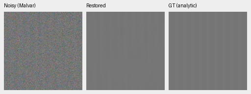

Metadata: `{"source_id":"carrier-l0.18-c0.02-p16-draw0","source":{"kind":"carrier","level":0.18,"contrast":0.02,"period":16,"seed":20261016},"condition":{"name":"iso12800-prior","shot":0.00256,"read":2.62144e-05,"exposure":1.0},"display_exposure":1,"reference":"Exact analytic clean target; no real capture or fitted inference calibration."}`.

## analytic / flat-l0.18-draw0

V63 parent20k; checkpoint SHA256`ed70952dd33c5d7da39199bf1306b58b579862920fb0cccd6b222f19871bc9b5`.

Metadata: `{"source_id":"flat-l0.18-draw0","source":{"kind":"flat","level":0.18,"contrast":0,"period":null,"seed":20261016},"condition":{"name":"iso12800-prior","shot":0.00256,"read":2.62144e-05,"exposure":1.0},"display_exposure":1,"reference":"Exact analytic clean target; no real capture or fitted inference calibration."}`.

V68 control1k; checkpoint SHA256`456a5fb245bc807d91470cbb067e137ea48ace8eb5796a3d6ad9218573d9ad0c`.

Metadata: `{"source_id":"flat-l0.18-draw0","source":{"kind":"flat","level":0.18,"contrast":0,"period":null,"seed":20261016},"condition":{"name":"iso12800-prior","shot":0.00256,"read":2.62144e-05,"exposure":1.0},"display_exposure":1,"reference":"Exact analytic clean target; no real capture or fitted inference calibration."}`.

V69 augmented1k; checkpoint SHA256`6f34be8b2cc4fbba1116b4ed17bbafe41d5526da928238d194b6355b9b8b665c`.

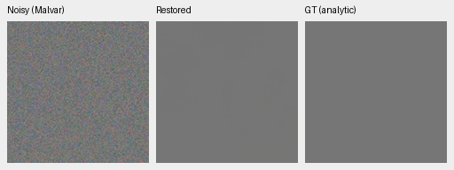

Metadata: `{"source_id":"flat-l0.18-draw0","source":{"kind":"flat","level":0.18,"contrast":0,"period":null,"seed":20261016},"condition":{"name":"iso12800-prior","shot":0.00256,"read":2.62144e-05,"exposure":1.0},"display_exposure":1,"reference":"Exact analytic clean target; no real capture or fitted inference calibration."}`.

## gfx / overcast-sky

V63 parent20k; checkpoint SHA256`ed70952dd33c5d7da39199bf1306b58b579862920fb0cccd6b222f19871bc9b5`.

Metadata: `{"region":{"name":"overcast-sky","noisy_xy":[5800,1400],"reference_xy":[5800,1400],"size":160,"selection_method":"Same sensor coordinates; sky has no fixed registration landmarks","context_green_correlation":null},"context_xywh":null,"conditioning":{"shot":0.0014635775921166604,"read":1.0715704128646712e-06},"display_exposure":4.0,"reference":"Separately framed low-ISO exposure; not exact GT; no resampling/warping"}`.

V68 control1k; checkpoint SHA256`456a5fb245bc807d91470cbb067e137ea48ace8eb5796a3d6ad9218573d9ad0c`.

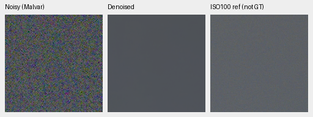

Metadata: `{"region":{"name":"overcast-sky","noisy_xy":[5800,1400],"reference_xy":[5800,1400],"size":160,"selection_method":"Same sensor coordinates; sky has no fixed registration landmarks","context_green_correlation":null},"context_xywh":null,"conditioning":{"shot":0.0014635775921166604,"read":1.0715704128646712e-06},"display_exposure":4.0,"reference":"Separately framed low-ISO exposure; not exact GT; no resampling/warping"}`.

V69 augmented1k; checkpoint SHA256`6f34be8b2cc4fbba1116b4ed17bbafe41d5526da928238d194b6355b9b8b665c`.

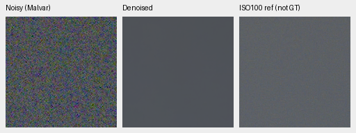

Metadata: `{"region":{"name":"overcast-sky","noisy_xy":[5800,1400],"reference_xy":[5800,1400],"size":160,"selection_method":"Same sensor coordinates; sky has no fixed registration landmarks","context_green_correlation":null},"context_xywh":null,"conditioning":{"shot":0.0014635775921166604,"read":1.0715704128646712e-06},"display_exposure":4.0,"reference":"Separately framed low-ISO exposure; not exact GT; no resampling/warping"}`.

## gfx / building-detail

V63 parent20k; checkpoint SHA256`ed70952dd33c5d7da39199bf1306b58b579862920fb0cccd6b222f19871bc9b5`.

Metadata: `{"region":{"name":"building-detail","noisy_xy":[5790,2690],"reference_xy":[5791,2690],"size":160,"selection_method":"Maximum normalized green correlation in input/reference 512px contexts; integer offsets only, no output-dependent selection","context_green_correlation":0.6824449896812439},"context_xywh":null,"conditioning":{"shot":0.0014635775921166604,"read":1.0715704128646712e-06},"display_exposure":4.0,"reference":"Separately framed low-ISO exposure; not exact GT; no resampling/warping"}`.

V68 control1k; checkpoint SHA256`456a5fb245bc807d91470cbb067e137ea48ace8eb5796a3d6ad9218573d9ad0c`.

Metadata: `{"region":{"name":"building-detail","noisy_xy":[5790,2690],"reference_xy":[5791,2690],"size":160,"selection_method":"Maximum normalized green correlation in input/reference 512px contexts; integer offsets only, no output-dependent selection","context_green_correlation":0.6824449896812439},"context_xywh":null,"conditioning":{"shot":0.0014635775921166604,"read":1.0715704128646712e-06},"display_exposure":4.0,"reference":"Separately framed low-ISO exposure; not exact GT; no resampling/warping"}`.

V69 augmented1k; checkpoint SHA256`6f34be8b2cc4fbba1116b4ed17bbafe41d5526da928238d194b6355b9b8b665c`.

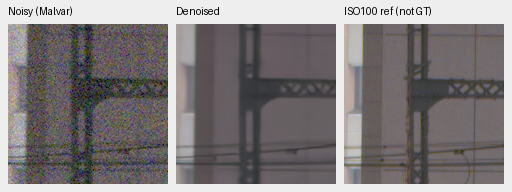

Metadata: `{"region":{"name":"building-detail","noisy_xy":[5790,2690],"reference_xy":[5791,2690],"size":160,"selection_method":"Maximum normalized green correlation in input/reference 512px contexts; integer offsets only, no output-dependent selection","context_green_correlation":0.6824449896812439},"context_xywh":null,"conditioning":{"shot":0.0014635775921166604,"read":1.0715704128646712e-06},"display_exposure":4.0,"reference":"Separately framed low-ISO exposure; not exact GT; no resampling/warping"}`.

## gfx / foliage

V63 parent20k; checkpoint SHA256`ed70952dd33c5d7da39199bf1306b58b579862920fb0cccd6b222f19871bc9b5`.

Metadata: `{"region":{"name":"foliage","noisy_xy":[8890,5570],"reference_xy":[8890,5570],"size":160,"selection_method":"Maximum normalized green correlation in input/reference 512px contexts; integer offsets only, no output-dependent selection","context_green_correlation":0.9597686529159546},"context_xywh":null,"conditioning":{"shot":0.0014635775921166604,"read":1.0715704128646712e-06},"display_exposure":4.0,"reference":"Separately framed low-ISO exposure; not exact GT; no resampling/warping"}`.

V68 control1k; checkpoint SHA256`456a5fb245bc807d91470cbb067e137ea48ace8eb5796a3d6ad9218573d9ad0c`.

Metadata: `{"region":{"name":"foliage","noisy_xy":[8890,5570],"reference_xy":[8890,5570],"size":160,"selection_method":"Maximum normalized green correlation in input/reference 512px contexts; integer offsets only, no output-dependent selection","context_green_correlation":0.9597686529159546},"context_xywh":null,"conditioning":{"shot":0.0014635775921166604,"read":1.0715704128646712e-06},"display_exposure":4.0,"reference":"Separately framed low-ISO exposure; not exact GT; no resampling/warping"}`.

V69 augmented1k; checkpoint SHA256`6f34be8b2cc4fbba1116b4ed17bbafe41d5526da928238d194b6355b9b8b665c`.

Metadata: `{"region":{"name":"foliage","noisy_xy":[8890,5570],"reference_xy":[8890,5570],"size":160,"selection_method":"Maximum normalized green correlation in input/reference 512px contexts; integer offsets only, no output-dependent selection","context_green_correlation":0.9597686529159546},"context_xywh":null,"conditioning":{"shot":0.0014635775921166604,"read":1.0715704128646712e-06},"display_exposure":4.0,"reference":"Separately framed low-ISO exposure; not exact GT; no resampling/warping"}`.

## gfx / chain-link-fence

V63 parent20k; checkpoint SHA256`ed70952dd33c5d7da39199bf1306b58b579862920fb0cccd6b222f19871bc9b5`.

Metadata: `{"region":{"name":"chain-link-fence","noisy_xy":[2240,6000],"reference_xy":[2241,6000],"size":160,"selection_method":"Maximum normalized green correlation in input/reference 512px contexts; integer offsets only, no output-dependent selection","context_green_correlation":0.9550720453262329},"context_xywh":null,"conditioning":{"shot":0.0014635775921166604,"read":1.0715704128646712e-06},"display_exposure":4.0,"reference":"Separately framed low-ISO exposure; not exact GT; no resampling/warping"}`.

V68 control1k; checkpoint SHA256`456a5fb245bc807d91470cbb067e137ea48ace8eb5796a3d6ad9218573d9ad0c`.

Metadata: `{"region":{"name":"chain-link-fence","noisy_xy":[2240,6000],"reference_xy":[2241,6000],"size":160,"selection_method":"Maximum normalized green correlation in input/reference 512px contexts; integer offsets only, no output-dependent selection","context_green_correlation":0.9550720453262329},"context_xywh":null,"conditioning":{"shot":0.0014635775921166604,"read":1.0715704128646712e-06},"display_exposure":4.0,"reference":"Separately framed low-ISO exposure; not exact GT; no resampling/warping"}`.

V69 augmented1k; checkpoint SHA256`6f34be8b2cc4fbba1116b4ed17bbafe41d5526da928238d194b6355b9b8b665c`.

Metadata: `{"region":{"name":"chain-link-fence","noisy_xy":[2240,6000],"reference_xy":[2241,6000],"size":160,"selection_method":"Maximum normalized green correlation in input/reference 512px contexts; integer offsets only, no output-dependent selection","context_green_correlation":0.9550720453262329},"context_xywh":null,"conditioning":{"shot":0.0014635775921166604,"read":1.0715704128646712e-06},"display_exposure":4.0,"reference":"Separately framed low-ISO exposure; not exact GT; no resampling/warping"}`.

## three-camera / 78e99e7b845b285f1c5b80afb16cce3f63ba1052a6f2bfb8491ecd6ecc31de4a:upper-left

V63 parent20k; checkpoint SHA256`ed70952dd33c5d7da39199bf1306b58b579862920fb0cccd6b222f19871bc9b5`.

Metadata: `{"source_sha256":"78e99e7b845b285f1c5b80afb16cce3f63ba1052a6f2bfb8491ecd6ecc31de4a","source":".cache/real-camera-qualitative/2021-06-11-19-48-11_L1000122_addf0e21e71ad60bb16a75f7f0490ece80f68fa4.dng","region":"upper-left","sensor_roi_xywh":[314,4118,160,160],"context_xywh":[250,4054,512,512],"conditioning":{"shot":4.372832896220782e-05,"read":1.6048777837313756e-07,"source":"input-only Haar flat-patch fit"},"display_exposure":2.0,"reference":"RawNIND on the same noisy capture; comparator, not GT; no pixelwise score"}`.

V68 control1k; checkpoint SHA256`456a5fb245bc807d91470cbb067e137ea48ace8eb5796a3d6ad9218573d9ad0c`.

Metadata: `{"source_sha256":"78e99e7b845b285f1c5b80afb16cce3f63ba1052a6f2bfb8491ecd6ecc31de4a","source":".cache/real-camera-qualitative/2021-06-11-19-48-11_L1000122_addf0e21e71ad60bb16a75f7f0490ece80f68fa4.dng","region":"upper-left","sensor_roi_xywh":[314,4118,160,160],"context_xywh":[250,4054,512,512],"conditioning":{"shot":4.372832896220782e-05,"read":1.6048777837313756e-07,"source":"input-only Haar flat-patch fit"},"display_exposure":2.0,"reference":"RawNIND on the same noisy capture; comparator, not GT; no pixelwise score"}`.

V69 augmented1k; checkpoint SHA256`6f34be8b2cc4fbba1116b4ed17bbafe41d5526da928238d194b6355b9b8b665c`.

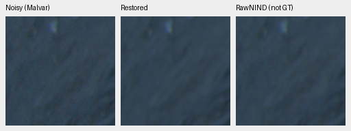

Metadata: `{"source_sha256":"78e99e7b845b285f1c5b80afb16cce3f63ba1052a6f2bfb8491ecd6ecc31de4a","source":".cache/real-camera-qualitative/2021-06-11-19-48-11_L1000122_addf0e21e71ad60bb16a75f7f0490ece80f68fa4.dng","region":"upper-left","sensor_roi_xywh":[314,4118,160,160],"context_xywh":[250,4054,512,512],"conditioning":{"shot":4.372832896220782e-05,"read":1.6048777837313756e-07,"source":"input-only Haar flat-patch fit"},"display_exposure":2.0,"reference":"RawNIND on the same noisy capture; comparator, not GT; no pixelwise score"}`.

## three-camera / 78e99e7b845b285f1c5b80afb16cce3f63ba1052a6f2bfb8491ecd6ecc31de4a:lower-right

V63 parent20k; checkpoint SHA256`ed70952dd33c5d7da39199bf1306b58b579862920fb0cccd6b222f19871bc9b5`.

Metadata: `{"source_sha256":"78e99e7b845b285f1c5b80afb16cce3f63ba1052a6f2bfb8491ecd6ecc31de4a","source":".cache/real-camera-qualitative/2021-06-11-19-48-11_L1000122_addf0e21e71ad60bb16a75f7f0490ece80f68fa4.dng","region":"lower-right","sensor_roi_xywh":[506,4310,160,160],"context_xywh":[250,4054,512,512],"conditioning":{"shot":4.372832896220782e-05,"read":1.6048777837313756e-07,"source":"input-only Haar flat-patch fit"},"display_exposure":2.0,"reference":"RawNIND on the same noisy capture; comparator, not GT; no pixelwise score"}`.

V68 control1k; checkpoint SHA256`456a5fb245bc807d91470cbb067e137ea48ace8eb5796a3d6ad9218573d9ad0c`.

Metadata: `{"source_sha256":"78e99e7b845b285f1c5b80afb16cce3f63ba1052a6f2bfb8491ecd6ecc31de4a","source":".cache/real-camera-qualitative/2021-06-11-19-48-11_L1000122_addf0e21e71ad60bb16a75f7f0490ece80f68fa4.dng","region":"lower-right","sensor_roi_xywh":[506,4310,160,160],"context_xywh":[250,4054,512,512],"conditioning":{"shot":4.372832896220782e-05,"read":1.6048777837313756e-07,"source":"input-only Haar flat-patch fit"},"display_exposure":2.0,"reference":"RawNIND on the same noisy capture; comparator, not GT; no pixelwise score"}`.

V69 augmented1k; checkpoint SHA256`6f34be8b2cc4fbba1116b4ed17bbafe41d5526da928238d194b6355b9b8b665c`.

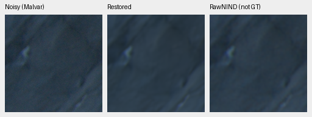

Metadata: `{"source_sha256":"78e99e7b845b285f1c5b80afb16cce3f63ba1052a6f2bfb8491ecd6ecc31de4a","source":".cache/real-camera-qualitative/2021-06-11-19-48-11_L1000122_addf0e21e71ad60bb16a75f7f0490ece80f68fa4.dng","region":"lower-right","sensor_roi_xywh":[506,4310,160,160],"context_xywh":[250,4054,512,512],"conditioning":{"shot":4.372832896220782e-05,"read":1.6048777837313756e-07,"source":"input-only Haar flat-patch fit"},"display_exposure":2.0,"reference":"RawNIND on the same noisy capture; comparator, not GT; no pixelwise score"}`.

## three-camera / 01104550e4cde320a53918721a7e1bdf2c9369d01eece0d8cce46c861c816e39:upper-left

V63 parent20k; checkpoint SHA256`ed70952dd33c5d7da39199bf1306b58b579862920fb0cccd6b222f19871bc9b5`.

Metadata: `{"source_sha256":"01104550e4cde320a53918721a7e1bdf2c9369d01eece0d8cce46c861c816e39","source":".cache/real-camera-qualitative/2019-10-13-21-38-20_DSC02083_bd0b79a49a75536a6a06c6e783772555b458b89d.arw","region":"upper-left","sensor_roi_xywh":[4048,3042,160,160],"context_xywh":[3984,2978,512,512],"conditioning":{"shot":8.19833843920702e-05,"read":1.2061987546279834e-07,"source":"input-only Haar flat-patch fit"},"display_exposure":1,"reference":"RawNIND on the same noisy capture; comparator, not GT; no pixelwise score"}`.

V68 control1k; checkpoint SHA256`456a5fb245bc807d91470cbb067e137ea48ace8eb5796a3d6ad9218573d9ad0c`.

Metadata: `{"source_sha256":"01104550e4cde320a53918721a7e1bdf2c9369d01eece0d8cce46c861c816e39","source":".cache/real-camera-qualitative/2019-10-13-21-38-20_DSC02083_bd0b79a49a75536a6a06c6e783772555b458b89d.arw","region":"upper-left","sensor_roi_xywh":[4048,3042,160,160],"context_xywh":[3984,2978,512,512],"conditioning":{"shot":8.19833843920702e-05,"read":1.2061987546279834e-07,"source":"input-only Haar flat-patch fit"},"display_exposure":1,"reference":"RawNIND on the same noisy capture; comparator, not GT; no pixelwise score"}`.

V69 augmented1k; checkpoint SHA256`6f34be8b2cc4fbba1116b4ed17bbafe41d5526da928238d194b6355b9b8b665c`.

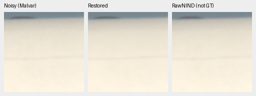

Metadata: `{"source_sha256":"01104550e4cde320a53918721a7e1bdf2c9369d01eece0d8cce46c861c816e39","source":".cache/real-camera-qualitative/2019-10-13-21-38-20_DSC02083_bd0b79a49a75536a6a06c6e783772555b458b89d.arw","region":"upper-left","sensor_roi_xywh":[4048,3042,160,160],"context_xywh":[3984,2978,512,512],"conditioning":{"shot":8.19833843920702e-05,"read":1.2061987546279834e-07,"source":"input-only Haar flat-patch fit"},"display_exposure":1,"reference":"RawNIND on the same noisy capture; comparator, not GT; no pixelwise score"}`.

## three-camera / 01104550e4cde320a53918721a7e1bdf2c9369d01eece0d8cce46c861c816e39:lower-right

V63 parent20k; checkpoint SHA256`ed70952dd33c5d7da39199bf1306b58b579862920fb0cccd6b222f19871bc9b5`.

Metadata: `{"source_sha256":"01104550e4cde320a53918721a7e1bdf2c9369d01eece0d8cce46c861c816e39","source":".cache/real-camera-qualitative/2019-10-13-21-38-20_DSC02083_bd0b79a49a75536a6a06c6e783772555b458b89d.arw","region":"lower-right","sensor_roi_xywh":[4240,3234,160,160],"context_xywh":[3984,2978,512,512],"conditioning":{"shot":8.19833843920702e-05,"read":1.2061987546279834e-07,"source":"input-only Haar flat-patch fit"},"display_exposure":1,"reference":"RawNIND on the same noisy capture; comparator, not GT; no pixelwise score"}`.

V68 control1k; checkpoint SHA256`456a5fb245bc807d91470cbb067e137ea48ace8eb5796a3d6ad9218573d9ad0c`.

Metadata: `{"source_sha256":"01104550e4cde320a53918721a7e1bdf2c9369d01eece0d8cce46c861c816e39","source":".cache/real-camera-qualitative/2019-10-13-21-38-20_DSC02083_bd0b79a49a75536a6a06c6e783772555b458b89d.arw","region":"lower-right","sensor_roi_xywh":[4240,3234,160,160],"context_xywh":[3984,2978,512,512],"conditioning":{"shot":8.19833843920702e-05,"read":1.2061987546279834e-07,"source":"input-only Haar flat-patch fit"},"display_exposure":1,"reference":"RawNIND on the same noisy capture; comparator, not GT; no pixelwise score"}`.

V69 augmented1k; checkpoint SHA256`6f34be8b2cc4fbba1116b4ed17bbafe41d5526da928238d194b6355b9b8b665c`.

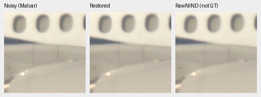

Metadata: `{"source_sha256":"01104550e4cde320a53918721a7e1bdf2c9369d01eece0d8cce46c861c816e39","source":".cache/real-camera-qualitative/2019-10-13-21-38-20_DSC02083_bd0b79a49a75536a6a06c6e783772555b458b89d.arw","region":"lower-right","sensor_roi_xywh":[4240,3234,160,160],"context_xywh":[3984,2978,512,512],"conditioning":{"shot":8.19833843920702e-05,"read":1.2061987546279834e-07,"source":"input-only Haar flat-patch fit"},"display_exposure":1,"reference":"RawNIND on the same noisy capture; comparator, not GT; no pixelwise score"}`.

## three-camera / f6214285997723a12b142b480fe70d996e5fde44b8c25c8bf352f5b31ad3846e:upper-left

V63 parent20k; checkpoint SHA256`ed70952dd33c5d7da39199bf1306b58b579862920fb0cccd6b222f19871bc9b5`.

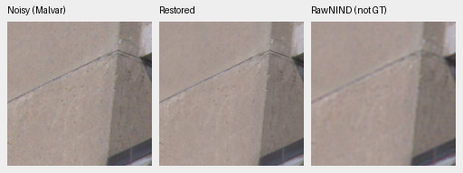

Metadata: `{"source_sha256":"f6214285997723a12b142b480fe70d996e5fde44b8c25c8bf352f5b31ad3846e","source":".cache/real-camera-qualitative/2019-05-19-15-15-05_DSCF2416_a2b2c8996d79eff8da71d668ada86d5dc8d58459.raf","region":"upper-left","sensor_roi_xywh":[1720,1616,160,160],"context_xywh":[1656,1552,512,512],"conditioning":{"shot":1.9414241387097276e-05,"read":1.6413062836047303e-07,"source":"input-only Haar flat-patch fit"},"display_exposure":2.0,"reference":"RawNIND on the same noisy capture; comparator, not GT; no pixelwise score"}`.

V68 control1k; checkpoint SHA256`456a5fb245bc807d91470cbb067e137ea48ace8eb5796a3d6ad9218573d9ad0c`.

Metadata: `{"source_sha256":"f6214285997723a12b142b480fe70d996e5fde44b8c25c8bf352f5b31ad3846e","source":".cache/real-camera-qualitative/2019-05-19-15-15-05_DSCF2416_a2b2c8996d79eff8da71d668ada86d5dc8d58459.raf","region":"upper-left","sensor_roi_xywh":[1720,1616,160,160],"context_xywh":[1656,1552,512,512],"conditioning":{"shot":1.9414241387097276e-05,"read":1.6413062836047303e-07,"source":"input-only Haar flat-patch fit"},"display_exposure":2.0,"reference":"RawNIND on the same noisy capture; comparator, not GT; no pixelwise score"}`.

V69 augmented1k; checkpoint SHA256`6f34be8b2cc4fbba1116b4ed17bbafe41d5526da928238d194b6355b9b8b665c`.

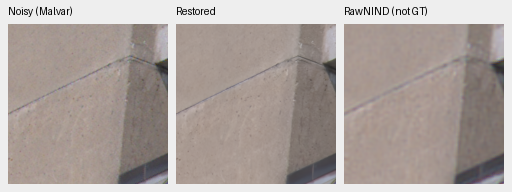

Metadata: `{"source_sha256":"f6214285997723a12b142b480fe70d996e5fde44b8c25c8bf352f5b31ad3846e","source":".cache/real-camera-qualitative/2019-05-19-15-15-05_DSCF2416_a2b2c8996d79eff8da71d668ada86d5dc8d58459.raf","region":"upper-left","sensor_roi_xywh":[1720,1616,160,160],"context_xywh":[1656,1552,512,512],"conditioning":{"shot":1.9414241387097276e-05,"read":1.6413062836047303e-07,"source":"input-only Haar flat-patch fit"},"display_exposure":2.0,"reference":"RawNIND on the same noisy capture; comparator, not GT; no pixelwise score"}`.

## three-camera / f6214285997723a12b142b480fe70d996e5fde44b8c25c8bf352f5b31ad3846e:lower-right

V63 parent20k; checkpoint SHA256`ed70952dd33c5d7da39199bf1306b58b579862920fb0cccd6b222f19871bc9b5`.

Metadata: `{"source_sha256":"f6214285997723a12b142b480fe70d996e5fde44b8c25c8bf352f5b31ad3846e","source":".cache/real-camera-qualitative/2019-05-19-15-15-05_DSCF2416_a2b2c8996d79eff8da71d668ada86d5dc8d58459.raf","region":"lower-right","sensor_roi_xywh":[1912,1808,160,160],"context_xywh":[1656,1552,512,512],"conditioning":{"shot":1.9414241387097276e-05,"read":1.6413062836047303e-07,"source":"input-only Haar flat-patch fit"},"display_exposure":2.0,"reference":"RawNIND on the same noisy capture; comparator, not GT; no pixelwise score"}`.

V68 control1k; checkpoint SHA256`456a5fb245bc807d91470cbb067e137ea48ace8eb5796a3d6ad9218573d9ad0c`.

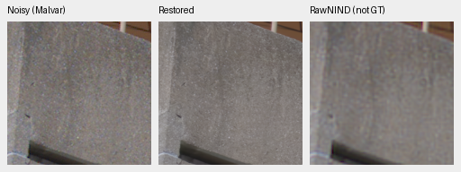

Metadata: `{"source_sha256":"f6214285997723a12b142b480fe70d996e5fde44b8c25c8bf352f5b31ad3846e","source":".cache/real-camera-qualitative/2019-05-19-15-15-05_DSCF2416_a2b2c8996d79eff8da71d668ada86d5dc8d58459.raf","region":"lower-right","sensor_roi_xywh":[1912,1808,160,160],"context_xywh":[1656,1552,512,512],"conditioning":{"shot":1.9414241387097276e-05,"read":1.6413062836047303e-07,"source":"input-only Haar flat-patch fit"},"display_exposure":2.0,"reference":"RawNIND on the same noisy capture; comparator, not GT; no pixelwise score"}`.

V69 augmented1k; checkpoint SHA256`6f34be8b2cc4fbba1116b4ed17bbafe41d5526da928238d194b6355b9b8b665c`.

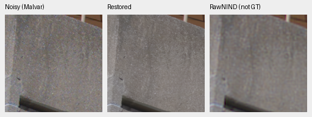

Metadata: `{"source_sha256":"f6214285997723a12b142b480fe70d996e5fde44b8c25c8bf352f5b31ad3846e","source":".cache/real-camera-qualitative/2019-05-19-15-15-05_DSCF2416_a2b2c8996d79eff8da71d668ada86d5dc8d58459.raf","region":"lower-right","sensor_roi_xywh":[1912,1808,160,160],"context_xywh":[1656,1552,512,512],"conditioning":{"shot":1.9414241387097276e-05,"read":1.6413062836047303e-07,"source":"input-only Haar flat-patch fit"},"display_exposure":2.0,"reference":"RawNIND on the same noisy capture; comparator, not GT; no pixelwise score"}`.

## colored-CPU / color-flat-neutral

V63 parent20k; checkpoint SHA256`ed70952dd33c5d7da39199bf1306b58b579862920fb0cccd6b222f19871bc9b5`.

Metadata: `{"ROI_xywh":[48,48,160,160],"conditioning":{"name":"iso12800-prior","shot":0.00256,"read":2.62144e-05,"exposure":1.0},"display_exposure":1.0,"case":{"id":"color-flat-neutral","condition":{"name":"iso12800-prior","shot":0.00256,"read":2.62144e-05,"exposure":1.0},"pattern":"RGGB","sha256":"89c2c1c29cabdb9364b776bb6dd5ef4d217df98d41b94313baf260b1a0aa70a7"},"reference":"Exact uniform analytic target, not a real photograph or a newly sampled degradation."}`.

V68 control1k; checkpoint SHA256`456a5fb245bc807d91470cbb067e137ea48ace8eb5796a3d6ad9218573d9ad0c`.

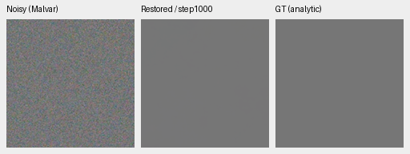

Metadata: `{"ROI_xywh":[48,48,160,160],"conditioning":{"name":"iso12800-prior","shot":0.00256,"read":2.62144e-05,"exposure":1.0},"display_exposure":1.0,"case":{"id":"color-flat-neutral","condition":{"name":"iso12800-prior","shot":0.00256,"read":2.62144e-05,"exposure":1.0},"pattern":"RGGB","sha256":"89c2c1c29cabdb9364b776bb6dd5ef4d217df98d41b94313baf260b1a0aa70a7"},"reference":"Exact uniform analytic target, not a real photograph or a newly sampled degradation."}`.

V69 augmented1k; checkpoint SHA256`6f34be8b2cc4fbba1116b4ed17bbafe41d5526da928238d194b6355b9b8b665c`.

Metadata: `{"ROI_xywh":[48,48,160,160],"conditioning":{"name":"iso12800-prior","shot":0.00256,"read":2.62144e-05,"exposure":1.0},"display_exposure":1.0,"case":{"id":"color-flat-neutral","condition":{"name":"iso12800-prior","shot":0.00256,"read":2.62144e-05,"exposure":1.0},"pattern":"RGGB","sha256":"89c2c1c29cabdb9364b776bb6dd5ef4d217df98d41b94313baf260b1a0aa70a7"},"reference":"Exact uniform analytic target, not a real photograph or a newly sampled degradation."}`.

## colored-CPU / color-flat-fabric-mean

V63 parent20k; checkpoint SHA256`ed70952dd33c5d7da39199bf1306b58b579862920fb0cccd6b222f19871bc9b5`.

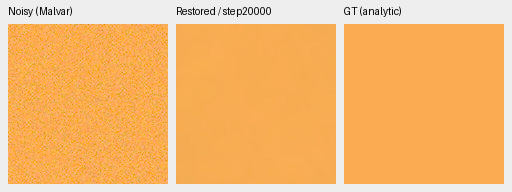

Metadata: `{"ROI_xywh":[48,48,160,160],"conditioning":{"name":"iso12800-prior","shot":0.00256,"read":2.62144e-05,"exposure":1.0},"display_exposure":1.0,"case":{"id":"color-flat-fabric-mean","condition":{"name":"iso12800-prior","shot":0.00256,"read":2.62144e-05,"exposure":1.0},"pattern":"RGGB","sha256":"7c2e2575b08152593e1678b2a58d763f79c53eb61a7fe8de43d4f33e25680438"},"reference":"Exact uniform analytic target, not a real photograph or a newly sampled degradation."}`.

V68 control1k; checkpoint SHA256`456a5fb245bc807d91470cbb067e137ea48ace8eb5796a3d6ad9218573d9ad0c`.

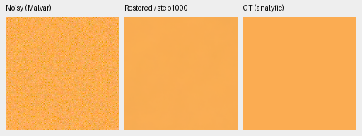

Metadata: `{"ROI_xywh":[48,48,160,160],"conditioning":{"name":"iso12800-prior","shot":0.00256,"read":2.62144e-05,"exposure":1.0},"display_exposure":1.0,"case":{"id":"color-flat-fabric-mean","condition":{"name":"iso12800-prior","shot":0.00256,"read":2.62144e-05,"exposure":1.0},"pattern":"RGGB","sha256":"7c2e2575b08152593e1678b2a58d763f79c53eb61a7fe8de43d4f33e25680438"},"reference":"Exact uniform analytic target, not a real photograph or a newly sampled degradation."}`.

V69 augmented1k; checkpoint SHA256`6f34be8b2cc4fbba1116b4ed17bbafe41d5526da928238d194b6355b9b8b665c`.

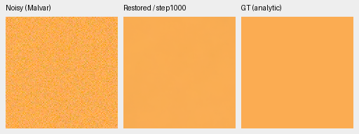

Metadata: `{"ROI_xywh":[48,48,160,160],"conditioning":{"name":"iso12800-prior","shot":0.00256,"read":2.62144e-05,"exposure":1.0},"display_exposure":1.0,"case":{"id":"color-flat-fabric-mean","condition":{"name":"iso12800-prior","shot":0.00256,"read":2.62144e-05,"exposure":1.0},"pattern":"RGGB","sha256":"7c2e2575b08152593e1678b2a58d763f79c53eb61a7fe8de43d4f33e25680438"},"reference":"Exact uniform analytic target, not a real photograph or a newly sampled degradation."}`.

## hue / gray-l0.18

NonlocalMatchFilter2026+Malvar:authors-RAW / gray-l0.18; checkpoint SHA256`b31bc8e21022389b0b209a9d1e6649485ed4dacc552b7ea04612df5f7515fcf2`.

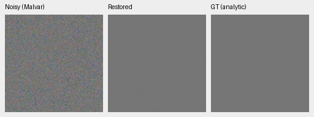

Metadata: `{"ROI_xywh":[48,48,160,160],"conditioning":{"name":"iso12800-prior","shot":0.00256,"read":2.62144e-05,"exposure":1.0},"display_exposure":1.0,"case":{"id":"gray-l0.18","source":{"id":"gray-l0.18","hue_degrees":null,"saturation":0.0,"peak":0.18,"linear_srgb":[0.18,0.18,0.18]},"condition":{"name":"iso12800-prior","shot":0.00256,"read":2.62144e-05,"exposure":1.0},"pattern":"RGGB","sha256":"70ebe5561edc947acc75da2f64acb6a4ad185add551b48f675e58a8d0cdcb2e3"},"reference":"Exact uniform analytic target, not a real photo."}`.

V63 parent20k; checkpoint SHA256`ed70952dd33c5d7da39199bf1306b58b579862920fb0cccd6b222f19871bc9b5`.

Metadata: `{"ROI_xywh":[48,48,160,160],"conditioning":{"name":"iso12800-prior","shot":0.00256,"read":2.62144e-05,"exposure":1.0},"display_exposure":1.0,"case":{"id":"gray-l0.18","source":{"id":"gray-l0.18","hue_degrees":null,"saturation":0.0,"peak":0.18,"linear_srgb":[0.18,0.18,0.18]},"condition":{"name":"iso12800-prior","shot":0.00256,"read":2.62144e-05,"exposure":1.0},"pattern":"RGGB","sha256":"70ebe5561edc947acc75da2f64acb6a4ad185add551b48f675e58a8d0cdcb2e3"},"reference":"Exact uniform analytic target, not a real photo."}`.

V68 control1k; checkpoint SHA256`456a5fb245bc807d91470cbb067e137ea48ace8eb5796a3d6ad9218573d9ad0c`.

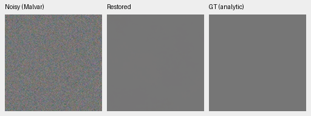

Metadata: `{"ROI_xywh":[48,48,160,160],"conditioning":{"name":"iso12800-prior","shot":0.00256,"read":2.62144e-05,"exposure":1.0},"display_exposure":1.0,"case":{"id":"gray-l0.18","source":{"id":"gray-l0.18","hue_degrees":null,"saturation":0.0,"peak":0.18,"linear_srgb":[0.18,0.18,0.18]},"condition":{"name":"iso12800-prior","shot":0.00256,"read":2.62144e-05,"exposure":1.0},"pattern":"RGGB","sha256":"70ebe5561edc947acc75da2f64acb6a4ad185add551b48f675e58a8d0cdcb2e3"},"reference":"Exact uniform analytic target, not a real photo."}`.

V69 augmented1k; checkpoint SHA256`6f34be8b2cc4fbba1116b4ed17bbafe41d5526da928238d194b6355b9b8b665c`.

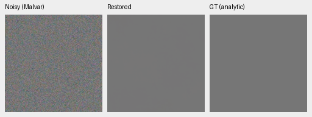

Metadata: `{"ROI_xywh":[48,48,160,160],"conditioning":{"name":"iso12800-prior","shot":0.00256,"read":2.62144e-05,"exposure":1.0},"display_exposure":1.0,"case":{"id":"gray-l0.18","source":{"id":"gray-l0.18","hue_degrees":null,"saturation":0.0,"peak":0.18,"linear_srgb":[0.18,0.18,0.18]},"condition":{"name":"iso12800-prior","shot":0.00256,"read":2.62144e-05,"exposure":1.0},"pattern":"RGGB","sha256":"70ebe5561edc947acc75da2f64acb6a4ad185add551b48f675e58a8d0cdcb2e3"},"reference":"Exact uniform analytic target, not a real photo."}`.

## hue / h030-s0.98-l0.90

NonlocalMatchFilter2026+Malvar:authors-RAW / h030-s0.98-l0.90; checkpoint SHA256`b31bc8e21022389b0b209a9d1e6649485ed4dacc552b7ea04612df5f7515fcf2`.

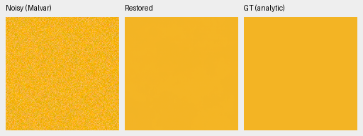

Metadata: `{"ROI_xywh":[48,48,160,160],"conditioning":{"name":"iso12800-prior","shot":0.00256,"read":2.62144e-05,"exposure":1.0},"display_exposure":1.0,"case":{"id":"h030-s0.98-l0.90","source":{"id":"h030-s0.98-l0.90","hue_degrees":30,"saturation":0.98,"peak":0.9,"linear_srgb":[0.9,0.459,0.018000000000000016]},"condition":{"name":"iso12800-prior","shot":0.00256,"read":2.62144e-05,"exposure":1.0},"pattern":"RGGB","sha256":"1b763d74f2ec1eede3711b13c2feab8e86e55bddcecf5005d3d9d206c196c008"},"reference":"Exact uniform analytic target, not a real photo."}`.

V63 parent20k; checkpoint SHA256`ed70952dd33c5d7da39199bf1306b58b579862920fb0cccd6b222f19871bc9b5`.

Metadata: `{"ROI_xywh":[48,48,160,160],"conditioning":{"name":"iso12800-prior","shot":0.00256,"read":2.62144e-05,"exposure":1.0},"display_exposure":1.0,"case":{"id":"h030-s0.98-l0.90","source":{"id":"h030-s0.98-l0.90","hue_degrees":30,"saturation":0.98,"peak":0.9,"linear_srgb":[0.9,0.459,0.018000000000000016]},"condition":{"name":"iso12800-prior","shot":0.00256,"read":2.62144e-05,"exposure":1.0},"pattern":"RGGB","sha256":"1b763d74f2ec1eede3711b13c2feab8e86e55bddcecf5005d3d9d206c196c008"},"reference":"Exact uniform analytic target, not a real photo."}`.

V68 control1k; checkpoint SHA256`456a5fb245bc807d91470cbb067e137ea48ace8eb5796a3d6ad9218573d9ad0c`.

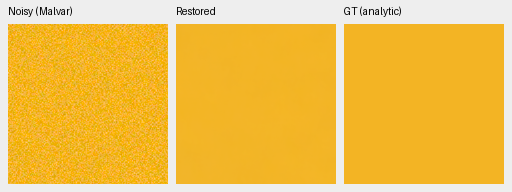

Metadata: `{"ROI_xywh":[48,48,160,160],"conditioning":{"name":"iso12800-prior","shot":0.00256,"read":2.62144e-05,"exposure":1.0},"display_exposure":1.0,"case":{"id":"h030-s0.98-l0.90","source":{"id":"h030-s0.98-l0.90","hue_degrees":30,"saturation":0.98,"peak":0.9,"linear_srgb":[0.9,0.459,0.018000000000000016]},"condition":{"name":"iso12800-prior","shot":0.00256,"read":2.62144e-05,"exposure":1.0},"pattern":"RGGB","sha256":"1b763d74f2ec1eede3711b13c2feab8e86e55bddcecf5005d3d9d206c196c008"},"reference":"Exact uniform analytic target, not a real photo."}`.

V69 augmented1k; checkpoint SHA256`6f34be8b2cc4fbba1116b4ed17bbafe41d5526da928238d194b6355b9b8b665c`.

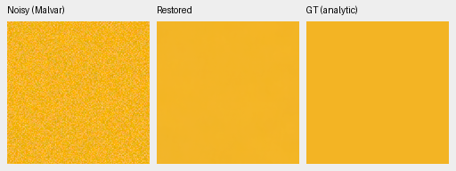

Metadata: `{"ROI_xywh":[48,48,160,160],"conditioning":{"name":"iso12800-prior","shot":0.00256,"read":2.62144e-05,"exposure":1.0},"display_exposure":1.0,"case":{"id":"h030-s0.98-l0.90","source":{"id":"h030-s0.98-l0.90","hue_degrees":30,"saturation":0.98,"peak":0.9,"linear_srgb":[0.9,0.459,0.018000000000000016]},"condition":{"name":"iso12800-prior","shot":0.00256,"read":2.62144e-05,"exposure":1.0},"pattern":"RGGB","sha256":"1b763d74f2ec1eede3711b13c2feab8e86e55bddcecf5005d3d9d206c196c008"},"reference":"Exact uniform analytic target, not a real photo."}`.

## hue / h315-s0.98-l0.90

NonlocalMatchFilter2026+Malvar:authors-RAW / h315-s0.98-l0.90; checkpoint SHA256`b31bc8e21022389b0b209a9d1e6649485ed4dacc552b7ea04612df5f7515fcf2`.

Metadata: `{"ROI_xywh":[48,48,160,160],"conditioning":{"name":"iso12800-prior","shot":0.00256,"read":2.62144e-05,"exposure":1.0},"display_exposure":1.0,"case":{"id":"h315-s0.98-l0.90","source":{"id":"h315-s0.98-l0.90","hue_degrees":315,"saturation":0.98,"peak":0.9,"linear_srgb":[0.9,0.018000000000000016,0.6795]},"condition":{"name":"iso12800-prior","shot":0.00256,"read":2.62144e-05,"exposure":1.0},"pattern":"RGGB","sha256":"6f08684e792ad7c9830d86de8813335b5440d747a802f1b1a932026710116a83"},"reference":"Exact uniform analytic target, not a real photo."}`.

V63 parent20k; checkpoint SHA256`ed70952dd33c5d7da39199bf1306b58b579862920fb0cccd6b222f19871bc9b5`.

Metadata: `{"ROI_xywh":[48,48,160,160],"conditioning":{"name":"iso12800-prior","shot":0.00256,"read":2.62144e-05,"exposure":1.0},"display_exposure":1.0,"case":{"id":"h315-s0.98-l0.90","source":{"id":"h315-s0.98-l0.90","hue_degrees":315,"saturation":0.98,"peak":0.9,"linear_srgb":[0.9,0.018000000000000016,0.6795]},"condition":{"name":"iso12800-prior","shot":0.00256,"read":2.62144e-05,"exposure":1.0},"pattern":"RGGB","sha256":"6f08684e792ad7c9830d86de8813335b5440d747a802f1b1a932026710116a83"},"reference":"Exact uniform analytic target, not a real photo."}`.

V68 control1k; checkpoint SHA256`456a5fb245bc807d91470cbb067e137ea48ace8eb5796a3d6ad9218573d9ad0c`.

Metadata: `{"ROI_xywh":[48,48,160,160],"conditioning":{"name":"iso12800-prior","shot":0.00256,"read":2.62144e-05,"exposure":1.0},"display_exposure":1.0,"case":{"id":"h315-s0.98-l0.90","source":{"id":"h315-s0.98-l0.90","hue_degrees":315,"saturation":0.98,"peak":0.9,"linear_srgb":[0.9,0.018000000000000016,0.6795]},"condition":{"name":"iso12800-prior","shot":0.00256,"read":2.62144e-05,"exposure":1.0},"pattern":"RGGB","sha256":"6f08684e792ad7c9830d86de8813335b5440d747a802f1b1a932026710116a83"},"reference":"Exact uniform analytic target, not a real photo."}`.

V69 augmented1k; checkpoint SHA256`6f34be8b2cc4fbba1116b4ed17bbafe41d5526da928238d194b6355b9b8b665c`.

Metadata: `{"ROI_xywh":[48,48,160,160],"conditioning":{"name":"iso12800-prior","shot":0.00256,"read":2.62144e-05,"exposure":1.0},"display_exposure":1.0,"case":{"id":"h315-s0.98-l0.90","source":{"id":"h315-s0.98-l0.90","hue_degrees":315,"saturation":0.98,"peak":0.9,"linear_srgb":[0.9,0.018000000000000016,0.6795]},"condition":{"name":"iso12800-prior","shot":0.00256,"read":2.62144e-05,"exposure":1.0},"pattern":"RGGB","sha256":"6f08684e792ad7c9830d86de8813335b5440d747a802f1b1a932026710116a83"},"reference":"Exact uniform analytic target, not a real photo."}`.

## extra-GFX / colored-neon-sign

V63 parent20k; checkpoint SHA256`ed70952dd33c5d7da39199bf1306b58b579862920fb0cccd6b222f19871bc9b5`.

Metadata: `{"source":[{"role":"noisy","path":"/home/dllu/proj/demosaic/.cache/gfx-qualitative-20231231/2023-12-31-17-13-27_DSCF3879_0412de8b8eaac075351e2fe2605cd2558376d7f4.raf","sha256":"15b98ea5d27a88a698cc8fd350fa433ff953aa570b379d7feab975c4a8b60634"},{"role":"reference","path":"/home/dllu/proj/demosaic/.cache/gfx-qualitative-20231231/2023-12-31-17-17-05_DSCF3880_fad45f6c7220eba9bad23a04e886c364157f9985.raf","sha256":"10afc189888370bec67499e9ea6fe28a4ffe925e3296c288580efd7b6c4d08cb"}],"region":{"name":"colored-neon-sign","noisy_xy":[9060,2050],"reference_xy":[9060,2050],"size":160,"selection_method":"Input-only locator selection, then maximum normalized green correlation in512px input/reference contexts; integer offsets within+/-8 only, no output-dependent selection or warp","context_green_correlation":0.9116097356755666},"ROI_xywh":[176,176,160,160],"context_xywh":[8884,1874,512,512],"conditioning":{"shot":0.0014635775921166604,"read":1.0715704128646712e-06,"source":"input Haar fit"},"display_exposure":4.0,"reference":"Independent DSCF3880 ISO100 f/5.6 AHD reference, not GT; time/motion/sign content differs from DSCF3879 ISO6400 f/1.7."}`.

V68 control1k; checkpoint SHA256`456a5fb245bc807d91470cbb067e137ea48ace8eb5796a3d6ad9218573d9ad0c`.

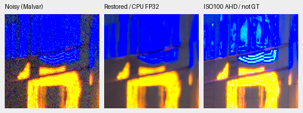

Metadata: `{"source":[{"role":"noisy","path":"/home/dllu/proj/demosaic/.cache/gfx-qualitative-20231231/2023-12-31-17-13-27_DSCF3879_0412de8b8eaac075351e2fe2605cd2558376d7f4.raf","sha256":"15b98ea5d27a88a698cc8fd350fa433ff953aa570b379d7feab975c4a8b60634"},{"role":"reference","path":"/home/dllu/proj/demosaic/.cache/gfx-qualitative-20231231/2023-12-31-17-17-05_DSCF3880_fad45f6c7220eba9bad23a04e886c364157f9985.raf","sha256":"10afc189888370bec67499e9ea6fe28a4ffe925e3296c288580efd7b6c4d08cb"}],"region":{"name":"colored-neon-sign","noisy_xy":[9060,2050],"reference_xy":[9060,2050],"size":160,"selection_method":"Input-only locator selection, then maximum normalized green correlation in512px input/reference contexts; integer offsets within+/-8 only, no output-dependent selection or warp","context_green_correlation":0.9116097356755666},"ROI_xywh":[176,176,160,160],"context_xywh":[8884,1874,512,512],"conditioning":{"shot":0.0014635775921166604,"read":1.0715704128646712e-06,"source":"input Haar fit"},"display_exposure":4.0,"reference":"Independent DSCF3880 ISO100 f/5.6 AHD reference, not GT; time/motion/sign content differs from DSCF3879 ISO6400 f/1.7."}`.

V69 augmented1k; checkpoint SHA256`6f34be8b2cc4fbba1116b4ed17bbafe41d5526da928238d194b6355b9b8b665c`.

Metadata: `{"source":[{"role":"noisy","path":"/home/dllu/proj/demosaic/.cache/gfx-qualitative-20231231/2023-12-31-17-13-27_DSCF3879_0412de8b8eaac075351e2fe2605cd2558376d7f4.raf","sha256":"15b98ea5d27a88a698cc8fd350fa433ff953aa570b379d7feab975c4a8b60634"},{"role":"reference","path":"/home/dllu/proj/demosaic/.cache/gfx-qualitative-20231231/2023-12-31-17-17-05_DSCF3880_fad45f6c7220eba9bad23a04e886c364157f9985.raf","sha256":"10afc189888370bec67499e9ea6fe28a4ffe925e3296c288580efd7b6c4d08cb"}],"region":{"name":"colored-neon-sign","noisy_xy":[9060,2050],"reference_xy":[9060,2050],"size":160,"selection_method":"Input-only locator selection, then maximum normalized green correlation in512px input/reference contexts; integer offsets within+/-8 only, no output-dependent selection or warp","context_green_correlation":0.9116097356755666},"ROI_xywh":[176,176,160,160],"context_xywh":[8884,1874,512,512],"conditioning":{"shot":0.0014635775921166604,"read":1.0715704128646712e-06,"source":"input Haar fit"},"display_exposure":4.0,"reference":"Independent DSCF3880 ISO100 f/5.6 AHD reference, not GT; time/motion/sign content differs from DSCF3879 ISO6400 f/1.7."}`.

## extra-GFX / illuminated-platform-boundary

V63 parent20k; checkpoint SHA256`ed70952dd33c5d7da39199bf1306b58b579862920fb0cccd6b222f19871bc9b5`.

Metadata: `{"source":[{"role":"noisy","path":"/home/dllu/proj/demosaic/.cache/gfx-qualitative-20231231/2023-12-31-17-13-27_DSCF3879_0412de8b8eaac075351e2fe2605cd2558376d7f4.raf","sha256":"15b98ea5d27a88a698cc8fd350fa433ff953aa570b379d7feab975c4a8b60634"},{"role":"reference","path":"/home/dllu/proj/demosaic/.cache/gfx-qualitative-20231231/2023-12-31-17-17-05_DSCF3880_fad45f6c7220eba9bad23a04e886c364157f9985.raf","sha256":"10afc189888370bec67499e9ea6fe28a4ffe925e3296c288580efd7b6c4d08cb"}],"region":{"name":"illuminated-platform-boundary","noisy_xy":[10320,4520],"reference_xy":[10321,4520],"size":160,"selection_method":"Input-only locator selection, then maximum normalized green correlation in512px input/reference contexts; integer offsets within+/-8 only, no output-dependent selection or warp","context_green_correlation":0.9831606311368877},"ROI_xywh":[176,176,160,160],"context_xywh":[10144,4344,512,512],"conditioning":{"shot":0.0014635775921166604,"read":1.0715704128646712e-06,"source":"input Haar fit"},"display_exposure":4.0,"reference":"Independent DSCF3880 ISO100 f/5.6 AHD reference, not GT; time/motion/sign content differs from DSCF3879 ISO6400 f/1.7."}`.

V68 control1k; checkpoint SHA256`456a5fb245bc807d91470cbb067e137ea48ace8eb5796a3d6ad9218573d9ad0c`.

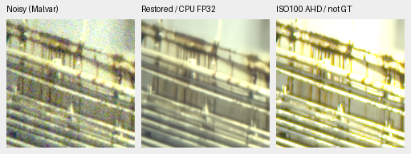

Metadata: `{"source":[{"role":"noisy","path":"/home/dllu/proj/demosaic/.cache/gfx-qualitative-20231231/2023-12-31-17-13-27_DSCF3879_0412de8b8eaac075351e2fe2605cd2558376d7f4.raf","sha256":"15b98ea5d27a88a698cc8fd350fa433ff953aa570b379d7feab975c4a8b60634"},{"role":"reference","path":"/home/dllu/proj/demosaic/.cache/gfx-qualitative-20231231/2023-12-31-17-17-05_DSCF3880_fad45f6c7220eba9bad23a04e886c364157f9985.raf","sha256":"10afc189888370bec67499e9ea6fe28a4ffe925e3296c288580efd7b6c4d08cb"}],"region":{"name":"illuminated-platform-boundary","noisy_xy":[10320,4520],"reference_xy":[10321,4520],"size":160,"selection_method":"Input-only locator selection, then maximum normalized green correlation in512px input/reference contexts; integer offsets within+/-8 only, no output-dependent selection or warp","context_green_correlation":0.9831606311368877},"ROI_xywh":[176,176,160,160],"context_xywh":[10144,4344,512,512],"conditioning":{"shot":0.0014635775921166604,"read":1.0715704128646712e-06,"source":"input Haar fit"},"display_exposure":4.0,"reference":"Independent DSCF3880 ISO100 f/5.6 AHD reference, not GT; time/motion/sign content differs from DSCF3879 ISO6400 f/1.7."}`.

V69 augmented1k; checkpoint SHA256`6f34be8b2cc4fbba1116b4ed17bbafe41d5526da928238d194b6355b9b8b665c`.

Metadata: `{"source":[{"role":"noisy","path":"/home/dllu/proj/demosaic/.cache/gfx-qualitative-20231231/2023-12-31-17-13-27_DSCF3879_0412de8b8eaac075351e2fe2605cd2558376d7f4.raf","sha256":"15b98ea5d27a88a698cc8fd350fa433ff953aa570b379d7feab975c4a8b60634"},{"role":"reference","path":"/home/dllu/proj/demosaic/.cache/gfx-qualitative-20231231/2023-12-31-17-17-05_DSCF3880_fad45f6c7220eba9bad23a04e886c364157f9985.raf","sha256":"10afc189888370bec67499e9ea6fe28a4ffe925e3296c288580efd7b6c4d08cb"}],"region":{"name":"illuminated-platform-boundary","noisy_xy":[10320,4520],"reference_xy":[10321,4520],"size":160,"selection_method":"Input-only locator selection, then maximum normalized green correlation in512px input/reference contexts; integer offsets within+/-8 only, no output-dependent selection or warp","context_green_correlation":0.9831606311368877},"ROI_xywh":[176,176,160,160],"context_xywh":[10144,4344,512,512],"conditioning":{"shot":0.0014635775921166604,"read":1.0715704128646712e-06,"source":"input Haar fit"},"display_exposure":4.0,"reference":"Independent DSCF3880 ISO100 f/5.6 AHD reference, not GT; time/motion/sign content differs from DSCF3879 ISO6400 f/1.7."}`.

