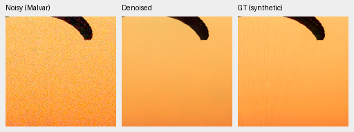
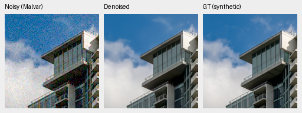
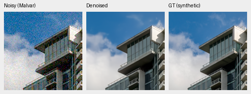
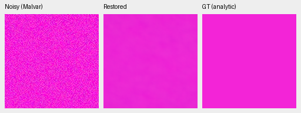
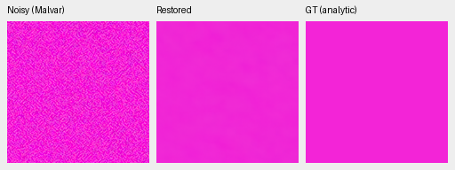
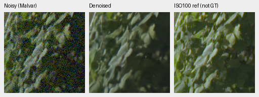
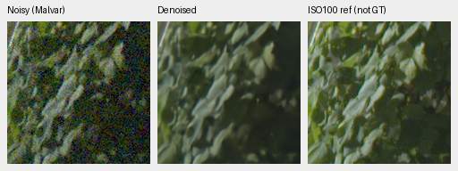
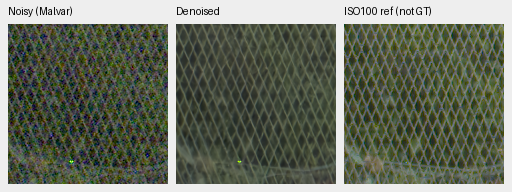

# Normalization first1k: small mean gains, unresolved texture and color

Current architecture and recommendations: [current model guide](current-model.md).
The versioned study below retains its measured results and original protocol.

At the first1,000 updates, V69 normalization augmentation gains **+.00621dB**
photographic sRGB PSNR over matched V68 control,95% source interval
**[+.00352,+.00920]**. Procedural PSNR gains+.09059dB. These small aggregate
gains do not establish better real-photo restoration: fabric cords remain
missing, GFX detail stays soft and saturated magenta retains coarse error.
**Neither model is promoted; V43 was the reference for this experiment.**

[Complete statistics, crop metadata and audited artifacts](results/normalization-v68-v69-first1k-review.json).
[All81 actually viewed native crops](normalization-v68-v69-first1k-native-gallery.md).
[Matched recipes, CUDA preflight and training boundaries](normalization-trial-v68-v69.md).

## What was compared

Both trials start from the same V63 original20k EMA with fresh AdamW/EMA,
seed50, LR3e−6, warmup100, planned4,000 updates, B16/native256/BF16,
40,170 Commons images/native128 captures/paired32 and25% paired/25% native
fractions. Training uses4×→geometry/PSF→area2; domain selection precedes fetch,
so replaced Commons batches are not loaded/augmented. All41 logged first1k
observation fingerprints, domains and LRs match. Only normalization policy,
run path and notes differ. V69 chooses center-half feature statistics with
stateless half-probability per image; V68 uses full-context statistics.
Ordinary inference is unchanged full-context normalization for all models.

The first1k gate follows the original4k LR curve; it is not a completed4k trial.
The new larger quarantined Commons corpus is unused. The parent was chosen
using earlier results; this is a research comparison, not blind selection.
Parent differences also include the fresh-optimizer fine-tuning updates.

Checkpoint SHA256:

- V63 parent: `ed70952dd33c5d7da39199bf1306b58b579862920fb0cccd6b222f19871bc9b5`.
- V68 control: `456a5fb245bc807d91470cbb067e137ea48ace8eb5796a3d6ad9218573d9ad0c`.
- V69 augmented: `6f34be8b2cc4fbba1116b4ed17bbafe41d5526da928238d194b6355b9b8b665c`.

## Full primary panels

The fresh shared-source evaluation has74,424 cases across427 photos/16
procedural sources, seven conditions, four CFAs and six methods: the three
neural models plus three classical witnesses. Known/unseen camera panels add
432/540 cases. Saved numerical/observation audits produce36 comparisons and
nine classical witnesses, using1,000 paired source-bootstrap draws/seed42.

| Model | Photo sRGB PSNR | Photo SSIM | Procedural sRGB PSNR | Procedural SSIM |
| --- | ---: | ---: | ---: | ---: |
| V63 parent20k |35.93309|.963290|35.07653|.976322|
| V68 control1k |35.97653|.963373|35.20076|.976483|
| V69 augmented1k |35.98273|.963391|35.29135|.976579|

Augmentation−control photo linear PSNR is+.01788dB[+.01247,+.02289],
and SSIM+.00001814[+.00000870,+.00002807]. Procedural sRGB PSNR is
+.09059dB[+.04358,+.15437]; procedural SSIM+.00009599[+.00000623,+.00021151].
These intervals resample development sources; they do not measure training
seed or model-selection uncertainty.

| Model | Known-camera measured-CFA PSNR | Unseen-camera measured-CFA PSNR |
| --- | ---: | ---: |
| V63 parent |54.20366|53.84298|
| V68 control |54.20115|53.84234|
| V69 augmented |54.20668|53.84716|

Augmentation−control measured-CFA intervals cross zero on both small panels:
known+.00553dB[−.02409,+.02512], unseen+.00482dB[−.00678,+.01643].
Known-camera approximate-AHD SSIM decreases−.00004068
[−.00007956,−.00000105]. Unseen approximate-AHD PSNR rises+.00677dB
[+.00374,+.01148], while its SSIM interval includes zero. These four/five-scene
panels do not establish broad real-camera improvement. Independently demosaiced
AHD is approximate RGB reference, not exact GT.

Known/unseen source: Benoit Brummer and Christophe De Vleeschouwer,
[Raw Natural Image Noise Dataset(2025)](https://doi.org/10.14428/DVN/DEQCIM),
[CC BY-SA4.0](https://creativecommons.org/licenses/by-sa/4.0/); individual scene
credits and CC0 grants appear in the dataset permissions file. The previews
are modified through restoration and rendering.

The frozen427/418/416 source cohorts give27 photographic sensitivity comparisons.
Their policy was fixed before these results. The complete values and independent
arithmetic are in the receipt:

| Photo cohort | Sources | V69−V68 sRGB PSNR, dB[95% source interval] |
| --- | ---: | --- |
| Original |427|+.006206[+.003520,+.009201]|
| Known capture series excluded |418|+.006217[+.003365,+.009170]|
| Known series and sites excluded |416|+.006188[+.003356,+.008912]|

Independent Decimal60 accumulation rebuilds107,604 metric values and3,843
source-metric means exactly;180 comparison fields differ by at most1.39e−17.
Known-series/site exclusions are source-ID
sensitivities, not certified scene independence. Unknown aliases and ancestor/
foundation-model exposure remain unresolved. The protected-final16 scenes/57
RAW files are not model-scored.

## Exact-GT photographic crops

Every panel below is160×160 native pixels, with no resizing: noisy WB-aware
Malvar → restored → exact configured simulated GT. Both use native256 ROI
`[48,48,160,160]`, RGGB, WB`[2,1,1.5]`, recorded fixed matrix, shot`.00256`,
read variance`.0000262144`, ADC16/black`.03`, and display×1/0EV. Evaluation is
CUDA FP16 with physical FP32; metrics use unquantized predictions, PNGs are
8-bit sRGB previews. Full hashes, source/ROI/noise/transforms accompany each
image in the linked receipt. Open original PNGs at100%.

Fabric: [Roy Egloff, Vertigo Swiss Riviera](https://commons.wikimedia.org/wiki/File:CH.VD.Villeneuve_2007-08-25_Vertigo-Swiss-Riviera_2392_3x2-R_4K.jpg),
source`0014aa4e075b1827f91ef8a02069e1e318f040ba`. All three still miss fine cords.

V63 parent20k

V68 control1k

V69 augmented1k

Building/clouds: [Dietmar Rabich, Vancouver Coal Harbour](https://commons.wikimedia.org/wiki/File:Vancouver_(BC,_Canada),_Coal_Harbour_Seaside_Park,_Blick_in_den_Himmel_--_2022_--_2158.jpg),
source`002fc6eeadf637e81d5a327f117b79abb86becd9`. Fine facade/cloud texture stays soft.

V63 parent20k

V68 control1k

V69 augmented1k

Both photographs are[CC BY-SA4.0](https://creativecommons.org/licenses/by-sa/4.0/),
modified by binning, crop, noise simulation and restoration. Exact GT applies
to the saved configured simulation, not real sensor ground truth.

## Weak detail and prospective colors

The1,792 analytic cases include three neural methods and Malvar. At high noise,
bright level.18/contrast.02/period16 in-phase gain is.33262 parent,
.25321 control and.26660 augmented. Dark level.01/contrast.1/period8 gain is
.00397/.00182/.00173: the carrier is almost erased. Each averages16 fixed
cases. Augmentation beats control on the selected bright carrier, while both
are below their parent; low output noise is not proof of recovered detail.

The frozen hue grid executes4,704 fresh predictions for the parent, candidates
and released NonlocalMatchFilter RAW+Malvar comparator. No old-source arrays
are reused. Independent audits reconstruct28,224 case fields and864 group
scalars. At peak.9/high-noise prior, each colored group has96 hue/CFA cases:

| Saturation | Model | Mean max channel bias | Mean RGB RMSE | Mean centered RGB RMS |
| ---: | --- | ---: | ---: | ---: |
|0.5|V63|0.014340|0.010282|0.002612|
|0.5|V68|0.013559|0.009619|0.002506|
|0.5|V69|0.013317|0.009443|0.002565|
|0.98|V63|0.005735|0.004511|0.001839|
|0.98|V68|0.003991|0.003351|0.001722|
|0.98|V69|0.004292|0.003512|0.001735|

Compared with control, augmentation lowers descriptive bias/RMSE in16 of18
groups, but increases both in the bright highly saturated and bright neutral
groups. Centered spatial RMS increases in6 of18. The bright.5-saturation group
has lower bias/RMSE but higher centered variation. These are descriptive fixed
grid results, not population confidence intervals or a universal color fix.
The native magenta views retain coarse color error; no clear visual advantage
of augmentation is established. The released comparator's magenta has a large
color error and patterned residual; this analytic result does not establish
real-photo superiority.

V63 parent20k

V68 control1k

V69 augmented1k

NonlocalMatchFilter2026+Malvar:authors-RAW / h315-s0.98-l0.90

## Standing GFX and other real photos

Locally cached DSCF3879 ISO6400/f1.7 and DSCF3880 ISO100/f5.6 are3m38s apart.
The scene/siblings remain outside training. Aperture, exposure and moving
subjects differ: the independently AHD-demosaiced ISO100 image is a qualitative
reference, **not exact GT or a pixelwise scoring target**. Original hashes:

- DSCF3879: `15b98ea5d27a88a698cc8fd350fa433ff953aa570b379d7feab975c4a8b60634`.
- DSCF3880: `10afc189888370bec67499e9ea6fe28a4ffe925e3296c288580efd7b6c4d08cb`.

Shared display×4/+2EV, WB`[1.51324503,1,2.21523179]`, recorded matrix,
input-only shot`.0014635775921166604` and read variance
`1.0715704128646712e−6` are fixed. Four ROIs come from blended full-frame FP32
outputs; supplementary neon/platform crops use the same frozen CPU context protocol.

| Region | Noisy sensor ROI(x,y,w,h) | ISO100 reference ROI |
| --- | --- | --- |
| Sky |5800,1400,160,160|5800,1400,160,160|
| Building |5790,2690,160,160|5791,2690,160,160|
| Foliage |8890,5570,160,160|8890,5570,160,160|
| Fence |2240,6000,160,160|2241,6000,160,160|
| Neon |9060,2050,160,160|9060,2050,160,160|
| Platform |10320,4520,160,160|10321,4520,160,160|

Foliage:

V63 parent20k

V68 control1k

V69 augmented1k

Chain-link fence:

V63 parent20k

V68 control1k

V69 augmented1k

Sky is smooth and building/foliage/fence detail remains soft. The models look
similar. The sharper f/5.6 reference cannot isolate restoration loss from
optical differences. Other-camera crops show crisper GFX50R surface variation
than the shown RawNIND comparator, but true fine texture versus residual noise
is unverified. Dark Q2 textures and Sony structures remain soft. No broad
decisive real-photo advantage is demonstrated.

## Review integrity and next step

All81 original PNGs were actually viewed:57 primary,12 hue, six supplementary
GFX and six selected CPU-color previews. Matching noisy/reference pixels are
bitwise equal across all26 observation groups; source/ROI/noise/display/WB/
matrix metadata match. Artifact checks cover57 primary PNGs,29 float arrays
and six full-frame RGB16 TIFFs, plus selected-color/hue/supplementary audits.
All three101.995852MP outputs use the recorded fixed tiling settings; timings
are individual shared-machine restoration observations, excluding decode/TIFF.
Tile512/overlap64/B4/FP16/physical-FP32 yields520 tiles per output:

| Model | Restoration seconds | Peak CUDA allocation, GB |
| --- | ---: | ---: |
| V63 parent |36.580|2.520|
| V68 control |37.063|2.520|
| V69 augmented |36.385|2.520|

CUDA allocation is not total unified RAM. These observations do not establish
a controlled speed difference or meet the100MP/10s target.

The first review stopped on a wrong wrapper import before full427 inference.
The next stopped because the hue library entry lacked inference mode; no hue
prediction array was saved. A recovery wrapper then rejected a stale plan path
before any stage. All failed plans/statuses/logs remain intact. The successful
recovery retains completed panels/statistics byte-for-byte, fixes entry-point
inference mode/root selection and uses a fresh hue path. No model/data/kernel,
output arrays or numerical bounds were changed to pass an audit. The direct
library inference-mode regression test and existing lineage tests pass.

Complete the original matched4,000-update schedules from the genuine first1k model/EMA/Adam/RNG states, preserving the original LR curve, seed, data, frozen source and normalization policies. Use separate continuation run directories to keep first1k logs/checkpoints and this review immutable. Review full photographic, paired, analytic, hue, GFX/native crops and source sensitivities at4k before any promotion. No additional training budget or corpus change is authorized by this decision.

This is one seed and the first1k boundary. SOTA, decisive superiority over
RawNIND on real photographs, and100MP within10s remain unmet/unproven.
