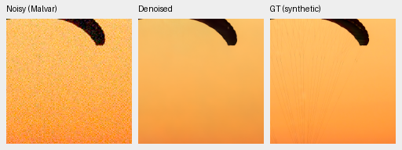
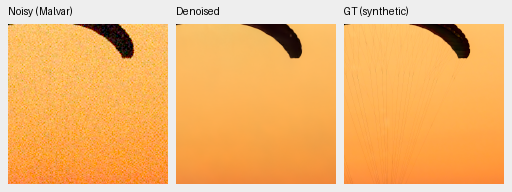
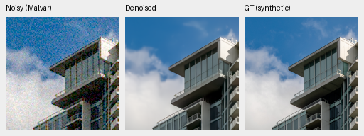
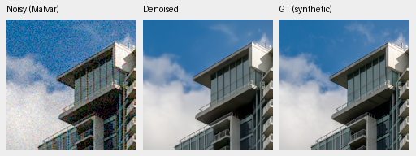
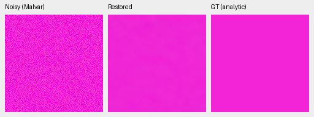
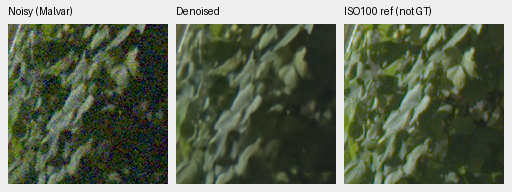
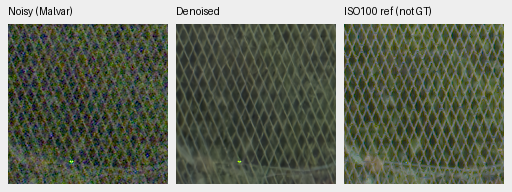

# Original4k normalization: small matched gain, persistent fidelity failures

Current architecture and recommendations: [current model guide](current-model.md).
The versioned study below retains its measured results and original protocol.

V69 normalization augmentation gains **+.02032dB** photographic sRGB PSNR over
matched V68 control,95% source interval**[+.01426,+.02806]**. The augmented
model's own1k-to4k change is only**+.00354dB[−.00177,+.00904]**; control falls
**−.01057dB[−.01881,−.00452]**. The larger between-arm gap mostly reflects
control's decline. Fine texture and coarse-color errors remain, with mixed
bright-color results and no clear broad real-photo gain. **Neither endpoint is
promoted; V43 was the reference for this experiment. This original4k study is complete.**

[Full comparisons, metadata, hashes and audits](results/normalization-v68-v69-original4k-review.json).
[All81 actually viewed original4k crop triplets](normalization-v68-v69-original4k-native-gallery.md).
[Training recipes, preflight and actual completion](normalization-trial-v68-v69.md).
[Earlier first1k quality review](normalization-v68-v69-first1k-review.md).

## Completed matched schedules

Both arms initialize from genuine V63 original20k EMA with fresh AdamW/EMA,
then resume their complete model/EMA/Adam/RNG states at1k and finish the original
4,000-update horizon. Seed50, LR3e−6/warmup100/cosine ending3e−7, B16/native256/
BF16, workers4+2+2, original40,170 Commons/native128 captures/paired32 and25%
paired/25% native fractions remain fixed. Commons uses4×→geometry/PSF→area2;
selected-domain loading avoids replaced Commons fetches. The larger future
quarantined corpus is unused. Only the training normalization policy, run path
and notes differ: V68 full-context statistics; V69 stateless half-probability
center-half statistics per image. Ordinary inference is full-context for both.

The architecture uses the frozen pinned DINOv3 ConvNeXt feature pyramid and the
pretrained RGB restoration trunk. This is a matched normalization-policy study,
not an architecture or DINO-presence ablation. Parent comparisons include the
fresh-optimizer fine-tuning updates. Parent selection used earlier research
results; it was not blind.

Both trainers and their controller exited successfully. Boundary audits verify
finite91 model/91 EMA/89 Adam states, complete RNG, unchanged context buffers
and source/data/recipe/parent identity. All162 **logged** input/domain/LR rows
match across arms, including exact1k log prefixes; all augmented masks are
independently recomputed. Production hooks verify restoration before first
fetch/EMA update and unchanged gradient-free DINO. No unlogged hashes or
bitwise-deterministic CUDA optimization are claimed. First1k/parent evidence
and their checkpoints remain unchanged. No extension beyond4k is queued.

Checkpoint SHA256:

- Parent V63: `ed70952dd33c5d7da39199bf1306b58b579862920fb0cccd6b222f19871bc9b5`.
- V68 control4k: `5bcb45adb6ace6aed3cd2071ad56f36bd019645ec4c117c4d6f65beda220b737`.
- V69 augmented4k: `8162020f954426a9fb5f657eb3e7d74ec7cde65c5c58f1f369ee556d0d535e59`.

Frozen training bundle:
`db5fb3ba42827e9db043dbc85f069bb1e5568cdafa872f7340d872852bc6a771`.

## Full photographic and procedural results

The fresh six-method primary panel covers427 photos/16 procedural sources,
seven noise/exposure conditions and four CFAs:74,424 cases, three neural models
and three classical witnesses. Known/unseen panels add432/540 cases. The60
comparisons/fifteen classical witnesses include matched policy, parent and
own-first1k progress. Existing observation/metadata/numerical bounds are unchanged;
paired source bootstrap uses1,000 draws/seed42.

| Model/boundary | Photo sRGB PSNR | Photo SSIM | Procedural sRGB PSNR | Procedural SSIM |
| --- | ---: | ---: | ---: | ---: |
|V63 parent20k|35.93309|0.963290|35.07653|0.976322|
|V68 control1k|35.97653|0.963373|35.20076|0.976483|
|V68 control4k|35.96596|0.963352|35.26853|0.976543|
|V69 augmented1k|35.98273|0.963391|35.29135|0.976579|
|V69 augmented4k|35.98628|0.963388|35.36376|0.976699|

At4k, augmentation−control photo linear PSNR is+.02953dB[+.01912,+.04077]
and SSIM+.00003621[+.00002665,+.00004711]. Procedural sRGB PSNR gains+.09522dB
[+.03684,+.16999], with SSIM+.00015631[+.00006946,+.00027635]. Against the
parent, photographic gains are+.03287dB[+.02364,+.04355] control and+.05319dB
[+.03881,+.06990] augmented. Better means do not imply restored weak detail.
The augmented own1k photo interval includes zero; finishing the planned horizon
is not proof of convergence or a useful new real-photo improvement.

## Paired real-camera panels

| Model | Known measured-CFA PSNR | Unseen measured-CFA PSNR |
| --- | ---: | ---: |
|V63 parent20k|54.20366|53.84298|
|V68 control4k|54.20920|53.86301|
|V69 augmented4k|54.21955|53.86247|

Augmentation−control measured-CFA PSNR is+.01035dB[+.00335,+.01696] known,
and−.00054dB[−.00490,+.00389] unseen. These panels contain only four/five scenes.
Known approximate-AHD PSNR and SSIM intervals include zero. Unseen AHD PSNR
gains+.00735dB[+.00116,+.01659], while its SSIM interval includes zero. The
registered independently demosaiced AHD previews are approximate RGB references
with residual noise; primary sensor scores use measured CFA samples. They are
not exact clean RGB GT or proof of broad superiority.

Source: Benoit Brummer and Christophe De Vleeschouwer,
[Raw Natural Image Noise Dataset(2025)](https://doi.org/10.14428/DVN/DEQCIM),
[CC BY-SA4.0](https://creativecommons.org/licenses/by-sa/4.0/); individual scene
credits and CC0 grants are in the dataset permissions file. Previews are modified
through restoration/rendering.

## Predeclared Commons source sensitivities

The fixed policy/source IDs predate these results. The original427 panel stays
intact; known capture-series/site exclusions give:

| Photo cohort | Sources | V69−V68 sRGB PSNR, dB[95% source interval] |
| --- | ---: | --- |
|original427|427|+0.020323[+0.014262,+0.028062]|
|known-capture-series-excluded|418|+0.020503[+0.014338,+0.027776]|
|known-capture-series-and-sites-excluded|416|+0.020537[+0.014378,+0.027263]|

All15 original photographic statistics reproduce exactly before subset analysis.
Independent Decimal60 accumulation rebuilds179,340 metric values and6,405
source-metric means exactly;300 comparison fields differ by at most1.39e−17.
These are source-ID sensitivities, not certified scene-independent cohorts.
Unknown aliases and ancestor/foundation pretraining exposure remain unresolved.
Source intervals exclude training-seed and selection uncertainty. The protected
final16 scenes/57 RAW files remain unscored.

## Native exact-GT photographic triplets

Each panel is160×160 at100%, with no resizing: noisy WB-aware Malvar → restored
→ exact configured simulated GT. Native256 ROI`[48,48,160,160]`, RGGB,
WB`[2,1,1.5]`, recorded fixed matrix, shot`.00256`, read variance`.0000262144`,
ADC16/black`.03` and display×1/0EV are shared. Evaluation uses CUDA FP16 with
physical FP32; metrics use unquantized arrays and previews are8-bit sRGB. Full
source/ROI/checkpoint/noise/display metadata accompany every image in the receipt.
Open original PNGs at100%.

Fabric: [Roy Egloff, Vertigo Swiss Riviera](https://commons.wikimedia.org/wiki/File:CH.VD.Villeneuve_2007-08-25_Vertigo-Swiss-Riviera_2392_3x2-R_4K.jpg),
source`0014aa4e075b1827f91ef8a02069e1e318f040ba`. Fine cords remain missing and
the coarse orange field differs from GT in all three restored examples.

V63 parent20k

V68 control4k

V69 augmented4k

Building/clouds: [Dietmar Rabich, Vancouver Coal Harbour](https://commons.wikimedia.org/wiki/File:Vancouver_(BC,_Canada),_Coal_Harbour_Seaside_Park,_Blick_in_den_Himmel_--_2022_--_2158.jpg),
source`002fc6eeadf637e81d5a327f117b79abb86becd9`. Fine facade/cloud detail stays soft.

V63 parent20k

V68 control4k

V69 augmented4k

Both photographs are[CC BY-SA4.0](https://creativecommons.org/licenses/by-sa/4.0/),
modified by binning, crop, noise simulation and restoration. Exact GT applies to
the configured saved simulation, not real sensor ground truth.

## Analytic texture and prospective hue checks

The1,792 analytic cases cover three neural methods plus Malvar. At high noise,
bright level.18/contrast.02/period16 in-phase gain is.33264 parent/.29841 control/
.31006 augmented, averaging16 fixed cases. Dark level.01/contrast.1/period8 gain
is.00397/.00330/.00333: almost erased. Both candidates recover some response
relative to1k but remain below their parent in the selected bright test. Low
residual noise does not establish faithful texture recovery.

The hue grid contains4,704 predictions:2,352 fresh candidate forwards plus2,352
strictly verified same-source parent/released-nonlocal arrays. Source/observation/
checkpoint/precision gates and per-array hash checks remain unchanged. Independent
audits reconstruct28,224 case fields and864 group scalars. One observation per
cell, one WB/camera and fixed brightness/saturation groups make these descriptive
diagnostics, not population confidence intervals.

At peak.9/high-noise prior:

| Saturation | Model | Cases | Mean max channel bias | Mean camera-RGB RMSE | Mean centered RGB RMS |
| ---: | --- | ---: | ---: | ---: | ---: |
|0.0|V63|4|0.001351|0.002232|0.001985|
|0.0|V68|4|0.001385|0.002268|0.002012|
|0.0|V69|4|0.001290|0.002233|0.001991|
|0.5|V63|96|0.014340|0.010282|0.002612|
|0.5|V68|96|0.015219|0.010745|0.002603|
|0.5|V69|96|0.015429|0.010830|0.002626|
|0.98|V63|96|0.005735|0.004511|0.001839|
|0.98|V68|96|0.005338|0.004075|0.001824|
|0.98|V69|96|0.005194|0.004022|0.001794|

Augmentation lowers bias/RMSE in13 of18 fixed groups versus control and raises
both in five; centered spatial RMS rises in four. Against its own1k checkpoint,
augmented bias/RMSE worsen in nine of18 groups, and centered RMS in five. Control
worsens in five groups for each metric. The bright.5-saturation group worsens
against the parent and own1k; the highly saturated group remains better than
parent but worse than own1k. Counts give equal weight to groups with different
case counts. There is no universal color improvement. Neural magenta views retain
coarse variation/bias; the released nonlocal comparator has large magenta color
error and patterned residual in this diagnostic.

V63 parent20k

V68 control4k

V69 augmented4k

NonlocalMatchFilter2026+Malvar:authors-RAW / h315-s0.98-l0.90

## Standing GFX and other real photographs

Cached DSCF3879 ISO6400/f1.7 and DSCF3880 ISO100/f5.6 are3m38s apart. The scene
and siblings remain outside training. Aperture, exposure and moving subjects
differ. The independent ISO100 AHD image is a qualitative reference, **not exact
GT or a pixelwise scoring target**. Originals stay read-only. Source SHA256:

- DSCF3879: `15b98ea5d27a88a698cc8fd350fa433ff953aa570b379d7feab975c4a8b60634`.
- DSCF3880: `10afc189888370bec67499e9ea6fe28a4ffe925e3296c288580efd7b6c4d08cb`.

Shared display×4/+2EV, WB`[1.51324503,1,2.21523179]`, recorded matrix and
input-only shot`.0014635775921166604`/read variance`1.0715704128646712e−6`
remain fixed. Four regions are cropped from blended full-frame FP32 outputs;
supplementary neon/platform views use the frozen CPU-context protocol.

| Region | Noisy sensor ROI(x,y,w,h) | Independent ISO100 ROI |
| --- | --- | --- |
| Sky |5800,1400,160,160|5800,1400,160,160|
| Building |5790,2690,160,160|5791,2690,160,160|
| Foliage |8890,5570,160,160|8890,5570,160,160|
| Fence |2240,6000,160,160|2241,6000,160,160|
| Neon |9060,2050,160,160|9060,2050,160,160|
| Platform |10320,4520,160,160|10321,4520,160,160|

Foliage:

V63 parent20k

V68 control4k

V69 augmented4k

Chain-link fence:

V63 parent20k

V68 control4k

V69 augmented4k

Sky is smooth; building lattice/wires, foliage, fence, neon boundaries and
platform structure remain soft and similar across methods. The sharper f/5.6
reference does not isolate restoration loss from optical differences. GFX50R
seams/cement variation look crisper than the shown RawNIND comparator, but true
texture versus residual noise is unverified. Q2 dark detail and Sony structures
remain soft. These views do not demonstrate broad decisive real-photo superiority.

## Why V43 was the reference for this experiment

Four historical V43 README originals were reopened at100%: the same two photos,
GFX foliage and fence. Their displayed noisy/reference pixels are bitwise equal
to the corresponding new V69 panels, with no resizing. The
[context receipt](results/normalization-v68-v69-original4k-review.json) binds their
hashes, source report and actual V43 checkpoint
`0d74cf31fb1c7e3f97fc692c855a2ca0ee3ebf562b454e4f8b135c28fc0aa5c5`.
The existing model alias resolves to that verified snapshot; no model changed.
These are visual context with differing model/source/training histories.

V43 retains a stronger orange gradient closer to the shown exact fabric GT;
cords remain missing. Building and GFX foliage/fence remain broadly similar.
The newer photo mean does not establish a useful broad replacement for the
working reference. Historical V43 context, in the same photo/foliage/fence order:

## Full-frame execution, audit closure and decision

All81 required new native PNGs were actually viewed, plus the four separate
historical context views. Across all26 new observation groups, noisy/reference
pixels are bitwise equal and coordinates, noise, display, WB/matrix metadata
match. The additional independent state/artifact checks pass57 primary PNGs,
29 F32 arrays and six full-frame RGB16 TIFFs; selected-CPU-color, hue and
supplementary/source audits also pass. All81 originals and metadata are in the
gallery/receipt. There are no new neural forwards in publication or native review.

Three101.995852MP restorations use tile512/overlap64/B4/FP16/physical-FP32 and
520 tiles each. Individual shared-machine restoration timings, excluding RAW
decode and TIFF encoding:

| Model | Restoration seconds | Peak CUDA allocation, GB |
| --- | ---: | ---: |
|V68 control4k|36.685|2.520|
|V69 augmented4k|36.566|2.520|
|V63 parent20k|36.316|2.520|

CUDA allocation is not total unified RAM. These observations do not establish
a controlled speed difference and do not meet100MP within10s. Both linear16
and sRGB16 outputs are verified for all three models.

The original4k trial is closed without promotion or further normalization
training. V43 was the reference and source of representative README crops during this study.
The next research task is a structural RAW reconstruction change addressing
coarse color, weak texture and full-resolution compute cost, with a new matched
protocol frozen before training. Full PROMPT SOTA, decisive superiority over
RawNIND on real photographs and100MP within10s remain unmet/unproven.
