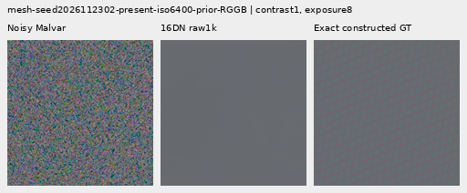
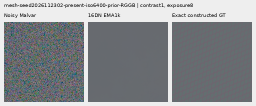
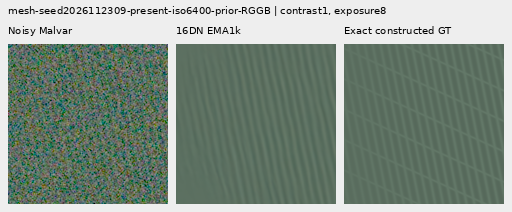
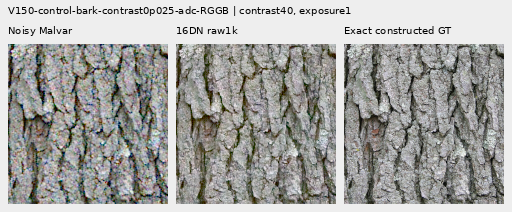
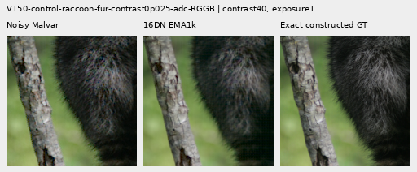

# V150 loss floor: completed matched review

Raising the late-head loss floor from 2 to 16 DN reduces much of the native
control's damage and gives small real noisy-flat gains. Native 512 full RMS falls
about .045–.047% versus V143. On two faint ADC-only photographic targets, mean
full RMS falls **3.058%**;
both late heads also lower photographic band error there. These are useful,
narrow gains. **No convincing new ISO6400 fine cab wires or noisy feather/bark
texture appear.** 16 DN mesh response remains 4.26–4.54% below V143, and exact
quiet regions remain worse than the parent.

The next noise-focused late-head training control should use the tested 16 DN
loss rather than inherit the larger 2 DN regressions. The 2 DN endpoint remains
a relevant ADC-band/coarse-flat comparator. No inference integration or general
model replacement is made: [V120/general and V143/explicit periodic detail](current-model.md)
retain their measured strengths and remaining weaknesses. These results guide the next late-head training comparison.

Both fresh 31,409-parameter heads complete 1,000 updates on the same 4,000 cached
training observations. All four fixed raw/EMA endpoints are scored on 822 cases
and actually viewed in 72 native figures. The fresh native 2 DN control reproduces
the old V148/V149 trace, raw/EMA/Adam state and **all 1,596 retained predictions
exactly**. No early epoch or loss-based endpoint choice occurs.

## Weak meshes and actual blank errors

Errors are means of per-observation RMS in unclipped camera RGB ×65535.
Response projects onto exact plane-detrended procedural texture; ideal is 1.
The 256 present observations are 64 recipes across four CFAs, not 256 independent
scenes. The matched control isolates loss normalization at this fixed horizon.

| Method | Present full RMS | Response | Actual blank RMS | Blank spatial RMS | Added blank RMS |
| --- | ---: | ---: | ---: | ---: | ---: |
|V143|9.11124|0.0220209|5.52332|5.34311|0.000000|
|2 DN raw|9.14391|0.0200224|5.55579|5.37668|0.638666|
|2 DN EMA|9.14421|0.0202779|5.56090|5.38196|0.673863|
|16 DN raw|9.11866|0.0210829|5.52871|5.34869|0.325369|
|16 DN EMA|9.11919|0.0210210|5.52954|5.34955|0.344148|
|Existing periodic detail|8.58613|0.0708975|5.52333|5.34312|0.000636|

16 DN response rises 3.67–5.30% over the matched control, and actual blank error
gets closer to V143, but neither weak response nor mesh error surpasses V143.
The new heads still miss a crossing family. The existing explicit periodic
`detail` option remains stronger on selected meshes, with incomplete orientations,
support seams/spill and little nonperiodic gain. Added correction energy is a
footprint rather than a hallucination measure; actual error is shown beside it.

| Test | V143 |2 DN raw |2 DN EMA |16 DN raw |16 DN EMA |
| --- | ---: | ---: | ---: | ---: | ---: |
|Absent mesh full RMS;256 observations|5.23791|5.26616|5.26982|5.24209|5.24285|
|Native 512 ISO6400 full RMS;24|18.54681|18.57179|18.58100|18.53835|18.53815|
|Native 512 ISO6400 full spatial RMS|18.23513|18.26064|18.27004|18.22650|18.22631|
|Native 512 ISO6400 block32 RMS|13.44056|13.44226|13.44271|13.44131|13.44135|
|Native 512 ISO12800 full RMS;24|24.07189|24.11647|24.13017|24.06114|24.06052|
|Native 512 ISO12800 full spatial RMS|23.59686|23.64244|23.65643|23.58581|23.58517|
|Native 512 ISO12800 block32 RMS|17.93254|17.93239|17.93232|17.93231|17.93225|
|Older native 256 ISO12800 full RMS;24|27.23355|27.21444|27.21728|27.19812|27.19550|

The noisy-flat full/spatial improvements are small and do not remove the existing
colored mottle. Coarse block32 changes are tiny and mixed; ISO6400 block32 error
still rises. All 48 constant ADC flat observations across 256/512 remain exactly
at the parent under every endpoint. The sloped ADC results below show why that
constant-input property does not establish broader flat safety.

## Noisy faint/dark photographs

Each group has 32 observations. The band is a native DCT16 luma annulus at
1/8–1/3 cycles/pixel; lower relative band error is better. Full/scoped metrics,
spatial errors and luma gains remain in the [score receipt](results/v150-objective-floor-v1/scores.json).

| Photo band error | V143 |2 DN raw |2 DN EMA |16 DN raw |16 DN EMA |
| --- | ---: | ---: | ---: | ---: | ---: |
|Retained512 faint|0.824639|0.825033|0.824991|0.824839|0.824860|
|Retained512 dark|0.661447|0.661510|0.661497|0.661470|0.661473|
|Organic384 faint|0.924117|0.924888|0.924829|0.924532|0.924567|
|Organic384 dark|0.781612|0.781709|0.781699|0.781662|0.781663|

16 DN reduces every noisy photographic group's band regression relative to
the matched control, yet all four remain worse than V143 and lose band response.
Faint whole-image error also rises. Retained-dark and organic-dark full RMS
improve slightly, without restoring the missing native feather, moth, grass or
bark texture. These small pixel-error gains are not evidence of useful new
low-contrast structure.

## Strong edges and exact quiet regions

Whole-scene RMS improves .276–.370% versus V143, less than the 2 DN control's
strong-edge gain. Exact quiet-region RMS/spatial errors remain above V143 but
are materially closer than the control. The 32 observations cover four strong
edge/pattern recipes, four CFAs and both priors.

| Prior; 16 cases | Method | Whole RMS | Quiet160 RMS | Quiet spatial RMS |
| --- | --- | ---: | ---: | ---: |
|ISO6400|V143|27.10563|3.89885|3.26850|
|ISO6400|2 DN raw|27.01160|3.93960|3.31411|
|ISO6400|2 DN EMA|27.00909|3.94348|3.31845|
|ISO6400|16 DN raw|27.03072|3.91519|3.28633|
|ISO6400|16 DN EMA|27.02807|3.91632|3.28754|
|ISO12800|V143|36.74747|6.15265|5.34183|
|ISO12800|2 DN raw|36.58945|6.20589|5.40200|
|ISO12800|2 DN EMA|36.57498|6.20733|5.40362|
|ISO12800|16 DN raw|36.61803|6.17032|5.36179|
|ISO12800|16 DN EMA|36.61163|6.17239|5.36423|

Under diagnostic 40× contrast, 16 DN adds less fine grain than 2 DN but leaves
the large colored blobs. Unboosted strong edges stay visually close. Main real
sky remains near the parent; its ISO100 reference is qualitative and unscored.

## ADC photo gains and sloped-field tradeoffs

These 8 ADC photo observations are two deliberately contrast-reduced Commons
targets across four CFAs, not 8 independent photographs or real high-ISO captures.
Both source IDs remain outside training. Targets retain each channel's mean
and scale deviations by .025; the 16-bit ADC has black .03 and shot=read=0.
The new analytic slopes comprise four level/tint/slope recipes across four CFAs.
Both datasets have exact constructed array targets.

| ADC test | V143 |2 DN raw |2 DN EMA |16 DN raw |16 DN EMA |
| --- | ---: | ---: | ---: | ---: | ---: |
|Photo full RMS;8|18.14987|17.63527|17.63514|17.59506|17.59492|
|Photo relative band error|0.101855|0.096193|0.096196|0.097070|0.097059|
|Photo luma-band response|0.968329|0.973636|0.973614|0.971985|0.971979|
|Sloped512 full RMS;16|3.77137|3.60172|3.61307|3.69349|3.69526|
|Sloped512 full spatial RMS|3.39725|3.23545|3.24903|3.33825|3.33965|
|Sloped512 block32 RMS|0.57465|0.65693|0.66997|0.73671|0.73584|
|Sloped512 crop block32 RMS|0.08815|0.08816|0.08817|0.08787|0.08787|
|Sloped512 worst absolute DC|11.17698|11.09516|11.09625|11.09479|11.10188|

16 DN lowers ADC photo full error about 3.057–3.058%, versus 2.835% for the native
control. The 2 DN control has lower ADC photographic band error than16 DN;
both improve that band versus V143. Fine bark/fur remain present, with small
visible edge/color changes at 40× contrast. This is a useful limited result,
without proving broad ADC or high-noise superiority.

On slopes, 16 DN lowers full/spatial error about 2%, but less than the 2 DN
control. Its coarse block32 error rises about 28% versus V143, despite a slightly
better worst DC. Central crop block32 alone would miss that wider-field
regression. The fixed native central views look smooth; they do not erase the
full-field numeric weakness.

## Native 100% comparisons

All 72 figures were actually inspected at original detail in 18 unscaled sheets.
Every crop cell is 160×160 original pixels. The [manifest](images/v150-objective-floor-v1/manifest-v1.json)
records source/ROI, noise conditioning, checkpoint SHA256, exposure, shared
contrast/anchor, camera display transform and byte-exact bindings. Twenty-four
triplets repeat comparison-board pixels; they are not additional observations.

The two mesh examples use native 512 contexts, RGGB, ROI `[176,176,160,160]`,
shot .00128/read 6.5536e-6, exposure 8 and contrast 1. Seeds end 2302/2309. The first
stays nearly flat; the second retains one family but misses crossings. **Noisy
→ restored → exact constructed GT**, identical transforms across methods:

ADC bark source metadata: Derek Ramsey (Ram-Man), CC BY-SA2.5,
SHA1 `0ae232278265dabbdd54f52c34045a3d03323aa7`. Raccoon fur: Korall,
CC BY3.0, SHA1 `2b5a51667b9906eecead8f82e08c7ba11750f8c6`. Both native 256
contexts use ROI `[48,48,160,160]`, display exposure 1 and contrast 40 about common
target channel means. These are ADC-only synthetic inputs and constructed photo
GT, not physical high-ISO capture GT. Both fixed candidate endpoints are shown:

The corresponding 2 DN control triplets are available for
[bark raw](images/v150-objective-floor-v1/comparison-42-native-matrix-raw-step1000-triplet.png),
[fur raw](images/v150-objective-floor-v1/comparison-43-native-matrix-raw-step1000-triplet.png),
[bark EMA](images/v150-objective-floor-v1/comparison-42-native-matrix-EMA-step1000-triplet.png) and
[fur EMA](images/v150-objective-floor-v1/comparison-43-native-matrix-EMA-step1000-triplet.png).
Sloped central crops at contrast 8/exposure `.18/level` cover
[.004](images/v150-objective-floor-v1/comparison-44.png),
[.02](images/v150-objective-floor-v1/comparison-45.png),
[.18](images/v150-objective-floor-v1/comparison-46.png) and
[.75](images/v150-objective-floor-v1/comparison-47.png), native 512,
ROI `[176,176,160,160]`. Exact levels/tints/slopes are in the manifest.

High-noise organic [feathers](images/v150-objective-floor-v1/comparison-13.png)
use Alexis Lours, CC BY4.0, source SHA1
`02a76fd33b5e1414a0504f0b3f0aeb03a569b6f4`, native 384,
ROI `[112,112,160,160]`, exposure 14.388348 and contrast 8. The
[dark bird/branch](images/v150-objective-floor-v1/comparison-25.png) uses Andrew
Mercer, CC BY-SA4.0, SHA1 `3e638bbb56ed80abc88939468783e3bf9b92ee77`, native 512,
ROI `[176,176,160,160]`, exposure 80.995917 and contrast 1. Both use
shot .00128/read 6.5536e-6. Their fine texture remains soft.

Standing DSCF3879 ISO6400/DSCF3880 ISO100 views retain
[sky](images/v150-objective-floor-v1/comparison-05.png),
[building](images/v150-objective-floor-v1/comparison-06.png),
[foliage](images/v150-objective-floor-v1/comparison-07.png) and
[chain-link fence](images/v150-objective-floor-v1/comparison-08.png), exposure 4.
The cab-mesh DSCF3842/3835 views retain native 768 context and both windows under
[nominal left](images/v150-objective-floor-v1/comparison-09.png),
[nominal right](images/v150-objective-floor-v1/comparison-10.png),
[profile3879 left](images/v150-objective-floor-v1/comparison-11.png) and
[profile3879 right](images/v150-objective-floor-v1/comparison-12.png) priors.
Their left/right ROIs are `[206,229,160,160]` / `[426,189,160,160]`, exposure 16,
contrast 1; both SOOC JPEGs stay native unboosted sRGB8. These independent
ISO100/AHD/JPEG references differ in aperture, shutter, processing and motion:
**qualitative references, not exact GT**, never pixelwise scored. Fine wires
remain soft and incomplete. The
[exact quiet patch](images/v150-objective-floor-v1/comparison-26.png) at 40× and
[whole-edge view](images/v150-objective-floor-v1/comparison-27.png) at 1× retain
identical coordinates across methods.

## Matched protocol and audits

The [recipe](../configs/quality-v143-objective-floor-v150.yaml) changes the
training RGB standard-deviation floor 2→16 DN16 and coefficient variance floor
`(2/65535)^2`→`(16/65535)^2`. Physical inputs, architecture, pre-gate spectral
objective, Charbonnier epsilons, source weights, initialization, seed, 1k horizon,
LR/schedule/clipping and EMA are fixed. The normalization also changes absolute
Charbonnier smoothing; it is not just a constant RGB-loss multiplier.

All 12 initial tensors match, and frequency outputs start zero at the parent.
All 85 neural source hashes remain unchanged. Eight objective tests pass,
including exact legacy value/gradient reproduction, all four CFAs, high-noise
invariance and 1/64 ADC spectral-gradient scaling. Legacy/current/archive outputs
match on 28 cases (56 forward-function evaluations). Both discarded CUDA 10 checks
include genuine 8+2 optimizer restoration and finite nonzero gradients for all 12
tensors; 4.07 GiB peak. Production restarts fresh and finishes both 1k states with
all 24 Adam states finite. The control exactly reproduces the old complete trace,
raw/EMA/Adam and all 1,596 retained outputs; new 24 ADC controls have no older head
archive. Review preserves model hashes and RNG under all 3,288 calls.

The same 4,000 adopted training observations retain native 256 photographs and
native 512 procedures, bin4→geometry→area2, 90,782-photo/27-region eligibility and
all validation/protected-source exclusions. The 24 added ADC controls are never
training inputs. Their 24 parent/DINO calls finish beforehand with unchanged
hashes/RNG and .99 GiB peak; there are no parent/DINO or stochastic-noise calls in
head training/review. Original media remains read only, with no RAW/dataz access.
The full 822-case review is adaptive reused validation, not fresh independent
evidence. Both final endpoints per arm are reported.

The [final evidence](results/v150-objective-floor-final-v1.json) preserves 14
byte-exact receipt copies and 72 PNGs, with all checkpoint/source bindings.
Independent metrics pass 40,210 scalar checks and 476 Decimal reductions,
maximum 4.55e-13. Display/PNG checks cover 32,332,800 RGB channels. All 10 primary
owners have exited; no experiment jobs remain. The
[preparation snapshot](results/v150-objective-floor-preparation-v1.json) retains
its original active 423-row/checkpoint 250 state, and the
[state-only final audit](results/v150-objective-floor-training-state-v1.json)
remains byte-exact beside the later full audit. An initial reporting harness
import-name error stopped before formulas; failed source/receipt are preserved,
with the corrected path loader and no model/input/worker restart.

Paired checkpoint SHA256:
`116e12c6b6b0a9ee690a182c7b592a40c13c75b0c2e5aea2ce7c1ed06a4a6b7b`.
16 DN raw export:
`fa69c62f8d2427a35ee764f9b1906f5b9a5416e43d45aa33df260e007f2acbae`;
EMA:
`c778418f160f6860f582e5c327d7c17a471b8bd2e3a2a2acf820c66939789c2c`.
All four endpoint hashes and parent bindings are in the figure manifest.

Tracked head work is 56 compatibility evaluations+20 discarded smoke updates+
2,000 production updates+3,288 quality calls = 5,364, excluding unit tests and the
separate 24 parent/DINO calls. No scientific worker was replaced or restarted.

## What the loss test establishes

The [full training-routing audit](results/v150-objective-floor-routing-v1.json)
matches all 1,000 rows/noise conditions per arm. ADC-only steps exceeding the
gradient clip threshold fall 35→4 out of 118; none of 882 noisy steps exceed it.
Median ADC preclip norm falls .298018→.018555, while median noisy norm also falls
.017676→.006884. The first two arm traces match exactly; the first difference
is the ADC batch at step 3. The change is routed as designed, but ADC still supplies
95.162% of a cap-at-1 squared-norm proxy. That proxy does not measure
Adam influence or prove a causal explanation for missing texture.

Mean support over all mesh observations stays about .16; mean per-observation coefficient-correction
RMS roughly halves. This is a smaller proposal, without establishing better
spatial selectivity or calibrated detection. The 16 DN change improves several
measured errors but does not resolve estimator recovery. Further isolation of
ADC supervision, alongside actual ADC tradeoff checks, remains a useful test;
estimator relative-phase evidence and aggregation also remain open questions.
The broader fine-detail/clean-sky objective remains active and unmet. See the
[diary](../diary/2026-11-03-15-03-40-v150-objective-floor-trial.md).
