# Fitting frequencies between FFT bins clarifies the mesh

The later [connected support/refit option](sparse-phase-support.md) raises average
response and reduces mean blank spill, with a worse worst-case tail. It is an
explicit `sparse` envelope; this earlier refined-TV mode remains available.

Small continuous frequency updates give modest, placement-sensitive changes in
the real crossing mesh on the same V143 parent. Fresh dark procedural validation shows **3.7% higher template
response and slightly lower texture error**, with **8.5% higher added-field RMS
in adjacent blank regions** versus fixed-bin TV. Fully absent inputs and the
tested wider sky stay unchanged. Recovery remains incomplete; this is an
additional explicit option, with the existing TV policy preserved.

[Implementation](../src/demosaic/phase_frequency.py) ·
[Execution/validation](results/offgrid-phase-publication-v1.json) ·
[Native source/ROI/checkpoint/noise/display metadata](images/offgrid-phase-v1/manifest.json).

## What changes

The [TV envelope](edge-phase-envelope.md) fits waves at frequencies selected on
a 256px FFT grid. Real wire spacing and angle rarely land exactly on those bins.
Their phase drifts across the window, and smoothing the local coefficients can
attenuate that drift. A small frequency adjustment reduces this mismatch.

The peak detector stays unchanged. Only waves with a positive **original global
gate** get a search; originally inactive gates stay off. For each active wave,
the two observed green phases retain their physical CFA positions, original
Hann taper and independent affine subtraction. The search maximizes the real
cross product of their continuous DFT coefficients. It uses an initial 3×3 grid
at −1/0/+1 bin, then at most 12 damped Newton steps, each capped at 0.5 bin, with
four fixed backtracking steps. Total displacement is bounded by ±1.5 bins per
axis. Every candidate remains in radial 0.03–0.22 with positive vertical frequency.
Potential collisions within 2 bins fall back to the original frequency.

If any observed sample in a selected window reaches the normalized upper ADC
endpoint (`>=1−1e−7`), the complete original fixed-bin TV fit is retained.
Clipping breaks the linear sinusoidal observation model. Otherwise the RGB/affine
WLS fit and active global power gate are recomputed at the new frequencies. Local sigma 16 coefficients, TV weight 16, 1024-step cap, gap 1e−5,
Gaussian32 heuristic power shrink 9, magnitude cap 3, 32-pixel aprons and stride 128 blending
are unchanged. No extra harmonics, GT, references, RNG or learned weights enter
refinement. Its adaptive search and covariance **are not calibrated confidence**.

The first development version capped gates at their old values. The selected
version refits power for active gates and adds explicit band/collision guards.
On the reused 64-recipe development sample, response rose 2.6%, complete error
fell 0.33% and added blank RMS rose 8.8%. Those results helped select the policy;
they are not fresh validation.

## Running either policy

```bash
source scripts/env.sh
uv run demosaic infer /mnt/external/demosaic/models/v143-final5000.pt photo.raf \
  /mnt/external/demosaic/output/photo-refined-linear.tiff \
  --preview /mnt/external/demosaic/output/photo-refined-srgb.tiff \
  --shot 0.00128 --read 0.0000065536 --precision float32 \
  --tile 512 --overlap 64 --batch-size 4 \
  --phase-harmonic --phase-harmonic-refine-frequency
```

`--phase-harmonic` alone retains fixed-bin TV. Add
`--phase-harmonic-refine-frequency` for this policy, which requires the `edge`
envelope. `complex` and `scalar` retain the earlier modes. TV follows the neural
device; `--phase-harmonic-device cpu` selects the NumPy reference. Ordinary
inference still leaves harmonic refinement disabled. The example noise prior
is not universal camera calibration. Sidecars record methodv4, original/refined
policy, frequency searches/evaluations/fallbacks, TV convergence diagnostics and
elapsed refinement time.

## Fresh locked validation

The base private frequency policy was locked before generating 64 new recipes,
seeds 2026110400–2026110463. Present/absent states and four CFAs give **512 actual
V143 root/DINO calls**, with unchanged model/backbone/input/RNG witnesses, zero
new V120 controls and zero training updates. Native 256 comes from continuous 512
geometry before area2 downsampling, zero optical PSF, level 0.02,
shot 0.00128/read variance 6.5536×10⁻⁶, ADC16/black 0.03. GT enters scoring only.
Checkpoint SHA256:
`96d146d017c54196288c585f8b7eddcf030e8a235061049c31e985b9380b7ce4`.
[Policy](results/offgrid-phase-locked-policy-v1.json) ·
[Complete fresh results](results/offgrid-phase-prospective-v1.json).

The clipping fallback was added **after** inspecting the first unguarded complete
real frames. All 512 fresh dark inputs have a false clipping predicate; an AST and
input audit proves their frequency policy and 100,663,296 output values remain
unchanged. Their scores remain valid for the final path on these inputs. This is
not prospective selection or validation of the clipping fallback on saturated
photos. All 16 CFA/clipped-phase fit checks retain the original WLS exactly, and
an actual correction test verifies equality to fixed-bin TV.
[Fallback policy](results/offgrid-phase-saturation-policy-v1.json) ·
[Guard equivalence audit](results/offgrid-phase-guard-audit-v1.json).

Both TV policies change 16 present cases from five recipes; 59 recipes remain
unchanged. **All 256 absent inputs retain every parent value.** These means cover
all 256 present cases; mean per-case RMS is not pooled-pixel RMS or independent
training-run evidence. Different activation from earlier samples comes from the
new draws, not a detector change.

| Fresh present cases | V143 parent | Fixed-bin TV | Refined-frequency TV |
| --- | ---: | ---: | ---: |
| Known-template gain, ideal 1 | .00713 | .01649 | .01711 |
| Native 160 spatial error, RMS DN16 | 10.42447 | 10.10372 | 10.08649 |
| Complete 256 error, RMS DN16 | 9.17823 | 8.95864 | 8.94585 |
| Added field in exact-blank pixels, RMS DN16 | 0 | .02632 | .02857 |
| Error in those blank pixels, RMS DN16 | 6.41007 | 6.41264 | 6.41280 |
| Worst per-case added blank RMS, DN16 | 0 | 1.94044 | 1.95296 |

Mean response rises 3.75%, spatial error falls 0.17% and complete error falls 0.14%
versus fixed-bin TV. Added blank RMS rises 8.54%; this is not a spill reduction.
Seven of 16 changed cases increase blank GT error; two lose template response.
The largest blank-error increase is 0.04042 DN16, seed 420/GRBG. Most very weak
recipes remain undetected. The brighter real lattice comes with a measured
partial-texture/blank tradeoff, not broad superiority or solved flat safety.

The fresh run uses 23 searches/424 objective evaluations, with no collision
fallbacks and maximum displacement 0.7812 bin. 19 of 23 TV solves cap at 1024;
maximum relative primal-dual gap 6.12×10⁻⁵. The bounded solver remains approximate.

## Native exact-GT examples

Noisy Malvar → refined-frequency TV → **exact procedural GT**. Cells remain
native 160×160 at ROI `[48,48,160,160]`, with identical WB/matrix/+3EV across
methods. The first two active seeds prefer RGGB; the worst blank-error regression
and first inactive seed are also shown. Selection follows the completed results.
Parent/fixed-TV/refined comparisons and all recipe metadata are in the manifest.

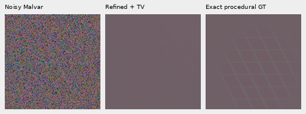

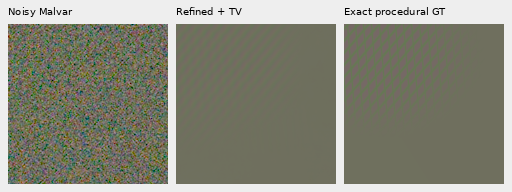

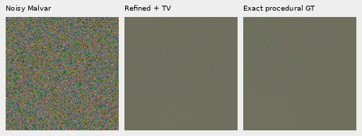

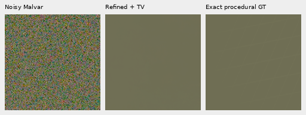

## Complete GFX comparisons

All three complete 101.996MP V143 parents and normalized RAW arrays are reused
exactly. This adds zero neural calls, RAW decoder opens or noise draws for real
frames. Existing cached independent ISO100/AHD arrays are reused for highlight
controls; source drives remain untouched. Originals stay read-only and all
standing test siblings stay out of training. ISO100 exposures and camera JPEGs
are **not exact GT**: aperture, exposure time, motion and processing differ.

Main DSCF3879 fixed-Haar rows: noisy → V120 → V143 → fixed-bin TV → refined TV →
DSCF3880 ISO100. Original native 160 ROIs, shared WB/matrix/+2EV remain.

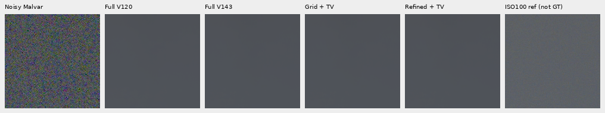

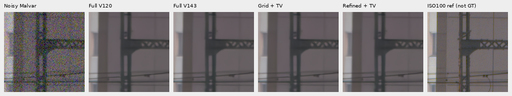

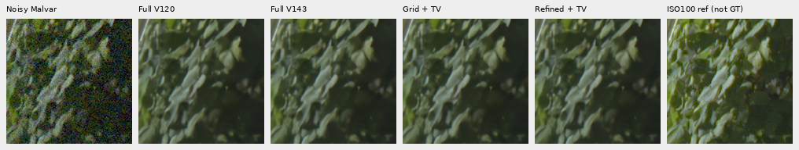

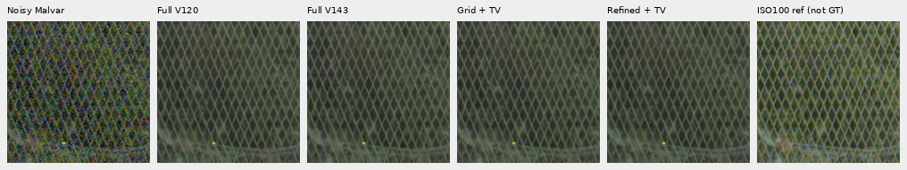

DSCF3842 fine-mesh rows: noisy → V143 → fixed-bin TV → refined TV → independent
DSCF3835 ISO100. Left/right ROIs start `[806,6489]`/`[1026,6449]`, with the same
integer reference translation and common+4EV. Nominal shot/read is 0.00128/
6.5536×10⁻⁶; nearby is0.0014635775921166604/1.0715704128646712×10⁻⁶, fixed from
DSCF3879 rather than calibrated to this capture.

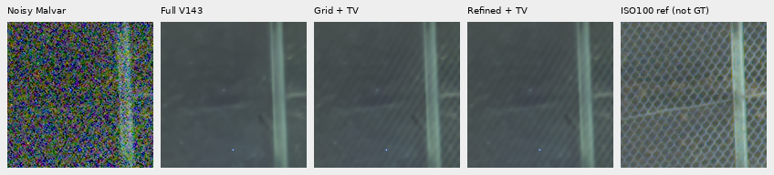

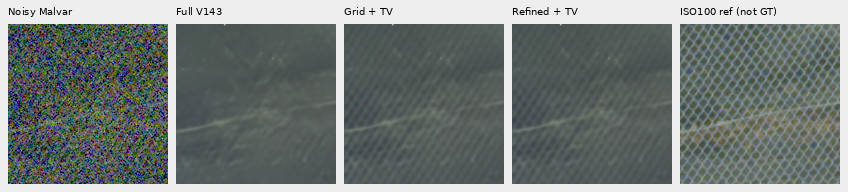

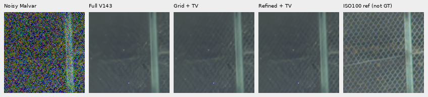

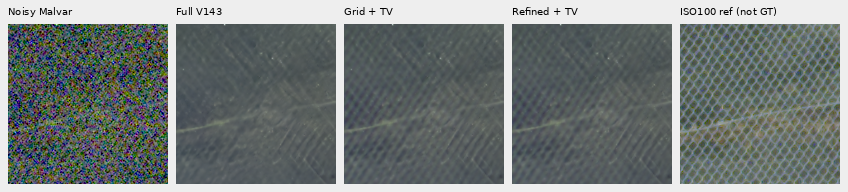

Both original camera JPEGs remain in companion rows: noisy → V143 → refined TV →
ISO6400 JPEG → independent ISO100 AHD → ISO100 JPEG, all at shared+4EV.

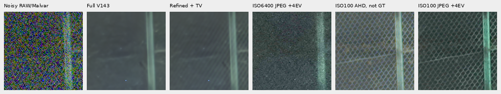

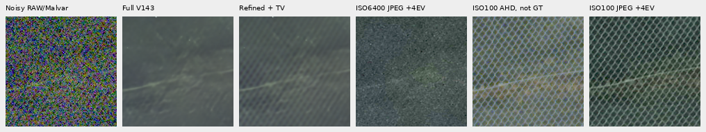

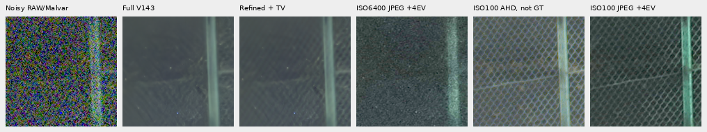

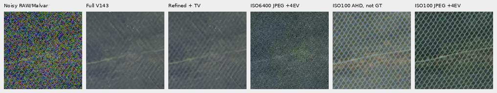

## Flat checks, highlights and cost

The fixed 96 photographic and 48 exact-uniform inputs per V120/V143 parent retain
every value. A separate 4096-draw stress test spans eight green levels 0.0001–0.3,
both nominal/nearby priors, four CFAs and 64 independent Poisson/Gaussian/ADC16
draws per combination. **No frequency is selected in any of 4096 cases**, so each
would bypass for any finite parent. The test supplies an exact flat oracle parent,
not neural inference; its 4096 extra noise draws are separate from the 512 model
observations. It does not establish universal false-positive control.
[Fresh flat stress](results/offgrid-phase-flat-stress-v1.json).

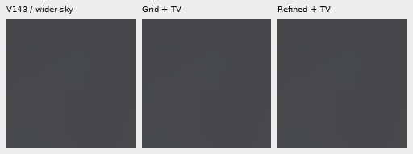

Strongest-change controls are outcome-selected on a fixed 160px grid, shown at
shared−2EV: noisy → V143 → fixed-bin TV → refined TV → independent ISO100/AHD.
They expose large changes and clipped highlights rather than exact-GT gains.
The first unguarded complete run amplified the main sign to a maximum added
29,572 DN16, versus 8,288 for fixed-bin TV. That failure prompted the observed-
clipping fallback. The unguarded outputs, source, metrics and receipts remain
preserved. The previous TV report's measured-green color/brightness limitation
still applies to the retained baseline; the fallback prevents new frequency
changes in clipped windows rather than establishing correct highlight color.

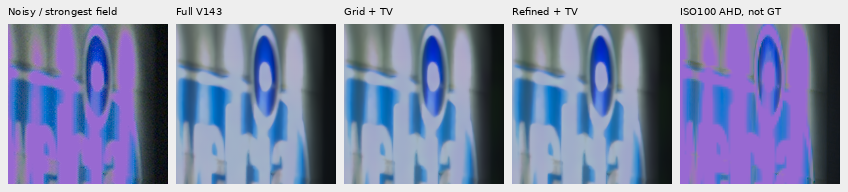


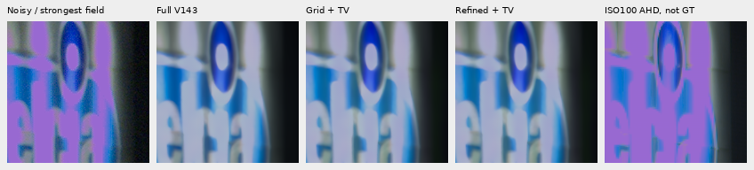

Centred development windows show a clearer lattice; the regular-grid full-frame
differences are smaller and uneven. Main foliage remains painterly and the larger
fence stays coherent. The same input-selected 2.88MP sky box
`[5200,200,2400,1200]` retains every parent channel. The previous 924 large-flat
windows also retain their zero-peak bypass by unchanged selection; these are
derived checks, not new noise draws or reexecuted neural inputs.

At the fixed unguarded strongest-change ROIs, the guarded output now matches
fixed-bin TV **exactly in all three native 160 crops**. The controls below show
noisy → V143 → fixed-bin TV → unguarded frequency → guarded frequency → independent
ISO100/AHD, sharing −2EV and coordinates. The original sign color disagreement
remains; retaining an earlier result is not exact-GT validation of that color.

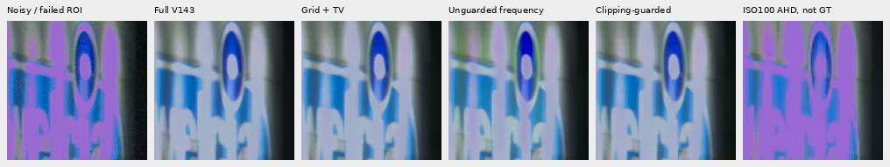


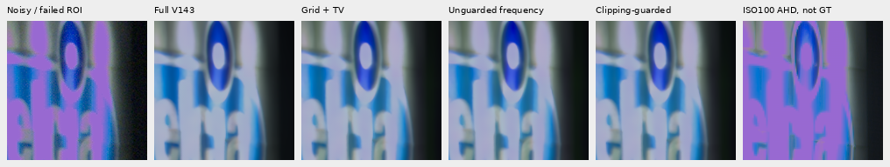

Complete-frame maximum added fields return to the grid-TV values:
8,288/11,638/12,083 DN16 for main/nominal/nearby. Whole-frame added RMS is
31.9590/66.7069/61.3714 DN16, versus 31.9597/66.7068/61.3648 for grid-TV. These
measure changes from the parent, not GT error or an image-quality score.

| Guarded complete refinement | Seconds | Frequency searches | Selected clipped windows | TV solves/capped | Max TV relative gap |
| --- | ---: | ---: | ---: | ---: | ---: |
| Main fixed Haar | 475.02 | 1101 | 484 | 1080/472 | 3.54×10⁻⁴ |
| Mesh nominal | 220.61 | 44 | 548 | 329/53 | 2.95×10⁻⁴ |
| Mesh nearby Haar | 470.18 | 1093 | 554 | 1150/414 | 4.51×10⁻⁴ |

Three contended CPU threads share one float64 CUDA TV solver, with one BLAS/Torch
CPU thread each. Timings cover refinement, not fresh end-to-end neural inference
or a controlled speed ranking. Many TV solves reach their cap. The 100MP/10s
target remains far away. Both unguarded and guarded complete executions are
preserved, with historical parent invocation metadata separate from refinement.

## Verification and remaining work

The original WLS body is factored without changing its equations: AST checks
verify the extracted body/prefix, and 512 original fits match the frozen helper
exactly. All 100,663,296 public CUDA values on reused development inputs match
the locked private candidate exactly. Fresh 1536 metric rows have an independent
joint 10-column affine/template solve, maximum gain difference 1.11×10⁻¹⁴.
Public CPU versus private GPU checks cover another 100,663,296 fresh values,
maximum absolute difference 3.47×10⁻¹⁸. Twelve scalar whole-context compatibility
checks remain within float32 rounding.

**81 relevant tests pass**, including actual CUDA reuse/RNG checks, independent
TV mathematics, physical CFA positions, known off-bin carriers/affine backgrounds,
search bounds, original inactive gates, ADC bypasses and actual CLI/RGB16 dispatch.
The CLI test explicitly stubs the neural pass; it is separate from 512 real calls.
All 74 package modules match the frozen full-frame execution. Historical 73-module
source, prior fitter equations, failed invocations and receipts remain preserved.

Independent rendering/native-copy checks cover 10,905,600 PNG channels across 29
actually viewed boards. All 917,962,668 linear RGB16 values match saved FP32
clip/round/orientation exactly; complete sRGB16 differs from independent float64
rendering by at most 1 DN16, with correct 16-bit/ICC tags. No crop pixels resize.
[Native/export audit](results/offgrid-phase-native-audit-v1.json) ·
[Independent fresh metrics](results/offgrid-phase-independent-audit-v1.json) ·
[Original numerical compatibility](results/offgrid-phase-port-parity-v1.json).

V120 remains the validated general recommendation; V143 full427/camera quality
is unmeasured. Weak-detail recovery, partial-texture spill, highlights, confidence,
window sensitivity and speed remain open. The improvement goal stays active.
