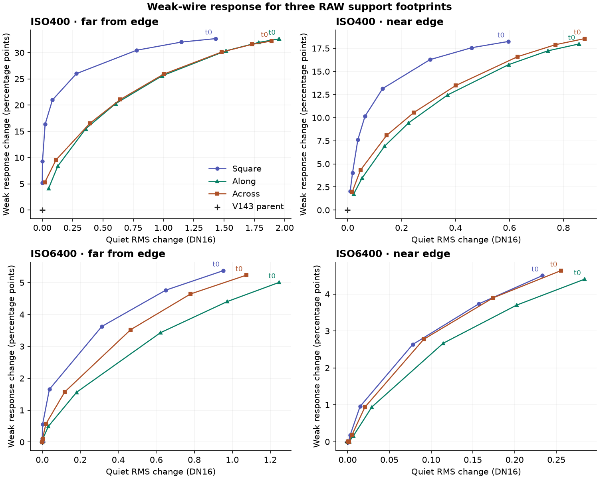
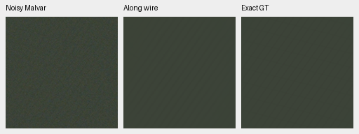
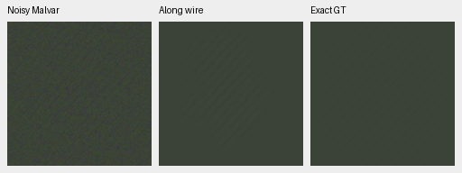

# Oriented support for held-out RAW evidence

The square window retains more weak-wire response at the tight quiet
budgets. At ISO400 far from the edge, the square gives **17.54%** response
against **5.40%** along the wire and **7.00%** across it. At ISO6400 far,
the across-wire arm lowers increment error slightly and also loses weak
response. All three reproduce the standing sky exactly. The cab still
lacks convincing fine crossings.
[Complete evidence and executed sources](results/oriented-raw-support-v1/publication.json).

The [donor subharmonic check](donor-subharmonics.md) corrects both doubled
frequencies in the synthetic guides. The ISO6400 query still has little
weak response at the conservative gate. An axis-aligned box may mix
support along a wire with evidence from adjacent quiet regions or a
strong edge. This comparison changes how each query fold pools evidence
after fitting.

## Validation footprints

The control uses a 129×129 square. The other arms sample a two-to-one
rectangle with the same continuous area, elongated along or across
the wire. The corrected frequency vector supplies its normal. Each
rectangle pools opposite-fold prediction improvements and their
normalizing energy on measured CFA pixels, with samples beyond the
tile omitted. Before clipping at the tile boundary, the sampled
rectangles contain 16,635–16,647 sites for the retained synthetic
directions, compared with 16,641 for the square. No image pixels are
resampled.

The three arms share the guides, eight-knot phase fits, discovery
shrinkage, fold veto, parent, and delivery step. Only local validation
support changes. All 384 synthetic views and eight standing camera
cases use the same query inputs and eight fixed thresholds. The
leave-one-geometry-out report chooses thresholds and one correction
scale using the other seven geometries. It reports the held-out
weak response and actual quiet error together. The real crops use
the fixed threshold 2 and the existing native coordinates and
display transforms.
[Operator](../src/demosaic/local_validated_waves.py).

## Held-out quiet-budget results

Each row averages eight held-out geometries. Within a geometry, RMS
pools the four CFA layouts in squared-error units. The additive quiet
budget is 0.02 DN16 over V143 on the seven calibration geometries. The
table shows the achieved errors on the eighth.

| Noise and edge | Footprint | Weak response | Quiet RMS DN16 | Weak-increment RMS DN16 |
| --- | --- | ---: | ---: | ---: |
| ISO400 far | Square | 17.536% | 2.51694 | 10.02081 |
| ISO400 far | Along | 5.400% | 2.54370 | 10.07125 |
| ISO400 far | Across | 6.998% | 2.51462 | 10.06851 |
| ISO400 near | Square | 9.481% | 6.11456 | 13.02156 |
| ISO400 near | Along | 6.950% | 6.11438 | 13.02951 |
| ISO400 near | Across | 6.730% | 6.11693 | 13.03072 |
| ISO6400 far | Square | 2.294% | 6.74949 | 22.46433 |
| ISO6400 far | Along | 1.681% | 6.77784 | 22.44076 |
| ISO6400 far | Across | 1.768% | 6.75083 | 22.43543 |
| ISO6400 near | Square | 3.973% | 22.92022 | 30.82640 |
| ISO6400 near | Along | 3.861% | 22.92105 | 30.82312 |
| ISO6400 near | Across | 3.958% | 22.92028 | 30.82468 |

Both rectangles lose weak response on all eight ISO400 far geometries.
At fixed threshold 2, those same arms retain 17.25% and 18.28% response
against the square's 18.09%, with quiet RMS rising from 2.515 to 2.850
and 2.884 DN16. The drop in response at the tight budget comes from
calibrating to comparable quiet errors. At ISO6400 near, the three
footprints give similar response in the tight case. In the separate
32-case wire-free edge diagnostic, every arm has edge RMS of 109.1746
DN16 and quiet RMS of about 22.0666 DN16 at threshold 2. The comparison
covers two-to-one rectangles. Adaptive footprints and other aspect
ratios remain open.
[Paired scores and fixed sweeps](results/oriented-raw-support-v1/summary.json) ·
[Wire-free edge diagnostic](results/oriented-raw-support-v1/edge-diagnostics.json).

## Native comparisons

The triplets show noisy Malvar, along-wire support at threshold 2,
and exact constructed GT. They use geometries 0 and 1, RGGB draw 1, the far
two-wire role, ROI `[176,176,160,160]`, exposure 2, and shared WB and
display transforms. Noise uses ADC16 black fraction 0.03, with
shot/read `8e-5/2.56e-8` at ISO400 and `0.00128/6.5536e-6` at ISO6400.
The synthetic parent is V143 EMA
`96d146d017c54196288c585f8b7eddcf030e8a235061049c31e985b9380b7ce4`.
The real parent is V120 EMA
`a9d9b6b4f974e24a6b11e5e740aab32314233a7f53c056cf37c7d2aac1c589fb`.
Both standing GFX families use the preceding corrected-guide windows.
The main DSCF3879/3880 crops use exposure 4, and the DSCF3842/3835 cab
uses exposure 16 and both recorded noise profiles. The ISO100 AHD and
camera JPEG are separate qualitative references, with changed exposure,
aperture and subject positions.

The high-noise synthetic crops remain nearly flat at the recorded
exposure. The real sky remains pixel-identical to V120. Building and
foliage are soft, and the coarse fence retains its visible crossings.
The cab crops change by up to 1.51 DN16 RMS relative to the square
window, with subtle diagonal modulation and no convincing new crossings.
[ISO6400 synthetic crop](images/oriented-raw-support-v1/iso6400-index0009-comparison.png) ·
[Sky](images/oriented-raw-support-v1/main-overcast-sky.png) ·
[Building](images/oriented-raw-support-v1/main-building-detail.png) ·
[Foliage](images/oriented-raw-support-v1/main-foliage.png) ·
[Coarse fence](images/oriented-raw-support-v1/main-chain-link-fence.png) ·
[Cab left](images/oriented-raw-support-v1/mesh-nominal-left.png) ·
[Cab right](images/oriented-raw-support-v1/mesh-nominal-right.png) ·
[Transferred profile left](images/oriented-raw-support-v1/mesh-profile3879-left.png) ·
[Transferred profile right](images/oriented-raw-support-v1/mesh-profile3879-right.png).

The two-thread collector took 405.40 seconds and reproduced all 392
square threshold-2 controls exactly. The report has 3,072 fixed scores
and 288 held-out rows. An independent audit verifies 1,728 native-pixel
reductions, 80 retained camera cells and four exact triplet subsets.
All twelve comparison boards were opened.
[Native provenance and viewing](images/oriented-raw-support-v1/manifest.json) ·
[Independent audit](results/oriented-raw-support-v1/independent-audit.json).
