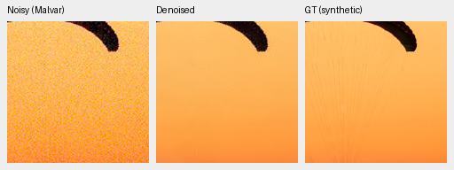
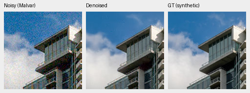
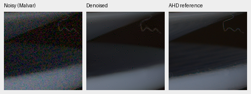
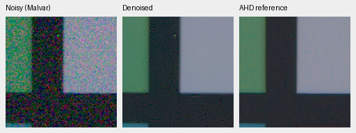
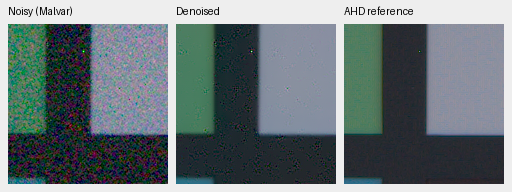
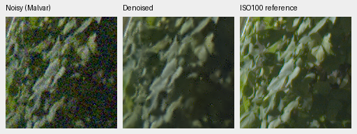
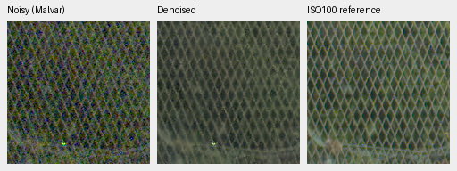
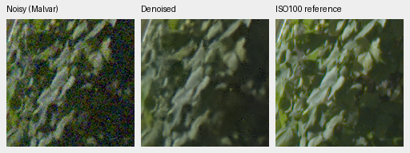
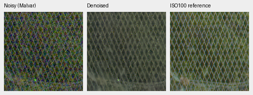

# Noise-aware packed detail: first quality review

**V40 and V41 still fail the real-camera quality gate.** The physical Wiener
detail prior recovers much of V38's grain-related loss, but both variants trail
the matched full-resolution V37 control. Raising phase adapter/head LR by 10×
does not close the gap. All models stop at the first 1,000-update gate; the
top-level README keeps its existing V34 representative model.
[Complete measurements, identities and native crop receipt](results/packed-detail-v40-v41-1k-review.json).

| Panel | Model | Measured-CFA PSNR | AHD RGB PSNR | AHD SSIM |
| --- | --- | ---: | ---: | ---: |
| Known4 | V34 parent | 54.24658 | 39.94860 | 0.930049 |
| Known4 | V37 full-resolution | 54.27943 | 40.01531 | 0.930415 |
| Known4 | V38 identity detail | 45.58580 | 32.36137 | 0.684875 |
| Known4 | V40 Wiener / phase LR1 | 52.90480 | 38.44569 | 0.896826 |
| Known4 | V41 Wiener / phase LR10 | 52.85833 | 38.44922 | 0.896357 |
| Unseen5 | V34 parent | 53.78664 | 38.51133 | 0.921075 |
| Unseen5 | V37 full-resolution | 53.67990 | 38.43590 | 0.920981 |
| Unseen5 | V38 identity detail | 43.56215 | 28.65607 | 0.539171 |
| Unseen5 | V40 Wiener / phase LR1 | 52.22122 | 36.38972 | 0.868912 |
| Unseen5 | V41 Wiener / phase LR10 | 52.23809 | 36.40158 | 0.869181 |

Known: four scenes/eight pairs/72 crops. Unseen: five scenes/ten pairs/90 crops.
Means balance captures within scenes and then scenes. Primary references are
registered low-noise CFA measurements. Independently demosaiced AHD RGB is an
auxiliary reference, **not exact RGB GT**. Protected-final performance is unscored.

V37 minus V40 primary PSNR: known +1.37463 dB, 95% source interval [+0.57939, +2.28993];
unseen +1.45867 dB, 95% source interval [+1.02932, +1.84599].
V40 minus V41: known +0.04647 dB, 95% source interval [-0.00734, +0.10028];
unseen -0.01687 dB, 95% source interval [-0.07440, +0.03111].
Intervals sample scenes/sources and do not measure training-seed variance.

| Model | 427-photo PSNR | SSIM | 16-procedural PSNR | SSIM |
| --- | ---: | ---: | ---: | ---: |
| V34 parent | 34.46662 | 0.954201 | 33.18400 | 0.962951 |
| V37 full-resolution | 34.65497 | 0.955273 | 33.80809 | 0.967787 |
| V38 identity detail | 30.90134 | 0.880821 | 28.70880 | 0.848509 |
| V40 Wiener / phase LR1 | 31.85320 | 0.927530 | 29.39871 | 0.899296 |
| V41 Wiener / phase LR10 | 31.82236 | 0.926083 | 29.51344 | 0.900097 |

V37 minus V40 photo PSNR: +2.80177 dB, 95% source interval [+2.72241, +2.87797].
V37 minus V41: +2.83261 dB, 95% source interval [+2.75616, +2.90727].
All 443 sources share seven conditions and four CFA patterns. The new-only
evaluation has 62,020 individual records; the composite comparison has 124,040,
including five neural models, both RawNIND calibrations and three classical
methods. RawNIND retains its original weights, input-only gain calibration and
method source; its measurements are explicitly reused.

## Matched experiment and implementation

Both new arms use immutable V34 step 1000 EMA, fresh AdamW/EMA, seed 47, batch 16,
base LR 3e-5/planned 3000 schedule, original 53 native4 captures/31 scenes, complete
40,170-source Commons4 training, paired data, original 8× validation and the same
25% paired /25% native /50% Commons mixture. They enable the
[noise-aware detail prior](packed-detail-prior.md); only phase LR differs.
The separate six-source V39 native extension is absent.

All **41 logged observation/target hashes match V38/V40/V41**. Unlogged
observations are not separately hashed. Both new arms share source bundle
`89cf3175165fe16025295b7102fa7b0bc255eea9cf3fc69c4bdd33fd94933e03` from the private worktree frozen at `d380028`.
Data/render/metric/evaluator bytes and scoring protocol match the frozen
comparator runs. Reuse also requires exact equality of 24 known and 30 unseen
classical pair summaries and all **37,212** classical synthetic case records.
The receipt retains old/new report hashes and original method identities.

Checkpoint SHA256:

- V40: `f5e4efd3d11e86e87e8204dfd27a21d8560f64d6e44f20df13911fad71e27ff3`
- V41: `aeab8f88fc24eda4897c5922a9b788fade491e891f3a8a5a9943aac6cd89728f`

The prior estimates local detail signal power after subtracting coefficient-
derived noise variance. It removes much more grain than an identity bypass,
but marginal variance modeling and this shallow phase path do not provide the
control's quality. Low-count GAT variance and tile boundaries remain approximate;
RGB covariance is not whitened. No reference fitting is used. All 321 final-source
tests pass, including Monte Carlo checks for every CFA, default-path bitwise
compatibility, ADC precision and optimizer/resume checks. Engineering checks
do not establish perceptual quality.

## Native synthetic and real crops

Noisy Malvar → restored → **exact synthetic GT**, each panel native 160×160,
never resized. These are the same first two prescribed validation sources.
RGGB/ISO12800 prior: `shot=.00256`, `read=.0000262144`, ROI[48,48,160,160] in
the validation tile, display×1, WB[2,1,1.5] and the fixed protocol matrix.
Per-triplet source/cache, checkpoint, noise and display metadata remain in the
receipt. PNGs are 8-bit sRGB previews; outputs and scoring retain physical FP32.

V40:

V41:

Sources: [Roy Egloff](https://commons.wikimedia.org/wiki/File:CH.VD.Villeneuve_2007-08-25_Vertigo-Swiss-Riviera_2392_3x2-R_4K.jpg)
and [Dietmar Rabich](https://commons.wikimedia.org/wiki/File:Vancouver_(BC,_Canada),_Coal_Harbour_Seaside_Park,_Blick_in_den_Himmel_--_2022_--_2158.jpg),
[CC BY-SA 4.0](https://creativecommons.org/licenses/by-sa/4.0/). Modified by
linear binning, crop, noise simulation, restoration and rendering; derivative
previews retain that license. Noisy/GT panel bytes match cached V37 exactly.

Known real examples, noisy → restored → independent AHD reference:

Real sources: Benoit Brummer and Christophe De Vleeschouwer,
[Raw Natural Image Noise Dataset](https://doi.org/10.14428/DVN/DEQCIM),
[CC BY-SA 4.0](https://creativecommons.org/licenses/by-sa/4.0/), with individual
scene credits/CC0 grants in publisher `permissions.txt`. Modified by crop,
restoration and rendering; derivative previews retain the applicable license.

Full 102 MP GFX DSCF3879 ISO6400 → restored → separate DSCF3880 ISO100 f/5.6,
native 160px foliage[8890,5570] and fence[2240,6000], reference fence x2241.
Shared +2EV/WB/matrix and input-only prior `shot=.001463577592`,
`read=.000001071570413`. Time, aperture and motion differ: the final panel is
a qualitative reference, **not GT**. No pixelwise GFX scores are computed.

The fixed foliage and fence crops still show residual grain. No decisive
qualitative superiority over RawNIND is established. The cleaner full-resolution
control crops remain in the [preceding review](packed-v37-v38-first-review.md).

All four GFX regions and all 20 new native triplets are retained in the receipt.
PNG SHA, panel dimensions, shared metadata and exact noisy/reference panel bytes
match the cached control. All four new 8746×11662×3 uint16 TIFFs pass independent
SHA/size, actual dtype/shape/16-bit tags and >256 sampled-code checks. sRGB files
carry ICC profiles. Files are in
`/mnt/external/demosaic/evaluation/gfx-3879-3880-packed-detail-v40-v41-1k-full-newonly/`.
Restoration took 18.82/17.89 s for V40/V41, tile 512/overlap 64/batch 4,
excluding RAW decoding, model loading, rendering and encoding. These are
successive shared-machine runs, not a repeated idle benchmark or a 10-second
result. The original V38 training-throughput gain is not a measurement of these
new variants. Neither is promoted on speed or on the engineering tests.
