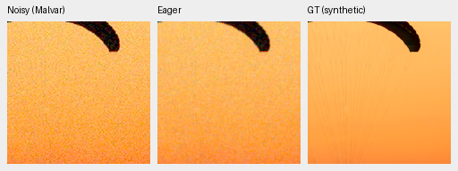
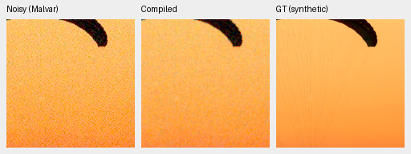
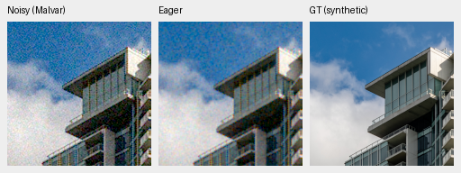
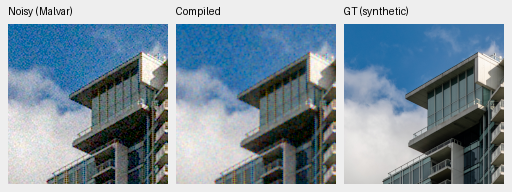

# Trained-checkpoint compilation benchmark

The [frozen benchmark queue](results/packed-isotropic-compilation-queue-v1.json)
is waiting behind the actual40k training and automatic quality review. There
is no trained-checkpoint CUDA compilation result yet. Production inference,
training and their precision settings are unchanged.

The earlier discarded12-update block benchmark suggested a possible speedup,
but did not establish trained-model accuracy or full-frame latency. This study
uses both actual40k EMA checkpoints only after their completed-state checks and
review owner have exited. Its source matches the review's physical model code;
the sole addition is the existing opt-in in-place compilation helper. Eight
internal components are compiled. DINO, physical stems and reconstruction stay
eager, with the same FP16 internal compute and FP32 physical work as the control.

## Fixed accuracy and timing protocol

Each model first compares eager and CUDA Inductor output on two saved native256
held-out photographic observations. A separate process tests the serving shape,
batch4/native512, on four real GFX contexts and an analytic batch covering all
four CFA patterns and low/high signal. These gates use a predeclared maximum
absolute difference of1 DN16 and RMS difference of.25 DN16. A failed gate ends
the study without expensive full timing or automatic adoption. The bound applies
to unclamped camera RGB; it is an engineering criterion, not proof of identical
perceptual quality. Eager-versus-IEEE-FP32 differences are also recorded on the
two photos, separately from compilation differences.

The full-frame cases use the cached DSCF3879 RAW,8746×11662 pixels
(101.995852MP), tiles512/overlap64/batch4. Four fresh workers cover both models
and policies in a fixed shuffled order. Each excludes one complete warmup and
records three complete restores. The timer includes raw validation, allocations,
transfers, neural compute and blending; decoding, compilation, warmup, comparisons
and export are excluded. Compilation setup and first calls are reported separately.
Workers are fresh processes; existing on-disk compiler caches are retained, so
first-call wall time is not necessarily a cold-cache compilation measurement.
Three-run medians and ranges describe this shared-machine run, not confidence
intervals or a unique hardware optimum.

Every full-frame RGB value is compared, including values outside the display
range. Repeat stability is checked against each case's first restore. The saved
float32 arrays and16-bit TIFFs are hashed, and every TIFF pixel must equal the
rounded/clipped float result. Model tensor bytes, parameter identities and state
keys must remain unchanged. The final CPU stage makes16 native GFX triplets:
sky, building, foliage and fence for each model/policy, with common conditioning
and display exposure4. DSCF3880 is a separate ISO100 f/5.6 reference, not GT.
Native visual inspection remains necessary before adopting compilation.

## Completed CPU execution preflight

The frozen executable ran both photos with the actual no-DINO16k EMA,
SHA256 `320c87cb4a357f9f86466ddd606d2b414ad4840cb8875690c5c222322e8289df`.
CUDA was hidden. Dynamo's **eager backend**, in FP32, produces bitwise-identical
RGB on both complete256px observations and leaves all state/identities unchanged.
This checks capture and the archived execution path; it does not test CUDA
Inductor or establish a speedup. Six focused tests pass, covering the in-place
helper and whole-RGB comparison, including the last partial chunk, unclipped
values, spatially constant bias and nonfinite values.

The four original512×192 PNGs below were inspected at native resolution.
Every panel contains160×160 pixels with one image pixel per PNG pixel; open the
original at100%. Both policies use ROI `[48,48,160,160]`, RGGB, shot.00256,
read2.62144e−5, the existing fixed **CPU-generated** Poisson/read/ADC observations,
WB `[2,1,1.5]`, the same recorded color matrix and display exposure1. The receipt
retains source attribution, observation hashes, full display metadata and PNG
hashes. These previews document execution equality; substantial residual noise
remains in this intermediate model. They do not replace the40k quality review.

Fabric source `0014aa4e075b1827f91ef8a02069e1e318f040ba`,
[Roy Egloff](https://commons.wikimedia.org/wiki/File:CH.VD.Villeneuve_2007-08-25_Vertigo-Swiss-Riviera_2392_3x2-R_4K.jpg),
[CC BY-SA4.0](https://creativecommons.org/licenses/by-sa/4.0),
with synthetic camera/noise processing:





Building source `002fc6eeadf637e81d5a327f117b79abb86becd9`,
[Dietmar Rabich](https://commons.wikimedia.org/wiki/File:Vancouver_(BC,_Canada),_Coal_Harbour_Seaside_Park,_Blick_in_den_Himmel_--_2022_--_2158.jpg),
[CC BY-SA4.0](https://creativecommons.org/licenses/by-sa/4.0),
with synthetic camera/noise processing:





## Reproduction and live status

`scripts/prepare_packed_compilation_inputs.py` freezes the two observations,
decodes the local cached GFX RAW once and verifies its four saved contexts
against the decoded pixels. It never reads the source hard drives. All fixtures
are inference-only; the GFX scene and siblings remain outside training.

```bash
source scripts/env.sh
CUDA_VISIBLE_DEVICES='' uv run --no-sync python -P \
  scripts/benchmark_packed_compilation.py CHECKPOINT \
  --inputs /mnt/external/demosaic/benchmarks/packed-isotropic-compilation-inputs-v1/inputs.json \
  --output /mnt/external/demosaic/benchmarks/NEW-CPU-check \
  --stage photos --device cpu --backend eager
```

CUDA photo checks use `--device cuda --backend inductor`. Full timing uses
`--stage full`, with `--compiled` for that policy. Do not run these concurrently
with the owned training/review. The already queued controller enforces their
serial dependency and fails without automatic restart on changed inputs or a
failed predecessor. It never trains, scores protected final scenes or promotes
a model. Its live status is
`/mnt/external/demosaic/runs/packed-isotropic-compilation-workflow-v1.json`.
