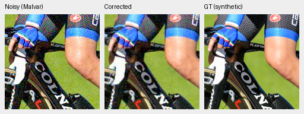
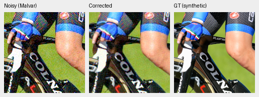
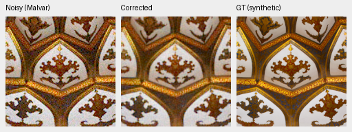
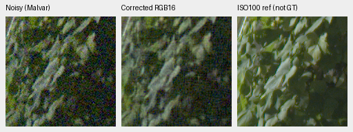
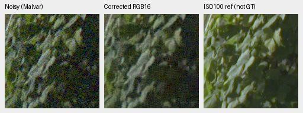
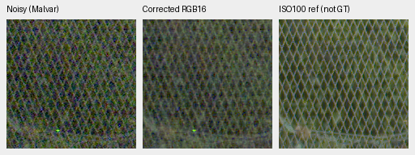
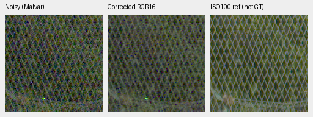
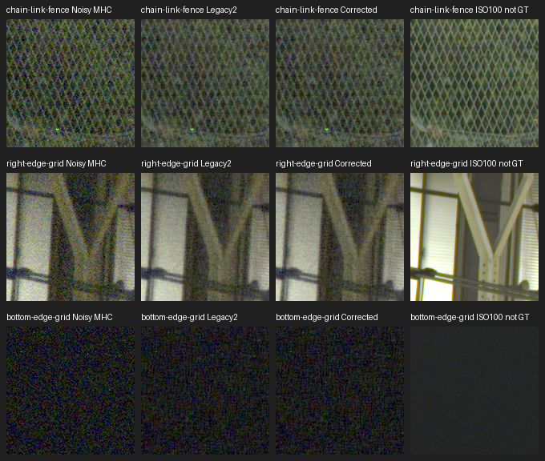
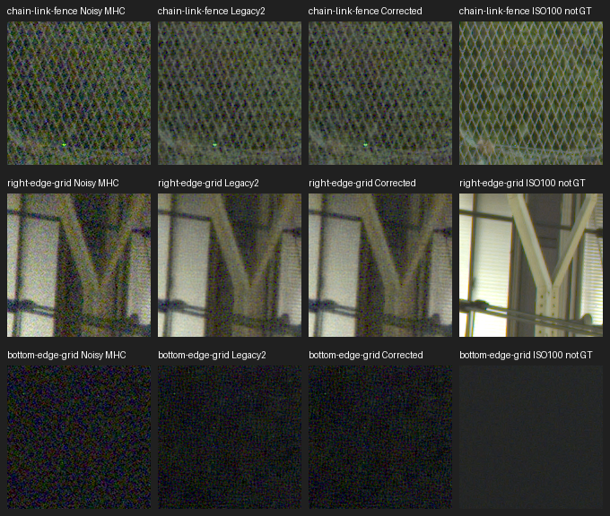
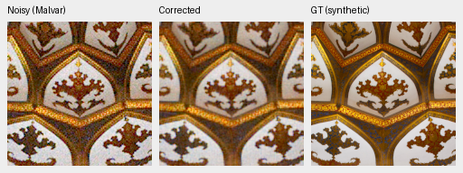

# Corrected tile grid: completed 40k CUDA review

The [completed supplement](results/packed-isotropic-corrected-grid-review-v2.json)
checks both actual 40k EMA checkpoints. Correct alignment reduces disagreement
with whole-context predictions, but does not improve the selected GT scores or
establish a visible quality gain. Both full 102MP restores take about54 seconds.
Neither model is promoted. The [original plan](results/packed-isotropic-corrected-grid-queue-v2.json)
remains unchanged; all required preceding owners and children exited before CUDA
work began. The original full quality review retains its frozen observations.

The original direct-patch quality panels and their source sensitivities retain
their frozen protocol. The [grid correction](packed-isotropic-tile-grid.md)
changes full-image tiling, without changing the physical model modules. This
supplement checks that corrected path on the actual completed 40k checkpoints.

## Completed results

Every saved F32 array and GT metric passed independent CPU replay within the
declared1e−4 absolute metric tolerance. Whole-context predictions are numerical
comparators, not GT. RMS excludes128 native pixels at the context boundary;
GT metrics exclude8. These use tile256/overlap64/batch1 and the precision below.

| Model / photograph | Legacy RMS vs whole, DN16 | Corrected RMS vs whole, DN16 | Legacy / corrected / whole sRGB PSNR |
| --- | ---: | ---: | --- |
| No-DINO / cyclist | 83.164 | 14.504 | 25.9331 / 25.9134 / 25.9127 |
| No-DINO / roof | 79.286 | 9.529 | 24.5390 / 24.5250 / 24.5246 |
| DINO / cyclist | 136.155 | 77.729 | 26.0679 / 26.0395 / 26.0311 |
| DINO / roof | 128.858 | 69.537 | 24.4645 / 24.4364 / 24.4252 |

Remaining context differences exceed the strict numerical-equivalence bounds.
Closer agreement with the whole network is not improved reconstruction accuracy.
For full101.995852MP DSCF3879, corrected tile512/overlap64/batch4 gives:

| Model | Median seconds | Three-run range seconds |
| --- | ---: | --- |
| No-DINO 40k | 54.436 | 54.034–54.585 |
| DINO 40k | 53.749 | 52.945–53.766 |

One full warmup is excluded, and repeat outputs are bitwise equal. Historical
legacy timings are separate single observations, without a concurrent speed
control. These shared-machine measurements do not establish a speedup.

Every corrected RGB16 channel reproduces its clipped/rounded saved F32 output.
Signed comparisons cover all305,987,556 old/new RGB16 channel values per model:
no-DINO changes26,295,683 values, RMS14.355DN and maximum8265DN;
DINO changes25,681,894, RMS16.181DN and maximum7367DN. These are export
differences, not unclipped F32 equivalence or real-image GT errors.

All36 preselected triplets were reviewed at original resolution in six boards.
The cyclist remains grainy with inaccurate fine fabric detail; roof ornament is
soft relative to exact GT. Legacy, corrected and whole-context views look very
similar. Sky/building retain grain, foliage stays soft and mesh remains uneven.
Neither selected edge shows an obvious visual regression or improvement, while
the bottom shadow remains noisy. This does not establish that all full-frame
differences are invisible.

## Actual CUDA native crops

The four photographic triplets use the same source contexts, ROI, noise,
WB/matrix and exposure as the CPU preflight documented below, but actual CUDA
FP16 internals / IEEE FP32 physical computation. Every panel stays160×160.
These are fixed CPU-generated seed42 observations, distinct from the official
256px GPU panel. Left to right: noisy Malvar, corrected model, exact synthetic GT.

No-DINO40k EMA SHA256:
`5708fdc19542ca1ef1aaafec25038dc049e4f5027782809846cf6d888ebed2cc`.
DINO40k EMA SHA256:
`4c2926e77dc5dea8580879eff9ebb69550fa891a295fa329a5800189c7fa8337`.

Real triplets below use cached DSCF3879/DSCF3880, exposure4 (+2EV), common
input WB/matrix and shot.0014635775921166604/read1.0715704128646712e−6
from the input Haar fit. Foliage ROI is`[8890,5570,160,160]`; fence is
`[2240,6000,160,160]`, reference fence x2241. The result JSON records full
source hashes, camera matrix and reference calibration. The separate ISO100
f/5.6 capture differs in aperture, exposure and motion: **not exact GT**.

The boards include fence, right edge and bottom edge as rows. Columns are noisy
Malvar, legacy RGB16, corrected RGB16 and independent ISO100 reference, all160px.

## Fixed observations and full-frame work

Two saved CPU-generated native 510px photographic observations compare legacy
tiling, corrected tiling and a whole-context forward for each model. They retain
the exact same noisy values and synthetic clean targets. Independent CPU replay
checks every saved array and the GT metrics, allowing 1e−4 absolute reduction
roundoff. This is a numerical replay tolerance, not a quality-improvement gate.

Two fresh eager CUDA workers then restore DSCF3879 at 8746×11662 pixels
(101.995852MP), tile512/overlap64/batch4. Each excludes one full warmup and times
three complete restores. The control uses the same FP16 internal and IEEE FP32
physical computation as the original review. Decode, warmup, export and audit
are excluded; raw validation, allocations, transfers, compute and blending are
included. Three-run medians/ranges describe shared-machine operation, without
confidence intervals or a concurrent speed comparison against historical runs.

The existing legacy 40k exports are reused after weight, method, precision,
source and conditioning checks. The old networks are not rerun. A frozen CPU
auditor verifies every corrected RGB16 pixel against its saved F32 prediction;
the new comparison checks every old/new RGB16 channel value with signed
subtraction. These are clipped/rounded export differences, not unquantized
equivalence or real-image GT error. Both displayed method panels decode RGB16
and share WB/matrix/exposure 4.

## The affected edges are included

The four standing GFX ROIs lie outside the final tile row/column and may remain
unchanged. Two predetermined additional regions therefore cover the changed
area, specified in [the edge selection](../configs/gfx-qualitative-grid-edges.json):

| Region | Noisy/reference sensor ROI |
| --- | --- |
| Right edge, building beams/windows | `[11300,3600,160,160]` |
| Bottom edge, deep shadow | `[7200,8400,160,160]` |

These coordinates were chosen from geometry and input/reference views before
any corrected full-frame prediction. Their 512px input contexts stay within the
sensor. The cached ISO100 RAF was decoded once with the existing LibRaw AHD /
own-CFA calibration. All four original reference crops reproduce bitwise before
the two additions are admitted. Source drives are untouched; this scene and its
siblings remain outside training.

The output contains 12 exact-synthetic-GT photo triplets and 24 full-frame GFX
triplets: sky, building, foliage, fence and both edges, before/after for each
model. Each panel remains 160×160 native pixels. The independent ISO100 f/5.6
capture differs in aperture, exposure and motion and is labeled **not GT**.
All36 native triplets have now been inspected, as recorded above.

## Completed CPU execution checks

The new photo program ran on the actual no-DINO 40k EMA and retained genuine
DINO 8k weights, with CUDA hidden. These different-budget executions check the
operators, not a DINO ablation. Tensor bytes, keys and parameter identities stay
unchanged. The final frozen executable's six no-DINO arrays match its root
execution bitwise. An existing 8k RGB16 identity check covers all 305,987,556 channel
values in a full 102MP file, including the last partial chunk. That is an
engineering identity fixture, not a new grid/quality result.

Twenty-two focused tests pass, covering signed 16-bit limits, last chunks,
pixel/channel counts, wrong or ambiguous legacy controls, whole-F32 differences
and original quarter-review gates. Ruff checks pass. The preflight also confirms
that incomplete training rejects review before inference and verifies 161 frozen
guards and 29 inputs.

The following original 512×192 PNGs were inspected at 100%. Each panel contains
160×160 pixels at ROI `[176,176,160,160]`, display exposure 1, RGGB,
shot.00256/read2.62144e−5, seed42 and WB `[2,1,1.5]`, with the same recorded color
matrix. They are CPU FP32 preflight examples, distinct from the official 256px
GPU panel. Noise and soft detail remain; these two views do not establish
generalization or a quality gain.

No-DINO 40k EMA SHA:
`5708fdc19542ca1ef1aaafec25038dc049e4f5027782809846cf6d888ebed2cc`.

[Cyclist source, Granada](https://commons.wikimedia.org/wiki/File:20180925_UCI_Road_World_Championships_Innsbruck_Women_Elite_ITT_Elisa_Longo_Borghini_850_8800.jpg),
[CC BY-SA4.0](https://creativecommons.org/licenses/by-sa/4.0),
8× binned source context `[261,89,510,510]`, synthetic camera/noise processing:

[Roof source, مانفی](https://commons.wikimedia.org/wiki/File:Emamzadeh_Esmaeil_roof.jpg),
[CC BY-SA4.0](https://creativecommons.org/licenses/by-sa/4.0),
8× binned source context `[10,11,510,510]`, synthetic camera/noise processing:

## Dependency and result policy

The original 40k quality review must succeed, its training/review owners and
children must exit, and both actual states must pass the independent lineage,
model/EMA/Adam/RNG/source/data/log checks. The compilation controller and its
last child must also exit. A compiler rejection or failure can precede this
separate eager-only validation; compilation is never retried or adopted by it.
Changed inputs or a failed required quality review stop the supplement.

Workflowv1 was prepared but never launched; v2 superseded it before launch to
include the affected edges. The live v2 status is
`/mnt/external/demosaic/runs/packed-isotropic-corrected-grid-workflow-v2.json`.
There is no automatic model promotion, continuation or protected-final scoring.
The full quality and 10-second goals remain open.
