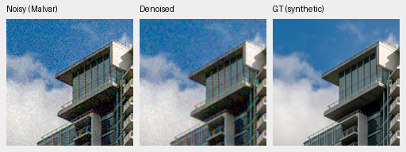
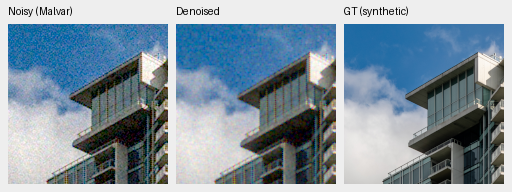
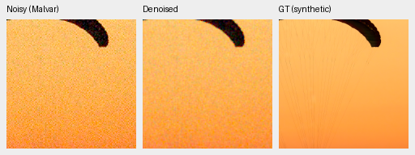
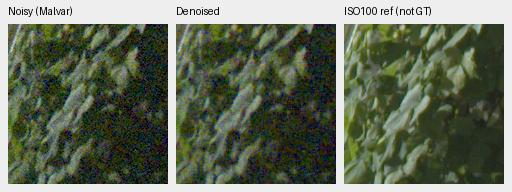
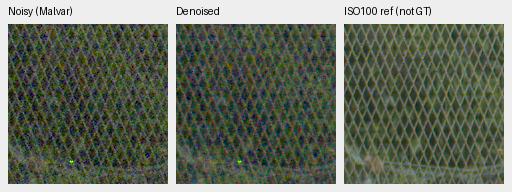
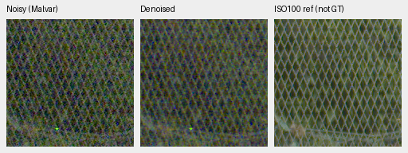
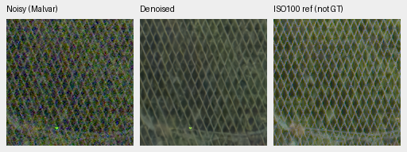
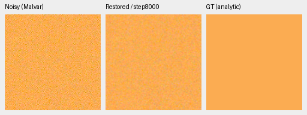
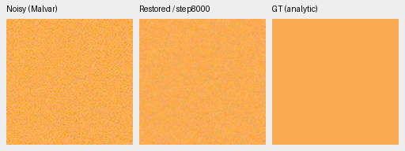

# Fresh RAW models at 32,000 examples: weak restoration, no promotion

The first matched boundary of the fresh RAW-native experiment performs only
slightly better than bilinear demosaicing. DINO V70 reaches **27.76515 dB**
photographic sRGB PSNR, versus **27.67087 dB** without DINO V71 and
**27.55481 dB** for bilinear. Native crops retain substantial noise. Both are
well below the working V43 and mature V63 references and are slower in this
full-frame run. **Neither endpoint is promoted; V43 remains the working model.**

[Source results, checkpoint hashes, exact crop sidecars and manual observations](results/packed-isotropic-first32000-review.json).
[Architecture, actual batch sweep and training protocol](packed-isotropic.md).

The complete frozen review has finished and its controller has exited. This
includes photographic/paired RAW panels, analytic/color/hue checks, full GFX,
three cached cameras, supplementary colored-light crops, artifact integrity and
source sensitivities. Actual visual notes cover14 published originals and six
additional hue triplets, rather than every produced image.

## Matched training boundary

Each model completed 8,000 updates at batch4: **32,000 examples**, only 5% of
the original 640,000-example / 160,000-update horizon. Both started with fresh
RAW restoration weights, fresh AdamW and fresh EMA; no Gaussian denoiser or
benchmark-trained initializer was used. LR2e−4, 2,000-update warmup and the
original long-horizon cosine schedule remain unchanged. This early boundary
does not establish convergence or the quality of a fully trained architecture.

The two arms share seed51, RAW256 patches, BF16 training, the original 40,170
Commons sources, native128 training captures and paired32 data. The fractions
are 25% paired RAW and 25% native RAW synthetic; remaining steps select
Commons/procedural data. Geometry/PSFs run between 4× and final 2× reductions;
selected-domain loading avoids discarded Commons augmentation. Newly downloaded
images, private GFX captures/siblings and protected final scenes are excluded.

Only DINO presence/fusion differs between the fresh arms. V70 uses the genuine
frozen DINOv3 ConvNeXt Tiny pyramid at pinned revision
`10d30274b4d445111e2d5bf75ac93bbd94db274b`.
The completed-training checks verify finite model/EMA/Adam, actual common fresh
initialization/global RNG, frozen DINO and all321 **logged** observation/domain/LR
matches. Unlogged observations were not independently hashed. V43 and V63 have
different architectures and much more prior training, including RGB denoiser
pretraining; comparisons to them do not isolate architecture alone.

Checkpoint SHA256:

- V71 no-DINO8k: `abd7345c080cb227d77385647c74614c0416d9316ad2f28c81c31cdd1f1697a2`.
- V70 DINO8k: `5fc021488d34df6ddf85cac8b0fc5cb0b0117713c87865c010e7e246979a2c14`.
- Working V43: `0d74cf31fb1c7e3f97fc692c855a2ca0ee3ebf562b454e4f8b135c28fc0aa5c5`.
- Mature V63: `ed70952dd33c5d7da39199bf1306b58b579862920fb0cccd6b222f19871bc9b5`.
- Publisher RawNIND: `c1f7de3de24cb12f4803ee65e11cfb467e9a5b80c3cb7126746ef026106c15e0`.
- Released Nonlocal RAW: `b31bc8e21022389b0b209a9d1e6649485ed4dacc552b7ea04612df5f7515fcf2`.

## Complete primary panels

The fixed photo panel has427 photographic and16 procedural sources, seven
conditions and four CFAs. Nine methods produce111,636 cases. Both RawNIND gain
adapters fit the observed noisy CFA, never the reference. Reported photo means
balance source IDs; the table below covers the427 photos only. Inference uses
FP16 neural compute with FP32 physical operations and channels-last layout.

| Model | Photo sRGB PSNR, dB | Photo SSIM | Known measured-CFA PSNR | Unseen measured-CFA PSNR |
| --- | ---: | ---: | ---: | ---: |
| V71 no-DINO8k | 27.67087 | 0.815779 | 44.18254 | 41.43793 |
| V70 DINO8k | 27.76515 | 0.819791 | 44.35326 | 41.64015 |
| Working V43 | 34.89934 | 0.957126 | 54.23332 | 53.80606 |
| Mature V63 | 35.93309 | 0.963290 | 54.20366 | 53.84298 |
| Bilinear | 27.55481 | 0.811702 | 44.10599 | 41.41325 |
| WB-aware Malvar | 28.53865 | 0.839520 | 43.80425 | 40.93797 |
| Wiener7 + Malvar | 29.29697 | 0.888098 | 50.07169 | 49.59129 |
| RawNIND global CFA gain | 26.69578 | 0.790028 | 54.06860 | 53.56220 |
| RawNIND channel CFA gain | 26.68357 | 0.789899 | 54.08474 | 53.76822 |

The matched DINO gap is +0.09428dB on photos (95% source bootstrap interval
[+0.08644,+0.10144]), +0.17072dB on known measured CFA
[+0.16220,+0.17804] and +0.20222dB on unseen measured CFA
[+0.16977,+0.25213]. Procedural sRGB PSNR falls−0.01990dB
[−0.03506,−0.00777]. These source intervals use1,000 draws/seed42 and do not
include training-seed or selection uncertainty. These modest differences leave a large
gap to mature references and do not make either fresh model a useful replacement.
RawNIND's synthetic-photo and native-pair behavior differ substantially; the
synthetic mean alone does not establish real-photo superiority.

Known/unseen RAW panels contain eight/ten capture pairs across four/five scenes,
72/90 crops and648/810 method cases. Primary scores use measured low-ISO CFA
samples under the existing registration/exposure protocol. Independently
demosaiced AHD previews are approximate RGB references with residual noise,
not exact RGB GT. These are development panels, not final independent-camera
certification. Source: Benoit Brummer and Christophe De Vleeschouwer,
[Raw Natural Image Noise Dataset](https://doi.org/10.14428/DVN/DEQCIM),
[CC BY-SA4.0](https://creativecommons.org/licenses/by-sa/4.0/), with individual
scene credits and permission records retained in the prepared manifests.

## Native photographic crops with exact synthetic GT

Each image below contains three unchanged160×160 panels: noisy WB-aware Malvar
→ model output → exact synthetic clean target. One image pixel is one PNG pixel;
open the512×192 PNG at100%. There is no crop resizing. The native resolution
here is the original8×8-binned evaluation image, not the original JPEG resolution.

Both sources use the fixed256px evaluation tile, ROI `(48,48,160,160)`, seed42,
RGGB and ISO12800 synthetic prior: shot`.00256`, read`2.62144e−5`, ADC16 bits,
black`.03`, display exposure×1, WB`[2,1,1.5]`, and the fixed evaluation color
matrix (diagonal1.1176470588, off-diagonal−.0588235294). Identical noisy/GT
pixels, coordinates and display settings are checked across models. Complete
source metadata and checkpoint hashes accompany each image in the result JSON.

Building/sky, V71:

Building/sky, V70:

Both retain substantial granular/color noise across the sky and building.
Fine clean structure remains missing; a subtle difference between arms is not
a compelling visual restoration gain.

Orange fabric, V71:

Orange fabric, V70:

Both retain coarse grain and fail to reconstruct the target's fine fabric cords.
Sources: [Dietmar Rabich, Vancouver building](https://commons.wikimedia.org/wiki/File:Vancouver_(BC,_Canada),_Coal_Harbour_Seaside_Park,_Blick_in_den_Himmel_--_2022_--_2158.jpg),
source ID`002fc6eeadf637e81d5a327f117b79abb86becd9`, and
[Roy Egloff, Vertigo Swiss Riviera](https://commons.wikimedia.org/wiki/File:CH.VD.Villeneuve_2007-08-25_Vertigo-Swiss-Riviera_2392_3x2-R_4K.jpg),
source ID`0014aa4e075b1827f91ef8a02069e1e318f040ba`;
[CC BY-SA4.0](https://creativecommons.org/licenses/by-sa/4.0/).
Modified through binning, cropping, noise simulation and restoration.

## Real GFX foliage and chain-link fence

These are unchanged160px crops from the actual blended101.995852MP restores.
The standing pair is cached DSCF3879 (ISO6400, f/1.7,1/240s) and DSCF3880
(ISO100, f/5.6,3s),3m38s apart. No warping/resampling is applied. Aperture,
motion and illumination differ, so the third panel is a **qualitative reference,
not GT**. The scene and siblings remain excluded from training.

Foliage ROI is `(8890,5570,160,160)` in both captures; fence is
`(2240,6000,160,160)` in noisy and `(2241,6000,160,160)` in reference. Display
exposure is×4/+2EV, shared noisy-capture WB`[1.5132450331,1,2.2152317881]`
and camera matrix. Conditioning uses shot`.0014635775921166604` and
read`1.0715704128646712e−6`; source/RAF hashes, common matrix and independent
reference exposure calibration are retained in the linked receipt.

V71 foliage and fence:

V70 foliage and fence:

Both fresh models leave strong grain and colored speckle. The working V43
removes much more noise, although leaf/mesh detail remains soft:

Publisher RawNIND with observed-CFA channel gains also removes much more noise
than the fresh models. Its foliage remains coarse and the mesh develops wavy
false texture:

No real-GFX pixelwise score is computed. Original RAWs remain read-only and all
processing uses the existing local cache.

## CPU FP32 analytic color check

The fixed orange flat field also retains substantial noise in CPU FP32. This
shows that the visible failure is not confined to FP16 inference, although it
does not identify the cause during training. These are held-out analytic
targets, not photographs or the separate optimization fixture.

V71 then V70, unchanged160px panels, noisy → restored → exact analytic GT:

The linked sidecars record the fixed observation hash, target RGB, RGGB,
ROI`(48,48,160,160)`, ISO12800 shot/read prior and shared×1 display/WB/matrix.

The complete fixed hue grid adds4,704 fresh predictions: V71, V70, V63 and the
released Nonlocal RAW reference. It covers24 hues, two saturations, three peak
levels, three grays, two noise conditions and four CFAs. Bright saturated flat
fields expose a tradeoff: direct RAW models preserve color averages relatively
well while leaving far more noise. At saturation.98, peak.9 and ISO12800:

| Model | Mean maximum channel bias | Centered RGB noise RMS | Total RGB RMSE |
| --- | ---: | ---: | ---: |
| V71 | 0.000532 | 0.022626 | 0.022630 |
| V70 | 0.000865 | 0.022387 | 0.022397 |
| V63 | 0.005735 | 0.001839 | 0.004511 |
| [Nonlocal released RAW](nonlocal-reference-full-review.md) | 0.016283 | 0.004003 | 0.013482 |

These descriptive means cover96 fixed hue/CFA cases each, in camera-linear
units. Lower mean color bias alone is not better denoising. Actual viewed bright
magenta crops show heavy grain for V70, coarse chromatic blotches for V63, and
desaturation/grid texture for Nonlocal. The complete72 groups and864 descriptive
scalar fields independently reproduce within6.94e−18; this finite diagnostic
grid is not a natural-photo ranking or a training-repeat confidence interval.

## Completed integrity and source checks

The primary statistics check108 comparisons and27 classical-control witnesses.
Native-artifact checks cover76 PNGs,32 unquantized F32 arrays, eight neural RGB16
TIFFs and four RawNIND RGB16 TIFFs. Common noisy/reference pixels and display
metadata match the frozen prior protocol. The checks validate artifacts; visual
observations above come from actual originals viewed at100%.

The81 source-sensitivity comparisons retain the original427 panel and use the
existing preselected418/416 subsets. DINO−no-DINO photo PSNR is respectively
`.094281 [.086437,.101443]`, `.094228 [.087060,.100791]`, and
`.094421 [.086818,.101318]`dB, with95% source bootstrap intervals. These are
source-ID exclusion sensitivities, not certified scene-independent cohorts.
Unknown source aliases and ancestor/foundation training exposure remain unresolved.
The protected final16 scenes/57 RAW files remain unscored.

## Full-frame timing and learning diagnosis

The same full GFX frame, tile512/overlap64/batch4, takes51.03s for V71 and53.64s
for V70. V43/V63 take31.45/31.61s; publisher RawNIND global/channel adapters take
14.60/12.88s. These are observed single-run eager FP16 restoration timings,
not confidence intervals or end-to-end RAW decode/TIFF-write times. The six
restores produce twelve RGB16 TIFFs. None meets the10s target in this run.
An internal compilation helper has CPU state/capture checks only; it was not
used here and supplies no trained-model CUDA speed or accuracy result.

The loss inspection confirms clean-target supervision, and actual raw/EMA
weights changed. A separate **discarded CPU optimization check** starts from a
copy of V71 EMA and fits one generated32px four-CFA training example for128 fresh
AdamW updates. MSE falls from`.0001559473` to`.0000228138` (ratio`.14629`), and
loss from`.0180424` to`.0057825`; all852 parameter tensors change. This shows
the model can optimize that fixed easy fixture. It does not establish
generalization, low-signal behavior or CUDA precision equivalence. No learned
weights are retained or admitted to a quality run.

A separate GPU diagnostic started only after the exact full-review owner exited.
On the same32px fixture, two independent copies of actual V71 EMA reduce MSE
from`.00015595` to`.0000224703` in FP32 and`.0000221397` in BF16 after128 fresh
AdamW updates. Initial EMA inference differs from GPU FP32 by at most
`.00012547` in BF16 and`.00001748` in FP16; all outputs and gradients are finite.
Raw weights and EMA both show similarly weak initial restoration. CPU/GPU
optimization curves need not be bitwise identical.

This argues against a universal BF16 inability to learn that simple fixture.
It does not settle low-signal behavior or learning across varied photographic
conditions. Undertraining and conditioning remain unresolved. The diagnostic
uses no held-out photo, saves no learned weights and changes no quality model,
architecture or production precision policy.
