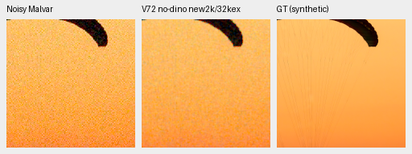
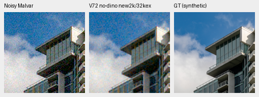
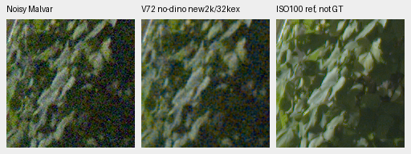
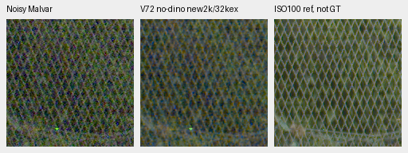

# V72 first-gate CPU crop review

V72 has completed2,000 optimizer updates /8,000 original B4 source steps /
32,000 example draws. On the two fixed synthetic observations it improves
about0.50dB over the original RAW model at the same example budget, but remains
visibly grainy and substantially behind the mature controls. This selected
CPU check does not promote V72. DINO V73 is still training; the complete
[matched FP32 review](packed-isotropic-mixed16-trial.md) remains queued.

[Checkpoint, source/ROI/noise/display metadata and complete artifact receipts](results/packed-isotropic-mixed16-V72-CPU-preview-v1.json).

The immutable V72 checkpoint SHA256 is
`8d67375e2169adb88f7dcdafd253e23642eb0d87b1dc2d79416cb0f22320416a`.
The actual worker exited; independent prefix/final checks verify finite model,
EMA and852 Adam states at the correct counters, genuine full-state resume,
bitwise FP32 portable reload, the original schedule, all82 logged mixed groups
and82 overlapping original V71 observation hashes/domains. V72 changes neural
units, training precision and optimizer grouping together relative to V71;
this comparison cannot isolate their individual effects.

## Two preselected exact-GT observations

These are existing fixed CPU Poisson/read/ADC observations, shared across all
methods: ISO12800 synthetic prior, shot`.00256`, read variance`2.62144e−5`,
RGGB, WB`[2,1,1.5]`, the recorded matrix and display exposure1. Each displayed
ROI is`[48,48,160,160]` in a native256 context. The numbers below use the
240×240 interior after border8, rather than just the displayed160×160 ROI.
Rendering is FP32, with NumPy float64 error accumulation. These are two
selected single-condition results, not427-source averages or confidence intervals.

| Method | Parachute sRGB PSNR | Building sRGB PSNR |
| --- | ---: | ---: |
| V72 new2k /32k examples | 28.79973 | 26.00101 |
| Original RAW8k /32k examples | 28.29771 | 25.49915 |
| Original RAW40k /160k examples | 31.48196 | 28.34273 |
| V43 working | 40.69080 | 35.20764 |
| V63 mature | 33.69030 | 35.76606 |
| RawNIND global observed-CFA gain | 29.73944 | 26.16556 |
| RawNIND channel observed-CFA gain | 29.83785 | 26.17905 |

The older40k checkpoint has five times V72's example budget. V43/V63 also
have other backbones, initialization and training histories. RawNIND adapters
share publisher weights and fit gains to noisy CFA samples without using GT.
The [complete native photo board](images/mixed16-V72-CPU-photos-native-board.png)
shows all seven methods. V72 retains noise in the canopy/sky; the mature
methods remove more noise but still lose fine cords, and V63 has a canopy
tone bias on this example.

Swiss Riviera / parachute, Roy Egloff,
[source](https://commons.wikimedia.org/wiki/File:CH.VD.Villeneuve_2007-08-25_Vertigo-Swiss-Riviera_2392_3x2-R_4K.jpg),
[CC BY-SA4.0](https://creativecommons.org/licenses/by-sa/4.0/).
The8× cache context is`[189,3,256,256]`, displayed ROI`[237,51,160,160]`.

Vancouver building/sky, Dietmar Rabich,
[source](https://commons.wikimedia.org/wiki/File:Vancouver_(BC,_Canada),_Coal_Harbour_Seaside_Park,_Blick_in_den_Himmel_--_2022_--_2158.jpg),
[CC BY-SA4.0](https://creativecommons.org/licenses/by-sa/4.0/).
Cache context`[195,89,256,256]`, displayed ROI`[243,137,160,160]`.
Both source modifications: linear-light binning, crop, simulated camera/noise,
restoration and shared display rendering. Open PNGs at100%; crop pixels are never resized.

## Standing GFX contexts

All four fixed sensor regions were inspected in the
[native GFX board](images/mixed16-V72-CPU-GFX-contexts-native-board.png).
These are512-pixel CPU context predictions, rather than blended full-frame
CUDA outputs. A common32-pixel context grid preserves all compared trunks'
sampling alignment. The surrounding windows move; the original160×160 noisy
sensor samples and Malvar display values remain bitwise identical.

| Region | Noisy xy | Reference xy | Aligned512 context xy |
| --- | --- | --- | --- |
| Sky | `[5800,1400]` | `[5800,1400]` | `[5600,1216]` |
| Building | `[5790,2690]` | `[5791,2690]` | `[5600,2496]` |
| Foliage | `[8890,5570]` | `[8890,5570]` | `[8704,5376]` |
| Fence | `[2240,6000]` | `[2241,6000]` | `[2048,5824]` |

The cached originals remain DSCF3879 ISO6400/f1.7/1/240s and DSCF3880
ISO100/f5.6/3s,3m38s apart. The latter is an independently demosaiced
qualitative reference, **not GT**: aperture, depth of field, clouds, lighting
and moving subjects differ. Shared input-only conditioning is shot
`.0014635775921166604`, read variance`1.0715704128646712e−6`; shared display
exposure4 (+2EV), WB`[1.5132450331,1,2.2152317881]` and the recorded matrix.
This scene and its siblings remain excluded from training.

V72 reduces some grain over originalRAW8k, but no clear new foliage or fence
detail advantage appears. OriginalRAW40k is less noisy; V43/V63 are much
cleaner. RawNIND shows wavy fence and building artifacts. The separate
reference's extra optical sharpness is not a reconstruction scoring target.

All42 triplets were represented and viewed in the two native boards; the four
new individual triplets above were also viewed. Readback verifies42 saved F32
predictions,42 exact denoised preview replays,12 shared noisy/reference panels
and54 unresized board cells. Both CPU execution and readback initialize no CUDA;
28 relevant boundary/reporting tests and Ruff pass. The rendering operator is
reused in readback, so this does not independently validate metric definitions.
Full held-out/camera/analytic/color results, DINO comparison and full-frame
quality/timing remain pending. V43 remains the working README reference.
