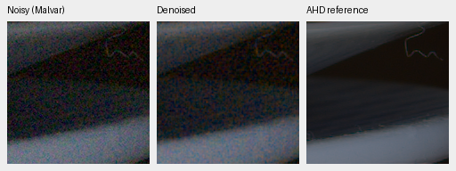
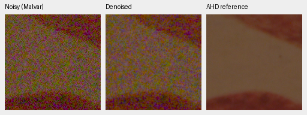

# V72: complete development-camera CPU check

V72 improves measured-CFA PSNR by **2.8302dB on known cameras and2.1418dB
on unseen cameras** against original V71 at the same32,000-example budget.
All nine scene means improve. It still trails Wiener7+Malvar and both RawNIND
adapters substantially, with strong visible grain; V72 is not promoted.

[Complete scores, checkpoint/source hashes, conditioning, crop ROIs and artifact receipts](results/packed-isotropic-mixed16-V72-camera-CPU-v1.json).
The [matched DINO/full photographic review](packed-isotropic-mixed16-trial.md)
remains queued behind V73 training. This CPU result does not replace that review.

V72 completed2,000 effective16 optimizer updates; V71 completed8,000 B4
updates. Both saw32,000 examples from the same frozen source mixture. Their
units, training precision and optimizer grouping differ together; this is not
a causal batch-size ablation. V72's immutable checkpoint is
`8d67375e2169adb88f7dcdafd253e23642eb0d87b1dc2d79416cb0f22320416a`.
Its actual prefix/resume/final state, all82 logged mixed updates and82 overlapping
original V71 observation hashes/domains were checked before CPU inference.

## Full development panels

All predictions are freshly computed in CPU IEEE FP32, NCHW, batch1. The
existing known-camera panel contains four scenes/eight captures/72 crops;
the unseen-camera panel has five scenes/ten captures/90 crops. Seven methods
produce504/630 metric records. Each crop is512×512; scoring excludes border32.
Means first balance crops within captures, then captures within each scene,
then scenes. Low-noise measured CFA samples supply the primary reference;
registered/calibrated LibRaw AHD RGB supplies auxiliary measurements and previews,
**not exact RGB GT**.

| Method | Known CFA PSNR | Unseen CFA PSNR |
| --- | ---: | ---: |
| V72 new2k /32k examples | 47.01274 | 43.57983 |
| Original V71 RAW8k /32k examples | 44.18253 | 41.43805 |
| RawNIND global observed-CFA gain | 54.06859 | 53.56220 |
| RawNIND channel observed-CFA gain | 54.08474 | 53.76822 |
| Bilinear | 44.10599 | 41.41325 |
| WB-aware Malvar | 43.80425 | 40.93797 |
| Wiener7 + WB-aware Malvar | 50.07169 | 49.59129 |

The own-model progress intervals from1,000 paired scene bootstrap resamples,
seed42, are[+2.48171,+3.17871]dB known and[+2.03356,+2.23557]dB unseen.
Per-scene gains range1.9342–3.2947dB. These intervals describe the finite
development scenes, not training-repeat uncertainty. Publisher model exposure
to these development sources is not completely certified. The two RawNIND
adapters share publisher weights, with observed noisy-CFA gain fits that do
not use the clean reference.

V72 remains7.0720/10.1884dB below the channel-gain RawNIND adapter. Its
auxiliary AHD sRGB PSNR is31.88825/27.58149 versus V71's29.92669/25.55998;
these auxiliary numbers depend on the reference demosaicer and alignment.
The observed improvement does not establish convergence, competitive final
quality or superiority to the working mature models. V43/V63 primary FP32
recomputations remain in the pending matched review.

## Native camera comparisons

All16 triplets were represented and inspected in the
[native camera board](images/mixed16-V72-camera-CPU-native-board.png).
V72 reduces grain over V71, but retains strong colored noise in the smooth
high-ISO areas. RawNIND removes much more noise on these selected crops,
while softening boundaries and imperfectly preserving detail. The AHD reference
also retains noise and is not an exact sharpness target.

Every displayed panel is160×160, with shared display exposure1 and variance
multiplier1. The ROI is`[176,176,160,160]` within each512 context. Input-only
Haar fits supply the fixed noise conditioning below; exact WB/matrix and
source/prepared-crop hashes are in the receipt.

| Preview | ISO |512 context sensor xy | Shot | Read variance |
| --- | ---: | --- | ---: | ---: |
| Known:2pilesofplates | 12800 | `[2756,1756]` | .0014251640143 | 1.5708073411e−6 |
| Known:7D-1 | 12800 | `[2344,1476]` | .0048119730712 | 6.6214510098e−5 |
| Unseen:LucieB_3apples | 6400 | `[2756,1754]` | .0023020145670 | 5.0209101013e−5 |
| Unseen:LucieB_Coulicoco | 12800 | `[2756,1754]` | .0023482592097 | 1.7038157420e−4 |

The [7D-1](images/mixed16-V72-camera-CPU-known-7D-1.png) and
[three-apples](images/mixed16-V72-camera-CPU-unseen-LucieB_3apples.png) triplets
are also retained. Open original PNGs at100%; no crop pixels are resized.
Source: Benoit Brummer and Christophe De Vleeschouwer,
[Raw Natural Image Noise Dataset](https://doi.org/10.14428/DVN/DEQCIM),
[CC BY-SA4.0](https://creativecommons.org/licenses/by-sa/4.0/), with per-scene
credits/CC0 grants retained;7D-1 is Peter Wemmert, CC0. Modifications are
registration/calibration, cropping, restoration and shared display rendering.

## Exact-GT companion crops from this checkpoint

These reuse the same checkpoint's existing fixed CPU synthetic observations,
not real-camera GT. They have RGGB ISO12800-prior shot`.00256`/read
`2.62144e−5`, display exposure1, WB`[2,1,1.5]`, the recorded matrix and
native ROI`[48,48,160,160]` in256 contexts. The
[complete source/crop settings](packed-isotropic-mixed16-V72-CPU-preview.md)
also cover the four standing GFX CPU contexts, including foliage and fence.
Those ISO100 GFX references remain separate qualitative captures, not GT.

Sources: [Roy Egloff](https://commons.wikimedia.org/wiki/File:CH.VD.Villeneuve_2007-08-25_Vertigo-Swiss-Riviera_2392_3x2-R_4K.jpg)
and [Dietmar Rabich](https://commons.wikimedia.org/wiki/File:Vancouver_(BC,_Canada),_Coal_Harbour_Seaside_Park,_Blick_in_den_Himmel_--_2022_--_2158.jpg),
[CC BY-SA4.0](https://creativecommons.org/licenses/by-sa/4.0/).
Changes:8× linear-light binning, crop, synthetic camera/noise, restoration and
shared rendering. Their source/cache coordinates and observation hashes remain
in the linked receipts.

Independent checks cover all1,134 case records,18 metric comparisons and
six classical-control witnesses, with maximum saved-summary arithmetic
difference7.11e−15. Native readback reconstructs all32 noisy/reference outer
panels from hashed prepared inputs with **zero changed8-bit values**, and
verifies all24 copied board cells. It reuses the production rendering operator
and does not replay saved denoised camera F32 arrays. The actual CPU owner
has exited. No CUDA, protected-final scoring, training extension or promotion
occurred. Complete matched quality and full-frame performance remain pending.
