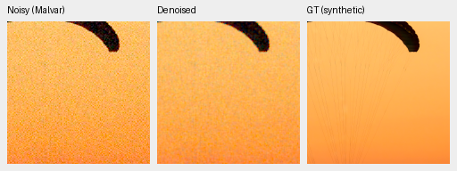
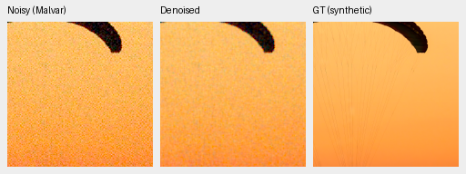
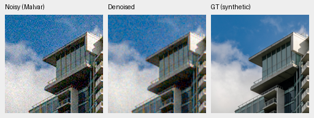
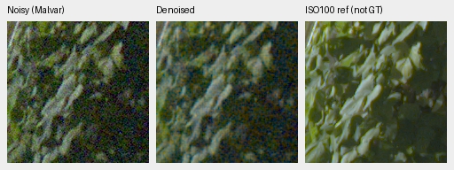
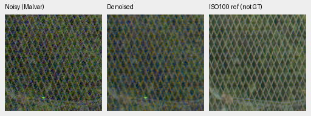

# Mixed16 review at32,000 examples

V72/V73 improve full427-photo PSNR by **0.50510/0.41568dB** over their older
equal-example controls, but remain visibly grainy and far below mature models.
Neither is promoted; V43 stays the README working reference. The matched
DINO photo gain is only0.00493dB. Full-frame FP32 restores take151.54/169.39s,
missing the100MP/10s target. SOTA and decisive real-photo superiority remain
unmet/unproven.

[Complete results, source/ROI/checkpoint/noise/display metadata, native-view ledger and audits](results/packed-isotropic-mixed16-first32000-review-v1.json).
[Frozen trial](packed-isotropic-mixed16-trial.md) and
[independent training-boundary audit](results/packed-isotropic-mixed16-first32000-training-boundary-v1.json).

## Training and comparisons

Both fresh arms completed2,000 effective16 optimizer updates /8,000 original
B4 source groups /32,000 example draws. Four B4 forwards precede one averaged
gradient clip/Adam/EMA update. Their original40,000-update/640,000-example
schedule,500-update warmup, LR2e−4 and adaptive EMA capped at`.999**4` remain
intact. Neural RAW gain32/residual÷32 and IEEE FP32 training preserve physical
output/loss units. Genuine pinned DINO remains frozen and gradient-free.

All82 logged source/noise/LR/example records match across the pair, including
82 overlaps with original V71 observations per arm. Both share the RAW
initializer and seed51; DINO presence/fusion differs within the pair. Against
older V70/V71, units, precision, optimizer grouping and EMA changed together;
their gains cannot be attributed to larger batches alone. V43/V63 have other
backbones, initialization and training histories.

| Arm | Checkpoint SHA256 |
| --- | --- |
| V72 no-DINO | `8d67375e2169adb88f7dcdafd253e23642eb0d87b1dc2d79416cb0f22320416a` |
| V73 DINO | `43c10f2a0af38761f9418f19c725edc4129284e76b5b2da89f66c184d1f643e1` |

Training retains40,170 Commons sources,128 native captures/106 declared groups
and32 paired scenes. Newly downloaded sources are outside these manifests.
The standing GFX scene/siblings and protected-final scenes remain excluded.

## Completed primary results

All11 methods were freshly evaluated in IEEE FP32 on shared observations.
Photo means balance427 sources over seven conditions/four CFAs;16 procedural
sources remain separate. Known/unseen means balance four/five scenes, nine
crops per exposure and two exposures per scene. Primary camera PSNR uses
registered low-noise measured CFA samples. AHD RGB is an auxiliary reference,
**not exact RGB GT**; reference noise/alignment remain limitations.

| Method | Photo sRGB PSNR | Photo SSIM | Known CFA PSNR | Unseen CFA PSNR |
| --- | ---: | ---: | ---: | ---: |
| V72 new2k /32k examples | 28.17595 | .841502 | 47.01274 | 43.57983 |
| V73 new2k /32k examples | 28.18088 | .841624 | 47.03053 | 43.61822 |
| Original V71 RAW8k /32k examples | 27.67085 | .815784 | 44.18253 | 41.43805 |
| Original V70 DINO8k /32k examples | 27.76520 | .819797 | 44.35326 | 41.64024 |
| V43 working reference | 34.89933 | .957125 | 54.23334 | 53.80629 |
| V63 mature DINO | 35.93298 | .963290 | 54.20368 | 53.84318 |
| RawNIND global observed-CFA gain | 26.69578 | .790028 | 54.06860 | 53.56220 |
| RawNIND channel observed-CFA gain | 26.68357 | .789899 | 54.08474 | 53.76822 |
| Bilinear | 27.55481 | .811702 | 44.10599 | 41.41325 |
| Malvar, WB-aware | 28.53865 | .839520 | 43.80425 | 40.93797 |
| Wiener7 + Malvar, WB-aware | 29.29697 | .888098 | 50.07169 | 49.59129 |

The paired source-bootstrap95% photo intervals are
V72−oldV71 **[+.48934,+.51988]dB**, V73−oldV70 **[+.40323,+.42759]dB**,
and V73−V72 **[+.00339,+.00697]dB**. The new pair still trails Malvar on photo
PSNR and mature controls by about6.7–7.8dB. RawNIND's synthetic/real behavior
differs strongly; its lower synthetic scores do not establish real superiority.

The camera DINO gaps are+.01779/+.03839dB known/unseen, with scene intervals
[+.00781,+.02577]/[+.01905,+.05514]. These tiny positive conditional differences
are from one training seed and four/five scenes. The1,000 paired resamples
(seed42) do not measure training repeatability or a general foundation effect.

Fixed source-ID sensitivities preserve the photo result:

| Cohort | Sources | V72−oldV71 dB | V73−oldV70 dB | V73−V72 dB |
| --- | ---: | ---: | ---: | ---: |
| Original | 427 | +.50510 | +.41568 | +.00493 |
| Known capture series excluded | 418 | +.50629 | +.41697 | +.00497 |
| Known series and sites excluded | 416 | +.50644 | +.41694 | +.00498 |

These cohorts were frozen before this review. They do not certify complete
scene independence or quantify ancestor/foundation pretraining exposure.
Protected-final scoring stays closed.

## Native exact-GT photo crops

Each triplet is noisy Malvar → EMA-restored → exact synthetic GT. Every crop is
160×160 at ROI`[48,48,160,160]` in a256 context, ISO12800 prior shot`.00256`,
read variance`2.62144e−5`, RGGB, display exposure1, WB`[2,1,1.5]` and the
recorded shared matrix. CUDA noise draws and floating-point previews are
separate from the earlier CPU checks, with
[small recorded preview-rounding differences](results/mixed16-CPU-GPU-GT-preview-differences-v1.json).
Use the shared GPU panels for this method comparison.
Open original PNGs at100%; crop pixels are never resized.

Swiss Riviera parachute, Roy Egloff,
[source](https://commons.wikimedia.org/wiki/File:CH.VD.Villeneuve_2007-08-25_Vertigo-Swiss-Riviera_2392_3x2-R_4K.jpg),
[CC BY-SA4.0](https://creativecommons.org/licenses/by-sa/4.0/).
Validation index0/seed42;8× cache context`[189,3,256,256]`, displayed cache
ROI`[237,51,160,160]`.

Vancouver building/sky, Dietmar Rabich,
[source](https://commons.wikimedia.org/wiki/File:Vancouver_(BC,_Canada),_Coal_Harbour_Seaside_Park,_Blick_in_den_Himmel_--_2022_--_2158.jpg),
[CC BY-SA4.0](https://creativecommons.org/licenses/by-sa/4.0/).
Validation index1/seed42; cache context`[195,89,256,256]`, displayed cache
ROI`[243,137,160,160]`. Both sources are modified by linear-light binning,
cropping, synthetic camera/noise, restoration and shared rendering.

The [eight-method native photo board](images/mixed16-first32k-photos-native.png)
adds mature controls, original8k models and both RawNIND adapters. The new arms
reduce some grain over old8k but remain weak; mature models lose fine canopy
cords and V63 retains a canopy-tone bias. The
[complete camera board](images/mixed16-first32k-cameras-native.png) similarly
shows strong colored grain in the new models. Its AHD row is not exact GT.
Camera source: Brummer/De Vleeschouwer,
[RawNIND](https://doi.org/10.14428/DVN/DEQCIM),
[CC BY-SA4.0](https://creativecommons.org/licenses/by-sa/4.0/), with per-scene
credits/CC0 grants retained;7D-1 is Peter Wemmert, CC0. Modifications include
registration/calibration, crop, restoration and shared rendering.

## Standing GFX and other real cameras

The [complete full-frame GFX board](images/mixed16-first32k-GFX-native.png)
covers sky, building, foliage and chain-link fence for six methods. These
standing crops come from complete blended101.996MP CUDA FP32 outputs.
DSCF3879 is ISO6400/f1.7/1/240s; DSCF3880 is ISO100/f5.6/3s,3m38s later.
The latter is a separate independently demosaiced qualitative reference,
**not GT**: optics, lighting and moving content differ. Originals remain
read-only, the two RAFs are locally cached, and the scene/siblings stay out of training.

Shared shot`.0014635775921166604`, read variance`1.0715704128646712e−6`,
display exposure4 (+2EV), WB`[1.5132450331,1,2.2152317881]` and the recorded
matrix are fixed. All displayed ROIs are160×160:

| Region | Noisy xy | Separate-reference xy |
| --- | --- | --- |
| Sky | `[5800,1400]` | `[5800,1400]` |
| Building | `[5790,2690]` | `[5791,2690]` |
| Foliage | `[8890,5570]` | `[8890,5570]` |
| Fence | `[2240,6000]` | `[2241,6000]` |

Both candidates retain strong sky/building grain and weak noisy foliage/fence
detail, without a clear new DINO advantage. V43/V63 are much cleaner with more
continuous fence structure, though foliage remains soft. RawNIND has wavy
fence/building artifacts. The sharper ISO100 capture is not a scoring target.

The [three-camera board](images/mixed16-first32k-three-camera-native.png)
uses six native512-context regions from cached Q2/a7RII/GFX50R captures. New
arms remain close to noisy Malvar in selected regions and retain GFX50R grain.
The last row is RawNIND on the same capture, not GT; these are context outputs
without reference scores. The
[neon/platform board](images/mixed16-first32k-highlights-native.png) adds two
CPU512 contexts, including RawNIND. The ISO100 sign content differs; no pixelwise
reference score is appropriate. These contexts are distinct from the full-frame outputs.

## Weak carriers and color

The [analytic board](images/mixed16-first32k-analytic-native.png) shows strong
flat-field noise and obscured weak carriers in the new arms. Mature controls
are cleaner but attenuate the darkest carrier. The complete2,240-case audit
covers448 observations per method, including Malvar,140 groups and3,760
summary scalars; maximum arithmetic difference is2.22e−16.

All4,704 hue predictions are freshly FP32, with no old FP16 array reuse.
The1,176 observations cover147 uniform colors × two noise conditions × four
CFAs, with one draw per case. The following high-saturation group has96 cases:
saturation.98, peak.90, ISO12800 prior,24 hues/four CFAs. Values are means
of per-case camera-linear statistics, not photographic scores or confidence intervals.

| Method | Max-channel absolute mean bias | RGB RMSE | Centered RGB RMS |
| --- | ---: | ---: | ---: |
| V72 | .001637 | .020580 | .020528 |
| V73 | .001706 | .020486 | .020431 |
| V63 mature | .005739 | .004512 | .001839 |
| Released Nonlocal RAW reference | .016283 | .013482 | .004003 |

The new arms have smaller mean bias here but much greater residual noise and
total error. This does not establish better overall color reconstruction.
The [hue board](images/mixed16-first32k-hue-native.png) shows residual V63
magenta bias and a structured magenta artifact in the released RAW reference.
The [selected-color board](images/mixed16-first32k-selected-colors-native.png)
adds the fixed neutral/fabric/cyclic-palette CPU checks:128 predictions,
including16 original/additional native triplets. Bright-field limitations remain.

## Full-frame execution and integrity

These are single shared-machine FP32 restore/blend observations on101.996MP,
excluding RAW decode, checkpoint loading, display rendering and TIFF writing.
They use a different precision from the earlier FP16 speed runs. The new NN
outputs use512 tiles,64 overlap, stride448, B4 and channels-last; their RAW/DINO
grid alignments are4/32 pixels. No repeated throughput study is claimed.

| Method | FP32 seconds |
| --- | ---: |
| V72 | 151.54 |
| V73 | 169.39 |
| V43 | 203.62 |
| V63 | 205.36 |
| RawNIND global CFA | 14.52 |
| RawNIND channel CFA | 17.21 |

Independent primary arithmetic covers138,226 records,156 metric comparisons
and39 classical witnesses, with maximum difference7.11e−15. Saved-array
color audits check768 selected-color fields and28,224 hue fields; the72-group
hue summary checks another864 descriptive scalars. Source sensitivity audits
rebuild117 comparisons from286,944 saved raw-case metric values. These audits
check declared coverage/arithmetic and do not independently define the metrics.

Artifact checks pass76 neural native triplets,32 saved F32 contexts, all twelve
RGB16 exports and the recorded display-rounding bounds. The TIFFs have the
expected101.996MP shape, uint16 pixels, metadata/ICC and more than256 sampled
codes. All146 report-native triplets were actually viewed, including additional
cyclic-palette checks;202 unresized board cells were rechecked. Published PNG
copies are byte-exact. All38 inputs/181 frozen-file guards and parent checkpoint
hashes remain unchanged. Both review owners exited successfully.

## Next budget check

Keep both models unpromoted and test more of their original untuned schedules.
The first gate is only5% of the640,000-example plan; measurable own-control
gains and intact state checks justify an isolated full-state continuation to
**10,000 optimizer updates /160,000 examples** (25% horizon). That matches the
older40k-B4 example budget;8,000 effective16 updates would be128,000 examples.

Preserve all2k archives/logs, resume current model/EMA/Adam/RNG in separate
directories, and retain sources, precision, LR and horizon. The
[trained-state CPU preflight](mixed16-trained-state-restart-CPU.md) passes;
actual production CUDA restoration/input checks remain required at launch.
This report records the decision and does not launch that run. More training
is a hypothesis, with another complete quality review required at its boundary.
