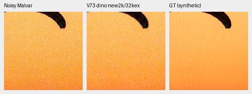
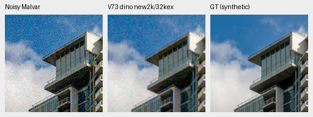
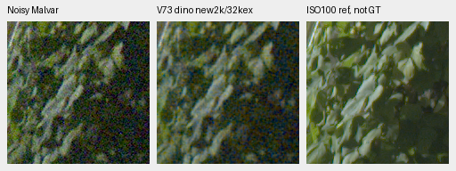
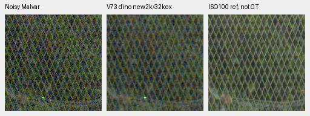

# Matched V72/V73 camera and native-crop interim review

At the matched 32,000-example gate, DINO V73 exceeds no-DINO V72 by only
0.01779/0.03839 dB on known/unseen-camera measured-CFA PSNR. Both remain
substantially behind mature models and RawNIND, and retain strong grain in the
native crops. Neither is promoted. The full photographic, analytic, full-frame
GFX and color review is now [complete](packed-isotropic-mixed16-first32000-review.md).
This historical interim covers the camera panel and selected CPU crop check.

[Complete statistics, checkpoint/source/ROI/noise/display metadata and artifact hashes](results/packed-isotropic-mixed16-matched-camera-interim-v1.json).
[Training-boundary audit](results/packed-isotropic-mixed16-first32000-training-boundary-v1.json)
and [fixed trial recipe](packed-isotropic-mixed16-trial.md).

Both fresh models completed 2,000 effective16 optimizer updates using four B4
forwards per update: 8,000 original source groups / 32,000 example draws. They
share the RAW initializer, source/noise sequence, IEEE FP32 training, gain32
neural units, schedule and seed51. Only the genuine frozen DINO branch and its
fusion differ within this pair. All82 logged source/noise/LR/example records
match. Their checkpoint SHA256 values are:

| Model | SHA256 |
| --- | --- |
| V72 no-DINO | `8d67375e2169adb88f7dcdafd253e23642eb0d87b1dc2d79416cb0f22320416a` |
| V73 DINO | `43c10f2a0af38761f9418f19c725edc4129284e76b5b2da89f66c184d1f643e1` |

## Completed GPU camera panels

All11 methods were freshly evaluated in IEEE FP32, batch4/channels-last.
Known cameras have four scenes/eight exposure pairs/72 crops per method;
unseen cameras have five scenes/ten pairs/90 crops. The792/990 case records
and all summary arithmetic were independently rebuilt, with maximum saved
arithmetic difference7.11e−15. Primary PSNR uses registered low-noise measured
CFA samples; independently demosaiced AHD RGB is an auxiliary reference,
**not exact RGB GT**. Means balance exposure pairs within each scene, then scenes.

| Method | Known CFA PSNR dB | Unseen CFA PSNR dB |
| --- | ---: | ---: |
| V72 no-DINO, new2k /32k examples | 47.01274 | 43.57983 |
| V73 DINO, new2k /32k examples | 47.03053 | 43.61822 |
| Original V71 no-DINO,8k /32k examples | 44.18253 | 41.43805 |
| Original V70 DINO,8k /32k examples | 44.35326 | 41.64024 |
| V43 working reference | 54.23334 | 53.80629 |
| V63 mature DINO | 54.20368 | 53.84318 |
| RawNIND global observed-CFA gain | 54.06860 | 53.56220 |
| RawNIND channel observed-CFA gain | 54.08474 | 53.76822 |
| Bilinear | 44.10599 | 41.41325 |
| Malvar | 43.80425 | 40.93797 |
| Wiener7 + Malvar | 50.07169 | 49.59129 |

The paired scene-bootstrap95% intervals for V73 minus V72 are
**[+0.00781,+0.02577]dB** known and **[+0.01905,+0.05514]dB** unseen
(1,000 resamples, seed42). These small positive conditional differences do
not measure training-repeat uncertainty: there is only one training seed and
four/five scenes. They do not establish a general foundation-model advantage.
Unseen auxiliary AHD sRGB PSNR changes by−0.00938dB, with an interval crossing
zero; auxiliary SSIM improves by0.00155/0.00214 on known/unseen scenes.

Both new arms improve over their original equal-example controls, but neural
units, training precision and optimizer grouping all changed together. This
cannot attribute their improvement to larger effective batches alone. Mature
V43/V63 have different architectures and training histories. The early gate
also does not establish convergence on the original40,000-update horizon.

The [matched camera board](images/mixed16-matched-first32000-cameras-native.png)
was viewed at native scale: noisy Malvar, V72, V73, V43, V63, two RawNIND
adapters and AHD reference. The new pair retains conspicuous colored grain;
the mature models and RawNIND remove much more noise on these selected regions.
The shared display exposure is1, conditioning multiplier1, and each crop is
160×160 at ROI`[176,176,160,160]` within its512 context. Fixed input-only
Haar conditioning and context sensor origins are:

| Scene | ISO | Context xy | Shot | Read variance |
| --- | ---: | --- | ---: | ---: |
| Known:2pilesofplates | 12800 | `[2756,1756]` | .0014251640143 | 1.5708073411e−6 |
| Known:7D-1 | 12800 | `[2344,1476]` | .0048119730712 | 6.6214510098e−5 |
| Unseen:LucieB_3apples | 6400 | `[2756,1754]` | .0023020145670 | 5.0209101013e−5 |
| Unseen:LucieB_Coulicoco | 12800 | `[2756,1754]` | .0023482592097 | 1.7038157420e−4 |

Source: Benoit Brummer and Christophe De Vleeschouwer,
[Raw Natural Image Noise Dataset](https://doi.org/10.14428/DVN/DEQCIM),
[CC BY-SA4.0](https://creativecommons.org/licenses/by-sa/4.0/), with per-scene
credits/CC0 grants retained;7D-1 is Peter Wemmert, CC0. Modifications are
registration/calibration, cropping, restoration and shared rendering. Exact
source/prepared-crop hashes, WB/matrices and all checkpoint hashes are in the receipt.

## Two exact-GT photo triplets per new model

These are the existing two fixed CPU-generated synthetic observations, separate
from the GPU camera and forthcoming full427 populations. Each model sees the
same noisy samples and exact synthetic clean target: RGGB ISO12800 prior,
shot`.00256`, read variance`2.62144e−5`, display exposure1, WB`[2,1,1.5]`
and the recorded shared matrix. Native ROI is`[48,48,160,160]` in a256 context.
Open the original PNG at100%; no crop pixels are resized.

Swiss Riviera parachute, Roy Egloff,
[source](https://commons.wikimedia.org/wiki/File:CH.VD.Villeneuve_2007-08-25_Vertigo-Swiss-Riviera_2392_3x2-R_4K.jpg),
[CC BY-SA4.0](https://creativecommons.org/licenses/by-sa/4.0/).
The8× cache context is`[189,3,256,256]`, displayed ROI`[237,51,160,160]`.
Left-to-right: noisy Malvar, denoised, exact synthetic GT.

Vancouver building/sky, Dietmar Rabich,
[source](https://commons.wikimedia.org/wiki/File:Vancouver_(BC,_Canada),_Coal_Harbour_Seaside_Park,_Blick_in_den_Himmel_--_2022_--_2158.jpg),
[CC BY-SA4.0](https://creativecommons.org/licenses/by-sa/4.0/).
Cache context`[195,89,256,256]`, displayed ROI`[243,137,160,160]`.
Both sources are modified by linear-light binning, crop, synthetic camera/noise,
restoration and shared rendering.

The [matched photo board](images/mixed16-matched-first32000-photos-native.png)
adds V43/V63 and both RawNIND adapters at the same coordinates and display
transform. Both new arms are visibly grainy and much weaker than the mature
controls here; fine canopy cords remain weak and V63 has a canopy-tone bias.

## Standing GFX foliage and fence

The [matched native GFX board](images/mixed16-matched-first32000-GFX-native.png)
also includes sky and building detail. These are CPU512-context predictions
on a common32-pixel sensor grid, **not full-frame CUDA outputs**. Both previews
use identical noisy/reference samples; the original160×160 sensor ROI and
Malvar pixels are bitwise unchanged from the standing test.

| Region | Noisy xy | Reference xy |512 context xy |
| --- | --- | --- | --- |
| Sky | `[5800,1400]` | `[5800,1400]` | `[5600,1216]` |
| Building | `[5790,2690]` | `[5791,2690]` | `[5600,2496]` |
| Foliage | `[8890,5570]` | `[8890,5570]` | `[8704,5376]` |
| Fence | `[2240,6000]` | `[2241,6000]` | `[2048,5824]` |

DSCF3879 is ISO6400/f1.7/1/240s; DSCF3880 is ISO100/f5.6/3s,3m38s later.
The latter is a separate independently demosaiced qualitative reference,
**not GT**: optics, lighting and moving subjects differ. Shared display
exposure4 (+2EV), WB`[1.5132450331,1,2.2152317881]`, shot
`.0014635775921166604` and read variance`1.0715704128646712e−6` are fixed.
All160×160 panels use the recorded common matrix. Both RAFs are locally cached;
originals remain read-only and the scene/siblings remain outside training.

The [V72 companion crops](packed-isotropic-mixed16-V72-CPU-preview.md)
show the same regions. There is no clear new-pair fine-leaf/fence advantage;
V43/V63 are much cleaner, while RawNIND has wavy fence/building artifacts.
The sharper low-ISO capture is not a pixelwise scoring target.

Saved-array readback verifies all84 CPU F32 predictions and exact denoised
PNG renderings,24 bitwise-identical shared-control predictions,12 common
noisy/reference panels and48 copied matched photo/GFX board cells. All32
camera board cells are also exact copies from their hashed native PNGs. This
reuses the rendering operator; it does not independently validate its metric
definitions. The V73 photo/GFX boards and all three matched boards were viewed
at native scale. The subsequent full quality/output/performance results are in
the completed report linked above; V43 remains the README working reference.
