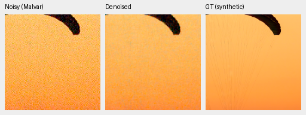
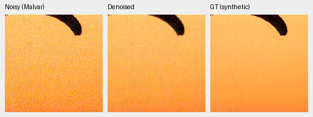
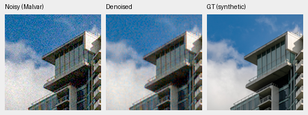
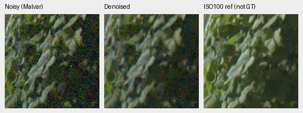
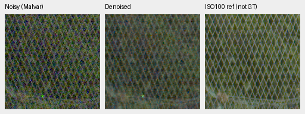

# Mixed16 review at160,000 examples

V72 no-DINO and V73 DINO improve photo PSNR by **+0.53338/+0.87718dB** over
their own2k checkpoints, but trail older equal-example RAW controls by
**1.02266/0.89509dB**. Both remain visibly grainy and far behind mature models.
Neither is promoted; V43 remains the README working reference. The matched
DINO gain is0.34873dB on this development protocol. Full-frame FP32 restores
take154.88/168.78s, missing the100MP/10s target. SOTA and decisive real-photo
superiority remain unmet/unproven.

[Complete results, source/ROI/checkpoint/noise/display metadata, native-view ledger and audit references](results/packed-isotropic-mixed16-quarter-review-v1.json).
[Training and full-state handoff](packed-isotropic-mixed16-quarter-training.md),
[frozen review plan](packed-isotropic-mixed16-quarter-review-queue.md) and
[previous32k-example review](packed-isotropic-mixed16-first32000-review.md).

## Matched training and primary results

Both arms resumed current model/EMA/Adam/RNG from2k and stopped at10,000
effective16 optimizer updates /40,000 original B4 groups /160,000 examples.
This is25% of the original40k-update/640k-example schedule, with its500-update
warmup, LR2e−4 and adaptive EMA cap`.999**4` retained. Four B4 forwards precede
one averaged gradient/clip/Adam/EMA update. RAW neural gain32/residual÷32 and
IEEE FP32 retain physical output/loss units. The genuine pinned DINO backbone
remains frozen and gradient-free.

Both actual startup restorations and the first16 source/noise fixtures pass.
All403 logged schedule/source/noise/example observations match across the
pair and overlapping older RAW records. Training retains40,170 Commons
sources,128 native captures/106 declared groups and32 paired scenes. Additional
downloads remain outside these manifests. The standing GFX scene/siblings and
protected-final scenes remain excluded.

| Arm | Checkpoint SHA256 |
| --- | --- |
| V72 no-DINO10k | `d6e3bc6d98b1ffc294ac651c731636ef4072bef284925f357b690b78cc7fa9c1` |
| V73 DINO10k | `64c5649a41669aa7e5276094278f3debb96b55174871c493ca380bf68ee3759f` |

All11 methods were freshly evaluated in FP32 on shared observations. Photo
means balance427 sources across seven conditions/four CFAs;16 procedural
sources remain separate. Camera means balance four known/five unseen scenes,
two exposures and nine crops per exposure. Camera PSNR uses registered
low-noise measured CFA samples. AHD RGB is auxiliary, **not exact RGB GT**;
reference noise and registration remain limitations.

| Method | Photo sRGB PSNR | Photo SSIM | Known CFA PSNR | Unseen CFA PSNR |
| --- | ---: | ---: | ---: | ---: |
| V72 new10k /160k examples | 28.70933 | .862796 | 49.46916 | 45.56826 |
| V73 new10k /160k examples | 29.05806 | .871473 | 49.74359 | 45.94882 |
| Original V71 RAW40k /160k examples | 29.73199 | .883234 | 48.28272 | 46.14959 |
| Original V70 DINO40k /160k examples | 29.95315 | .886794 | 48.36804 | 46.01175 |
| V43 working reference | 34.89933 | .957125 | 54.23334 | 53.80629 |
| V63 mature DINO | 35.93298 | .963290 | 54.20368 | 53.84318 |
| RawNIND global observed-CFA gain | 26.69578 | .790028 | 54.06860 | 53.56220 |
| RawNIND channel observed-CFA gain | 26.68357 | .789899 | 54.08474 | 53.76822 |
| Bilinear | 27.55481 | .811702 | 44.10599 | 41.41325 |
| Malvar, WB-aware | 28.53865 | .839520 | 43.80425 | 40.93797 |
| Wiener7 + Malvar, WB-aware | 29.29697 | .888098 | 50.07169 | 49.59129 |

Paired source-bootstrap95% photo intervals are V73−V72
**[+.33648,+.36059]dB**, V72−oldV71 **[−1.05473,−.98922]dB** and
V73−oldV70 **[−.92884,−.86229]dB**. Own2k progress intervals are
V72 **[+.51567,+.54909]dB** and V73 **[+.85068,+.89999]dB**. The six parent
comparisons reuse existing matching observations after protocol/coverage and
classical-control checks, avoiding repeated parent inference.

DINO's known/unseen measured-CFA gains over new no-DINO are+.27443/+.38056dB,
with scene intervals[+.16856,+.45021]/[+.30794,+.47594]. Against older
equal-example controls, new known-camera scores improve while unseen-camera
scores decline. These are one training seed and four/five camera scenes;
1,000 paired resamples(seed42) do not measure training repeatability or a
general foundation effect. Within the new pair DINO presence/fusion differs.
Against old RAW controls, units, precision, optimizer grouping and EMA also
differ; this cannot isolate a larger-batch effect. Mature models have other
backbones, initialization and training histories.

Fixed source-ID sensitivities retain the photo ordering:

| Cohort | Sources | V72−oldV71 dB | V73−oldV70 dB | V73−V72 dB |
| --- | ---: | ---: | ---: | ---: |
| Original | 427 | −1.02266 | −.89509 | +.34873 |
| Known capture series excluded | 418 | −1.02674 | −.89817 | +.34963 |
| Known series and sites excluded | 416 | −1.02690 | −.89743 | +.35010 |

These cohorts were frozen before this review. They do not certify complete
scene independence or quantify ancestor/foundation pretraining exposure.
Protected-final scoring stays closed.

## Native exact-GT photo crops

Each triplet is noisy Malvar → EMA-restored → exact synthetic GT. Every panel
is160×160 at ROI`[48,48,160,160]` in a256 context, synthetic ISO12800 prior
shot`.00256`, read variance`2.62144e−5`, RGGB, exposure1, WB`[2,1,1.5]` and
the recorded shared matrix. These are actual shared CUDA observations and
previews, distinct from earlier CPU noise/rounding checks. Open original PNGs
at100%; the crop pixels are never resized.

Swiss Riviera parachute, Roy Egloff,
[source](https://commons.wikimedia.org/wiki/File:CH.VD.Villeneuve_2007-08-25_Vertigo-Swiss-Riviera_2392_3x2-R_4K.jpg),
[CC BY-SA4.0](https://creativecommons.org/licenses/by-sa/4.0/).
Validation index0/seed42;8× cache context`[189,3,256,256]`, displayed cache
ROI`[237,51,160,160]`.

Vancouver building/sky, Dietmar Rabich,
[source](https://commons.wikimedia.org/wiki/File:Vancouver_(BC,_Canada),_Coal_Harbour_Seaside_Park,_Blick_in_den_Himmel_--_2022_--_2158.jpg),
[CC BY-SA4.0](https://creativecommons.org/licenses/by-sa/4.0/).
Validation index1/seed42; cache context`[195,89,256,256]`, displayed cache
ROI`[243,137,160,160]`. Both sources are modified by linear-light binning,
crop, synthetic camera/noise, restoration and shared rendering.

The [eight-method photo board](images/mixed16-quarter-photos-native.png) shows
substantial new-model canopy/sky/building grain, without a clear DINO detail
advantage in these two ROIs. Mature controls are cleaner but lose fine canopy
cords; RawNIND has soft/wavy building detail. The
[known](images/mixed16-quarter-known-native.png) and
[unseen](images/mixed16-quarter-unseen-native.png) camera boards also show
strong new-model colored grain. Their AHD row is not exact RGB GT.
Camera source: Brummer/De Vleeschouwer,
[RawNIND](https://doi.org/10.14428/DVN/DEQCIM),
[CC BY-SA4.0](https://creativecommons.org/licenses/by-sa/4.0/), with per-scene
credits/CC0 grants retained;7D-1 is Peter Wemmert, CC0. Modifications include
registration/calibration, cropping, restoration and shared rendering.

## Standing GFX and other real cameras

The [six-method full-frame GFX board](images/mixed16-quarter-GFX-native.png)
covers the standing sky, building, foliage and chain-link fence ROIs. These
crops come from complete blended101.996MP CUDA FP32 outputs. Locally cached
DSCF3879 is ISO6400/f1.7/1/240s; DSCF3880 is ISO100/f5.6/3s,3m38s later.
The latter is an independently demosaiced qualitative reference, **not GT**:
optics, time, lighting and moving content differ. Originals remain read-only;
the scene/siblings stay out of training.

Shared shot`.0014635775921166604`, read variance`1.0715704128646712e−6`,
display exposure4(+2EV), WB`[1.5132450331,1,2.2152317881]` and the recorded
matrix stay fixed. All displayed ROIs are160×160:

| Region | Noisy xy | Separate-reference xy |
| --- | --- | --- |
| Sky | `[5800,1400]` | `[5800,1400]` |
| Building | `[5790,2690]` | `[5791,2690]` |
| Foliage | `[8890,5570]` | `[8890,5570]` |
| Fence | `[2240,6000]` | `[2241,6000]` |

Both new arms retain substantial sky/building grain and weak noisy
foliage/fence structure. DINO appears somewhat smoother locally but has no
clear fine-detail advantage in these four views. Mature V43/V63 are much
cleaner with more continuous fence diamonds, though foliage is soft. RawNIND
has wavy building/fence patterns. The sharper ISO100 capture is not a scoring target.

The [three-camera board](images/mixed16-quarter-three-camera-native.png)
adds six512px contexts from cached Q2/a7RII/GFX50R captures. New arms stay
close to noisy Malvar on dark texture and bright/out-of-focus plane regions,
and retain stronger GFX50R stone grain than mature controls. Its RawNIND row
is another model output, not GT. The
[neon/platform board](images/mixed16-quarter-highlights-native.png) adds two
CPU512 contexts, distinct from full-frame CUDA outputs. New models remain
grainy, mature models smooth texture, and RawNIND has a regular sign pattern.
ISO100 sign content/brightness differs; no pixelwise reference score is appropriate.

## Weak carriers and color

The [analytic board](images/mixed16-quarter-analytic-native.png) shows strong
new-model colored grain, including the flat target. Mature controls suppress
the darkest carrier along with noise. The complete2,240-case audit covers448
observations per method,140 groups and3,760 summary scalars, with maximum
arithmetic difference2.22e−16. These views do not replace the complete
response/noise measurements.

All4,704 hue predictions are freshly FP32, without old FP16 array reuse.
The1,176 observations cover147 uniform colors × two noise conditions × four
CFAs, one draw per case. The high-saturation group below has96 cases:
saturation.98, peak.90, ISO12800 prior,24 hues/four CFAs. Entries are means
of per-case camera-linear descriptive statistics, not photographic scores or CIs.

| Method | Max-channel absolute mean bias | RGB RMSE | Centered RGB RMS |
| --- | ---: | ---: | ---: |
| V72 | .003286 | .017951 | .017799 |
| V73 | .002798 | .017169 | .017036 |
| V63 mature | .005739 | .004512 | .001839 |
| Released Nonlocal RAW reference | .016283 | .013482 | .004003 |

The new pair has lower mean bias here but much greater residual noise and
total error than V63. This does not establish better overall color. The
[hue board](images/mixed16-quarter-hue-native.png) shows V63 magenta mottling
and a structured magenta grid in the released RAW comparator. The
[selected-color board](images/mixed16-quarter-selected-colors-native.png)
adds neutral/fabric/cyclic-palette CPU checks:128 predictions and16 original/
additional triplets. Both new models retain strong fine color grain.

## Execution, integrity and next budget

These are single shared-machine FP32 restore/blend observations on101.996MP,
excluding RAW decode, model loading, rendering and TIFF export. New outputs
use512 tiles,64 overlap, stride448, B4 and channels-last; their RAW/DINO grid
alignments are4/32 pixels. No repeated throughput study is claimed, and these
FP32 timings are distinct from earlier FP16 runs.

| Method | FP32 seconds |
| --- | ---: |
| V72 | 154.88 |
| V73 | 168.78 |
| V43 | 206.01 |
| V63 | 207.94 |
| RawNIND global CFA | 15.60 |
| RawNIND channel CFA | 14.43 |

Independent primary arithmetic covers138,226 records,156 metric comparisons
and39 classical witnesses, maximum difference7.11e−15. Separate parent
progression adds24 metric differences/six protocol witnesses. Selected-color,
hue, highlight and117 fixed-cohort sensitivity audits also pass. Artifact
checks cover76 selected neural native PNGs,32 F32 contexts and all twelve
full-frame RGB16 TIFFs, including expected shape/type and declared display
rounding bounds. All146 report-native triplets were actually viewed;
all202 unresized board cells were independently rechecked against final
original PNGs before publication. Seventeen published PNG copies are byte-exact.
All50 inputs/190 frozen-file guards remain unchanged; the review owner exited.
These audits verify declared arithmetic/artifact integrity, not metric definitions
or generalization beyond this development protocol.

Keep both models unpromoted and preserve their complete10k states and original
40k/640k-example schedules. More training remains a hypothesis; this report
does not extend the run. Analyze the queued CUDA inference profiles and EMA
comparison before selecting the next bounded matched trial. An isolated EMA
speedup would still require a whole-step measurement before production adoption.
The fixed FP16 precision gate remains unchanged. Newly downloaded training
sources and protected-final scenes stay outside this experiment.
