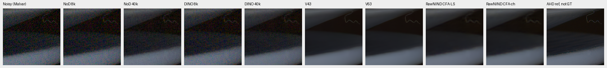
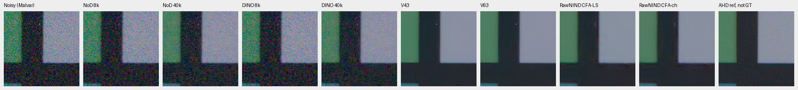
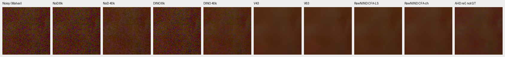
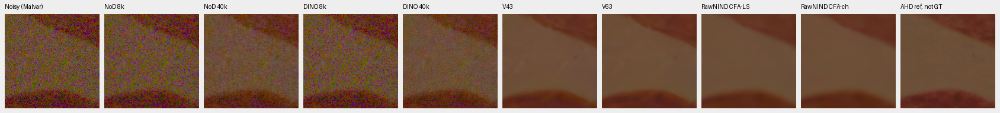
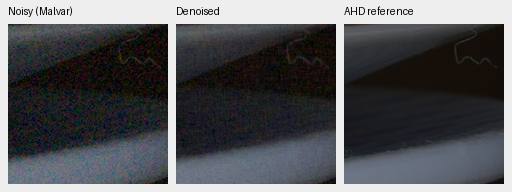
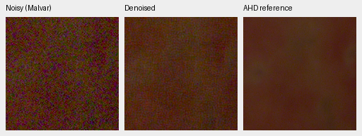

# Interim 40k camera-panel progress

Both RAW-native models improve their own 8k measured-CFA camera scores by
about 4.0–4.7 dB after full-state continuation to 40k. Visible grain decreases
in all four selected native views, but substantial noise remains. Both models
still trail the simple Wiener comparator and the retained V43/V63 models on
these panels. Neither is promoted or automatically extended.

This covers the **completed known/unseen camera panels only**. The full-photo,
analytic, GFX, other-camera, color, hue, statistical and corrected-grid reviews
remain pending. It is not the complete 40k performance review.
[Independent reductions, source/ROI/conditioning/checkpoint records and images](results/packed-isotropic-quarter-camera-interim-v1.json).

## Measured-reference CFA scores

| Model / checkpoint | Known-camera PSNR | Unseen-camera PSNR |
| --- | ---: | ---: |
| No-DINO 8k | 44.1825 | 41.4379 |
| No-DINO 40k | 48.2818 | 46.1458 |
| DINO 8k | 44.3533 | 41.6402 |
| DINO 40k | 48.3667 | 46.0103 |
| Wiener7 + WB-aware Malvar | 50.0717 | 49.5913 |
| V43 step2000 | 54.2333 | 53.8061 |
| V63 step20000 | 54.2037 | 53.8430 |
| RawNIND CFA-LS | 54.0686 | 53.5622 |
| RawNIND CFA-channel | 54.0847 | 53.7682 |

These are scene-balanced **camera-linear measured-CFA PSNR** values in dB,
not sRGB or synthetic-photo PSNR. The known panel has four scenes/eight noisy
captures; unseen has five scenes/ten captures. Each capture has nine prepared
crops. Crops are averaged within capture, captures within scene, then scenes
are averaged equally. These are point means from one training seed. New
confidence intervals and source sensitivities await the complete review;
complete scene independence remains unproven.

No-DINO's own progress is +4.0992/+4.7079 dB; DINO's is +4.0134/+4.3701 dB.
The matched DINO-minus-no-DINO gap at 40k is +0.0849 dB known and −0.1355 dB
unseen, so these two panels do not establish a consistent context benefit.
V43/V63 have different backbones, initialization and training histories;
their stronger scores do not identify which component explains the gap.

Primary errors use valid registered low-noise RAW measurements. Reference noise
and registration uncertainty remain. The displayed LibRaw AHD RGB references
are auxiliary independently demosaiced images, **not exact RGB GT**. No
protected-final scene is scored here.

Scene source: Benoit Brummer and Christophe De Vleeschouwer,
[Raw Natural Image Noise Dataset](https://doi.org/10.14428/DVN/DEQCIM).
These derived comparison/crop images are distributed under
[CC BY-SA 4.0](https://creativecommons.org/licenses/by-sa/4.0/); individual scene
credits and permission records remain in the prepared manifests. Changes:
registered RAW crops, demosaicing, model restoration, color rendering and panel layout.

## Native 8k-to-40k comparisons

Every column contains 160×160 unchanged pixels. The order is noisy Malvar,
no-DINO 8k/40k, DINO 8k/40k, V43, V63, both RawNIND adapters, and AHD reference.
Open originals at 100%; the wide canvas is not a resized crop. These use every
previously selected camera-panel ROI, with no output-dependent replacement.

All previews use exposure 1 and their identical recorded WB/color matrix.
The input/reference pixels, source ROIs and shot/read conditioning are exactly
the same across methods and endpoints. Original full crop receipts and
checkpoint hashes accompany the linked JSON. The 40k hashes are:

| Arm | SHA256 |
| --- | --- |
| No-DINO | `5708fdc19542ca1ef1aaafec25038dc049e4f5027782809846cf6d888ebed2cc` |
| DINO | `4c2926e77dc5dea8580879eff9ebb69550fa891a295fa329a5800189c7fa8337` |

Known `2pilesofplates`, ISO12800: source context `[2756,1756,512,512]`,
crop `[176,176,160,160]` within it; shot `.001425164014313677`, read
`1.570807341075873e-6`. Dark surfaces retain much more grain than the mature
controls after the visible 8k-to-40k improvement.

Known `7D-1`, ISO12800: context `[2344,1476,512,512]`, same within-context crop;
shot `.004811973071234885`, read `6.621451009845082e-5`. The green/dark frame
still contains substantial colored grain.

Unseen `LucieB_3apples`, ISO6400: context `[2756,1754,512,512]`, same crop;
shot `.0023020145669588325`, read `5.020910101285205e-5`. Reduced speckles remain
clearly visible compared with the mature controls.

Unseen `LucieB_Coulicoco`, ISO12800: context `[2756,1754,512,512]`, same crop;
shot `.0023482592096665538`, read `.00017038157420448983`. Grain decreases
without approaching the mature controls' smooth flat regions.

Two compact triplets retain noisy/restored/reference panels: no-DINO 40k on
plates and DINO 40k on apples. Sources, ROIs and display settings are those
above; the right panel is AHD reference, not exact GT.

## Independent checks and remaining decision

The independent auditor reduces all 648/810 per-crop records through the
capture/scene hierarchy using `math.fsum`. Its maximum difference from the saved
summaries is 7.11e−15. All 486 classical-control case metric records match the
8k reports exactly. Checkpoint ancestry matches the original 8k and independently
verified 40k boundaries. Source hashes, noise/WB/matrix/exposure/ROI metadata
and all noisy/reference preview pixels match across the native comparisons.
All four full grids were inspected at original resolution.

This uses saved results and PNG pixels only, with no new model forward, GPU
work, image resampling or changes to the running frozen review. The retained
operator/receipt is under
`/mnt/external/demosaic/benchmarks/packed-isotropic-quarter-camera-progress-v1/`.
The original 8k report stays unchanged. The next model/continuation decision
still requires the complete quality, statistics, full-frame and native review.
