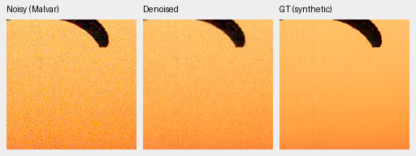
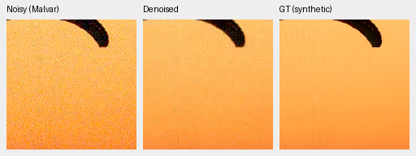
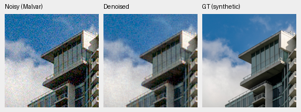
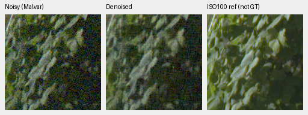
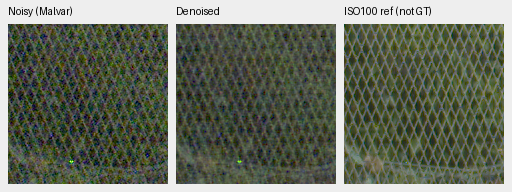
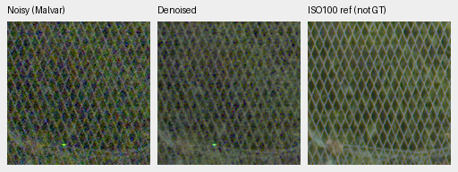

# RAW-native review at 40,000 updates

Current architecture and recommendations: [current model guide](current-model.md).
The versioned study below retains its measured results and original protocol.

Longer training improves both models, but **neither is promoted**. Compared with
their own 8k boundaries, photo PSNR rises by 2.061/2.188 dB and measured-CFA
camera scores by about 4.0–4.7 dB. Both still trail V43/V63 substantially, retain
visible real-photo grain and miss the 100MP/10s target. V43 was the reference for this study; SOTA and decisive real-photo superiority remain unproven.

[Complete results, checkpoint/source hashes, native crop settings and audits](results/packed-isotropic-quarter-review-v1.json).
[Original 8k review](packed-isotropic-first32000-review.md).
[Matched camera progress grids](packed-isotropic-quarter-camera-interim.md).

## Training and completed evaluation

Each arm completed 40,000 global updates / 160,000 example draws at batch4.
They resumed their own original 8k raw model, EMA, Adam and RNG states, retaining
the original 160k-update cosine horizon, LR2e−4, warmup2k and frozen
Commons40170/native128/paired32 data. No diagnostic weights or expanded corpus
entered training. All 1,602 logged observations per arm match in step, domain,
LR and batch hash. Genuine frozen DINO weights remain unchanged and gradient-free.
The [independent completed-state audit](results/packed-isotropic-quarter-training-boundary-v1.json)
passed after the training controller and final child exited.

The completed review covers 648 known-camera cases, 810 unseen-camera cases,
111,636 photographic/procedural cases, 2,240 analytic cases, full GFX RGB16
exports, three cached cameras, 128 selected CPU color predictions and a
4,704-case hue grid. The latter uses 2,352 new predictions and 2,352 independently
verified existing V63/Nonlocal arrays. There are 132 metric comparisons,
33 classical witnesses and 99 source-sensitivity comparisons.

The original recipes and immutable 8k evidence remain available. Both endpoints
stay at this review boundary; no extension or protected-final scoring has begun.

| Arm | 40k checkpoint SHA256 |
| --- | --- |
| No-DINO | `5708fdc19542ca1ef1aaafec25038dc049e4f5027782809846cf6d888ebed2cc` |
| DINO | `4c2926e77dc5dea8580879eff9ebb69550fa891a295fa329a5800189c7fa8337` |

## Quality results

| Method | Photo sRGB PSNR | Photo SSIM | Known CFA PSNR | Unseen CFA PSNR |
| --- | ---: | ---: | ---: | ---: |
| No-DINO 40k | 29.73207 | 0.883240 | 48.28179 | 46.14578 |
| DINO 40k | 29.95327 | 0.886787 | 48.36667 | 46.01029 |
| V43 step2000 | 34.89934 | 0.957126 | 54.23332 | 53.80606 |
| V63 step20000 | 35.93309 | 0.963290 | 54.20366 | 53.84298 |
| RawNIND CFA-LS | 26.69578 | 0.790028 | 54.06860 | 53.56220 |
| RawNIND CFA-channel | 26.68357 | 0.789899 | 54.08474 | 53.76822 |
| Bilinear | 27.55481 | 0.811702 | 44.10599 | 41.41325 |
| WB-aware Malvar | 28.53865 | 0.839520 | 43.80425 | 40.93797 |
| Wiener7 + WB-aware Malvar | 29.29697 | 0.888098 | 50.07169 | 49.59129 |

Photo means balance 427 source images over seven conditions and four CFAs.
Sixteen procedural sources remain separate. Known/unseen camera means balance
four/five scenes, averaging nine crops within each capture and captures within
scene. Primary camera scores use valid low-noise reference-CFA measurements.
Their noise/alignment uncertainty remains; AHD RGB is an auxiliary reference,
not exact RGB GT. RawNIND's synthetic and real-camera behavior differs strongly;
its lower synthetic scores do not establish real-photo superiority for our models.

The photo DINO gain is +0.22120 dB, paired source-bootstrap 95% interval
[+0.19898,+0.24462]. Own 8k-to-40k gains are +2.06120 [+2.01618,+2.10617]
without DINO and +2.18811 [+2.13570,+2.23434] with DINO. On the fixed
418/416-source sensitivity cohorts, the DINO gap remains about +0.221 dB and
both own-progress gains remain positive. These source-ID checks do not prove
complete scene independence or account for training-repeat/pretraining uncertainty.

The camera DINO gaps have opposite signs: +0.08488 dB known
[−0.16835,+0.41605] and −0.13550 dB unseen. These panels do not establish a
consistent real-camera context benefit. V43/V63 differ in backbone,
initialization and training history, so their advantage is not a matched
architecture ablation. No convergence or universal architecture rejection follows.

## Exact-GT native photographic crops

Every panel is 160×160 pixels, copied without resizing. Display exposure is 1,
WB `[2,1,1.5]`, with the same recorded camera-to-sRGB matrix. All methods share
the same observations and targets. These use the ISO12800 synthetic prior,
shot `.00256`, read variance `2.62144e−5`, RGGB and 16-bit ADC simulation.
The ROI is `[48,48,160,160]` in a native256 validation crop; source crop RNG
seed42 and degradation protocol seed20261014 are recorded. Open PNGs at 100%.

Swiss Riviera / parachute, Roy Egloff,
[original source](https://commons.wikimedia.org/wiki/File:CH.VD.Villeneuve_2007-08-25_Vertigo-Swiss-Riviera_2392_3x2-R_4K.jpg),
[CC BY-SA 4.0](https://creativecommons.org/licenses/by-sa/4.0/).
The 8×-binned cache context is `[189,3,256,256]`; displayed cache ROI
`[237,51,160,160]`. Changes: linear-light binning, crop, camera/noise simulation,
restoration and color rendering. Faint canopy lines remain difficult: the new
models leave substantial grain; smoother mature controls also lose fine lines.

Vancouver building/sky, Dietmar Rabich,
[original source](https://commons.wikimedia.org/wiki/File:Vancouver_(BC,_Canada),_Coal_Harbour_Seaside_Park,_Blick_in_den_Himmel_--_2022_--_2158.jpg),
[CC BY-SA 4.0](https://creativecommons.org/licenses/by-sa/4.0/).
Cache context `[195,89,256,256]`, displayed ROI `[243,137,160,160]`, with the
same modifications. Both 40k models reduce grain over 8k but remain noisier
than V43/V63 on the sky and building surfaces.

The complete native [parachute](images/packed-quarter-photo-progress-0.png) and
[building](images/packed-quarter-photo-progress-1.png) grids include both 8k/40k
arms, mature controls and both RawNIND adapters at identical pixels.

## Standing GFX100S and other real captures

DSCF3879 is ISO6400/f1.7/1/240s; DSCF3880 is ISO100/f5.6/3s, 3m38s later.
The latter is independently demosaiced and calibrated to its own measured CFA;
aperture, depth of field, time and moving subjects differ. It is **not GT**.
Both RAFs were locally cached and remain excluded from training with their siblings.

Full-frame previews share exposure4 (+2EV), WB `[1.5132450331,1,2.2152317881]`
and the recorded camera matrix. Input-only conditioning remains shot
`.0014635775921166604`, read `1.0715704128646712e−6`. Each method uses identical
noisy sensor coordinates. Original input/reference-only integer registration
stays fixed; no output-dependent warping or brightness matching is used.

| Region | Noisy xy | Reference xy | Size |
| --- | --- | --- | --- |
| Sky | `[5800,1400]` | `[5800,1400]` | 160 |
| Building | `[5790,2690]` | `[5791,2690]` | 160 |
| Foliage | `[8890,5570]` | `[8890,5570]` | 160 |
| Fence | `[2240,6000]` | `[2241,6000]` | 160 |

Grain decreases over 8k, but neither 40k model approaches the mature controls'
noise removal. The new models do not establish a fine-leaf or fence advantage.
RawNIND retains wavy fence artifacts; V43/V63 have cleaner regular diamonds
but still soften foliage. The reference's smaller aperture prevents treating
its extra sharpness as an exact reconstruction target.

All old/new/control comparisons are retained in native grids:
[sky](images/packed-quarter-GFX-progress-0.png),
[building](images/packed-quarter-GFX-progress-1.png),
[foliage](images/packed-quarter-GFX-progress-2.png),
[fence](images/packed-quarter-GFX-progress-3.png).
The [neon/platform board](images/packed-quarter-highlights-native-inspection.png)
uses CPU context predictions, not the full-frame CUDA output. Sign content and
platform brightness differ in the independent reference; no pixelwise real score is reported.

The [Q2/a7RII/GFX50R board](images/packed-quarter-three-camera-native-inspection.png)
shows no clear new fine-detail advantage. Its right panels are RawNIND
comparators on the same capture, **not clean references or GT**.

## Analytic detail, colors and hue

The [analytic board](images/packed-quarter-analytic-native-inspection.png)
shows residual grain in the 40k carriers and flat control. Mature models remove
more noise but attenuate the faint dark carrier. Retained grain is not evidence
of recovered texture. The [CPU color board](images/packed-quarter-colors-native-inspection.png)
and [hue board](images/packed-quarter-hue-native-inspection.png) likewise show
noise/color limitations. V63 is smoother but retains hue/low-frequency errors;
the released Nonlocal comparator shows patterned magenta output against an
exact uniform target. These are selected analytic observations, not real-photo
or training-repeat confidence evidence.

All 126 selected source triplets across the completed reports were represented
and inspected in native comparison grids. Their noisy/reference pixels and
declared display settings match; no resampling was introduced.

## Full-photo execution and decision

| Method | 101.996 MP restore |
| --- | ---: |
| No-DINO40k | 50.70 s |
| DINO40k | 53.74 s |
| V43 | 30.46 s |
| V63 | 32.38 s |
| RawNIND CFA-LS / CFA-channel | 15.70 / 16.31 s |

These are single restores on GB10, tile512/overlap64/batch4. Timers include
validation, allocations, transfers, network and blending, excluding decode and
export. They are not repeated medians. NN internals use FP16 with IEEE FP32
physical reconstruction; RawNIND uses FP32. Twelve full-size RGB16 TIFFs were
verified for hashes, dimensions, sample precision and declared color/ICC tags.

This frozen review uses the original 2-pixel tiling geometry. The separate
[corrected-grid CUDA/full-frame study](packed-isotropic-corrected-grid-queue.md)
is still required. The [trained compilation study](packed-isotropic-compilation.md)
rejected its first no-DINO photo accuracy gate; compilation remains off.

Independent artifacts cover 76 PNGs, 32 F32 arrays, eight NN RGB16 files plus
four RawNIND RGB16 exports and declared native display-rounding checks.
The hue/selected-color and source-sensitivity audits also passed. These are
integrity and declared numerical checks; manual native review is recorded separately.
Source-ID bootstraps do not eliminate unknown related scenes, prior foundation
exposure or training/selection uncertainty. Protected-final scenes stay closed.

Both 40k checkpoints and complete resume states are retained. The small
training-only coordinate diagnostic continues separately; its final comparison
remains pending. Further work must close the restoration gap; neither
completed training nor the positive DINO photo interval establishes the goal.
