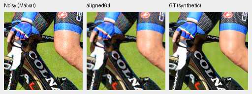
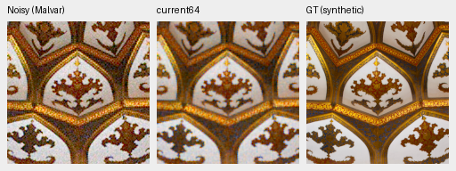
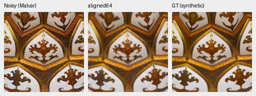
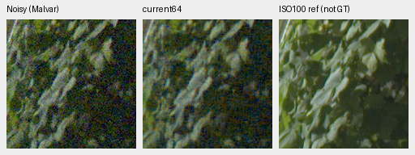
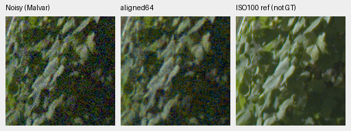
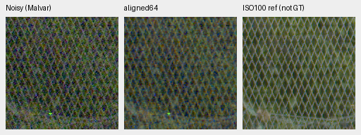
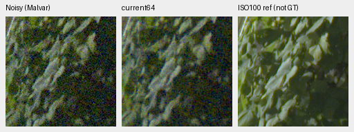
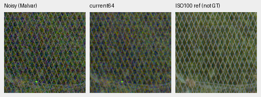
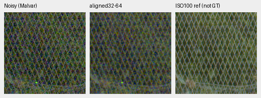

# Preserve the packed model's sampling grid during tiling

The tiler now keeps the RAW trunk's 4-pixel grid, and its DINO ConvNeXt
context's 32-pixel grid, consistent across tiles. Previously, preserving only
the 2×2 Bayer phase allowed final tiles to shift the learned feature grids.
This is a coordinate correction, without a trained restoration-quality gain.
[Measured arrays, source/weight hashes and native crop metadata](results/packed-isotropic-grid-fix-CPU-v1.json).

For the full GFX height of 8,746 pixels, tile512/overlap64 previously placed
the final tile at8,234: an even coordinate, but offset by2 on the RAW trunk's
grid. The corresponding corrected starts are8,236 without DINO and8,256 with
DINO. Padding extends whole CFA cells, and the returned image retains every
original pixel coordinate and the original dimensions. Nothing is resized.

`restore_tiled` now pads to the model's grid and rounds stride down to a grid
multiple, preserving at least the requested overlap. Tiles must fit that grid;
an overlap leaving no full grid step is rejected. Timing records the actual
`tile_grid_alignment` and `tile_stride`. Other architectures, including the
working V43 model, retain their existing geometry. Tile512/overlap64 still
requires520 tiles for this GFX frame in both packed variants.

## Actual trained CPU checks

Two cached GFX contexts, each966×962, compare tiled output with a single
whole-context FP32 forward. RMS differences below use every RGB value in the
interior after excluding224 pixels on each side, without clipping. DN16 means
65535 times camera-linear difference. **The whole-network output is a numerical
comparator, not GT.**

| Checkpoint and context | Previous grid RMS DN16 | Correct grid RMS DN16 | Correct grid maximum DN16 |
| --- | ---: | ---: | ---: |
| No-DINO24k, foliage | 18.8784 | 2.6349 | 165.5476 |
| No-DINO24k, fence | 19.3131 | 2.6399 | 184.4703 |
| DINO8k, foliage | 19.0720 | 6.5856 | 185.4898 |
| DINO8k, fence | 24.4620 | 7.0954 | 251.0670 |

The models have different training budgets and context origins. Each row tests
one checkpoint's tiling; these numbers are not a DINO ablation. For DINO,
aligning only the RAW grid still misses its context grid. Its measured RMS
values of6.3601/7.2159 do not establish that either alignment eliminates finite
context errors. The32-pixel choice follows the encoder's sampling grid rather
than selecting the best value on these two contexts.

Alignment leaves missing-context and padding differences. In a separate
no-DINO diagnostic, increasing overlap to224 reduces interior RMS to.4602/.5822
DN16, but maxima remain30.05/52.66 DN16. This is not whole-network equivalence,
and the default overlap remains64. No corrected-grid GPU speed is measured.

The corrected tiler itself ran six actual CPU restores: both GFX regions for
both models and the two photo observations below. Every RGB value matches
bitwise with the old operator applied to independently grid-padded inputs.
All tensor bytes and parameter identities, including the genuine frozen DINO,
remain unchanged. The physical model modules match the frozen old source;
only tiling geometry changes.

An actual packed-trunk regression fixture emits a known4-pixel residual over
a flat colored CFA field. The old tiler mixes its phases near final tiles;
the corrected tiler preserves the expected field on even/odd rectangles and
overlaps not divisible by4. Separate tests cover the32-pixel context grid,
legacy geometry and invalid requests. The archived pre-fix code fails the
regression; the corrected focused suite passes56 tests with two CUDA-only skips.

## Native synthetic-target views

The two sources are the first audited validation images large enough for a
native510px crop. Both retain the original8× linear-light targets. New fixed
**CPU-generated** Poisson/read/ADC draws use RGGB, shot.00256, read2.62144e−5,
seed42, WB `[2,1,1.5]` and the recorded common color matrix. Tile256/overlap64
uses the actual24k no-DINO EMA. These are additional selected observations,
distinct from the official256px GPU panel.

| Source | Previous-grid sRGB PSNR | Correct-grid sRGB PSNR |
| --- | ---: | ---: |
| Cyclist | 24.46316 | 24.45741 |
| Roof | 24.09717 | 24.09197 |

These border8 scores fall slightly; they provide no photographic quality gain.
All four original512×192 PNGs were inspected. Each panel is160×160 native
pixels at ROI `[176,176,160,160]`, with shared display exposure1. Open originals
at100%; crop pixels are never resized. Residual noise and soft detail remain.

Cyclist source `039a221ab23b6e79f59111752337744617f857f8`,
[Granada](https://commons.wikimedia.org/wiki/File:20180925_UCI_Road_World_Championships_Innsbruck_Women_Elite_ITT_Elisa_Longo_Borghini_850_8800.jpg),
[CC BY-SA4.0](https://creativecommons.org/licenses/by-sa/4.0).
Source context `[261,89,510,510]`; synthetic camera/noise processing:

Roof source `059947d9a94d2e5c6d21c270bd5d9204bd91b580`,
[مانفی](https://commons.wikimedia.org/wiki/File:Emamzadeh_Esmaeil_roof.jpg),
[CC BY-SA4.0](https://creativecommons.org/licenses/by-sa/4.0).
Source context `[10,11,510,510]`; synthetic camera/noise processing:

## Native GFX foliage and fence

All eight originals below were inspected at native resolution. Shared display
exposure4, WB `[1.5132450331,1,2.2152317881]`, the same recorded camera matrix,
shot.0014635775921166604 and read1.0715704128646712e−6 apply to every policy.
Foliage uses sensor ROI `[8890,5570,160,160]`; fence uses
`[2240,6000,160,160]`. The separate fence reference starts at2241.

DSCF3879 is ISO6400/f1.7; DSCF3880 is ISO100/f5.6 with different motion and
aperture. The independently demosaiced ISO100 capture is a qualitative reference,
not pixelwise GT. These predictions use partial contexts, not full102MP restores.
Policy differences are subtle; both intermediate models retain substantial noise.

No-DINO24k, previous and corrected grid:

DINO8k, previous and corrected grid:

The no-DINO24k checkpoint SHA is
`5cc735e14c155c46d24a3499fec6f4ce3a6352846602170ffa828c2515bcaf91`;
DINO8k is
`5fc021488d34df6ddf85cac8b0fc5cb0b0117713c87865c010e7e246979a2c14`.
The receipt binds observations, every source/ROI, full display metadata,
private operators, arrays, images, source snapshots and checkpoint hashes.

## Existing trials retain their frozen protocol

The running40k training, automatic quality review and queued compilation study
keep their immutable source and previous tiling geometry. They remain controlled
comparisons under that recorded protocol. Their full-frame results will not
validate the corrected geometry. Before promoting either packed endpoint,
review the corrected grid on CUDA and full frames too. This correction does
not promote a model or satisfy the remaining quality/speed goals.
