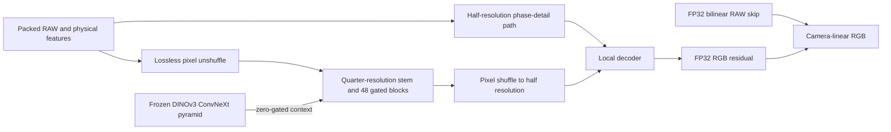

# Experimental RAW-native isotropic backbone

`packed-isotropic` is implemented and passes engineering checks. Its
[completed 40k review](packed-isotropic-quarter-review.md) finds clear progress
over the [8k boundary](packed-isotropic-first32000-review.md), but photo scores
29.73/29.95 dB still trail mature controls and native views retain substantial
grain. Full GFX restores take50.70/53.74s. **Neither endpoint is promoted**;
V43 remains the working reference.
The [experimental fixed-unit options](packed-isotropic-units.md) record RAW
input gain and learned residual scale in checkpoints. Defaults preserve existing
models; a full-data quality gain remains untested. The completed batch-learning
diagnostic motivates testing a mixed-domain effective batch16.
The three requested pipeline improvements are already measured separately in
[the pipeline report](training-pipeline.md); this experiment retains that data
path and does not change the existing model recipes.

The [tile-grid correction and trained CPU checks](packed-isotropic-tile-grid.md)
now preserve the RAW4-pixel and DINO32-pixel grids across final tiles. This fixes
coordinate consistency without a restoration-quality gain. The original40k
review retains its immutable previous geometry. The [completed CUDA supplement](packed-isotropic-corrected-grid-queue.md)
reduces whole-context disagreement, but its36 native triplets show similar
appearance and repeated full-frame medians are53.75–54.44s. Neither model is
promoted.

The [completed normalization study](normalization-v68-v69-original4k-review.md)
left missing fine detail, bright-color bias and roughly36s/102MP restoration
unresolved. The earlier packed RGB variants averaged interpolated RGB before a
coarse pretrained network and lost substantial quality. The subsequent RAW
kernel head already mixed all CFA colors into every output color; missing
cross-color coefficients was not its limitation. That head materializes324
coefficients per native pixel and remained slow and weak on detail after its
original10k schedule.

This new option instead feeds the measured Bayer samples directly into a
trainable spatial network. Its design is informed by
[Fan and Zhang's JD3Net, WACVW2026, §3.1](https://arxiv.org/html/2601.00703v2),
which studies downsampled isotropic networks using simplified NAF blocks.
We reuse this project's existing `GatedBlock` implementation. No code or
weights from the unlicensed JD3Net repository are incorporated, and this is
not a reproduction of its architecture, training or reported scores.

## Representation and reconstruction

The entry features at half native resolution contain four spatial RAW phases,
four log-variance maps, twelve phase/color labels, and twelve WB/matrix values.
The coordinates are fixed camera-linear values; there is no image-wide
min/max normalization, GAT inverse or output clamp. The log variance uses
`(log(max(variance,1e-12))+12)/6`; the WB uses `log2(max(WB,1e-6))`.
Negative measurements remain available to the network.



The quarter-resolution body uses width96, six residual groups, and eight gated
blocks per group. Each group ends in a3×3 convolution and contributes a0.1-scaled
residual. The width32 half-resolution path has two blocks before fusion and two
afterward. Only the final pixel shuffle constructs native RGB; there are no
native-resolution neural feature maps or dense kernel coefficients. Input
stems, measured-signal interpolation, tail and final residual addition retain
IEEE FP32 arithmetic. Internal blocks use the requested AMP precision.

Packing rearranges pixels without averaging or interpolation. The stem is
learned and can still discard information; retaining samples at its input is
not a guarantee of recovered texture. Padding extends whole packed cells at
odd borders. Cropping removes padding rather than squeezing its extent.

DINOv3 uses the genuine, frozen
`facebook/dinov3-convnext-tiny-pretrain-lvd1689m` weights at revision
`10d30274b4d445111e2d5bf75ac93bbd94db274b`. All four stages feed trainable
top-down lateral projections at native quarter resolution. A zero gate
preserves the common initial RAW network and RNG in the DINO/no-DINO
comparison. The preview is a WB/color-rendered bilinear estimate from the noisy
RAW; no target enters this context branch. The encoder remains in evaluation
mode and is excluded from portable restoration/EMA weights, as in the existing
models. Its license remains in `third_party/dinov3/LICENSE.md` and is copied to
training runs by the trainer.

## Engineering evidence

[Public CUDA receipt](results/packed-isotropic-CUDA-preflight-v1.json), from
`scripts/preflight_packed_isotropic.py`:

* Twelve discarded B16/native256/BF16 optimizer updates used the actual frozen
  Commons40170/native128/paired32 data and production4/2/2 loader workers.
  All three domains occurred. Geometry/PSF still precedes the final2× reduction;
  the selected domain is chosen before fetching its batch.
* All863 trainable tensors received finite nonzero gradients and changed.
  The3,686,156 trainable parameters, EMA and Adam states remained finite.
  Genuine frozen DINO weights stayed bitwise unchanged and gradient-free.
* Initial predictions exactly equaled the FP32 bilinear signal skip. Tests
  also preserve a one-code16-bit input change, every Bayer pattern and odd
  rectangular extents. These are representation checks, not accuracy scores.
* Portable EMA reload matched every model/backbone tensor and both fixed photo
  outputs exactly in FP32, BF16 and FP16. The12-update checkpoint is discarded
  engineering evidence, not a quality candidate or quality initializer.
* Peak training CUDA allocation was11.584GB, excluding the rest of unified
  system memory. Synthetic B4/native512 forward-only median time was276.94ms
  FP16 and279.14ms BF16, after five warmups and three ten-forward repeats.
  Decode, tile extraction/transfer, blending and writing are excluded. There is
  no measured full-frame speedup or claim that the10s target is satisfied.

A separate [discarded block-compilation check](results/packed-isotropic-block-compilation-v1.json)
reduced median synthetic B4/native512 FP16 forward time from276.58ms to148.03ms
(46.5% less time across three ten-forward repeats). Only the six body groups,
half-resolution local blocks and decoder were compiled with `fullgraph=True`;
DINO and physical work stayed eager. The largest observed RGB difference on
the timed random batch was1.1921e-7. This used the same12-update engineering
checkpoint, so it does not establish numerical accuracy on a trained quality
candidate. Two fixed photos also ran with finite compiled outputs; their
eager/compiled differences were not measured in this check. The benchmark's
random batch was not seeded or retained. Compilation remains a separate
engineering experiment and is not enabled in the CLI or training recipes.
Its exact operator is archived at
`/mnt/external/demosaic/benchmarks/packed-isotropic-block-compilation-v1/operator.py`;
the published receipt binds its SHA. No compiled checkpoint was saved.

The [trained-checkpoint compilation study](packed-isotropic-compilation.md) is
now queued after the40k quality review. It adds full-RGB accuracy gates, saved
native photo/GFX crops, and repeated actual102MP eager/Inductor timings. Its
completed16k CPU eager-backend preflight is bitwise equal; CUDA trained-model
accuracy and full-frame speed remain unmeasured.

The focused CPU suite passed117 tests, including both backbones' deterministic
interrupted-training restart tests and legacy RGB/RAW-kernel tests. DINO unit
tests use a deliberately tiny random encoder; the CUDA receipt separately
checks the genuine pretrained encoder.

The private full receipt is
`/mnt/external/demosaic/benchmarks/packed-isotropic-CUDA-preflight-v1/receipt.json`,
SHA256 `5833658a26f4e1659431415fbd8235da67f9a753483e6ea92bd85b8837bd56cd`.
The discarded checkpoint SHA256 is
`25553cbb8001963b018acd5d8480565e20e8c5cfc9f146dd216bfee66389d787`;
the archived producer source bundle is
`50dc11ec5c906fbbc4d3c5b1b530b95acb3b40a5f725d3a622891b2471c21d16`.

```bash
source scripts/env.sh
uv run --no-sync python scripts/preflight_packed_isotropic.py \
  configs/dino-packed-isotropic-b16-v70.yaml \
  --output /mnt/external/demosaic/benchmarks/packed-isotropic-CUDA-preflight-NEW
```

## Fresh matched quality comparison

The completed [actual training batch sweep](results/packed-isotropic-training-batch-sweep-v1.json)
selects **batch4** for this new architecture. All eight cases verify the same
initializer, source bundle, manifests, model, LR, mixed-domain schedule and
workers. Each excludes15 warmup updates and measures45, including selected-domain
loading/augmentation, physical work, DINO, backward, AdamW and EMA.

| Batch | Mean patches/s | Two-run range | Peak CUDA GB |
| ---: | ---: | ---: | ---: |
| **4** | **23.95** | 23.73–24.18 | 3.25 |
| 8 | 22.90 | 22.15–23.65 | 6.11 |
| 16 | 20.42 | 20.36–20.47 | 11.83 |
| 32 | 19.84 | 19.63–20.05 | 23.27 |

Batch4's mean is17.3% above16 with less allocation. These are two repeats on a
shared machine, not confidence intervals or a unique hardware optimum. Other
work varied during the sweep. This choice applies to the new RAW-native body;
the earlier RGB pipeline retains its own measured batch16 setting. No batch-only
quality/convergence claim or direct timing comparison between architectures is
made. The rule chooses the highest mean; within2% of it, prefer less allocation.

An independent CPU reader reconstructed all480 logged updates, all360 measured
updates/domain counts and all eight timings from saved logs. It checked every
runtime configuration and source snapshot, the shared discarded12-update EMA,
manifest hashes, actual step60 checkpoints, finite model/EMA/863 Adam states,
and unchanged planned5000 timing schedule. It initialized no CUDA. The exact
operator is archived as `independent-auditor.py` in
`/mnt/external/demosaic/benchmarks/packed-isotropic-training-batch-sweep-v1/`.
Benchmark weights never initialize quality runs.

The [genuine-weight CPU initialization check](results/packed-isotropic-genuine-matched-initialization-CPU-v1.json)
compared all852 RAW-restoration tensors, global Torch/Python random states and
all four CFA patterns' initial odd-rectangle outputs with and without the real
pinned27,820,128-parameter DINO backbone. They match exactly. Tiny-encoder unit
tests and production-size genuine-DINO GPU checks remain separate evidence.

The actual recipes are now
[V70 DINO at batch4](../configs/dino-packed-isotropic-b4-v70.yaml) and
[V71 no-DINO at batch4](../configs/no-dino-packed-isotropic-b4-v71.yaml).
The old batch16 templates were used for engineering and were never quality
trained. Before either fresh quality run, we fixed the same example-count
budgets as those templates:640,000 planned examples,32,000 before the first
review and8,000 during warmup. At batch4 these become160,000 planned updates,
8,000 before review and2,000 warmup updates. **LR stays2e-4**, with no scaling.
Both arms start fresh with seed51 and the original cosine horizon for these
new recipes. This is a prospective schedule choice, not a retiming/resume of
trained weights; equal image counts do not imply batch convergence equivalence.

[Launch evidence](results/packed-isotropic-first-review-launch-v1.json) records
actual live controller/child identities and the no-DINO arm's real training
prefix through step250. Its actual constructor records RAW weights and global
RNG before data work; the second arm must match them. Both arms use fresh
AdamW/EMA, with no Gaussian, parent or benchmark initialization. They run
serially, each stopping after8,000 updates. The controller verifies actual
model/EMA/Adam state, source/data/recipe and original LR schedule, genuine
frozen-DINO preservation, and every logged domain/observation fingerprint
before declaring the matched boundary complete. No quality result or promotion
is implied by finite training losses.

The frozen source bundle matches the GPU preflight:
`50dc11ec5c906fbbc4d3c5b1b530b95acb3b40a5f725d3a622891b2471c21d16`.
The launch plan SHA is
`e60dcbe9a207029f26d1141f52c1fde4a868399bddb2f51e47c9b4a6d58bb5c9`.
It pins161 frozen source/tool/config files and immutable input receipts/manifests.
The controller and plan live in
`/mnt/external/demosaic/benchmarks/packed-isotropic-first-review-workflow-v1/`;
current status is
`/mnt/external/demosaic/runs/packed-isotropic-first-review-workflow-v1.json`.
A failed run stops without automatic restart. Source hard drives are not used;
future qualitative evaluation has links to the existing hot RAW caches.

Both arms retain Commons40170 sources, native128 captures/106 groups, paired32
sources, fractions.25/.25, wide8 palette, physical noise/ADC, geometry/PSF order,
loss and original8× validation manifest. No newly downloaded images, GFX scene
or siblings, or protected-final scenes are admitted. Only DINO presence/fusion
differs. Earlier pretrained RGB models remain external quality references,
not matched fresh-training/convergence controls. Feature coordinates, trunk
and reconstruction jointly change against those references.

After training, review known/unseen camera data, frozen427 photos with the
existing predeclared source sensitivities, procedural/weak-texture/color stress
cases, and cached GFX/three-camera native crops. The color-grid evaluator now
accepts explicitly declared fresh checkpoints only at their exact boundary,
rejecting parent-initialized or timing-initialized candidates; its existing
parent/continuation checks remain strict. Ten focused lineage tests passed.
Any performance report must include at least two native100% noisy/denoised/GT
triplets with exact source/ROI, checkpoint SHA, noise and display metadata.
GFX DSCF3879/DSCF3880 remains a qualitative pair, not exact GT. Include foliage
and fence alongside sky/building detail. Assess the actual boundary before any
continuation. A weak early result alone does not prove convergence.

## Queued full review

[The frozen review queue](results/packed-isotropic-first32000-review-queue-v1.json)
is live and waits for the exact successful training controller/final child exit.
It then independently checks both actual8000-update states, all321 logged
observation/domain/LR matches, actual common fresh tensors/RNG and genuine frozen
DINO preservation. It never starts GPU evaluation while that owner is live.

All four neural models (the fresh pair plus V43 and mature V63) run on the same
known/unseen RAW and full427 photographic observations. Both publisher RawNIND
CFA gain adapters run too, using the observed noisy CFA rather than any clean
reference to fit gains. Together with the three classical controls, this is
648 known,810 unseen and111636 full-panel cases. The panel uses the unchanged
427 photos,16 procedural sources, seven conditions and four Bayer patterns.
Each RawNIND gain adapter is bound by both its shared weight hash and method
label; it cannot silently collapse into the other adapter's statistics.

The remaining fixed stages cover2240 analytic cases,128 selected CPU color
cases,4704 fresh color-grid cases (the fresh pair, V63 and released Nonlocal
RAW reference), six full GFX restores with12 RGB16 TIFFs, three other cached
cameras, and supplementary neon/platform crops. Primary statistics compare
nine model pairs across three panels (108 metrics and27 classical-control
witnesses), followed by81 comparisons on the existing427/418/416 source cohorts.
The statistics are source-balanced, not certified scene-independent estimates
or training-repeat uncertainty. Different prior training budgets remain explicit.

The CPU engineering replay exercised those exact numeric operators on the
closed historical four-model/nine-method ConvNeXt10k panels:108 comparisons
and18 shared-weight label bindings passed, reproducing the historical
ConvNeXt-minus-no-context photo difference of−.000858dB. This replay performed
no V70/V71 inference and supplies no new quality result. Thirty-two focused
review/lineage/sensitivity tests passed. The frozen CPU preflight additionally
verified165 source/tool/config guards and36 inputs, parsed all stage programs,
and confirmed that the actual pending training state rejects a review.

The review plan SHA is
`dc8c4f5af9b4c7bc3218476cd7f7836157e6d18478cbb995609d966fc87ed246`,
under `/mnt/external/demosaic/benchmarks/packed-isotropic-first32000-review-workflow-v1/`.
Current status is
`/mnt/external/demosaic/runs/packed-isotropic-first32000-review-workflow-v1.json`.
All private RAW inputs resolve to existing hot local/SSD caches. Known-camera
publisher ADC headers are read only from already-local public RAWs. Original
photo directories and the protected-final scenes are untouched.

The queue produces artifacts and integrity/statistics checks. Actual native
visual inspection, an explicit quality decision and any continuation remain
separate work after it finishes. No model promotion or README crop replacement
is automatic; the requested qualitative/SOTA and10s targets remain unproven.

The no-DINO arm has since completed its actual8000-update boundary. Its model,
EMA,852 Adam states, original LR/source/data recipe and321 logged rows passed
the training controller's checks. Checkpoint SHA:
`abd7345c080cb227d77385647c74614c0416d9316ad2f28c81c31cdd1f1697a2`.
At that handoff the DINO arm had started: its actual fresh RAW tensors/global
RNG and first seven logged observations matched control. Both completed
boundaries and all321 logged matches are now verified below.

A further CPU replay of the new artifact reader passed on genuine closed
historical files:76 native PNGs,32 F32 arrays, eight neural RGB16 TIFFs and four
additional RawNIND RGB16 TIFFs. It checked exact common noisy/reference pixels,
metadata and declared display bounds without new inference or visual-quality
claims. Receipt:
`/mnt/external/demosaic/benchmarks/packed-isotropic-review-artifacts-CPU-replay-v1/replay.json`,
SHA `152d358c80f7482f8ea557140f2b2b0f1c853b03a60d3d887d63c6bae0cec03d`.

## Internal in-place compilation helper

`demosaic.inference.compile_restoration_blocks` now prepares only the six
isotropic groups, local blocks and decoder with
[PyTorch Module.compile](https://docs.pytorch.org/docs/2.14/generated/torch.nn.Module.html#torch.nn.Module.compile).
The installed2.14.1+cu130 implementation was inspected directly: it compiles
the module call without adding an `OptimizedModule` wrapper to the registered
module tree. The helper requires evaluation mode, is idempotent for a chosen
backend, and rejects a backend change or an unsupported backbone. Physical
stems/tail, DINO and all default inference/training paths stay eager.
It is an internal opt-in, with no CLI flag or active-recipe change.

[Actual checkpoint CPU proof](results/packed-isotropic-inplace-compilation-CPU-v1.json)
uses the completed no-DINO8000 checkpoint, two fixed photo observations and
Dynamo's **eager backend**. All852 state tensors/parameter identities and
keys remain exact, with no `_orig_mod` prefixes. Both FP32 predictions are
bitwise identical. Portable state reload has ordinary uncompiled modules and
matches every tensor/output. The helper modifies no weights or conditioning.
The eight compiled call implementations are retained on repeated preparation.

Forty-one targeted CPU tests passed, with two CUDA-only tests skipped. Tests
also exercise nonzero output-head weights, all four CFA patterns, odd rectangular
shapes, portable reload and unchanged physical components. This proves capture
and state compatibility, **not Inductor/CUDA accuracy or performance**. The
prior148ms result used a separate wrapped-module experiment and a12-update
engineering checkpoint; it is not a timing result for this helper or a trained
quality candidate. Genuine GPU precision/native comparisons and actual full-frame
timing must precede any compute-policy adoption.

The CPU operator is `scripts/preflight_block_compilation_cpu.py`; private receipt
`/mnt/external/demosaic/benchmarks/packed-isotropic-inplace-compilation-CPU-v1/receipt.json`,
SHA `fda8270f203d9b5da2d73dc07e37f61d6de443f937ad6889ed2e6ef117dc2e6f`.
The active training and queued quality review execute their earlier frozen code;
this root-worktree addition does not alter either comparison.

## Completed training and review handoff

[Both actual first32000-example boundaries are complete](results/packed-isotropic-first32000-training-completion-v1.json).
V70 DINO checkpoint SHA is
`5fc021488d34df6ddf85cac8b0fc5cb0b0117713c87865c010e7e246979a2c14`;
V71 no-DINO remains
`abd7345c080cb227d77385647c74614c0416d9316ad2f28c81c31cdd1f1697a2`.
Each has8000 actual updates under its original160000-update horizon, finite
model/EMA/Adam, correct source/recipe, common fresh initialization/global RNG,
and all321 logged observation/domain/LR matches. Genuine DINO remained frozen
and gradient-free. Training owners have exited; no continuation is running.

The first review controller stopped before inference because its startup reader
included the final validation record when checking321 training records. That
was a review-reader bug, not a failed training run or bad checkpoint. The fix
filters `event=train` explicitly and still rejects missing/duplicate training
steps. Thirty-three focused tests passed, followed by an actual completed-state
CPU preflight. The original failed controller, source, plan and logs remain
unchanged. Neither training nor its schedule/data/weights were rerun or altered.

A separate **v2** review completed the original frozen protocol. Its plan
SHA is `d91bb847e546d8929e13cd774752b48baba8ced020865daade161ddd48d58396`,
with166 frozen guards and36 inputs; all output directories are new. Current
status is `/mnt/external/demosaic/runs/packed-isotropic-first32000-review-workflow-v2.json`.
The known648, unseen810 and full111636-case panels, analytic/color/hue/GFX
stages, statistics, export integrity and source sensitivities all completed.
Its controller and final child exited successfully.
The earlier v1 queue receipt describes its retained observation, not current
execution. Use v2 for current progress.

The [completed review](packed-isotropic-first32000-review.md) publishes14 unchanged
native triplets and records six additional viewed hue originals. Both fresh
models leave substantial noise in photos, real GFX foliage/fence and CPU FP32
uniform fields. The DINO photo mean gains+.09428dB over control, but remains
close to bilinear and far below V43/V63. Actual full GFX times are51.03/53.64s
without/with DINO. Neither endpoint is promoted or automatically continued;
this is only5% of the original training horizon, not a convergence verdict.

An isolated, serialized GPU check after review-owner exit verifies that actual
V71 EMA can learn the same easy synthetic fixture in FP32 and BF16, reducing
MSE by about86% after128 updates. Its learned weights are discarded. This does
not explain weak varied-photo learning or justify a production precision change.
V43 stays the working and README reference; protected-final scenes remain unscored.

The [production-training learning diagnosis](packed-isotropic-production-learning.md)
then replays64 actual training examples. BF16 and FP32 are both weak on the mixed
set; isolated batches learn more. Fresh Adam moments and a function-preserving
RAW parameter rescaling do not produce a broad fix. All diagnostic weights are
discarded. The unchanged original pair now resumes with full state in new branch
run directories to an explicit40k-update review, a quarter of its original
160k horizon. Actual no-DINO restore/RNG/EMA and first16 observation checks pass;
DINO starts serially afterward. No new quality result or promotion is claimed.

The [full quarter-horizon review is queued](packed-isotropic-production-learning.md#frozen-quarter-horizon-review-queue)
behind the exact training owner. It adds each arm's own8k progress to the fixed
primary comparisons, with132 metric comparisons and99 source sensitivities.
Unchanged color-grid reference arrays are independently verified for reuse;
both new models still receive fresh predictions. CPU historical-score/reuse
checks validate the operators, not future40k quality. Native visual review and
the required photographic/GFX crop report remain pending after inference.
