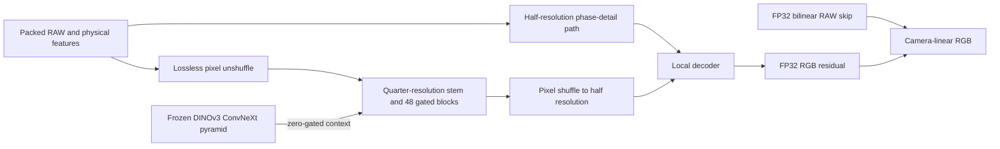

# Experimental RAW-native isotropic backbone

`packed-isotropic` is implemented and passes engineering checks. It has **no
reviewed quality result and is not promoted**. V43 remains the working reference.
The three requested pipeline improvements are already measured separately in
[the pipeline report](training-pipeline.md); this experiment retains that data
path and does not change the existing model recipes.

The [completed normalization study](normalization-v68-v69-original4k-review.md)
left missing fine detail, bright-color bias and roughly36s/102MP restoration
unresolved. The earlier packed RGB variants averaged interpolated RGB before a
coarse pretrained network and lost substantial quality. The subsequent RAW
kernel head already mixed all CFA colors into every output color; missing
cross-color coefficients was not its limitation. That head materializes324
coefficients per native pixel and remained slow and weak on detail after its
original10k schedule.

This new option instead feeds the measured Bayer samples directly into a
trainable spatial network. Its design is informed by
[Fan and Zhang's JD3Net, WACVW2026, §3.1](https://arxiv.org/html/2601.00703v2),
which studies downsampled isotropic networks using simplified NAF blocks.
We reuse this project's existing `GatedBlock` implementation. No code or
weights from the unlicensed JD3Net repository are incorporated, and this is
not a reproduction of its architecture, training or reported scores.

## Representation and reconstruction

The entry features at half native resolution contain four spatial RAW phases,
four log-variance maps, twelve phase/color labels, and twelve WB/matrix values.
The coordinates are fixed camera-linear values; there is no image-wide
min/max normalization, GAT inverse or output clamp. The log variance uses
`(log(max(variance,1e-12))+12)/6`; the WB uses `log2(max(WB,1e-6))`.
Negative measurements remain available to the network.



The quarter-resolution body uses width96, six residual groups, and eight gated
blocks per group. Each group ends in a3×3 convolution and contributes a0.1-scaled
residual. The width32 half-resolution path has two blocks before fusion and two
afterward. Only the final pixel shuffle constructs native RGB; there are no
native-resolution neural feature maps or dense kernel coefficients. Input
stems, measured-signal interpolation, tail and final residual addition retain
IEEE FP32 arithmetic. Internal blocks use the requested AMP precision.

Packing rearranges pixels without averaging or interpolation. The stem is
learned and can still discard information; retaining samples at its input is
not a guarantee of recovered texture. Padding extends whole packed cells at
odd borders. Cropping removes padding rather than squeezing its extent.

DINOv3 uses the genuine, frozen
`facebook/dinov3-convnext-tiny-pretrain-lvd1689m` weights at revision
`10d30274b4d445111e2d5bf75ac93bbd94db274b`. All four stages feed trainable
top-down lateral projections at native quarter resolution. A zero gate
preserves the common initial RAW network and RNG in the DINO/no-DINO
comparison. The preview is a WB/color-rendered bilinear estimate from the noisy
RAW; no target enters this context branch. The encoder remains in evaluation
mode and is excluded from portable restoration/EMA weights, as in the existing
models. Its license remains in `third_party/dinov3/LICENSE.md` and is copied to
training runs by the trainer.

## Engineering evidence

[Public CUDA receipt](results/packed-isotropic-CUDA-preflight-v1.json), from
`scripts/preflight_packed_isotropic.py`:

* Twelve discarded B16/native256/BF16 optimizer updates used the actual frozen
  Commons40170/native128/paired32 data and production4/2/2 loader workers.
  All three domains occurred. Geometry/PSF still precedes the final2× reduction;
  the selected domain is chosen before fetching its batch.
* All863 trainable tensors received finite nonzero gradients and changed.
  The3,686,156 trainable parameters, EMA and Adam states remained finite.
  Genuine frozen DINO weights stayed bitwise unchanged and gradient-free.
* Initial predictions exactly equaled the FP32 bilinear signal skip. Tests
  also preserve a one-code16-bit input change, every Bayer pattern and odd
  rectangular extents. These are representation checks, not accuracy scores.
* Portable EMA reload matched every model/backbone tensor and both fixed photo
  outputs exactly in FP32, BF16 and FP16. The12-update checkpoint is discarded
  engineering evidence, not a quality candidate or quality initializer.
* Peak training CUDA allocation was11.584GB, excluding the rest of unified
  system memory. Synthetic B4/native512 forward-only median time was276.94ms
  FP16 and279.14ms BF16, after five warmups and three ten-forward repeats.
  Decode, tile extraction/transfer, blending and writing are excluded. There is
  no measured full-frame speedup or claim that the10s target is satisfied.

A separate [discarded block-compilation check](results/packed-isotropic-block-compilation-v1.json)
reduced median synthetic B4/native512 FP16 forward time from276.58ms to148.03ms
(46.5% less time across three ten-forward repeats). Only the six body groups,
half-resolution local blocks and decoder were compiled with `fullgraph=True`;
DINO and physical work stayed eager. The largest observed RGB difference on
the timed random batch was1.1921e-7. This used the same12-update engineering
checkpoint, so it does not establish numerical accuracy on a trained quality
candidate. Two fixed photos also ran with finite compiled outputs; their
eager/compiled differences were not measured in this check. The benchmark's
random batch was not seeded or retained. Compilation remains a separate
engineering experiment and is not enabled in the CLI or training recipes.
Its exact operator is archived at
`/mnt/external/demosaic/benchmarks/packed-isotropic-block-compilation-v1/operator.py`;
the published receipt binds its SHA. No compiled checkpoint was saved.

The focused CPU suite passed117 tests, including both backbones' deterministic
interrupted-training restart tests and legacy RGB/RAW-kernel tests. DINO unit
tests use a deliberately tiny random encoder; the CUDA receipt separately
checks the genuine pretrained encoder.

The private full receipt is
`/mnt/external/demosaic/benchmarks/packed-isotropic-CUDA-preflight-v1/receipt.json`,
SHA256 `5833658a26f4e1659431415fbd8235da67f9a753483e6ea92bd85b8837bd56cd`.
The discarded checkpoint SHA256 is
`25553cbb8001963b018acd5d8480565e20e8c5cfc9f146dd216bfee66389d787`;
the archived producer source bundle is
`50dc11ec5c906fbbc4d3c5b1b530b95acb3b40a5f725d3a622891b2471c21d16`.

```bash
source scripts/env.sh
uv run --no-sync python scripts/preflight_packed_isotropic.py \
  configs/dino-packed-isotropic-b16-v70.yaml \
  --output /mnt/external/demosaic/benchmarks/packed-isotropic-CUDA-preflight-NEW
```

## Fresh matched quality comparison

The completed [actual training batch sweep](results/packed-isotropic-training-batch-sweep-v1.json)
selects **batch4** for this new architecture. All eight cases verify the same
initializer, source bundle, manifests, model, LR, mixed-domain schedule and
workers. Each excludes15 warmup updates and measures45, including selected-domain
loading/augmentation, physical work, DINO, backward, AdamW and EMA.

| Batch | Mean patches/s | Two-run range | Peak CUDA GB |
| ---: | ---: | ---: | ---: |
| **4** | **23.95** | 23.73–24.18 | 3.25 |
| 8 | 22.90 | 22.15–23.65 | 6.11 |
| 16 | 20.42 | 20.36–20.47 | 11.83 |
| 32 | 19.84 | 19.63–20.05 | 23.27 |

Batch4's mean is17.3% above16 with less allocation. These are two repeats on a
shared machine, not confidence intervals or a unique hardware optimum. Other
work varied during the sweep. This choice applies to the new RAW-native body;
the earlier RGB pipeline retains its own measured batch16 setting. No batch-only
quality/convergence claim or direct timing comparison between architectures is
made. The rule chooses the highest mean; within2% of it, prefer less allocation.

An independent CPU reader reconstructed all480 logged updates, all360 measured
updates/domain counts and all eight timings from saved logs. It checked every
runtime configuration and source snapshot, the shared discarded12-update EMA,
manifest hashes, actual step60 checkpoints, finite model/EMA/863 Adam states,
and unchanged planned5000 timing schedule. It initialized no CUDA. The exact
operator is archived as `independent-auditor.py` in
`/mnt/external/demosaic/benchmarks/packed-isotropic-training-batch-sweep-v1/`.
Benchmark weights never initialize quality runs.

The [genuine-weight CPU initialization check](results/packed-isotropic-genuine-matched-initialization-CPU-v1.json)
compared all852 RAW-restoration tensors, global Torch/Python random states and
all four CFA patterns' initial odd-rectangle outputs with and without the real
pinned27,820,128-parameter DINO backbone. They match exactly. Tiny-encoder unit
tests and production-size genuine-DINO GPU checks remain separate evidence.

The actual recipes are now
[V70 DINO at batch4](../configs/dino-packed-isotropic-b4-v70.yaml) and
[V71 no-DINO at batch4](../configs/no-dino-packed-isotropic-b4-v71.yaml).
The old batch16 templates were used for engineering and were never quality
trained. Before either fresh quality run, we fixed the same example-count
budgets as those templates:640,000 planned examples,32,000 before the first
review and8,000 during warmup. At batch4 these become160,000 planned updates,
8,000 before review and2,000 warmup updates. **LR stays2e-4**, with no scaling.
Both arms start fresh with seed51 and the original cosine horizon for these
new recipes. This is a prospective schedule choice, not a retiming/resume of
trained weights; equal image counts do not imply batch convergence equivalence.

[Launch evidence](results/packed-isotropic-first-review-launch-v1.json) records
actual live controller/child identities and the no-DINO arm's real training
prefix through step250. Its actual constructor records RAW weights and global
RNG before data work; the second arm must match them. Both arms use fresh
AdamW/EMA, with no Gaussian, parent or benchmark initialization. They run
serially, each stopping after8,000 updates. The controller verifies actual
model/EMA/Adam state, source/data/recipe and original LR schedule, genuine
frozen-DINO preservation, and every logged domain/observation fingerprint
before declaring the matched boundary complete. No quality result or promotion
is implied by finite training losses.

The frozen source bundle matches the GPU preflight:
`50dc11ec5c906fbbc4d3c5b1b530b95acb3b40a5f725d3a622891b2471c21d16`.
The launch plan SHA is
`e60dcbe9a207029f26d1141f52c1fde4a868399bddb2f51e47c9b4a6d58bb5c9`.
It pins161 frozen source/tool/config files and immutable input receipts/manifests.
The controller and plan live in
`/mnt/external/demosaic/benchmarks/packed-isotropic-first-review-workflow-v1/`;
current status is
`/mnt/external/demosaic/runs/packed-isotropic-first-review-workflow-v1.json`.
A failed run stops without automatic restart. Source hard drives are not used;
future qualitative evaluation has links to the existing hot RAW caches.

Both arms retain Commons40170 sources, native128 captures/106 groups, paired32
sources, fractions.25/.25, wide8 palette, physical noise/ADC, geometry/PSF order,
loss and original8× validation manifest. No newly downloaded images, GFX scene
or siblings, or protected-final scenes are admitted. Only DINO presence/fusion
differs. Earlier pretrained RGB models remain external quality references,
not matched fresh-training/convergence controls. Feature coordinates, trunk
and reconstruction jointly change against those references.

After training, review known/unseen camera data, frozen427 photos with the
existing predeclared source sensitivities, procedural/weak-texture/color stress
cases, and cached GFX/three-camera native crops. The color-grid evaluator now
accepts explicitly declared fresh checkpoints only at their exact boundary,
rejecting parent-initialized or timing-initialized candidates; its existing
parent/continuation checks remain strict. Ten focused lineage tests passed.
Any performance report must include at least two native100% noisy/denoised/GT
triplets with exact source/ROI, checkpoint SHA, noise and display metadata.
GFX DSCF3879/DSCF3880 remains a qualitative pair, not exact GT. Include foliage
and fence alongside sky/building detail. Assess the actual boundary before any
continuation. A weak early result alone does not prove convergence.
