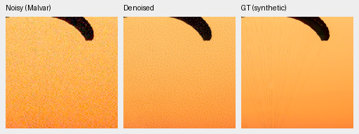
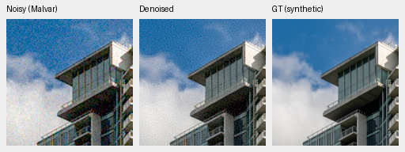
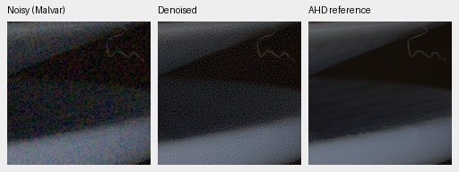
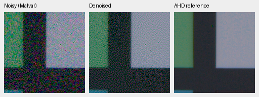
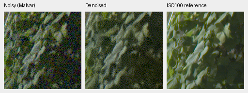
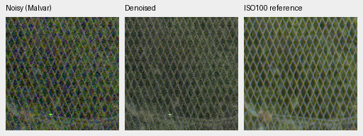

# Packed reconstruction: first quality gate

**V38 fails the real-camera quality gate.** Its 2.34× training throughput does
not compensate for substantial residual grain. Compared with the matched V37
control, measured-CFA PSNR falls 8.69 dB on known cameras and 10.12 dB on unseen
cameras. Both stop after their first 1,000 updates. The full 427-photo and full
GFX review is now complete and confirms the rejection.
[Metrics, source/checkpoint identities and native-crop receipt](results/packed-v37-v38-first-review.json).

| Panel | Model | Measured-CFA PSNR | AHD RGB PSNR | AHD SSIM |
| --- | --- | ---: | ---: | ---: |
| Known4 | V34 parent | 54.24658 | 39.94860 | .930049 |
| Known4 | V37 full-resolution control | 54.27943 | 40.01531 | .930415 |
| Known4 | V38 packed | 45.58580 | 32.36137 | .684875 |
| Unseen5 | V34 parent | 53.78664 | 38.51133 | .921075 |
| Unseen5 | V37 full-resolution control | 53.67990 | 38.43590 | .920981 |
| Unseen5 | V38 packed | 43.56215 | 28.65607 | .539171 |

Known: four scenes/eight pairs/72 crops. Unseen: five scenes/ten pairs/90 crops.
Means balance captures within scenes and then scenes. Primary references are
registered measured low-noise CFA samples; independently demosaiced AHD RGB is
an auxiliary reference, **not exact RGB GT**. Both RawNIND gain variants and
classical methods remain in the receipt. Protected-final performance is unscored.

Both arms start from the same V34 step1000 EMA, fresh AdamW/EMA, seed47,
batch16, LR3e-5 / planned3000 schedule, same complete4× Commons/native targets,
original8× validation and 25% paired /25% native /50% Commons mix. Only RGB
processing scale differs. **All41 logged observation hashes match**, with the
same initializer and source bundle
`547ac4dabc408e342960baa5ee9928257ec5522741c24cd35528b46af94c2110`.
The newly reviewed six-source native extension is absent from both arms.

Checkpoint SHA256:

- V37: `2e79285ba72003417eb681cae2bc304106548c8a8d3235dd20a4ea7218ec332a`
- V38: `279b936322a2f42686efc31285b6342b7ddce6296342d7285158ae845cff8cc2`

| Model | 427-photo PSNR | SSIM | 16-procedural PSNR | SSIM |
| --- | ---: | ---: | ---: | ---: |
| V34 parent | 34.46662 | .954201 | 33.18400 | .962951 |
| V37 full-resolution control | 34.65497 | .955273 | 33.80809 | .967787 |
| V38 packed | 30.90134 | .880821 | 28.70880 | .848509 |

V37 gains **.18835 dB** over its parent, 95% source-bootstrap interval
[+.16031,+.21364]. V38 trails its matched control by3.75363dB
[3.65916,3.85081]. All443 sources share seven conditions/four CFAs;99,232 rows
include both RawNIND modes and three classical methods. These source intervals
do not measure training-seed variance. V37 is the stronger full-photo reference,
with the known/unseen real tradeoff above.

The packed CNN denoises an area2 RGB observation. Its identity detail bypass
then adds the original high-frequency MHC residual. An analytical basis-impulse
calculation finds that this residual contains **58.03% of MHC noise power**
under independent unit Gaussian CFA noise, unit WB and interior pixels, even
if the coarse prediction is perfectly noiseless. This is a diagnosis of the
initial bypass, not a measurement of trained residual power; low-count GAT
variance is approximate. The new phase head did not remove enough of that
burden in this first1k trial. The crops confirm substantial remaining grain.
[Coefficient-energy diagnostic](results/packed-detail-noise-diagnostic.json).

Noisy Malvar → restored → **exact synthetic GT** below. Each panel is native
160×160, never resized. These are the first two prescribed sources from the
completed full suite. Same RGGB/ISO12800 prior
(`shot=.00256`, `read=.0000262144`), ROI[48,48,160,160] in the validation tile,
display×1, WB[2,1,1.5] and fixed protocol matrix. Source/cache/checkpoint/noise/
display records are retained per triplet. PNGs are8-bit sRGB previews; model
outputs and metrics retain physical FP32 precision.

V37:

V38:

Sources: [Roy Egloff](https://commons.wikimedia.org/wiki/File:CH.VD.Villeneuve_2007-08-25_Vertigo-Swiss-Riviera_2392_3x2-R_4K.jpg)
and [Dietmar Rabich](https://commons.wikimedia.org/wiki/File:Vancouver_(BC,_Canada),_Coal_Harbour_Seaside_Park,_Blick_in_den_Himmel_--_2022_--_2158.jpg),
[CC BY-SA4.0](https://creativecommons.org/licenses/by-sa/4.0/). Modified by linear
binning, crop, noise simulation, restoration and rendering; derivative previews
retain that license. Native PNG hashes/dimensions, shared metadata and identical
noisy/GT panels are verified across methods.

Known real examples, noisy → V38 → independent AHD reference:

Real sources: Benoit Brummer and Christophe De Vleeschouwer,
[Raw Natural Image Noise Dataset](https://doi.org/10.14428/DVN/DEQCIM),
[CC BY-SA4.0](https://creativecommons.org/licenses/by-sa/4.0/), with individual
scene credits/CC0 grants in publisher `permissions.txt`. Modified by crop,
restoration and rendering; derivative previews retain the applicable license.

Full102MP GFX DSCF3879 ISO6400 → restored → separate DSCF3880 ISO100 f/5.6,
native160px foliage[8890,5570] and fence[2240,6000], reference fence x2241.
Shared+2EV/WB/matrix and input-only prior (`shot=.001463577592`,
`read=.000001071570413`). Aperture, time and motion differ: the final panel
is a qualitative reference, **not GT**.

All four regions and both RawNIND calibrations remain in the receipt. The
packed result remains grainy; no qualitative superiority is established. All
ten8746×11662×3 uint16 TIFFs passed full SHA/size, actual dtype/shape/16-bit
sample tags and >256 sampled-code checks. Each sRGB file carries ICC metadata.
Files reside in `/mnt/external/demosaic/evaluation/gfx-3879-3880-packed-v37-v38-1k-full/`,
`restored-{0,1,2,3,4}-{linear16,srgb16}.tiff`: V34/V37/V38/RawNIND-global/
RawNIND-channel. Restoration took35.54/34.33/19.90/18.24/18.12s, respectively,
tile512/overlap64/batch4, successive shared-machine runs excluding decode,
model load, rendering and encoding. This is neither a repeated idle benchmark
nor a10-second result. Native crop verification includes shared source/ROI/
noise/display metadata and identical noisy/reference panel bytes.

The next packed variant needs a noise-aware native-detail path and a check of
the new head's optimization. The working full-resolution reference remains
V34; even V37's additional training has mixed known/unseen effects. Training
speed alone does not justify promotion or a claim of improved 100 MP quality.
