# Absolute pair-common supervision: V165 final quality

Adding absolute pair-common supervision gives **1.35–1.91% lower native512 full-flat RMS and 6.22–8.69% lower quiet spatial RMS versus V164**. The grain reduction is useful and visible in amplified crops. **Mesh response falls 48.91–50.30%, back to about the V143 parent**, while quiet color bias increases. This does not combine fine dark detail recovery with reliable flat regions.

All 48 native512 full-flat inputs improve versus V143 at both endpoints, with mean reductions **0.61–0.97%**. Against V164, 46/48 raw and 47/48 EMA inputs improve; maximum increases are 0.0852 / 0.00509 DN16. Mean full-flat RMS is 0.19–0.44% below V160 ordinary, although V157 retains stronger full/coarse accuracy. Coarse block32 means worsen **0.179–0.235% versus V164**, with 45/48 raw and 47/48 EMA inputs worse. All 48 coarse inputs remain better than V143, with means 0.53–0.75% lower. Retain this total-flat/grain option beside V164's stronger coarse/response option and V157's coarse capacity.

Quiet spatial RMS improves on **all 32 inputs at both endpoints versus V164**. Against V143, 16/32 raw and 26/32 EMA spatial errors improve; mean changes range from +0.304% to −0.443%. Total quiet error behaves differently. Raw means worsen another **1.17% / 6.66% at ISO6400/12800 versus V164**, with 18/32 inputs worse and maximum increase 2.114 DN16. EMA means improve **3.45% / 0.482%**, but eleven of 32 inputs worsen, with maximum increase 0.890 DN16. Total quiet means remain 21.61–23.44% above V143 raw and 9.92–9.96% above V143 EMA; 28/32 raw and 24/32 EMA inputs are worse. V158 retains much stronger quiet accuracy.

The original-pixel decomposition finds higher quiet DC bias in all four endpoint/prior means: **+7.67–28.07% versus V164**. ISO6400 raw/EMA rises 2.920559→3.355499 / 2.435001→2.621823 DN16; ISO12800 rises 3.897991→4.992170 / 3.496767→3.956646. Reduced fine grain therefore coexists with stronger broad color shifts. Absolute common-error supervision did not solve the common color-bias problem in this run.

Mesh response reaches only **2.196% raw / 2.201% EMA of exact constructed GT amplitude**, slightly below V143's 2.202%, and far below V161's 4.83–5.24%. Present full RMS rises 1.35–1.41% versus V164, while actual blank RMS falls 2.96–3.31% and exact-absence RMS falls 2.76–3.09%. A post-hoc reduction of the original archived metadata finds mean support below 1e-4 on all 256 present-mesh cases at both candidate endpoints. Median support falls from 0.462–0.463 to 2.88e-6 / 2.96e-6, despite larger pre-support coefficient RMS. This is consistent with a nearly closed support path, but full gate maps and a trained-path removal were not recorded, so it is not an isolated causal explanation. [Archived support metadata and exact ADC checks](results/v165-archived-support-summary-v1.json).

Natural-photo changes are small and mixed: five of eight full-RMS cohort means improve, three worsen; changes range from −0.045% to +0.025% versus V164. Three of eight band-response means rise and five fall. Fine organic texture remains soft. All eight ADC-photo predictions at each candidate endpoint equal V143 exactly, losing the small prior ADC gain; V150's retained 3.06% improvement remains stronger. ADC sloped-plane full RMS improves 0.164–0.189% versus V164 but coarse error worsens 0.516–0.545%. All 192 tested ADC constants remain exact parent outputs.

All 72 native figures / 24 triplets were actually inspected in 18 original-detail sheets. Flat and quiet crops show less fine colored/gridded grain, with persistent broad mottle and conspicuous raw magenta casts in the mixed quiet fields. Both real cab windows and both priors show weaker strands than V164 and no convincing new complete crossings. The coarse main fence is preserved, while foliage and fine photographic textures remain softened. The fixed +2EV sky looks smooth; this single view does not prove flat safety. ISO100 f/5.6 and native JPEG views remain qualitative references, not exact GT.

The common term has nonzero total supervision on 620 paired batches / 1,240 pairs. Full-parameter pre-clip norms exceed one on 454/900 supervised candidate batches versus 205/900 control batches. These records describe optimization pressure rather than an isolated quality cause. Independent recombination verifies all 2,000 actual weighted total losses bit-exactly; unit and inherited-mask checks cover all 1,000 updates. Preserve the measured grain/total-flat gains, the large detail loss and the remaining color-bias failure together. The requested combination remains unresolved. [All reductions, paired cases and actual viewing evidence](results/v165-quality-claims-v1.json) retain both strengths and costs. The auxiliary [publication-binding correction](results/v165-pair-common-v1/publication-binding-correction.json) versions unused helpers while preserving their original receipts; no scientific worker or call was restarted or repeated.

[Final evidence and immutable sources](results/v165-pair-common-final-v1.json) · [Native pixels, source ROIs, conditioning, exposure and checkpoint hashes](images/v165-pair-common-v1/manifest-v1.json).

## Response and actual blank error

RMS values are camera-RGB DN16. Response1 means the exact constructed mesh amplitude. Blank error measures actual target error; added blank RMS measures displacement from V143.

| Method | Present full RMS | Response | Actual blank RMS | Blank spatial RMS | Added blank RMS |
| --- | ---: | ---: | ---: | ---: | ---: |
|V143|9.111243|0.02202090|5.523323|5.343113|0.00000000|
|Fine ctrl raw|8.947860|0.04298160|5.637360|5.464793|1.34797252|
|Fine ctrl EMA|8.966273|0.04428747|5.676891|5.498597|1.41673023|
|Pair common raw|9.074446|0.02195898|5.470216|5.295156|0.37809509|
|Pair common EMA|9.087227|0.02200951|5.488723|5.303904|0.35323757|
|Existing periodic detail|8.586126|0.07089755|5.523328|5.343118|0.00063557|

## Quiet neighbors and coarse fields

| Prior | Method | Whole RMS | Quiet RMS | Quiet spatial RMS |
| --- | --- | ---: | ---: | ---: |
|ISO6400|V143|27.105631|3.898845|3.268502|
|ISO6400|Fine ctrl raw|27.092429|4.756900|3.571089|
|ISO6400|Fine ctrl EMA|27.032807|4.440278|3.576172|
|ISO6400|Pair common raw|27.372595|4.812567|3.278449|
|ISO6400|Pair common EMA|27.241772|4.287011|3.265355|
|ISO12800|V143|36.747466|6.152652|5.341833|
|ISO12800|Fine ctrl raw|35.912107|7.015014|5.678909|
|ISO12800|Fine ctrl EMA|35.797159|6.795786|5.683969|
|ISO12800|Pair common raw|37.177695|7.481974|5.325421|
|ISO12800|Pair common EMA|36.939700|6.763055|5.318190|

Quiet bias is averaged per RGB channel before its Euclidean RMS. The independent pixel audit verifies total squared = spatial squared + DC squared per case; means of RMS values do not share that identity.

| Prior | Method | Quiet DC RMS DN16 |
| --- | --- | ---: |
| iso6400-prior | parent | 2.016074 |
| iso6400-prior | fine-control-raw-step1000 | 2.920559 |
| iso6400-prior | fine-control-EMA-step1000 | 2.435001 |
| iso6400-prior | pair-common-raw-step1000 | 3.355499 |
| iso6400-prior | pair-common-EMA-step1000 | 2.621823 |
| iso12800-prior | parent | 2.849060 |
| iso12800-prior | fine-control-raw-step1000 | 3.897991 |
| iso12800-prior | fine-control-EMA-step1000 | 3.496767 |
| iso12800-prior | pair-common-raw-step1000 | 4.992170 |
| iso12800-prior | pair-common-EMA-step1000 | 3.956646 |

|Flat test|V143|Fine ctrl raw|Fine ctrl EMA|Pair common raw|Pair common EMA|
| --- | ---: | ---: | ---: | ---: | ---: |
|Native512 ISO6400 full RMS|18.546808|18.641462|18.704638|18.389322|18.433963|
|Native512 ISO6400 spatial RMS|18.235130|18.317477|18.408207|18.093024|18.128634|
|Native512 ISO6400 block32 RMS|13.440561|13.308966|13.343335|13.340227|13.368441|
|Native512 ISO12800 full RMS|24.071890|24.247602|24.334657|23.837530|23.870109|
|Native512 ISO12800 spatial RMS|23.596861|23.793476|23.919147|23.401662|23.446909|
|Native512 ISO12800 block32 RMS|17.932544|17.764766|17.805977|17.803392|17.837810|
|Older native256 ISO12800 full RMS|27.233548|27.420305|27.540492|27.014856|27.058890|
|Older native256 ISO12800 spatial RMS|26.017191|26.234218|26.364485|25.820092|25.862237|
|Older native256 ISO12800 block32 RMS|19.539875|19.374084|19.414466|19.413954|19.444776|

## Natural detail and ADC controls

|Photo test|V143|Fine ctrl raw|Fine ctrl EMA|Pair common raw|Pair common EMA|
| --- | ---: | ---: | ---: | ---: | ---: |
|Retained512 faint full RMS|33.963754|33.970170|33.970455|33.954970|33.958618|
|Retained512 faint band error|0.824639|0.824405|0.824263|0.824672|0.824662|
|Retained512 faint band response|0.298560|0.298465|0.299179|0.297790|0.297856|
|Retained512 dark full RMS|29.097715|29.107420|29.104238|29.101295|29.100958|
|Retained512 dark band error|0.661447|0.661251|0.661216|0.661438|0.661436|
|Retained512 dark band response|0.531446|0.530007|0.530484|0.530436|0.530482|
|Organic384 faint full RMS|37.469061|37.471276|37.464811|37.471409|37.474037|
|Organic384 faint band error|0.924117|0.924541|0.924286|0.924106|0.924099|
|Organic384 faint band response|0.150701|0.150356|0.151105|0.150263|0.150298|
|Organic384 dark full RMS|33.685796|33.701834|33.693801|33.700100|33.697031|
|Organic384 dark band error|0.781612|0.781635|0.781611|0.781583|0.781577|
|Organic384 dark band response|0.398945|0.397522|0.398063|0.398256|0.398272|

|ADC test|V143|Fine ctrl raw|Fine ctrl EMA|Pair common raw|Pair common EMA|
| --- | ---: | ---: | ---: | ---: | ---: |
|Photo full RMS|18.149871|18.137415|18.139575|18.149871|18.149871|
|Photo band error|0.101855|0.101766|0.101789|0.101855|0.101855|
|Photo band response|0.968329|0.968213|0.968246|0.968329|0.968329|
|Sloped512 full RMS|3.771369|3.777983|3.776996|3.770831|3.770815|
|Sloped512 spatial RMS|3.397249|3.403972|3.402864|3.396711|3.396696|
|Sloped512 block32 RMS|0.574652|0.571751|0.571925|0.574869|0.574877|
|Sloped512 crop block32 RMS|0.088145|0.088145|0.088145|0.088148|0.088148|
|Sloped512 worst absolute DC|11.176981|11.189394|11.188623|11.176846|11.176815|

## Fixed native comparisons

Every cell is native 160×160; crop pixels are never resized. All RAW methods within each board share source coordinates, camera display transform, exposure and contrast. JPEG cells retain native sRGB8 without exposure/contrast changes. Both final raw/EMA endpoints of both heads are shown, with eight retained V156/V157/V158/V159/V160 ordinary/V160 paired/V161/V162 columns.

The main scene is DSCF3879 ISO6400 versus DSCF3880 ISO100 f/5.6. The fine cab mesh uses DSCF3842 versus DSCF3835 and both camera JPEGs. Aperture, shutter, moving subjects and processing differ: ISO100 views are qualitative references, not exact GT. All30 real score rows stay unscored.

### Mesh and exact absence

mesh-seed2026112302-present-iso6400-prior-RGGB; ROI `[176, 176, 160, 160]`, RAW exposure 8, contrast 1.

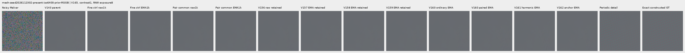

mesh-seed2026112302-present-iso6400-prior-RGGB; ROI `[176, 176, 160, 160]`, RAW exposure 8, contrast 40.

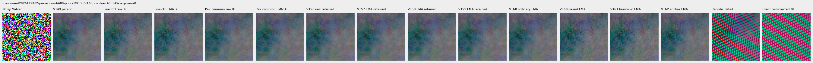

mesh-seed2026112309-present-iso6400-prior-RGGB; ROI `[176, 176, 160, 160]`, RAW exposure 8, contrast 1.

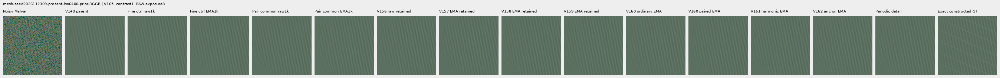

mesh-seed2026112309-present-iso6400-prior-RGGB; ROI `[176, 176, 160, 160]`, RAW exposure 8, contrast 40.

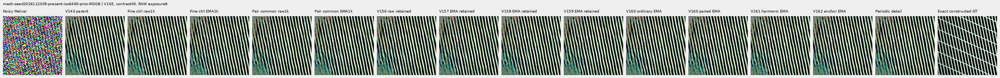

mesh-seed2026112304-absent-iso6400-prior-RGGB; ROI `[165, 0, 160, 160]`, RAW exposure 8, contrast 40.

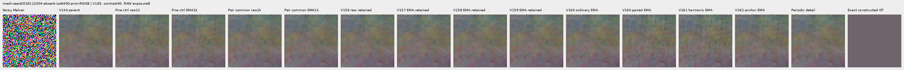

### Quiet neighbors beside edges

mixed-vertical-step-iso6400-prior-RGGB; ROI `[80, 176, 160, 160]`, RAW exposure 8, contrast 40.

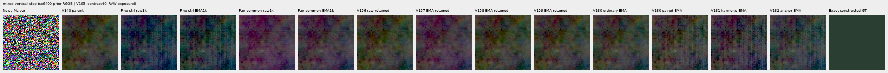

mixed-vertical-step-iso6400-prior-RGGB; ROI `[240, 176, 160, 160]`, RAW exposure 8, contrast 1.

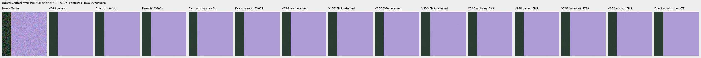

mixed-vertical-step-iso12800-prior-RGGB; ROI `[80, 176, 160, 160]`, RAW exposure 8, contrast 40.

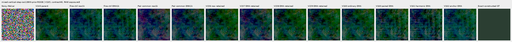

mixed-vertical-step-iso12800-prior-RGGB; ROI `[240, 176, 160, 160]`, RAW exposure 8, contrast 1.

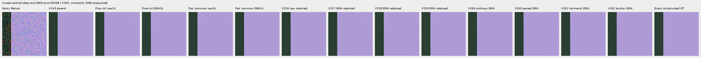

mixed-narrow-bar-iso6400-prior-RGGB; ROI `[80, 176, 160, 160]`, RAW exposure 8, contrast 40.

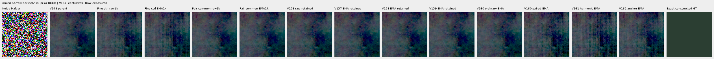

mixed-narrow-bar-iso6400-prior-RGGB; ROI `[240, 176, 160, 160]`, RAW exposure 8, contrast 1.

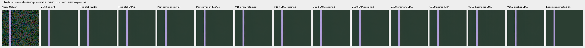

mixed-narrow-bar-iso12800-prior-RGGB; ROI `[80, 176, 160, 160]`, RAW exposure 8, contrast 40.

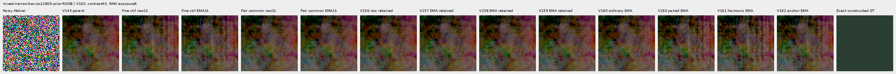

mixed-narrow-bar-iso12800-prior-RGGB; ROI `[240, 176, 160, 160]`, RAW exposure 8, contrast 1.

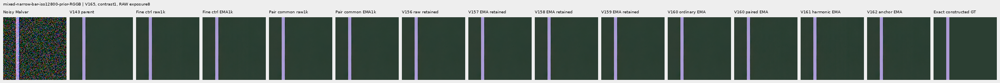

mixed-slanted-step-iso6400-prior-RGGB; ROI `[80, 176, 160, 160]`, RAW exposure 8, contrast 40.

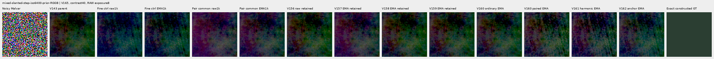

mixed-slanted-step-iso6400-prior-RGGB; ROI `[240, 176, 160, 160]`, RAW exposure 8, contrast 1.

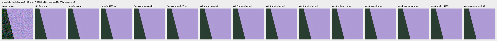

mixed-slanted-step-iso12800-prior-RGGB; ROI `[80, 176, 160, 160]`, RAW exposure 8, contrast 40.

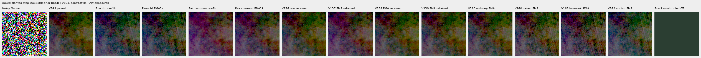

mixed-slanted-step-iso12800-prior-RGGB; ROI `[240, 176, 160, 160]`, RAW exposure 8, contrast 1.

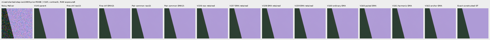

mixed-striped-patch-iso6400-prior-RGGB; ROI `[80, 176, 160, 160]`, RAW exposure 8, contrast 40.

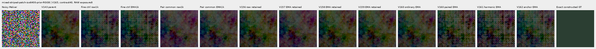

mixed-striped-patch-iso6400-prior-RGGB; ROI `[240, 176, 160, 160]`, RAW exposure 8, contrast 1.

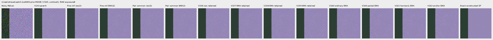

mixed-striped-patch-iso12800-prior-RGGB; ROI `[80, 176, 160, 160]`, RAW exposure 8, contrast 40.

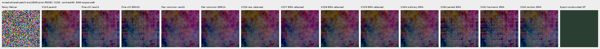

mixed-striped-patch-iso12800-prior-RGGB; ROI `[240, 176, 160, 160]`, RAW exposure 8, contrast 1.

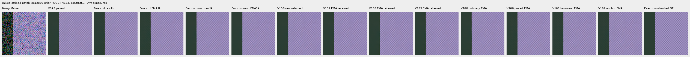

### Standalone flats and slopes

gray-l0.02-adc-only-RGGB; ROI `[48, 48, 160, 160]`, RAW exposure 4, contrast 40.

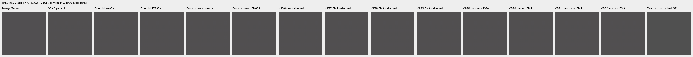

gray-l0.02-iso12800-prior-RGGB; ROI `[48, 48, 160, 160]`, RAW exposure 4, contrast 40.

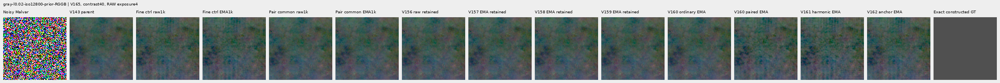

flat512-gray-l0.02-adc-only-RGGB; ROI `[176, 176, 160, 160]`, RAW exposure 4, contrast 40.

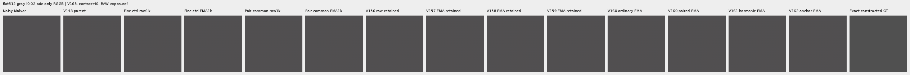

flat512-gray-l0.02-iso6400-prior-RGGB; ROI `[176, 176, 160, 160]`, RAW exposure 4, contrast 40.

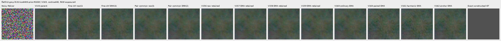

flat512-gray-l0.02-iso12800-prior-RGGB; ROI `[176, 176, 160, 160]`, RAW exposure 4, contrast 40.

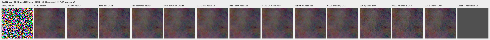

flat512-h210-s0.50-l0.02-iso6400-prior-RGGB; ROI `[176, 176, 160, 160]`, RAW exposure 4, contrast 40.

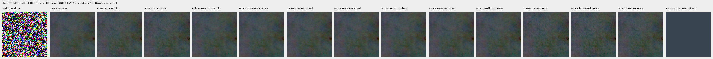

flat512-gray-l0.18-iso12800-prior-RGGB; ROI `[176, 176, 160, 160]`, RAW exposure 1, contrast 8.

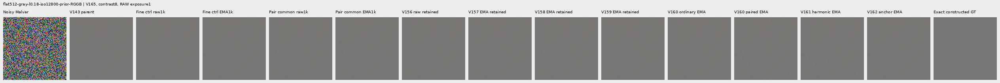

flat512-gray-l0.90-iso12800-prior-RGGB; ROI `[176, 176, 160, 160]`, RAW exposure 1, contrast 4.

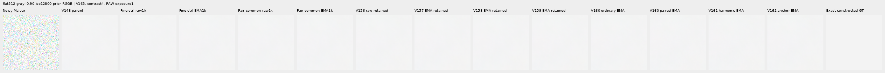

V150-control-ADC-plane0-RGGB; ROI `[176, 176, 160, 160]`, RAW exposure 45, contrast 8.

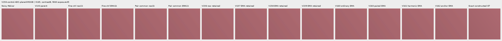

V150-control-ADC-plane1-RGGB; ROI `[176, 176, 160, 160]`, RAW exposure 9, contrast 8.

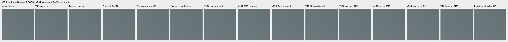

V150-control-ADC-plane2-RGGB; ROI `[176, 176, 160, 160]`, RAW exposure 1, contrast 8.

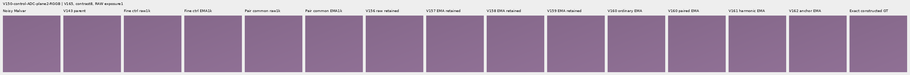

V150-control-ADC-plane3-RGGB; ROI `[176, 176, 160, 160]`, RAW exposure 0.24, contrast 8.

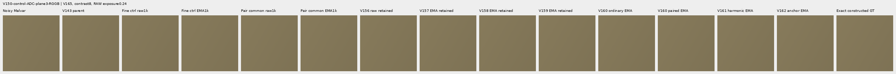

### Natural photographic detail

organic-02a76fd33b5e1414a0504f0b3f0aeb03a569b6f4-photo-faint-RGGB; ROI `[112, 112, 160, 160]`, RAW exposure 14.3883, contrast 8.

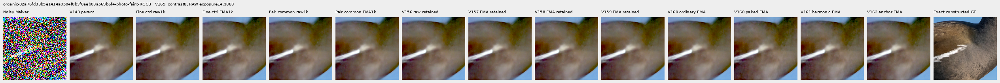

organic-dabacecd4780a1c230f8e9fce6ca1a604bdeab4c-photo-dark-RGGB; ROI `[112, 112, 160, 160]`, RAW exposure 102.758, contrast 1.

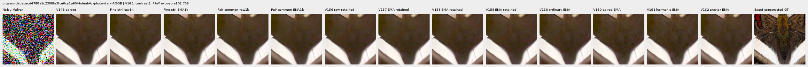

organic-6b3920bceba82d95ecf9351d47f6f94267694bd0-photo-dark-RGGB; ROI `[112, 112, 160, 160]`, RAW exposure 64.0491, contrast 1.

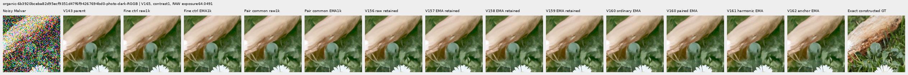

photo-3e638bbb56ed80abc88939468783e3bf9b92ee77-photo-faint-RGGB; ROI `[176, 176, 160, 160]`, RAW exposure 12.1494, contrast 8.

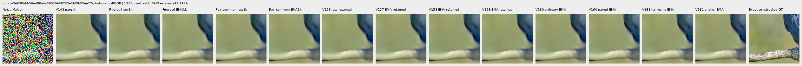

photo-3e638bbb56ed80abc88939468783e3bf9b92ee77-photo-dark-RGGB; ROI `[176, 176, 160, 160]`, RAW exposure 80.9959, contrast 1.

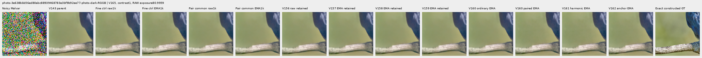

V150-control-bark-contrast0p025-adc-RGGB; ROI `[48, 48, 160, 160]`, RAW exposure 1, contrast 40.

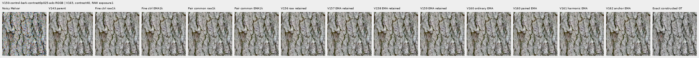

V150-control-raccoon-fur-contrast0p025-adc-RGGB; ROI `[48, 48, 160, 160]`, RAW exposure 1, contrast 40.

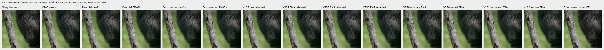

### Protected real GFX scenes

main-overcast-sky; ROI `[176, 176, 160, 160]`, RAW exposure 4, contrast 1.

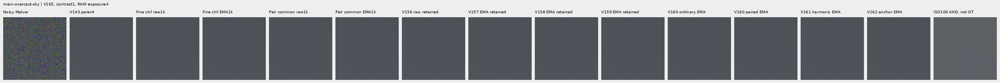

main-building-detail; ROI `[176, 176, 160, 160]`, RAW exposure 4, contrast 1.

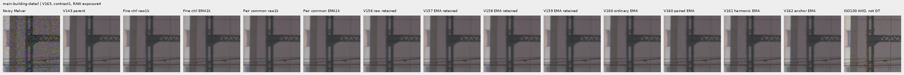

main-foliage; ROI `[176, 176, 160, 160]`, RAW exposure 4, contrast 1.

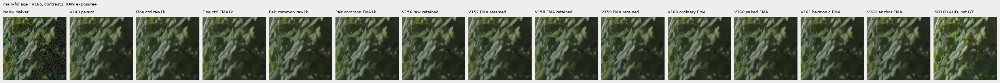

main-chain-link-fence; ROI `[176, 176, 160, 160]`, RAW exposure 4, contrast 1.

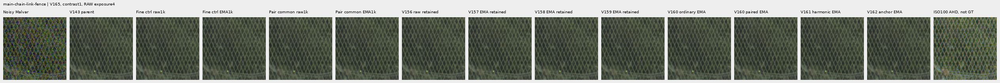

mesh-nominal; ROI `[206, 229, 160, 160]`, RAW exposure 16, contrast 1.

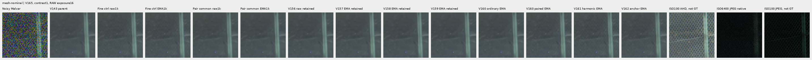

mesh-nominal; ROI `[426, 189, 160, 160]`, RAW exposure 16, contrast 1.

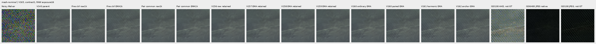

mesh-profile3879; ROI `[206, 229, 160, 160]`, RAW exposure 16, contrast 1.

mesh-profile3879; ROI `[426, 189, 160, 160]`, RAW exposure 16, contrast 1.

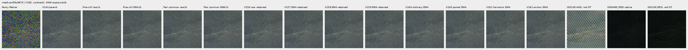

### Noisy, restored, exact constructed GT triplets

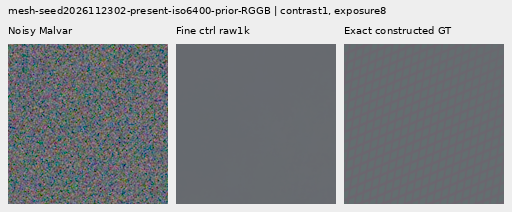

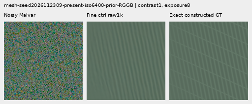

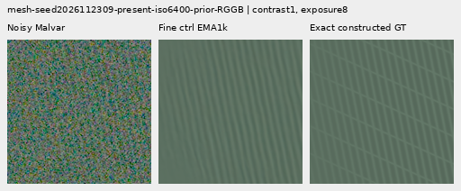

## Training, architecture and validation

Two fresh identical 124,909-parameter / 47-tensor V164 heads use the same 1,000 retained V160 batches. Only added pair-common absolute-error loss weight 0 versus 1 changes. Stable pseudo-Huber uses fixed 16 DN16 units on (e_a+e_b)/2, where each error uses its own actual target. Both retain pair-difference weight 1, floor 2 DN16 and Charbonnier epsilon .003, flat-target anchor .25, all base losses, initialization, LR, AdamW, clipping and EMA clocks. All 89 neural modules remain byte-identical. Only each image’s own RAW, parent RGB and physical conditioning enter inference; targets, pair labels, units and ISO100 references do not.

Pair differences cannot see equal errors in both members; the common term supplies direct absolute pressure in that output subspace. The common term cannot see opposite errors. Ordinary RGB, gradient, local/regional and clean-flat losses remain. Equal common and opposite difference output gradients are orthogonal, but shared parameter updates need not be. Shared noise does not cancel in the pair average. The fixed common unit is a training weight, not estimated RGB covariance, confidence or a flat-safety threshold.

A fixed motivation diagnostic evaluates V164 raw and EMA on the six paired batches in the original ten-batch training prefix: 12 root calls / 48 head images, with all twelve batch predictions retained externally. Mean common fractions of pair MSE are 87.7–87.8% mesh, 56.7–56.8% photo and 80.3–80.7% weak. These training examples are not held-out quality evidence. Shared noise, bias and missing detail all contribute; existing absolute losses already supervise common error. The exact squared-error decomposition does not extend additively to pseudo-Huber. Independent FP64 replay checks 48 scalars, while twelve CUDA leaf-output backwards verify the new loss and full adjoints to within 1.41e-9. [Motivation and sources](results/v165-pair-common-motivation-v1.json).

The control exactly reproduces all V164 candidate training trace rows and final raw/EMA/Adam states. All 1,644 actual control predictions replay byte-exact before archive storage adoption. The candidate keeps 1,644 new external arrays. Only the current contrast holds architecture, data, initialization and other losses fixed; historical comparators mix interventions. CFA placements, reused procedural recipes and this adaptive cohort are related, not independent scene replications or blind generalization evidence.

The retained cache has 4,000 frames: 1,382 present/background pairs and 1,236 ordinary frames from 2,618 scene/patch instances. Its 486 photo pairs visit 268 free-photo IDs; 234 reduce contrast and 245 use reviewed ROIs. Geometry precedes area 2 after bin 4; optical blur is zero. All 18 held-out IDs and protected captures/JPEGs/siblings remain excluded. V165 constructs no new scenes/noise or parent/DINO predictions. [V160 construction evidence](paired-response.md) retains its original accounting failure and explicit 23-batch adoption.

All 221 CPU checks pass, including 22 new independent value/full-output-adjoint, common/opposite-error, target-preservation, permutation, tiny-error, zero-ADC and invalid-input checks. Genuine 8+2 model/EMA/Adam/RNG restoration passes; first ten complete smoke/train rows match exactly. CUDA parity replays 28 archived contexts at all four CFAs and native 256/384/512/768 sizes: 56 root calls. Twenty additional parity leaf-output backwards independently check ten inherited flat-anchor, six pair-unit and four new common-loss cases; these are not neural forwards. Four strict CPU endpoint loads and 94 finite final Adam states pass.

`fine-control`: 205/900 supervised batches clip; pre-clip norm median 0.446245, maximum 113.614426.

`pair-common`: 454/900 supervised batches clip; pre-clip norm median 1.015648, maximum 479.207886.

The 100 zero-gradient ADC batches advance Adam/EMA clocks. Gradient norms describe optimization pressure; they do not isolate the cause of a quality change.

The independent audit checks 40,210 scalars across 4,686 rows and 476 Decimal reductions; maximum scalar difference is 5.12e-13. All 72 native images / 24 triplets were actually viewed in 18 original-detail sheets; 61,824,000 RGB channels were independently checked.

Actual scientific work is 5,376 root calls / 11,472 head images: main trial 5,364 roots / 11,424 images (56 parity, 20 discarded smoke, 2,000 training, 3,288 main review), plus 12 motivation roots / 48 images. Thirty-two leaf-output backwards (20 parity, 12 motivation) and CPU tests are outside neural counts. All 1,644 new main candidate arrays / 4.421 GiB and twelve motivation batch predictions remain external. All ten main scientific owners and the original motivation owner are terminal, with no scientific failure, restart or repeated work. New local/external reserves are 56/136 GiB plus a .5 GiB projected margin and .25 GiB remaining local artifact bound; older evidence is retained. Original RAW files and `/mnt/dataz` are unused.

## Actual training objectives, units and inherited masks

Independent FP32 recombination of the recorded components reproduces all 2,000 actual weighted total losses bit-exactly, including zero ADC totals. This checks weights and conditional routing; it does not recompute training targets or losses from full training predictions, which were not retained. Output-level semantics are checked separately in the CPU/CUDA and retained-prefix diagnostic. The recorded common loss can be positive on ADC pairs even though its total supervision is zero.

| Domain | ADC only | Arm | Batches | Pairs | Common supervised batches | Mean recorded common loss |
| --- | --- | --- | ---: | ---: | ---: | ---: |
| mesh | False | fine-control | 307 | 614 | 0 | 0.000000 |
| mesh | False | pair-common | 307 | 614 | 307 | 0.092403 |
| photo | False | fine-control | 214 | 428 | 0 | 0.000000 |
| photo | False | pair-common | 214 | 428 | 214 | 1.032940 |
| flat | True | fine-control | 12 | 0 | 0 | 0.000000 |
| flat | True | pair-common | 12 | 0 | 0 | 0.000000 |
| mixed | False | fine-control | 139 | 0 | 0 | 0.000000 |
| mixed | False | pair-common | 139 | 0 | 0 | 0.000000 |
| weak | False | fine-control | 99 | 198 | 0 | 0.000000 |
| weak | False | pair-common | 99 | 198 | 99 | 0.152707 |
| flat | False | fine-control | 141 | 0 | 0 | 0.000000 |
| flat | False | pair-common | 141 | 0 | 0 | 0.000000 |
| mesh | True | fine-control | 34 | 68 | 0 | 0.000000 |
| mesh | True | pair-common | 34 | 68 | 0 | 0.001152 |
| photo | True | fine-control | 29 | 58 | 0 | 0.000000 |
| photo | True | pair-common | 29 | 58 | 0 | 0.300848 |
| mixed | True | fine-control | 17 | 0 | 0 | 0.000000 |
| mixed | True | pair-common | 17 | 0 | 0 | 0.000000 |
| weak | True | fine-control | 8 | 16 | 0 | 0.000000 |
| weak | True | pair-common | 8 | 16 | 0 | 0.000619 |

An independent NumPy reconstruction verifies all 1,000 actual records / 2,000 fingerprints: both arms use identical 2 DN16-floor pair-difference units derived from original retained mean shot-increment variances. The original 16 DN16 cached arrays are reconstructed separately. These are increment training proxies rather than post-ADC or restored-RGB covariance. All 1,000 actual masks replay the already independent V162 oracle on identical targets and unchanged mask code through V164; no new independent mask computation is claimed.

| Domain | ADC only | Pairs | Median difference unit DN16 | P90 unit | Maximum unit |
| --- | --- | ---: | ---: | ---: | ---: |
| mesh | False | 614 | 8.604690 | 25.789597 | 88.750217 |
| photo | False | 428 | 61.038446 | 270.123829 | 853.877535 |
| weak | False | 198 | 17.108980 | 58.000702 | 110.375437 |
| mesh | True | 68 | 2.000000 | 2.000000 | 2.000000 |
| photo | True | 58 | 2.000000 | 2.000000 | 2.000000 |
| weak | True | 16 | 2.000000 | 2.000000 | 2.000000 |

The unchanged detached flat-target mask requires per-channel truncated 17×17 range at most 1 DN16. Eligible weak gradients retain their actual targets. Its pseudo-Huber uses 16 DN16 units and a whole-image denominator, so coverage controls term weight. Mean batch fraction reflects that denominator; pixel-weighted fraction accounts for mixed context sizes. ADC masks remain recorded despite zero total supervision. Coverage does not establish inference flatness.

| Domain | ADC only | Batches | Mean batch eligible fraction | Pixel-weighted eligible fraction |
| --- | --- | ---: | ---: | ---: | ---: |
| mesh | False | 307 | 0.699702 | 0.699702 |
| mesh | True | 34 | 0.667894 | 0.667894 |
| weak | False | 99 | 0.502555 | 0.502555 |
| weak | True | 8 | 0.500000 | 0.500000 |
| photo | False | 214 | 0.522321 | 0.522321 |
| photo | True | 29 | 0.507665 | 0.507665 |
| flat | False | 141 | 0.688589 | 0.688589 |
| flat | True | 12 | 0.646564 | 0.646564 |
| mixed | False | 139 | 0.907641 | 0.907641 |
| mixed | True | 17 | 0.907094 | 0.907094 |

[Original protocol](results/v165-pair-common-v1/original-protocol.md) · [Immutable preparation](results/v165-pair-common-preparation-v1.json) · [Independent publication verification](results/v165-pair-common-publication-verification-v1.json).

## Photographic credits

Derived native targets/crops retain the respective source licenses; transformations include linearization, area binning and exposure/contrast changes. Source IDs and ROIs are in the manifest.

| Source | Author | License |
| --- | --- | --- |
| [File:Emamzadeh Esmaeil roof.jpg](https://commons.wikimedia.org/wiki/File:Emamzadeh_Esmaeil_roof.jpg) | مانفی | [CC BY-SA 4.0](https://creativecommons.org/licenses/by-sa/4.0) |
| [File:HP-85-IMG 0439.jpg](https://commons.wikimedia.org/wiki/File:HP-85-IMG_0439.jpg) | Rama & Musée Bolo | [CC BY-SA 2.0 fr](https://creativecommons.org/licenses/by-sa/2.0/fr/deed.en) |
| [File:Spangled Drongo - AndrewMercer - DSC00966.jpg](https://commons.wikimedia.org/wiki/File:Spangled_Drongo_-_AndrewMercer_-_DSC00966.jpg) | Andrew Mercer (www.baldwhiteguy.co.nz) | [CC BY-SA 4.0](https://creativecommons.org/licenses/by-sa/4.0) |
| [File:Naxos Chora 2025-06-14 0505.jpg](https://commons.wikimedia.org/wiki/File:Naxos_Chora_2025-06-14_0505.jpg) | Tsui | [CC BY-SA 4.0](https://creativecommons.org/licenses/by-sa/4.0) |
| [File:Castelo Novo April 2015-2a.jpg](https://commons.wikimedia.org/wiki/File:Castelo_Novo_April_2015-2a.jpg) | Alvesgaspar | [CC BY-SA 4.0](https://creativecommons.org/licenses/by-sa/4.0) |
| [File:RX50 -5 ¼” dual floppy disk drive 02.jpg](https://commons.wikimedia.org/wiki/File:RX50_-5_%C2%BC%E2%80%9D_dual_floppy_disk_drive_02.jpg) | Mister rf | [CC BY-SA 4.0](https://creativecommons.org/licenses/by-sa/4.0) |
| [File:DSC00752 San Salvator Laur.jpg](https://commons.wikimedia.org/wiki/File:DSC00752_San_Salvator_Laur.jpg) | Rione Colonna | [CC BY 4.0](https://creativecommons.org/licenses/by/4.0) |
| [File:Regierungsgebäude, Vaduz.jpg](https://commons.wikimedia.org/wiki/File:Regierungsgeb%C3%A4ude,_Vaduz.jpg) | AuHaidhausen | [CC BY 4.0](https://creativecommons.org/licenses/by/4.0) |
| [File:Common moorhen (Gallinula chloropus) France.jpg](https://commons.wikimedia.org/wiki/File:Common_moorhen_(Gallinula_chloropus)_France.jpg) | Alexis Lours | [CC BY 4.0](https://creativecommons.org/licenses/by/4.0) |
| [File:Dried platanus leaves on rain puddle, Quinta das Conchas e dos Lilases, Lisbon, Portugal julesvernex2.jpg](https://commons.wikimedia.org/wiki/File:Dried_platanus_leaves_on_rain_puddle,_Quinta_das_Conchas_e_dos_Lilases,_Lisbon,_Portugal_julesvernex2.jpg) | Jules Verne Times Two | [CC BY-SA 4.0](https://creativecommons.org/licenses/by-sa/4.0) |
| [File:Close wing pudding position of Lethe visrava (Moore, 1866) - White-edged Woodbrown WLB IMG 0997.jpg](https://commons.wikimedia.org/wiki/File:Close_wing_pudding_position_of_Lethe_visrava_(Moore,_1866)_-_White-edged_Woodbrown_WLB_IMG_0997.jpg) | Thamblyok | [CC BY-SA 4.0](https://creativecommons.org/licenses/by-sa/4.0) |
| [File:Daisies near Cockspur coral tree (Erythrina crista-galli) roots, Jardim da Praça de Londres, Lisbon, Portugal julesvernex2.jpg](https://commons.wikimedia.org/wiki/File:Daisies_near_Cockspur_coral_tree_(Erythrina_crista-galli)_roots,_Jardim_da_Pra%C3%A7a_de_Londres,_Lisbon,_Portugal_julesvernex2.jpg) | Jules Verne Times Two | [CC BY-SA 4.0](https://creativecommons.org/licenses/by-sa/4.0) |
| [File:Apples on tree 2021 G1.jpg](https://commons.wikimedia.org/wiki/File:Apples_on_tree_2021_G1.jpg) | George Chernilevsky | [CC BY-SA 4.0](https://creativecommons.org/licenses/by-sa/4.0) |
| [File:Close wing Nectering of Pseudozizeeria maha (Kollar, 1844) - Pale Grass Blue WLB.jpg](https://commons.wikimedia.org/wiki/File:Close_wing_Nectering_of_Pseudozizeeria_maha_(Kollar,_1844)_-_Pale_Grass_Blue_WLB.jpg) | Anitava Roy | [CC BY-SA 4.0](https://creativecommons.org/licenses/by-sa/4.0) |
| [File:Grey heron (Ardea cinerea) head.jpg](https://commons.wikimedia.org/wiki/File:Grey_heron_(Ardea_cinerea)_head.jpg) | Alexis Lours | [CC BY 4.0](https://creativecommons.org/licenses/by/4.0) |
| [File:Openwing position of Parasarpa dudu (Westwood, -1850-) - White Commodore.jpg](https://commons.wikimedia.org/wiki/File:Openwing_position_of_Parasarpa_dudu_(Westwood,_-1850-)_-_White_Commodore.jpg) | MaheshBaruahwildlife | [CC BY-SA 4.0](https://creativecommons.org/licenses/by-sa/4.0) |
| [File:Kentucky Coffee-tree Gymnocladus dioicus 3264px.jpg](https://commons.wikimedia.org/wiki/File:Kentucky_Coffee-tree_Gymnocladus_dioicus_3264px.jpg) | Photo (c)2007 Derek Ramsey (Ram-Man) | [CC BY-SA 2.5](https://creativecommons.org/licenses/by-sa/2.5) |
| [File:Racoon clinging to a tree.JPG](https://commons.wikimedia.org/wiki/File:Racoon_clinging_to_a_tree.JPG) | Korall | [CC BY 3.0](https://creativecommons.org/licenses/by/3.0) |

## Fixed component checkpoints

- `fine-control-raw-step1000`: `db147d92c3d81b4c33fa9592c887278674d47bd0d21935584714341e6fbe5047`.
- `fine-control-EMA-step1000`: `16ed06b7b24410ac681f3a808500a2b992f420e4e300dcf66bc9331640c9d4e9`.
- `pair-common-raw-step1000`: `a0808b3aacb236a5b3f6b0d36523b264708c31539f1784114b7df2c411f33ab3`.
- `pair-common-EMA-step1000`: `1d60e7081a101f27a889eb2c939f277fbe7efca50efeff08c9ade7d98f3fbaac`.
