# Weak-pair training units: V164 final quality

Reducing the paired-response training-unit floor from 16 to 2 DN16 gives **8.35–12.32% more mesh response and 0.28–0.52% lower coarse flat error versus V163** at identical architecture, data and other losses. These are useful measured gains to retain. They come with higher total-flat and quiet-region error, and do not resolve the missing fine cab-fence crossings.

Mesh response reaches **4.298% raw / 4.429% EMA of exact constructed GT amplitude**, up 12.322% / 8.348% versus the exactly reproduced phase control and 95.19% / 101.12% versus V143. V161 still gives stronger learned response at 4.83–5.24%. Present full RMS improves 0.105% raw but worsens 0.051% EMA versus V163. Actual blank RMS rises 0.872% / 0.825%; exact-absence RMS rises 0.832% / 0.831%. The higher response therefore includes a measurable false-detail cost, even with differential false changes and absolute flat-target errors penalized during training.

Native512 coarse block32 means improve **0.517% / 0.460% raw** at ISO6400/12800 and **0.317% / 0.276% EMA** versus V163; all 48 inputs improve at both endpoints. They are 0.71–0.98% below V143, again on all 48 inputs. Raw coarse accuracy approaches V157: ISO6400 is essentially equal to V157 raw, ISO12800 0.045% worse; it improves 0.037–0.081% versus V157 EMA. V157 raw remains the stronger coarse comparator. Total-flat RMS instead rises **0.268–0.391% versus V163**, with 40/48 raw and 42/48 EMA inputs worse. Maximum increases are 0.388 / 0.343 DN16. Total-flat means remain 0.51–1.09% above V143; V160 ordinary retains stronger total-flat accuracy. A coarse reduction is not a full-resolution flat-field improvement.

Quiet-region RMS worsens **9.854% / 2.802% at ISO6400** and **2.668% / 0.198% at ISO12800**, raw / EMA, versus V163. Only 5/32 raw and 7/32 EMA inputs improve; maximum increases are 1.545 / 0.984 DN16. All 32 quiet spatial errors worsen at both endpoints, with mean increases of 1.72–3.94%. The independent decomposition separates spatial error from channel bias: ISO6400 raw DC RMS rises 2.469855→2.920559 DN16, while EMA rises 2.395376→2.435001. At ISO12800 raw rises 3.773396→3.897991, while EMA DC falls 3.623360→3.496767 despite the spatial cost. Against V143, all32 raw quiet total errors and 31/32 EMA errors are worse; all32 spatial errors are worse at both endpoints. Neither the retained flat-target anchor nor the paired loss establishes inference flatness.

All eight natural-photo band-response cohort means increase **0.090–0.770% versus V163**, but full RMS worsens in six of eight means by 0.007–0.044%; the two faint organic means improve 0.009–0.014%. These small adaptive-cohort changes are not convincing visible texture recovery. ADC-photo RMS rises about 0.030% versus V163 and stays only 0.057–0.069% below V143, far from V150's retained 3.06% gain. ADC sloped-plane coarse means improve 0.171–0.255% versus V163 while full RMS worsens 0.058–0.080%. All192 tested ADC constant outputs remain exact parent values.

All72 native figures were actually inspected in18 original-detail sheets, including all24 noisy/restored/exact-GT triplets. The weakest constructed mesh remains nearly featureless at the normal transform; amplified colored/grid texture persists, while the stronger mesh family has more dominant-direction contrast with weak transverse crossings. Both real cab windows and both priors still lack convincing new complete crossings; V161 retains stronger learned strand contrast. The main coarse chain-link fence is reconstructed, but building edges, foliage and fine photographic textures remain softened. The fixed +2EV main sky view stays smooth; it does not establish flat safety. Contrast40 flat and quiet crops retain broad colored mottle and fine grain. Raw6400 quiet crops show a stronger blue cast, consistent with the DC audit; EMA differences are smaller. ISO100 and native JPEG references differ in aperture, exposure time, motion and processing: qualitative references, not exact GT.

Retain V164 as a useful stronger-response/coarse option, alongside V161's stronger learned mesh response, V162's grain reduction, V163's quieter bias, V158's near-parent quiet behavior, V157's coarse strength and V160 ordinary's total-flat accuracy. Only the V164 floor contrast fixes architecture, cache, initialization and other losses; historical comparisons mix interventions. The smaller unit also changes the physical Charbonnier transition, and global clipping means analytic fixed-error gradient multipliers are not actual optimizer update ratios. The requested combination of fine dark fence recovery and reliable flat regions remains unresolved. [Audited reductions, all paired cases and actual viewing evidence](results/v164-quality-claims-v1.json) preserve the strengths and costs.

[Final evidence and immutable sources](results/v164-pair-unit-floor-final-v1.json) · [Native pixels, source ROIs, conditioning, exposure and checkpoint hashes](images/v164-pair-unit-floor-v1/manifest-v1.json).

## Response and actual blank error

RMS values are camera-RGB DN16. Response1 means the exact constructed mesh amplitude. Blank error measures actual target error; added blank RMS measures displacement from V143.

| Method | Present full RMS | Response | Actual blank RMS | Blank spatial RMS | Added blank RMS |
| --- | ---: | ---: | ---: | ---: | ---: |
|V143|9.111243|0.02202090|5.523323|5.343113|0.00000000|
|Phase ctrl raw|8.957231|0.03826631|5.588622|5.411993|1.08082965|
|Phase ctrl EMA|8.961685|0.04087513|5.630462|5.451010|1.21218164|
|Pair floor2 raw|8.947860|0.04298160|5.637360|5.464793|1.34797252|
|Pair floor2 EMA|8.966273|0.04428747|5.676891|5.498597|1.41673023|
|Existing periodic detail|8.586126|0.07089755|5.523328|5.343118|0.00063557|

## Quiet neighbors and coarse fields

| Prior | Method | Whole RMS | Quiet RMS | Quiet spatial RMS |
| --- | --- | ---: | ---: | ---: |
|ISO6400|V143|27.105631|3.898845|3.268502|
|ISO6400|Phase ctrl raw|26.986131|4.330212|3.435640|
|ISO6400|Phase ctrl EMA|26.979330|4.319271|3.482048|
|ISO6400|Pair floor2 raw|27.092429|4.756900|3.571089|
|ISO6400|Pair floor2 EMA|27.032807|4.440278|3.576172|
|ISO12800|V143|36.747466|6.152652|5.341833|
|ISO12800|Phase ctrl raw|35.866912|6.832716|5.545841|
|ISO12800|Phase ctrl EMA|35.771495|6.782337|5.588088|
|ISO12800|Pair floor2 raw|35.912107|7.015014|5.678909|
|ISO12800|Pair floor2 EMA|35.797159|6.795786|5.683969|

Quiet bias is averaged per RGB channel before its Euclidean RMS. The independent pixel audit verifies total squared = spatial squared + DC squared per case; means of RMS values do not share that identity.

| Prior | Method | Quiet DC RMS DN16 |
| --- | --- | ---: |
| iso6400-prior | parent | 2.016074 |
| iso6400-prior | phase-control-raw-step1000 | 2.469855 |
| iso6400-prior | phase-control-EMA-step1000 | 2.395376 |
| iso6400-prior | fine-pair-raw-step1000 | 2.920559 |
| iso6400-prior | fine-pair-EMA-step1000 | 2.435001 |
| iso12800-prior | parent | 2.849060 |
| iso12800-prior | phase-control-raw-step1000 | 3.773396 |
| iso12800-prior | phase-control-EMA-step1000 | 3.623360 |
| iso12800-prior | fine-pair-raw-step1000 | 3.897991 |
| iso12800-prior | fine-pair-EMA-step1000 | 3.496767 |

|Flat test|V143|Phase ctrl raw|Phase ctrl EMA|Pair floor2 raw|Pair floor2 EMA|
| --- | ---: | ---: | ---: | ---: | ---: |
|Native512 ISO6400 full RMS|18.546808|18.591729|18.643330|18.641462|18.704638|
|Native512 ISO6400 spatial RMS|18.235130|18.270816|18.348602|18.317477|18.408207|
|Native512 ISO6400 block32 RMS|13.440561|13.378119|13.385712|13.308966|13.343335|
|Native512 ISO12800 full RMS|24.071890|24.166555|24.239957|24.247602|24.334657|
|Native512 ISO12800 spatial RMS|23.596861|23.700166|23.818940|23.793476|23.919147|
|Native512 ISO12800 block32 RMS|17.932544|17.846781|17.855207|17.764766|17.805977|
|Older native256 ISO12800 full RMS|27.233548|27.312940|27.421470|27.420305|27.540492|
|Older native256 ISO12800 spatial RMS|26.017191|26.106662|26.237532|26.234218|26.364485|
|Older native256 ISO12800 block32 RMS|19.539875|19.449790|19.458808|19.374084|19.414466|

## Natural detail and ADC controls

|Photo test|V143|Phase ctrl raw|Phase ctrl EMA|Pair floor2 raw|Pair floor2 EMA|
| --- | ---: | ---: | ---: | ---: | ---: |
|Retained512 faint full RMS|33.963754|33.966439|33.967994|33.970170|33.970455|
|Retained512 faint band error|0.824639|0.824647|0.824462|0.824405|0.824263|
|Retained512 faint band response|0.298560|0.297329|0.298279|0.298465|0.299179|
|Retained512 dark full RMS|29.097715|29.095662|29.096800|29.107420|29.104238|
|Retained512 dark band error|0.661447|0.661305|0.661250|0.661251|0.661216|
|Retained512 dark band response|0.531446|0.529323|0.530009|0.530007|0.530484|
|Organic384 faint full RMS|37.469061|37.474622|37.470047|37.471276|37.464811|
|Organic384 faint band error|0.924117|0.924864|0.924570|0.924541|0.924286|
|Organic384 faint band response|0.150701|0.149207|0.150121|0.150356|0.151105|
|Organic384 dark full RMS|33.685796|33.687156|33.687013|33.701834|33.693801|
|Organic384 dark band error|0.781612|0.781630|0.781604|0.781635|0.781611|
|Organic384 dark band response|0.398945|0.396837|0.397541|0.397522|0.398063|

|ADC test|V143|Phase ctrl raw|Phase ctrl EMA|Pair floor2 raw|Pair floor2 EMA|
| --- | ---: | ---: | ---: | ---: | ---: |
|Photo full RMS|18.149871|18.131938|18.134059|18.137415|18.139575|
|Photo band error|0.101855|0.101739|0.101761|0.101766|0.101789|
|Photo band response|0.968329|0.968380|0.968370|0.968213|0.968246|
|Sloped512 full RMS|3.771369|3.774965|3.774793|3.777983|3.776996|
|Sloped512 spatial RMS|3.397249|3.400843|3.400540|3.403972|3.402864|
|Sloped512 block32 RMS|0.574652|0.573213|0.572903|0.571751|0.571925|
|Sloped512 crop block32 RMS|0.088145|0.088148|0.088147|0.088145|0.088145|
|Sloped512 worst absolute DC|11.176981|11.179721|11.179511|11.189394|11.188623|

## Fixed native comparisons

Every cell is native 160×160; crop pixels are never resized. All RAW methods within each board share source coordinates, camera display transform, exposure and contrast. JPEG cells retain native sRGB8 without exposure/contrast changes. Both final raw/EMA endpoints of both heads are shown, with eight retained V156/V157/V158/V159/V160 ordinary/V160 paired/V161/V162 columns.

The main scene is DSCF3879 ISO6400 versus DSCF3880 ISO100 f/5.6. The fine cab mesh uses DSCF3842 versus DSCF3835 and both camera JPEGs. Aperture, shutter, moving subjects and processing differ: ISO100 views are qualitative references, not exact GT. All30 real score rows stay unscored.

### Mesh and exact absence

mesh-seed2026112302-present-iso6400-prior-RGGB; ROI `[176, 176, 160, 160]`, RAW exposure 8, contrast 1.

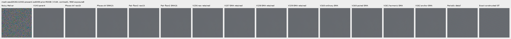

mesh-seed2026112302-present-iso6400-prior-RGGB; ROI `[176, 176, 160, 160]`, RAW exposure 8, contrast 40.

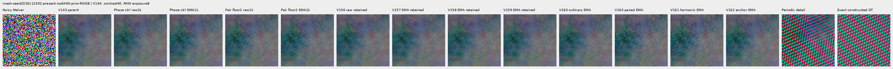

mesh-seed2026112309-present-iso6400-prior-RGGB; ROI `[176, 176, 160, 160]`, RAW exposure 8, contrast 1.

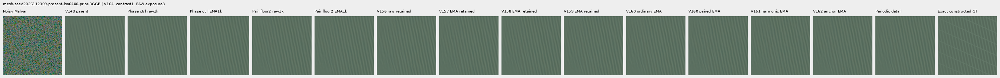

mesh-seed2026112309-present-iso6400-prior-RGGB; ROI `[176, 176, 160, 160]`, RAW exposure 8, contrast 40.

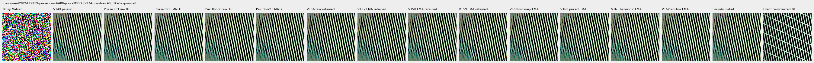

mesh-seed2026112304-absent-iso6400-prior-RGGB; ROI `[165, 0, 160, 160]`, RAW exposure 8, contrast 40.

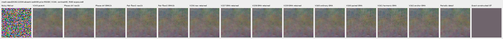

### Quiet neighbors beside edges

mixed-vertical-step-iso6400-prior-RGGB; ROI `[80, 176, 160, 160]`, RAW exposure 8, contrast 40.

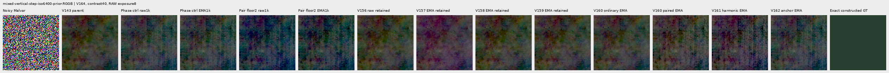

mixed-vertical-step-iso6400-prior-RGGB; ROI `[240, 176, 160, 160]`, RAW exposure 8, contrast 1.

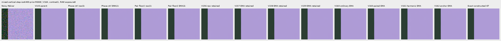

mixed-vertical-step-iso12800-prior-RGGB; ROI `[80, 176, 160, 160]`, RAW exposure 8, contrast 40.

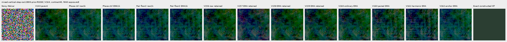

mixed-vertical-step-iso12800-prior-RGGB; ROI `[240, 176, 160, 160]`, RAW exposure 8, contrast 1.

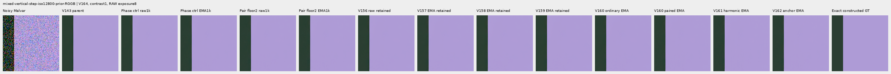

mixed-narrow-bar-iso6400-prior-RGGB; ROI `[80, 176, 160, 160]`, RAW exposure 8, contrast 40.

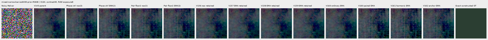

mixed-narrow-bar-iso6400-prior-RGGB; ROI `[240, 176, 160, 160]`, RAW exposure 8, contrast 1.

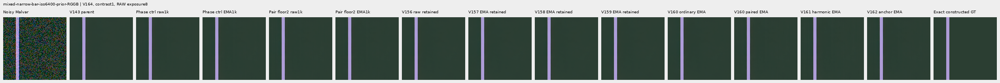

mixed-narrow-bar-iso12800-prior-RGGB; ROI `[80, 176, 160, 160]`, RAW exposure 8, contrast 40.

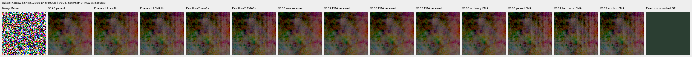

mixed-narrow-bar-iso12800-prior-RGGB; ROI `[240, 176, 160, 160]`, RAW exposure 8, contrast 1.

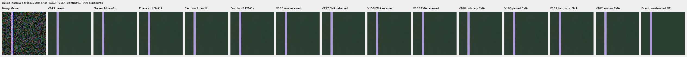

mixed-slanted-step-iso6400-prior-RGGB; ROI `[80, 176, 160, 160]`, RAW exposure 8, contrast 40.

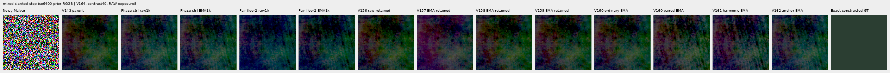

mixed-slanted-step-iso6400-prior-RGGB; ROI `[240, 176, 160, 160]`, RAW exposure 8, contrast 1.

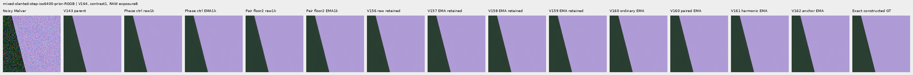

mixed-slanted-step-iso12800-prior-RGGB; ROI `[80, 176, 160, 160]`, RAW exposure 8, contrast 40.

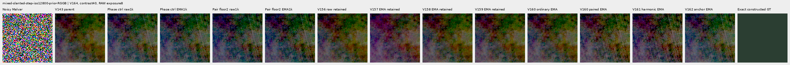

mixed-slanted-step-iso12800-prior-RGGB; ROI `[240, 176, 160, 160]`, RAW exposure 8, contrast 1.

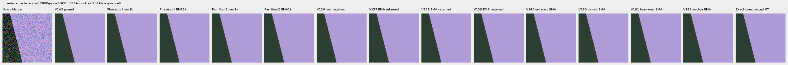

mixed-striped-patch-iso6400-prior-RGGB; ROI `[80, 176, 160, 160]`, RAW exposure 8, contrast 40.

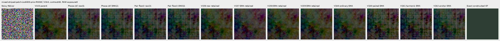

mixed-striped-patch-iso6400-prior-RGGB; ROI `[240, 176, 160, 160]`, RAW exposure 8, contrast 1.

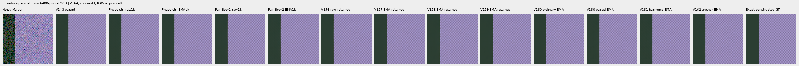

mixed-striped-patch-iso12800-prior-RGGB; ROI `[80, 176, 160, 160]`, RAW exposure 8, contrast 40.

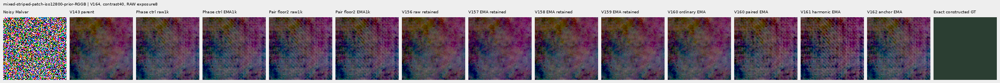

mixed-striped-patch-iso12800-prior-RGGB; ROI `[240, 176, 160, 160]`, RAW exposure 8, contrast 1.

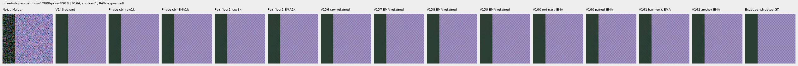

### Standalone flats and slopes

gray-l0.02-adc-only-RGGB; ROI `[48, 48, 160, 160]`, RAW exposure 4, contrast 40.

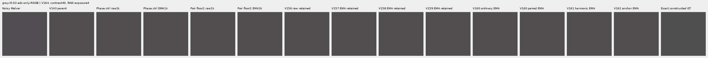

gray-l0.02-iso12800-prior-RGGB; ROI `[48, 48, 160, 160]`, RAW exposure 4, contrast 40.

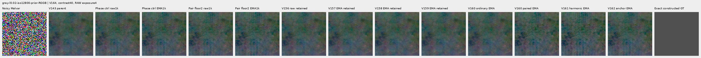

flat512-gray-l0.02-adc-only-RGGB; ROI `[176, 176, 160, 160]`, RAW exposure 4, contrast 40.

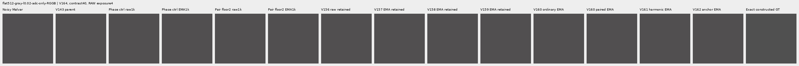

flat512-gray-l0.02-iso6400-prior-RGGB; ROI `[176, 176, 160, 160]`, RAW exposure 4, contrast 40.

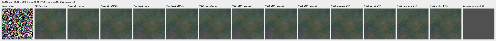

flat512-gray-l0.02-iso12800-prior-RGGB; ROI `[176, 176, 160, 160]`, RAW exposure 4, contrast 40.

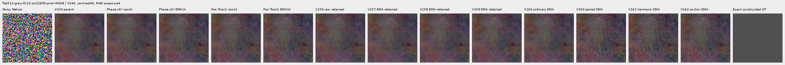

flat512-h210-s0.50-l0.02-iso6400-prior-RGGB; ROI `[176, 176, 160, 160]`, RAW exposure 4, contrast 40.

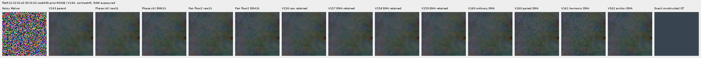

flat512-gray-l0.18-iso12800-prior-RGGB; ROI `[176, 176, 160, 160]`, RAW exposure 1, contrast 8.

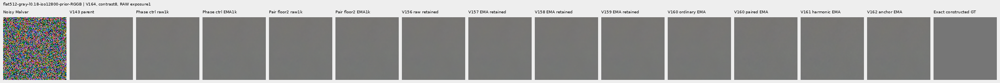

flat512-gray-l0.90-iso12800-prior-RGGB; ROI `[176, 176, 160, 160]`, RAW exposure 1, contrast 4.

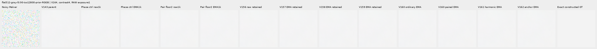

V150-control-ADC-plane0-RGGB; ROI `[176, 176, 160, 160]`, RAW exposure 45, contrast 8.

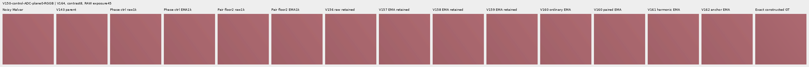

V150-control-ADC-plane1-RGGB; ROI `[176, 176, 160, 160]`, RAW exposure 9, contrast 8.

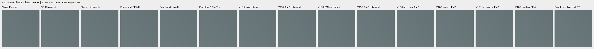

V150-control-ADC-plane2-RGGB; ROI `[176, 176, 160, 160]`, RAW exposure 1, contrast 8.

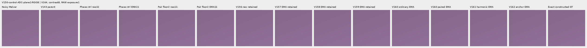

V150-control-ADC-plane3-RGGB; ROI `[176, 176, 160, 160]`, RAW exposure 0.24, contrast 8.

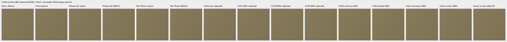

### Natural photographic detail

organic-02a76fd33b5e1414a0504f0b3f0aeb03a569b6f4-photo-faint-RGGB; ROI `[112, 112, 160, 160]`, RAW exposure 14.3883, contrast 8.

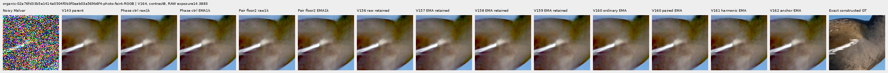

organic-dabacecd4780a1c230f8e9fce6ca1a604bdeab4c-photo-dark-RGGB; ROI `[112, 112, 160, 160]`, RAW exposure 102.758, contrast 1.

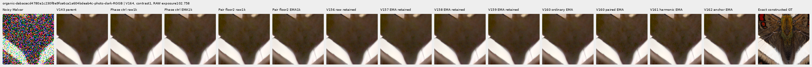

organic-6b3920bceba82d95ecf9351d47f6f94267694bd0-photo-dark-RGGB; ROI `[112, 112, 160, 160]`, RAW exposure 64.0491, contrast 1.

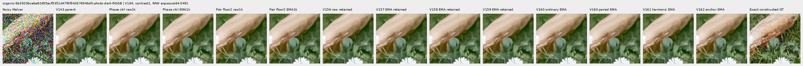

photo-3e638bbb56ed80abc88939468783e3bf9b92ee77-photo-faint-RGGB; ROI `[176, 176, 160, 160]`, RAW exposure 12.1494, contrast 8.

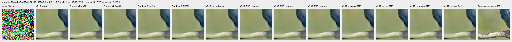

photo-3e638bbb56ed80abc88939468783e3bf9b92ee77-photo-dark-RGGB; ROI `[176, 176, 160, 160]`, RAW exposure 80.9959, contrast 1.

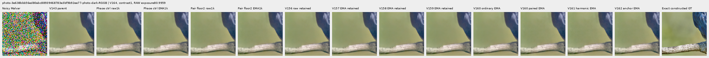

V150-control-bark-contrast0p025-adc-RGGB; ROI `[48, 48, 160, 160]`, RAW exposure 1, contrast 40.

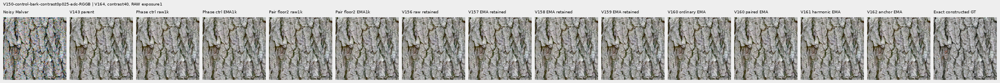

V150-control-raccoon-fur-contrast0p025-adc-RGGB; ROI `[48, 48, 160, 160]`, RAW exposure 1, contrast 40.

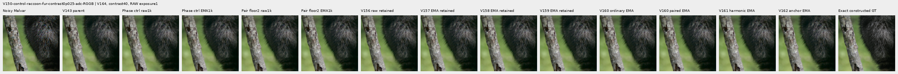

### Protected real GFX scenes

main-overcast-sky; ROI `[176, 176, 160, 160]`, RAW exposure 4, contrast 1.

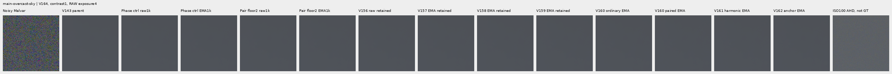

main-building-detail; ROI `[176, 176, 160, 160]`, RAW exposure 4, contrast 1.

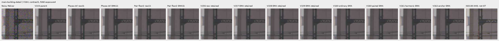

main-foliage; ROI `[176, 176, 160, 160]`, RAW exposure 4, contrast 1.

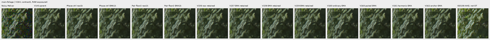

main-chain-link-fence; ROI `[176, 176, 160, 160]`, RAW exposure 4, contrast 1.

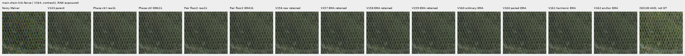

mesh-nominal; ROI `[206, 229, 160, 160]`, RAW exposure 16, contrast 1.

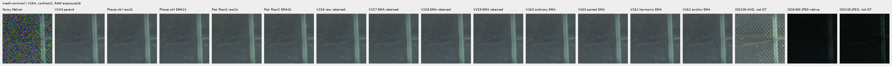

mesh-nominal; ROI `[426, 189, 160, 160]`, RAW exposure 16, contrast 1.

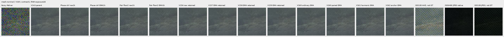

mesh-profile3879; ROI `[206, 229, 160, 160]`, RAW exposure 16, contrast 1.

mesh-profile3879; ROI `[426, 189, 160, 160]`, RAW exposure 16, contrast 1.

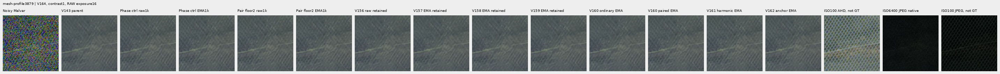

### Noisy, restored, exact constructed GT triplets

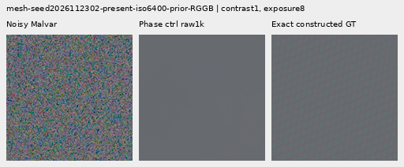

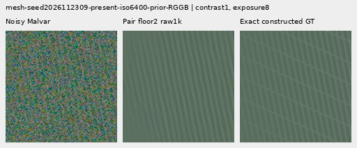

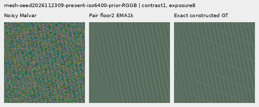

## Training, architecture and validation

Two fresh identical 124,909-parameter / 47-tensor V163 heads use the same 1,000 retained V160 batches. Only the paired-response training-unit floor changes from 16 to 2 DN16. Pair weight 1, dimensionless Charbonnier epsilon 0.003, flat-target anchor weight 0.25, all base losses, initialization, LR, AdamW, clipping and EMA clocks stay fixed. No new neural code is introduced: all 89 neural modules remain byte-identical. Only each image’s own RAW, parent RGB and physical conditioning enter inference; targets, pair labels, units and ISO100 references do not.

Original retained FP32 mean pre-ADC shot-increment variances reconstruct all 1,382 old cached units bit-exact. Shared Poisson counts/read draws give modeled increment variance shot times absolute clean-sensor difference; read noise cancels before ADC. The smaller floor changes 620/1,240 supervised pairs, including 455/614 mesh, 73/428 photographic and 92/198 weak pairs. The 142 ADC pairs retain zero total supervision. Unit ratios stay within 1–8 and unaffected units remain bit-exact. These are training proxies rather than restored-RGB covariance, confidence or an inference threshold.

A smaller unit changes relative weighting and the physical Charbonnier transition. Large-error gradients can rise eightfold and tiny-error gradients sixty-fourfold at the most floor-limited pairs. Differential false detail in exactly unchanged target regions remains penalized; errors shared by both pair members remain invisible to this term. Absolute RGB/local/regional and flat-target losses are therefore retained. The flat mask still uses detached per-channel 17×17 clean-target range at most 1 DN16 with truncated borders; eligible weak gradients keep their actual targets. Stable pseudo-Huber target error uses 16 DN16 units and a whole-image denominator. Coverage does not establish inference flatness.

The control exactly reproduces all V163 candidate training trace rows and final raw/EMA/Adam states. All 1,644 actual control predictions replay byte-exact before archive storage adoption. The candidate keeps 1,644 new external arrays. Only the current contrast holds architecture, data and other losses fixed; historical comparators mix other changes. CFA placements, reused procedural recipes and this adaptive cohort are related, not independent scene replications or blind generalization evidence.

The retained cache has 4,000 frames: 1,382 present/background pairs and 1,236 ordinary frames from 2,618 scene/patch instances. Its 486 photo pairs visit 268 free-photo IDs; 234 reduce contrast and 245 use reviewed ROIs. Geometry precedes area 2 after bin 4; optical blur is zero. All 18 held-out IDs and protected captures/JPEGs/siblings remain excluded. V164 constructs no new scenes/noise or parent/DINO predictions. [V160 construction evidence](paired-response.md) retains its original accounting failure and explicit 23-batch adoption.

All 199 CPU checks pass, including 19 new independent FP32 unit, loss, full-output-adjoint, scaling, empty/invalid, common-error and zero-ADC checks. Genuine 8+2 model/EMA/Adam/RNG restoration passes; first ten complete smoke/train rows match exactly. CUDA parity replays 28 archived contexts at all four CFAs and native 256/384/512/768 sizes: 56 root calls. Sixteen additional leaf-output backwards independently check ten inherited flat-mask/loss cases and six smaller-pair-unit/loss/adjoint cases; these are not neural forwards. Four strict CPU endpoint loads and 94 finite final Adam states pass. [Pretrial state/source audit](results/v164-objective-motivation-v1.json) also records why reducing Adam epsilon was not selected: it contributes only about 0.1% of the median denominator in actual final phase/support weights.

`phase-control`: 198/900 supervised batches clip; pre-clip norm median 0.428669, maximum 113.627281.

`fine-pair`: 205/900 supervised batches clip; pre-clip norm median 0.446245, maximum 113.614426.

The 100 zero-gradient ADC batches advance Adam/EMA clocks. Gradient norms describe optimization pressure; they do not isolate the cause of a quality change.

The independent audit checks 40,210 scalars across 4,686 rows and 476 Decimal reductions; maximum scalar difference is 5.12e-13. All 72 native images / 24 triplets were actually viewed in 18 original-detail sheets; 61,824,000 RGB channels were independently checked.

Actual scientific work is 5,364 root head calls: 56 parity, 20 discarded smoke, 2,000 training and 3,288 main review, evaluating 11,424 head images. Sixteen numerical leaf-output backwards and CPU tests are outside neural counts. All 1,644 new candidate arrays / 4.421 GiB remain external. All ten original scientific controllers/workers are terminal with no scientific failure or repeated call. The auxiliary docs-update heading-lookup failure is retained in preparation evidence. New local/external reserves are 56/144 GiB plus a 0.5 GiB projected margin and 0.25 GiB remaining-local-artifact bound; older evidence is retained. Original RAW files and `/mnt/dataz` are unused.

## Actual training units and inherited audited masks

An independent NumPy reconstruction verifies all 1,000 actual control/candidate unit records and 2,000 fingerprints against original retained mean increment variances. Original 16 DN16 cached units also match. All 1,000 actual masks replay the already independent V162 oracle on identical targets and unchanged mask code through V163; no new independent mask computation is claimed. ADC total losses and gradient norms remain exactly zero.

| Domain | ADC only | Pairs | Affected pairs | Median unit ratio | P90 ratio | Maximum ratio |
| --- | --- | ---: | ---: | ---: | ---: | ---: |
| mesh | False | 614 | 455 | 1.859456 | 5.597480 | 8.000000 |
| photo | False | 428 | 73 | 1.000000 | 1.325681 | 8.000000 |
| weak | False | 198 | 92 | 1.000000 | 2.605275 | 5.975421 |
| mesh | True | 68 | 68 | 8.000000 | 8.000000 | 8.000000 |
| photo | True | 58 | 58 | 8.000000 | 8.000000 | 8.000000 |
| weak | True | 16 | 16 | 8.000000 | 8.000000 | 8.000000 |

Mean batch mask fraction reflects the whole-image denominator; pixel-weighted fraction accounts for mixed context sizes. ADC masks are recorded even though their total supervised loss is zero.

| Domain | ADC only | Batches | Mean batch eligible fraction | Pixel-weighted eligible fraction |
| --- | --- | ---: | ---: | ---: | ---: |
| mesh | False | 307 | 0.699702 | 0.699702 |
| mesh | True | 34 | 0.667894 | 0.667894 |
| weak | False | 99 | 0.502555 | 0.502555 |
| weak | True | 8 | 0.500000 | 0.500000 |
| photo | False | 214 | 0.522321 | 0.522321 |
| photo | True | 29 | 0.507665 | 0.507665 |
| flat | False | 141 | 0.688589 | 0.688589 |
| flat | True | 12 | 0.646564 | 0.646564 |
| mixed | False | 139 | 0.907641 | 0.907641 |
| mixed | True | 17 | 0.907094 | 0.907094 |

[Original protocol](results/v164-pair-unit-floor-v1/original-protocol.md) · [Immutable preparation](results/v164-pair-unit-floor-preparation-v1.json) · [Independent publication verification](results/v164-pair-unit-floor-publication-verification-v1.json).

## Photographic credits

Derived native targets/crops retain the respective source licenses; transformations include linearization, area binning and exposure/contrast changes. Source IDs and ROIs are in the manifest.

| Source | Author | License |
| --- | --- | --- |
| [File:Emamzadeh Esmaeil roof.jpg](https://commons.wikimedia.org/wiki/File:Emamzadeh_Esmaeil_roof.jpg) | مانفی | [CC BY-SA 4.0](https://creativecommons.org/licenses/by-sa/4.0) |
| [File:HP-85-IMG 0439.jpg](https://commons.wikimedia.org/wiki/File:HP-85-IMG_0439.jpg) | Rama & Musée Bolo | [CC BY-SA 2.0 fr](https://creativecommons.org/licenses/by-sa/2.0/fr/deed.en) |
| [File:Spangled Drongo - AndrewMercer - DSC00966.jpg](https://commons.wikimedia.org/wiki/File:Spangled_Drongo_-_AndrewMercer_-_DSC00966.jpg) | Andrew Mercer (www.baldwhiteguy.co.nz) | [CC BY-SA 4.0](https://creativecommons.org/licenses/by-sa/4.0) |
| [File:Naxos Chora 2025-06-14 0505.jpg](https://commons.wikimedia.org/wiki/File:Naxos_Chora_2025-06-14_0505.jpg) | Tsui | [CC BY-SA 4.0](https://creativecommons.org/licenses/by-sa/4.0) |
| [File:Castelo Novo April 2015-2a.jpg](https://commons.wikimedia.org/wiki/File:Castelo_Novo_April_2015-2a.jpg) | Alvesgaspar | [CC BY-SA 4.0](https://creativecommons.org/licenses/by-sa/4.0) |
| [File:RX50 -5 ¼” dual floppy disk drive 02.jpg](https://commons.wikimedia.org/wiki/File:RX50_-5_%C2%BC%E2%80%9D_dual_floppy_disk_drive_02.jpg) | Mister rf | [CC BY-SA 4.0](https://creativecommons.org/licenses/by-sa/4.0) |
| [File:DSC00752 San Salvator Laur.jpg](https://commons.wikimedia.org/wiki/File:DSC00752_San_Salvator_Laur.jpg) | Rione Colonna | [CC BY 4.0](https://creativecommons.org/licenses/by/4.0) |
| [File:Regierungsgebäude, Vaduz.jpg](https://commons.wikimedia.org/wiki/File:Regierungsgeb%C3%A4ude,_Vaduz.jpg) | AuHaidhausen | [CC BY 4.0](https://creativecommons.org/licenses/by/4.0) |
| [File:Common moorhen (Gallinula chloropus) France.jpg](https://commons.wikimedia.org/wiki/File:Common_moorhen_(Gallinula_chloropus)_France.jpg) | Alexis Lours | [CC BY 4.0](https://creativecommons.org/licenses/by/4.0) |
| [File:Dried platanus leaves on rain puddle, Quinta das Conchas e dos Lilases, Lisbon, Portugal julesvernex2.jpg](https://commons.wikimedia.org/wiki/File:Dried_platanus_leaves_on_rain_puddle,_Quinta_das_Conchas_e_dos_Lilases,_Lisbon,_Portugal_julesvernex2.jpg) | Jules Verne Times Two | [CC BY-SA 4.0](https://creativecommons.org/licenses/by-sa/4.0) |
| [File:Close wing pudding position of Lethe visrava (Moore, 1866) - White-edged Woodbrown WLB IMG 0997.jpg](https://commons.wikimedia.org/wiki/File:Close_wing_pudding_position_of_Lethe_visrava_(Moore,_1866)_-_White-edged_Woodbrown_WLB_IMG_0997.jpg) | Thamblyok | [CC BY-SA 4.0](https://creativecommons.org/licenses/by-sa/4.0) |
| [File:Daisies near Cockspur coral tree (Erythrina crista-galli) roots, Jardim da Praça de Londres, Lisbon, Portugal julesvernex2.jpg](https://commons.wikimedia.org/wiki/File:Daisies_near_Cockspur_coral_tree_(Erythrina_crista-galli)_roots,_Jardim_da_Pra%C3%A7a_de_Londres,_Lisbon,_Portugal_julesvernex2.jpg) | Jules Verne Times Two | [CC BY-SA 4.0](https://creativecommons.org/licenses/by-sa/4.0) |
| [File:Apples on tree 2021 G1.jpg](https://commons.wikimedia.org/wiki/File:Apples_on_tree_2021_G1.jpg) | George Chernilevsky | [CC BY-SA 4.0](https://creativecommons.org/licenses/by-sa/4.0) |
| [File:Close wing Nectering of Pseudozizeeria maha (Kollar, 1844) - Pale Grass Blue WLB.jpg](https://commons.wikimedia.org/wiki/File:Close_wing_Nectering_of_Pseudozizeeria_maha_(Kollar,_1844)_-_Pale_Grass_Blue_WLB.jpg) | Anitava Roy | [CC BY-SA 4.0](https://creativecommons.org/licenses/by-sa/4.0) |
| [File:Grey heron (Ardea cinerea) head.jpg](https://commons.wikimedia.org/wiki/File:Grey_heron_(Ardea_cinerea)_head.jpg) | Alexis Lours | [CC BY 4.0](https://creativecommons.org/licenses/by/4.0) |
| [File:Openwing position of Parasarpa dudu (Westwood, -1850-) - White Commodore.jpg](https://commons.wikimedia.org/wiki/File:Openwing_position_of_Parasarpa_dudu_(Westwood,_-1850-)_-_White_Commodore.jpg) | MaheshBaruahwildlife | [CC BY-SA 4.0](https://creativecommons.org/licenses/by-sa/4.0) |
| [File:Kentucky Coffee-tree Gymnocladus dioicus 3264px.jpg](https://commons.wikimedia.org/wiki/File:Kentucky_Coffee-tree_Gymnocladus_dioicus_3264px.jpg) | Photo (c)2007 Derek Ramsey (Ram-Man) | [CC BY-SA 2.5](https://creativecommons.org/licenses/by-sa/2.5) |
| [File:Racoon clinging to a tree.JPG](https://commons.wikimedia.org/wiki/File:Racoon_clinging_to_a_tree.JPG) | Korall | [CC BY 3.0](https://creativecommons.org/licenses/by/3.0) |

## Fixed component checkpoints

- `phase-control-raw-step1000`: `f130518961d59e4e83dc73dd4837510c3b491ebf7b8772a953e2db82afd08719`.
- `phase-control-EMA-step1000`: `24590df11d41e6825485409f7c59ba411d21f3392455d8c9d07d8dc80b8d0df5`.
- `fine-pair-raw-step1000`: `e1279997854c69255cdbe7041bf2094778b0153b57512fb49ca0ee3655002709`.
- `fine-pair-EMA-step1000`: `6f76721d18dc5be22714164bcf2b82d98a65ae2d06778b58631d40e968b2155c`.
