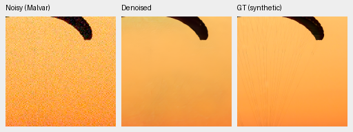
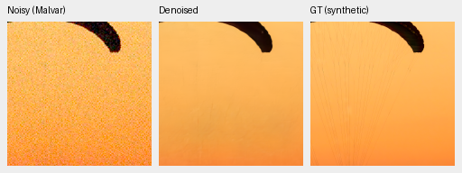
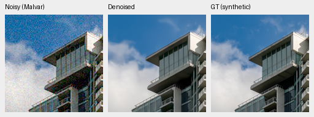
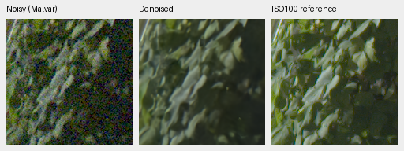
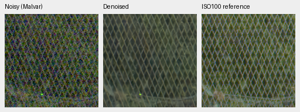
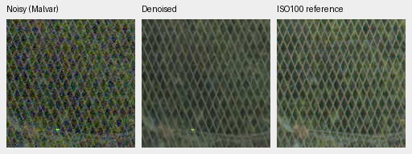

# Paired-data expansion: original4000-step schedules reviewed

**No promotion.** The expanded corpus's early photo PSNR gain disappears at
4000 updates: expanded−control−.000488dB[−.022240,+.017406]. Real-camera
differences remain uncertain, and native GFX differences are small. Keep V43
step2000 and its README crops as the real-photo reference; reviewed83-ID data
stays a separate opt-in corpus, without a demonstrated general advantage.
[Complete results, hashes and40 native triplets](results/paired-expansion-v53-v54-4k-review.json).
[First1000 gate](paired-expansion-v53-v54-review.md).

V53 uses original32 IDs/32 groups/64 pairs/576 crops. V54 uses83 IDs/71 groups/
166 pairs/1492 crops, preserving all legacy cases/bytes and adding51 reviewed
IDs. Identity-screen and temporal-LCD holds remain excluded. Sony/NikonZ6/
Canon6D/NikonD40 groups change24/3/4/1→60/3/7/1; this changes camera proportions
as well as source count. [Admission and provenance](paired-training-admission.md).

Both start identical retained V43 step2000 EMA, seed52/B16/LR3e-5/planned4000/
warmup100, original full-resolution/precision and genuine frozen DINO-S. Initial
AdamW/EMA are fresh in both. The1000→4000 continuation restores complete model,
EMA/AdamW/Python/Torch/CUDA RNG and finishes the original cosine schedule at
LR3e-6, with no reset or model/data policy change. Commons40170/native128,
25/25/50 batch mix,4×→geometry/PSF→2× training and original8× validation stay fixed.
All126 logged nonpaired observation hashes match; all36 logged paired hashes
change. Unlogged steps are not independently hashed. Both immutable first1000
snapshots remain intact; exact4000 checkpoint/optimizer/source identities are
in the receipt. No convergence follows from completing this finite schedule.

| Panel | Model | Measured-CFA PSNR | AHD RGB PSNR | AHD SSIM |
| --- | --- | ---: | ---: | ---: |
| Known4 | V53 original paired32 | 54.21630 | 40.08843 | 0.931278 |
| Known4 | V54 reviewed paired83 | 54.16238 | 40.06983 | 0.931586 |
| Known4 | RawNIND global CFA-LS | 54.06860 | 39.67805 | 0.928811 |
| Known4 | RawNIND channel CFA-LS | 54.08474 | 39.71710 | 0.928831 |
| Unseen5 | V53 original paired32 | 53.72586 | 38.50913 | 0.920041 |
| Unseen5 | V54 reviewed paired83 | 53.69989 | 38.42512 | 0.918246 |
| Unseen5 | RawNIND global CFA-LS | 53.56220 | 38.14484 | 0.918380 |
| Unseen5 | RawNIND channel CFA-LS | 53.76822 | 38.56191 | 0.922127 |

Known4 has8 pairs/72 crops; unseen5 has10 pairs/90 crops. Primary scores use
registered low-noise measured CFA; AHD RGB is auxiliary and **not exact GT**.
RawNIND uses publisher global-ADC normalization with observed-CFA global/channel
gain matching, without reference fitting. Protected-final scoring remains closed.

| Model | 427-photo PSNR | SSIM | 16-procedural PSNR | SSIM |
| --- | ---: | ---: | ---: | ---: |
| V53 original paired32 | 34.948012 | 0.958175 | 33.742024 | 0.969166 |
| V54 reviewed paired83 | 34.947524 | 0.958249 | 33.664202 | 0.968861 |
| RawNIND global CFA-LS | 26.695781 | 0.790028 | 24.974265 | 0.720411 |
| RawNIND channel CFA-LS | 26.683573 | 0.789899 | 24.985678 | 0.720500 |

| Difference, dB[95% source interval] | Known primary | Unseen primary | Photo sRGB | Procedural sRGB |
| --- | --- | --- | --- | --- |
| V54 reviewed paired83 − V53 original paired32 | -0.053923 [-0.192065, +0.036351] | -0.025973 [-0.173249, +0.112689] | -0.000488 [-0.022240, +0.017406] | -0.077822 [-0.501544, +0.250155] |
| V53 original paired32 − RawNIND channel CFA-LS | +0.131561 [-0.256826, +0.507004] | -0.042356 [-0.323674, +0.249485] | +8.264439 [+8.095419, +8.446013] | +8.756346 [+7.599659, +9.718485] |
| V54 reviewed paired83 − RawNIND channel CFA-LS | +0.077638 [-0.274603, +0.362807] | -0.068329 [-0.484118, +0.316243] | +8.263951 [+8.092207, +8.447918] | +8.678524 [+7.193075, +9.771204] |

Intervals describe evaluation-source variation, not training-seed uncertainty.
One training seed; all86,828 synthetic-suite metric cases recomputed with two
networks/two RawNIND/three classical methods. All62,020 classical/RawNIND cases
replay exactly from the first gate. Retained V43 has known54.23332/unseen53.80606
primary and photo34.89934/.957126; its shorter continuation history differs
and is context, not a matched data arm.

| Descriptive4000−1000 change, dB | Known primary | Unseen primary | Photo | Procedural |
| --- | ---: | ---: | ---: | ---: |
| V53 original paired32 | -0.044455 | +0.048859 | -0.005789 | +0.221633 |
| V54 reviewed paired83 | -0.142118 | +0.056014 | -0.102820 | -0.230683 |

The early+.09654dB expanded-photo advantage is not sustained. Neither a bigger
training set nor more updates establishes a real-photo improvement here.
A separate [weak-procedural-source candidate](weak-texture-source.md) can test
that change against the fixed V54 control without promoting the83-ID corpus
or interpreting its early best mean as a robust winner.

## Native comparisons

All panels native160×160; no resizing. Exact synthetic GT photos use shared
ROI[48,48,160,160], RGGB/ISO12800 prior shot=.00256/read=.0000262144,
WB[2,1,1.5], fixed matrix/display×1. All shared noisy/reference bytes and
ROI/noise/display metadata match. Metrics use unquantized predictions; PNGs
are8-bit display copies with exact checkpoint/reference hashes in receipts.

GFX DSCF3879 ISO6400 → restored → separate DSCF3880 ISO100 f/5.6. Native foliage
[8890,5570,160,160], fence[2240,6000,160,160] (reference x2241); sky/building
also published. Shared+2EV, input-only shot=.0014635775921166604/
read=.0000010715704128646712. Time/aperture/motion differ: ISO100 is a qualitative
reference, **not GT**, without warping, reference gain fitting or pixelwise score.

### Exact synthetic GT: 0014aa4e

### Exact synthetic GT: 002fc6ee

### Separate ISO100 qualitative reference: foliage

### Separate ISO100 qualitative reference: chain-link-fence

Thirty PNGs were visually inspected: V53/V54/channel-RawNIND across both exact
GT sources, both known/unseen paired examples and all four GFX regions. All40
published PNGs verify SHA/geometry/metadata/shared panels; global-RawNIND
variants are verified without separate visual judgment. Both neural arms
remain close. Fine fabric strands stay largely lost, leaves waxy and building
detail soft. Fence geometry is more coherent than RawNIND's colored grid,
with soft wires. No consistent expanded-data native advantage is apparent.
The ISO100 reference is independently sharper and optically different.

All8 complete8746×11662×3 RGB16 TIFFs verify fullSHA/bytes/dtype/16-bit tags,
>256 sampled codes and ICC for sRGB. Shared-machine single observations:
0:dino-paired-control-b16-v53:step-4000: 34.38s; 1:dino-paired-expanded-b16-v54:step-4000: 33.63s; RawNIND:CFA-LS: 17.68s; RawNIND:CFA-channel: 17.59s. These are not repeated speed measurements;100MP/10s and
the requested broad real-image margin/SOTA remain unproven.

Sources: [Roy Egloff](https://commons.wikimedia.org/wiki/File:CH.VD.Villeneuve_2007-08-25_Vertigo-Swiss-Riviera_2392_3x2-R_4K.jpg)
and [Dietmar Rabich](https://commons.wikimedia.org/wiki/File:Vancouver_(BC,_Canada),_Coal_Harbour_Seaside_Park,_Blick_in_den_Himmel_--_2022_--_2158.jpg),
[CC BY-SA4.0](https://creativecommons.org/licenses/by-sa/4.0/); modified by binning,
crop, synthetic noise, restoration and rendering. Paired sources: Benoit Brummer/
Christophe De Vleeschouwer, [RawNIND](https://doi.org/10.14428/DVN/DEQCIM), per-scene
grants in receipts. GFX by the project owner.
