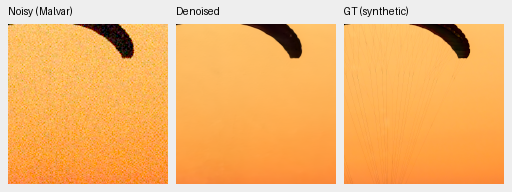
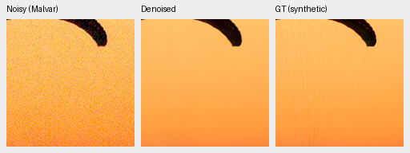
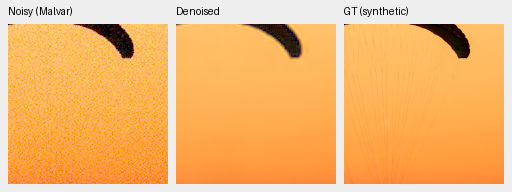
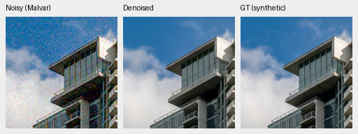
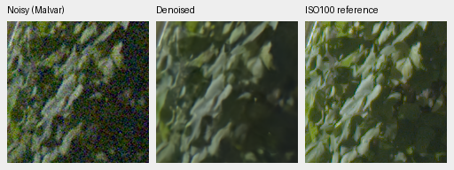
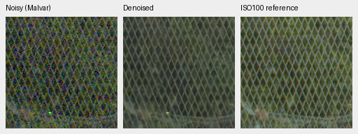

# Reviewed paired-data expansion: matched step1000 comparison

The subsequent [complete4000-step review](paired-expansion-v53-v54-4k-review.md)
finds that the early synthetic-photo advantage below is not sustained.
The corpus remains opt-in; no model promotion follows from this first gate.

The expanded corpus improves photo PSNR by+.09654dB[+.06749,+.13638] and
SSIM by+.000471[+.000361,+.000572] over the matched control. Real-camera
primary changes are mixed, with intervals crossing zero; native GFX differences
remain subtle. This first gate retained V43 step2000 and called for finishing
both original4000-step schedules. The linked final review completes that work;
see [current model choices](current-model.md) for present recommendations.

[Full results, source/checkpoint hashes and40 verified native triplets](results/paired-expansion-v53-v54-review.json).
[Admission and grouping review](paired-training-admission.md).

This changes only paired training data: original32 publisher scenes/32 sampling
groups/64 pairs/576 crops versus reviewed83 publisher IDs/71 groups/166 pairs/
1492 crops. All legacy pairs and crop bytes remain. Expanded data adds51 reviewed
IDs/102 pairs/916 crops; seven identity-screen holds and one temporal-LCD hold
remain excluded. Actual-content sampling aliases avoid counting the same artwork
or scene repeatedly. Registered real pairs retain residual noise, optical and
registration mismatch; their auxiliary AHD RGB is **not exact GT**.
Group sampling also changes the camera proportions: ILCE-7C/Nikon Z6/Canon6D/
NikonD40 groups are24/3/4/1 in the control and60/3/7/1 in the expanded corpus.
This is a reviewed-corpus comparison, not an isolated source-count effect at
fixed camera proportions; additional data remains mostly Sony.

Both arms initialize the identical retained V43 step2000 EMA
`0d74cf31fb1c7e3f97fc692c855a2ca0ee3ebf562b454e4f8b135c28fc0aa5c5`,
then use fresh AdamW/EMA, seed52, B16, LR3e-5/planned4000/warmup100 for1000 new
updates. They retain original full-resolution/precision flags and genuinely
pretrained frozen DINO-S. Commons40170/native128,25/25/50 domain mix,
4×→geometry/PSF→2× training targets, original8× validation and optimizer schedule
are identical. All35 logged nonpaired observations match byte-exactly; all6 logged
paired observations change. Full-source CUDA suite451 tests and actual genuine
parent/B16/two-update/portable-FP16 preflight passed before training.

| Panel | Model | Measured-CFA PSNR | AHD RGB PSNR | AHD SSIM |
| --- | --- | ---: | ---: | ---: |
| Known4 | V53 original paired32 | 54.26076 | 40.07280 | 0.931532 |
| Known4 | V54 reviewed paired83 | 54.30450 | 40.09109 | 0.931471 |
| Known4 | RawNIND global CFA-LS | 54.06860 | 39.67805 | 0.928811 |
| Known4 | RawNIND channel CFA-LS | 54.08474 | 39.71710 | 0.928831 |
| Unseen5 | V53 original paired32 | 53.67700 | 38.33389 | 0.917924 |
| Unseen5 | V54 reviewed paired83 | 53.64388 | 38.30980 | 0.917275 |
| Unseen5 | RawNIND global CFA-LS | 53.56220 | 38.14484 | 0.918380 |
| Unseen5 | RawNIND channel CFA-LS | 53.76822 | 38.56191 | 0.922127 |

Known4:8 pairs/72 crops; unseen5:10 pairs/90 crops, whose camera families remain
excluded from training. Registered clean measured CFA is primary; separately
demosaiced AHD RGB is auxiliary. RawNIND uses publisher global-ADC normalization
with global/channel gain calibration from observed CFA only. No reference-based
fitting. Protected-final scoring stays closed.

| Model | 427-photo PSNR | SSIM | 16-procedural PSNR | SSIM |
| --- | ---: | ---: | ---: | ---: |
| V53 original paired32 | 34.953801 | 0.957133 | 33.520392 | 0.968035 |
| V54 reviewed paired83 | 35.050344 | 0.957604 | 33.894886 | 0.967828 |
| RawNIND global CFA-LS | 26.695781 | 0.790028 | 24.974265 | 0.720411 |
| RawNIND channel CFA-LS | 26.683573 | 0.789899 | 24.985678 | 0.720500 |

| Difference, dB[95% source interval] | Known primary | Unseen primary | Photo sRGB | Procedural sRGB |
| --- | --- | --- | --- | --- |
| V54 reviewed paired83 − V53 original paired32 | +0.04374 [-0.02550, +0.11349] | -0.03313 [-0.07540, +0.01166] | +0.09654 [+0.06749, +0.13638] | +0.37449 [+0.07026, +0.78091] |
| V53 original paired32 − RawNIND channel CFA-LS | +0.17602 [-0.22828, +0.54811] | -0.09122 [-0.40629, +0.20263] | +8.27023 [+8.11320, +8.43742] | +8.53471 [+7.20674, +9.49648] |
| V54 reviewed paired83 − RawNIND channel CFA-LS | +0.21976 [-0.22775, +0.61472] | -0.12434 [-0.48171, +0.20090] | +8.36677 [+8.20869, +8.52895] | +8.90921 [+7.93570, +9.67295] |

One training seed and early1000-update review. Intervals bootstrap evaluation
sources, not training seeds. The full443-source seven-condition/four-CFA review
has86,828 metric cases; all62,020 classical/RawNIND cases replay exactly from the
earlier retained-parent evaluation. The retained V43 step2000 reference has
known54.23332/unseen53.80606 primary, photo34.89934/.957126 and procedural
33.28537/.966604; it has fewer updates and is context, not a matched data arm.

## Native crops

Each panel is native160×160; no resizing. Two exact synthetic GT sources use
identical ROI[48,48,160,160], RGGB/ISO12800 prior shot=.00256/read=.0000262144,
WB[2,1,1.5], fixed protocol matrix, display×1. Noisy/reference panel bytes and
ROI/noise/display metadata verify exact across all methods. PNGs are8-bit
previews; numerical scores use unquantized predictions.

Full102MP GFX DSCF3879 ISO6400 → restored → DSCF3880 ISO100 f/5.6 uses shared
+2EV/input-only shot=.0014635775921166604/read=.0000010715704128646712.
Foliage[8890,5570,160,160]; fence[2240,6000,160,160], reference x2241. Sky/building
also saved. The scene/time/aperture/motion differ; ISO100 is a qualitative
reference, **not GT**. No warping or pixelwise GFX reference score.

### Exact synthetic GT: 0014aa4e

### Exact synthetic GT: 002fc6ee

### Separate ISO100 qualitative reference: foliage

### Separate ISO100 qualitative reference: chain-link-fence

Sources: [Roy Egloff](https://commons.wikimedia.org/wiki/File:CH.VD.Villeneuve_2007-08-25_Vertigo-Swiss-Riviera_2392_3x2-R_4K.jpg)
and [Dietmar Rabich](https://commons.wikimedia.org/wiki/File:Vancouver_(BC,_Canada),_Coal_Harbour_Seaside_Park,_Blick_in_den_Himmel_--_2022_--_2158.jpg),
[CC BY-SA4.0](https://creativecommons.org/licenses/by-sa/4.0/); modified by binning,
crop, simulated noise, restoration and rendering. Paired sources: Benoit Brummer/
Christophe De Vleeschouwer, [RawNIND](https://doi.org/10.14428/DVN/DEQCIM),
per-scene credits/grants in receipts. GFX by the project owner.

All8 complete8746×11662×3 RGB16 TIFFs verify fullSHA/size/dtype/tags/>256 sampled
codes, with ICC in sRGB files. Single shared-machine processing observations:
0:dino-paired-control-b16-v53:step-1000: 34.62s; 1:dino-paired-expanded-b16-v54:step-1000: 34.85s; RawNIND:CFA-LS: 17.75s; RawNIND:CFA-channel: 17.59s. These are not repeated speed measurements; the requested
100MP/10s target is unproven.

## Native interpretation and next gate

Thirty native PNGs were visually inspected: both trained arms and channel-
calibrated RawNIND, across both exact-GT photographs, both known/unseen paired
examples and all four GFX regions. All40 published PNGs verify hashes, metadata,
native dimensions and common noisy/reference pixels; the ten global-RawNIND
variants are verified without a separate visual judgment.

The synthetic sky/building example is much cleaner and more coherent than
RawNIND, but weak fabric strands in the other exact-GT crop remain largely lost
in both arms. Registered real paired examples have very small V53/V54 native
differences. GFX foliage retains waxy/soft leaves; the fence preserves a less
colored wire grid than RawNIND, with soft wires and background texture. Small
building details remain soft and sky is smooth. Expanded data does not show a
consistent broad real-photo advantage in these examples. ISO100 optics/time
differences prevent treating its sharper texture as pixelwise GT.

Expanded−control primary known+.04374dB[−.02550,+.11349], unseen−.03313dB
[−.07540,+.01166]. Procedural PSNR+.37449dB[+.07026,+.78091], with SSIM change
−.000208[−.001211,+.000569]. These early source intervals do not establish
convergence, training-seed robustness or the requested large real-photo margin.
The next gate resumes both complete step1000 states through their unchanged
4000-step cosine schedule, preserving immutable first-gate checkpoints and all
held-out protocols. It changes no model, noise policy or data recipe.
[Actual continuation receipt](results/paired-expansion-v53-v54-4k-launch.json):
the prior controller exited successfully; frozenb62c996 resumes at1000, with
finite BF16 updates observed from1001 onward. Same451-test/genuine-preflight
source; no repeated GPU suite or fresh optimizer. Complete review repeats at4000.

A separate [training-only DINO preview check](dino-preview-sensitivity.md) also
finds no consistent middle/deep feature improvement from fixed phase-Wiener7
filtering. No preview-policy change is bundled into this data experiment.
