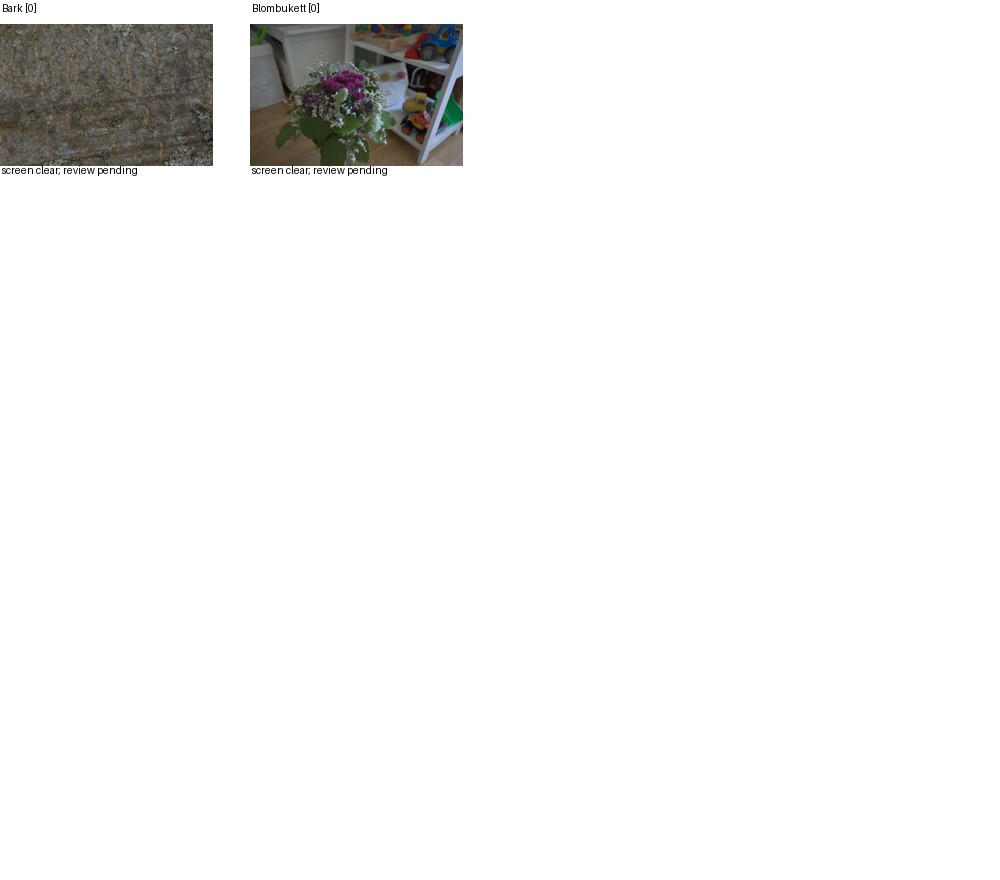
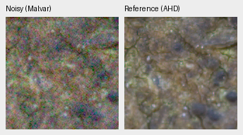
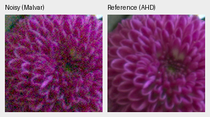
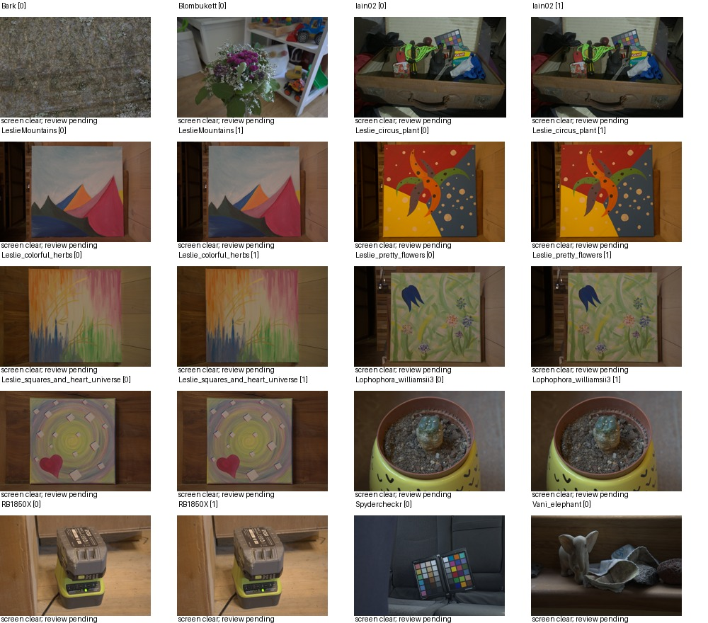
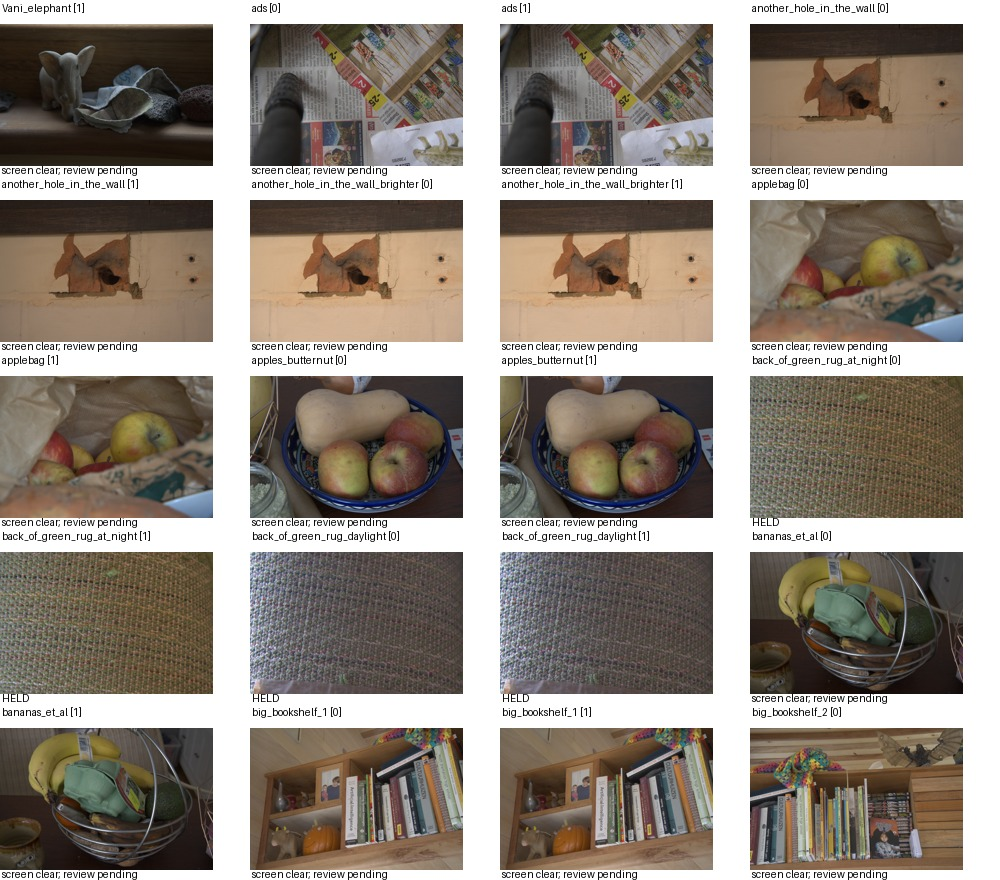
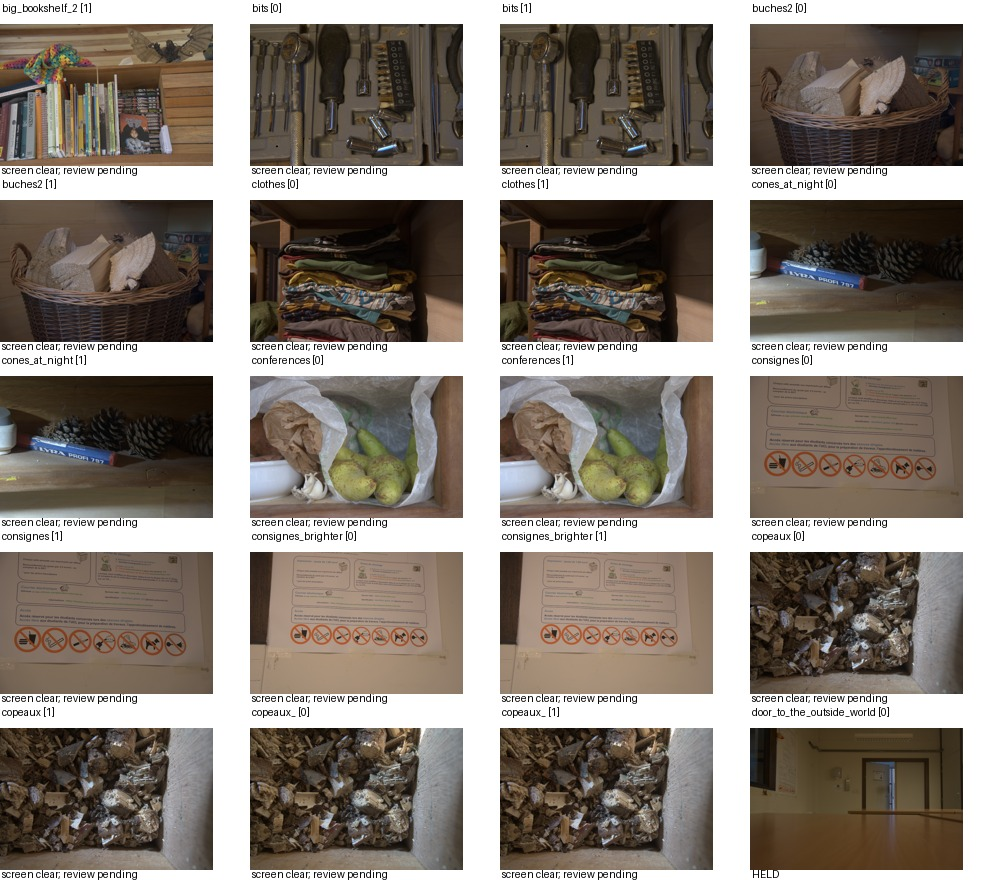
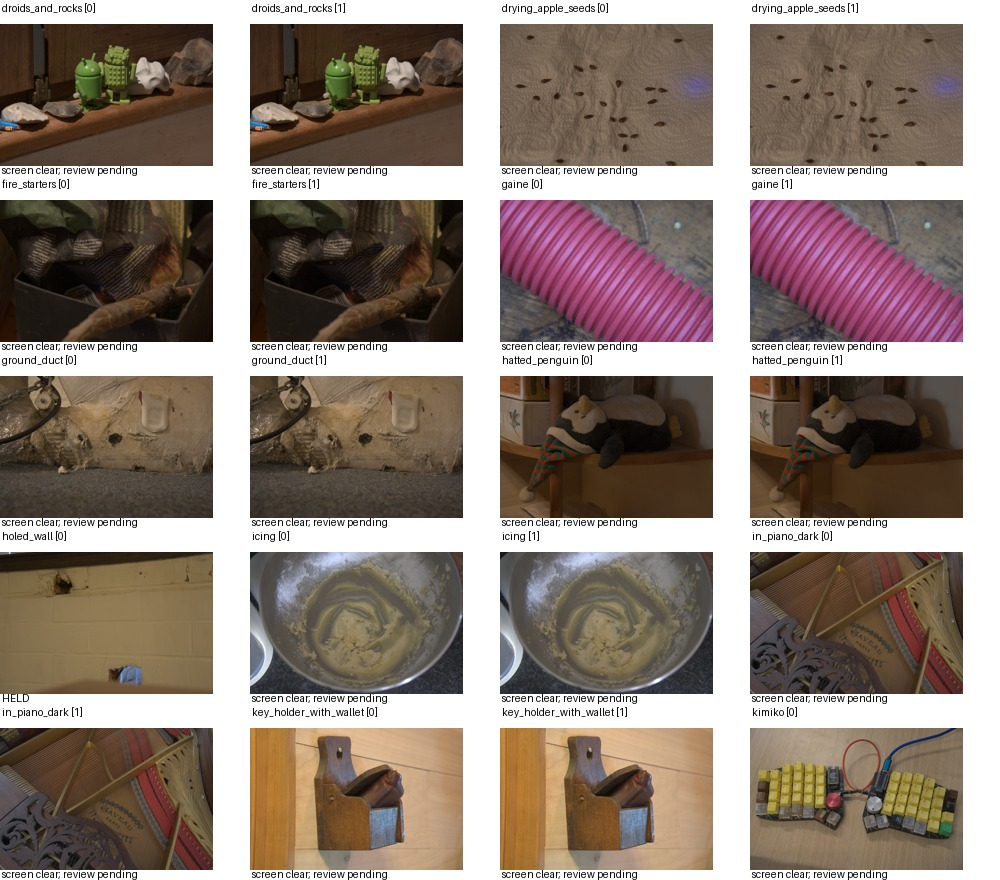
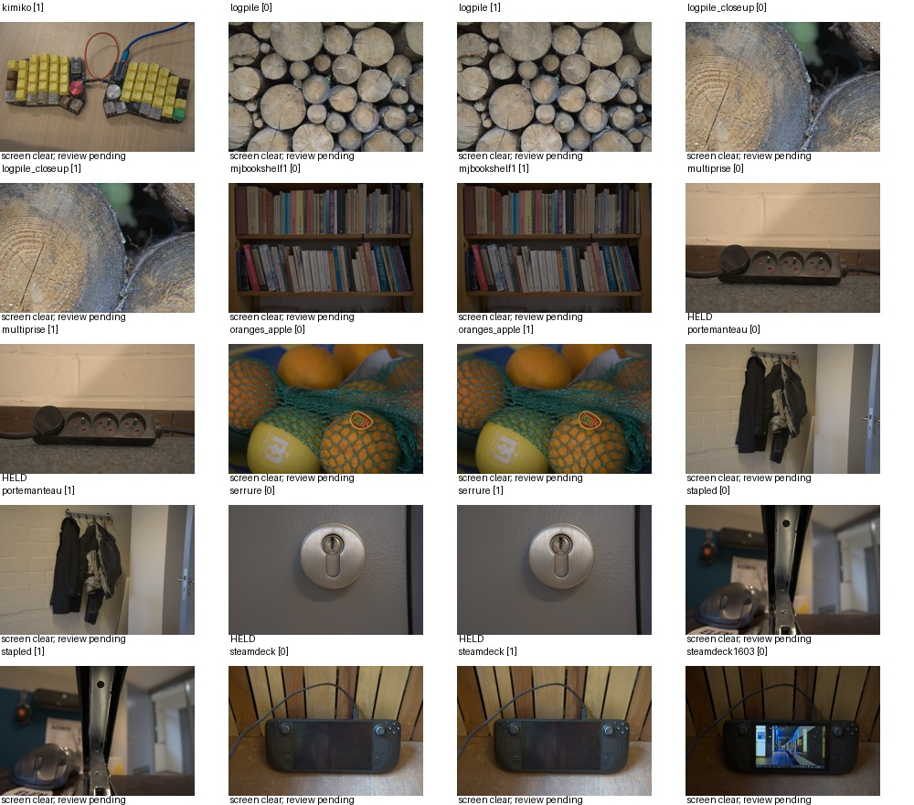
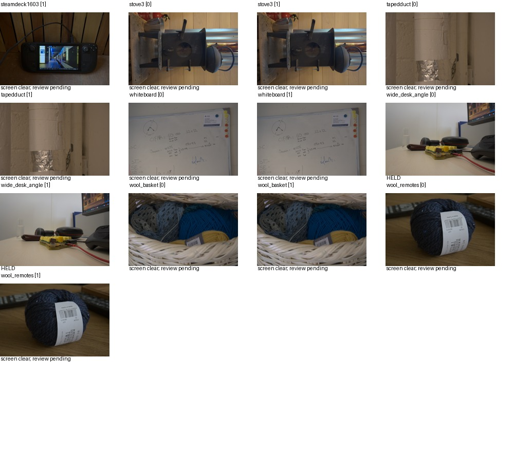

# Additional public paired RAW scenes

The frozen [RawNIND publisher catalog](https://doi.org/10.14428/DVN/DEQCIM)
contains59 eligible new scene candidates after conservative metadata exclusions:
231 RAW files,11.03GB. This can broaden the current32-scene paired supervision,
but **nothing is admitted to training yet**.
[Selection and provenance](results/paired-extension-quarantine-plan.json).

The downloader keeps the original fixed training allowlist intact. It excludes
all cached protected scene identities, existing32 training names/source hashes,
official test reserves/TEST filenames, unknown sensors, and entire MuseeL-,
LucieB_,7D-,D60- and boardgames_ families. This also excludes nearby views such
as boardgames_bot when boardgames_top is protected. New scene aliases sharing
protected/existing/selected source SHA1s are excluded. Selection uses metadata
only: up to two filename-ordered clean frames, noisy ISO nearest1600 and highest
remaining ISO≤12800. All new records explicitly carry split=quarantine.

The dataset release is CC BY-SA4.0. The plan retains per-scene permission text;
four selected scenes have explicit CC0 grants,55 use the dataset grant. Any
non-CC0 scene override is rejected rather than inheriting the dataset license
over that override. Existing publisher metadata, descriptor and permissions
are pinned; the latter two verify the publisher's file checksums. Every RAW
must verify size, publisher checksum and source SHA1, then records SHA256.
Sources/permissions/catalog and acquisition code are archived locally.

The downloader is lock-protected, resumes verified files, refuses a changed
plan, uses one worker and retains512GiB free space. All writes are under
`/mnt/external/demosaic/paired-extension-20261016-quarantine-v1/`; source photo
directories are not used. It runs separately from GPU training; active recipes,
holdouts and the GFX exclusion stay fixed.

```bash
source scripts/env.sh
uv run --no-sync python scripts/fetch_paired_extension.py \
  --output /mnt/external/demosaic/paired-extension-20261016-quarantine-v1 \
  --workers 1 --reserve-gib 512 --download
```

Before any future opt-in training extension, check both clean references against
cached protected views and the Commons val/test sources, inspect scene content,
decode camera metadata, and review registration/valid-reference coverage. Clean
RAW references retain noise; independently demosaiced RGB is auxiliary, not
exact GT. Quarantine preparation must preserve its split and cannot be loaded
by the current `PairedDataset` training guard. Frozen development/final data
cannot enter the extension. The finite identity screen is not proof of complete
scene separation. Downloading or preparing data alone establishes no model gain.

Sixteen targeted acquisition/selection tests pass: original paired acquisition
tests plus new metadata-only/quarantine/split/family/source-alias/license tests.
No enlarged full-suite count is claimed from this separate invocation.

The [background acquisition](results/paired-extension-download-launch.json) runs
from frozen `e2db058`. The new screen checks **both** clean references against
all42 cached protected RAW/GFX views and all4,558 Commons val/test images.
Both sides use seven full/center/corner views and eight dihedral transforms;
aspect4%, dHash≤40 OR correlation≥.95 flags hold the whole scene. Uninformative
or unidentified-camera references are held. Source/cache hashes, duplicate IDs,
safe ledger names, locks, frozen recipes and interruption reuse are checked.
Flags remain quarantined for review; no scoring model is loaded.

[The actual two-scene pilot](results/paired-extension-pilot.json) decoded Canon
EOS6D Bark and Blombukett, passed the identity screen, registered four noisy
pairs and verified36 fixed512px crops. All prepared records retain quarantine.
The ordinary-Bayer decoder preflight reports RGGB/3670×5496 for Bark. A separate
preparer records failed scenes, verifies every NPZ's hash/dimensions/native
float32 data/measured-reference mask, and preserves per-scene outcomes for
restart. Screen-clear or successful preparation is not training admission.
Eleven targeted screening/preparation tests pass separately from acquisition.

These resized contact images are for dataset content inspection:



Native160px data/registration pairs, **noisy Malvar → independent AHD reference**,
shared+1EV and fixed ROI[176,176,160,160] inside the center512px prepared crop:





These are not learned-model outputs or exact-GT comparisons. The high-ISO frames
are ISO12800; source/ROI/registration/noise/display settings are in the receipt.
Per-series apertures match (f/7.1 bark, f/4 bouquet), but low-ISO exposures are
1/4s and0.4s versus1/500s and1/320s. Scene movement and reference sharpness need
further native review before admission. Both scenes have CC0 grants by Peter
Wemmert; source RAWs are read-only and preview transforms are disclosed.

The [complete CPU review is queued](results/paired-extension-review-queue.json)
in frozen `b9a7d37`. Its controller waits for the identity-matched download
process to exit and the complete231-file manifest to exist, re-verifies every
RAW, then screens both references of all59 scenes and prepares only screen-clear
quarantine records. Two CPU threads are used; CUDA is disabled. It requires the
actual training loader to reject the resulting manifest. Live status:
`/mnt/external/demosaic/runs/paired-extension-review-v1-workflow.json`.

## Full acquisition and screen complete

[All231 files verify](results/paired-extension-full-screen.json), totaling
11,031,685,946 bytes. The screen checks113 clean references against42 protected
RAW/GFX references and4,558 Commons holdout sources. **52 scenes screen clear;
seven remain held.** Clear is a finite identity-screen outcome, not approval.
Actual clean cameras are108 Sony ILCE-7C references, three Canon EOS6D and two
Nikon D40; neither held-out EOSM100 nor GH1 appears. All seven flags remain held
without automatic false-positive resolution. Alignment/crop preparation is live.

All six content pages were inspected: textures/logs, cloth/yarn, books/shelves,
fruit, signs, tools, plants, paintings, still-life props and a chart. Repeated
framing/lighting variants require grouping or subset selection. Reference motion,
sharpness and native crop validity remain pending. These resized contacts are
data inspection, not model-performance or native-pixel comparisons:













Source: Benoit Brummer and Christophe De Vleeschouwer,
[RawNIND](https://doi.org/10.14428/DVN/DEQCIM), CC BY-SA4.0 with individual CC0
grants/credits in the pinned permissions file. Modified by LibRaw linear
rendering, area reduction, sRGB display, resizing and labels; the previews
retain the source grant. Scene credits and source/cache hashes remain in the
acquisition and screening receipts.

The [paired loader's review contract](paired-training-admission.md) is ready
and defaults closed. Its registry stays empty until native review is complete;
quarantine preparation alone cannot enable training.

The [measured-residual diagnostic](paired-target-residuals.md) now checks the
original training set and two-scene pilot. Most supported pairs have low lag
correlation, but selected cases show structure requiring closer native review.
It does not alter targets or automatically admit/reject sources.
