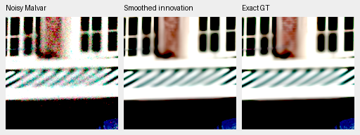
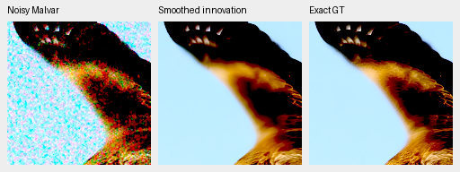

# How parent noise enters the paired luminance correction

The [same-noise-law repeat study](paired-repeat-stability.md#response-matching-at-600-updates-on-separate-photos)
finds that the starting paired head adds 315 DN16² of
fine-increment variance on 32 ISO6400 photos. About 234 DN16²
comes from covariance with the Corpus 100k parent's error.
This replay tests which parent-dependent inputs contribute
to that behavior.

## Fixed queries and input changes

The correction head receives the parent's pooled luminance
guide and a noise-whitened Bayer innovation. The innovation
subtracts the parent's mosaic from the measured query. For
each of 96 held-out photos, two independent ISO6400 queries
use two other disjoint, same-law redraws of their identical
clean targets. The parent prediction from the extra capture
can provide the guide, the mosaic used in the innovation, or
both. The query RAW, variance, support guard and RGB parent
receiving the correction stay fixed. The held-out donor is an
extra simulated measurement. Changing parent sources also
changes the relations among the network's input features.

Three single-frame controls use the same measured query for
every input. The guide control averages its local contrast
feature in a 3×3 packed-Bayer window. The innovation control
averages its noise-whitened residual with a 3×3 pooled
version at equal weights. The third combines both. All versions
use the same clipped-neighborhood mask and the same two-window
green support. Replaying both parent paths unchanged reproduces
the frozen head exactly.

Each exposure keeps the original native crop and camera
calibration. The two query/donor pairings have no shared noise
draws. The score uses the central 96×96 exact-target core and
the 1/8 to 1/3 cycles/pixel luminance band. The original 64
photos set the response-matching and flat-error-matching
scales. The other 32 photos measure transfer at those scales.
Intervals resample complete photos.

A directional follow-up keeps 5/9 of the original innovation,
the same center weight as uniform smoothing. The remaining
4/9 pools opposing neighbors along the horizontal, vertical
and both diagonal directions. Softmax weights favor directions
with less change in the frozen parent guide, measured over
the same 3×3 packed window. The filter operates within each
Bayer phase, without copying color samples. A second control
uses the correction and its support entirely from the extra
capture and adds that correction to the unchanged query parent.
This removes the dependence between the correction's inputs
and the query parent for the two simulated exposures.

## ISO6400 independent-draw results

The differences below compare each nominal policy with Corpus
100k alone on the 32 additional held-out sources. The canonical
head uses the original measurement twice, first in the parent
and again in the innovation. Its two-draw variance increase is
303 DN16², with 224 DN16² from twice the parent-correction
covariance.

| Policy | Aligned response gain (percentage points) | Fine-increment RMS difference (DN16) | Exact-flat RMS difference (DN16) | Between-draw variance difference (DN16²) |
| --- | ---: | ---: | ---: | ---: |
| V120 EMA | −0.427 | +0.445 | +0.557 | −128.4 |
| Canonical paired head | +0.409 | +0.424 | +0.048 | +303.0 |
| Extra-capture guide | +0.407 | +0.422 | +0.048 | +302.0 |
| Extra-capture mosaic in the innovation | +0.383 | +1.152 | +0.050 | +563.9 |
| Extra-capture guide and mosaic | +0.377 | +1.142 | +0.049 | +559.0 |
| Single-frame guide smoothing | +0.336 | +0.354 | +0.043 | +254.2 |
| Single-frame innovation smoothing | +0.171 | +0.092 | +0.008 | +101.5 |
| Single-frame guide and innovation smoothing | +0.134 | +0.081 | +0.007 | +84.7 |
| Single-frame directional innovation smoothing | +0.252 | +0.160 | +0.012 | +149.1 |
| Entirely extra-capture correction | +0.357 | −0.252 | +0.039 | +84.5 |

Replacing the guide alone lowers variance just 0.2 DN16²
[−1.4, 1.2] at matched response. Replacing only the parent's
mosaic raises variance 226 DN16² [86, 403] and fine-increment
error 0.651 DN16 [0.290, 1.105] against the response-matched
canonical head. In this construction the innovation still
contains the original query. Subtracting the mosaic from
another exposure removes the usual dependence between that
query and the subtracted estimate.

When the *whole correction* comes from the extra capture,
the covariance contribution falls from 224 to 1.3 DN16²
[−13.5, 13.5]. Increment RMS changes by −0.252 DN16 versus
Corpus 100k, with interval [−0.467, −0.060].
The flat error remains 0.039 DN16 higher. This establishes
how the same correction behaves with a genuinely independent
second measurement. The single-frame controls retain the
query as their only measurement.

At the response matched on the original 64 photos, uniform
innovation smoothing lowers independent increment RMS on
the additional photos by 0.016 DN16 [0.004, 0.031], exact-flat
RMS by 0.0036 DN16 and variance by 3.8 DN16². This uses a
canonical correction strength of 0.411. At nominal strength
the directional smoother retains 0.082 percentage points
more response than uniform smoothing and has higher variance.
When calibrated against the canonical head at the same flat
error, its response is higher by 0.041 percentage points
[0.010, 0.069]. The increment difference is +0.009 DN16,
with interval [−0.040, 0.070]. Both single-frame candidates
retain higher increment and flat errors than Corpus 100k.
[Source-bound results](results/paired-feedback-paths-v1/publication.json) ·
[Frozen evaluation and source archive](results/paired-feedback-paths-v1/evidence.tar.xz).

## Native exact-target crops

Each 160×160 triplet shows noisy Malvar, uniform single-frame
innovation smoothing and the exact simulation target. All
panels use `[48,48,160,160]` within a 256×256 native query,
ISO6400 shot/read `0.00128/6.5536e-6`, ADC16 black level 0.03,
capture exposure 0.33, display exposure ×3.0303 and contrast ×2.
The components use paired-head EMA
`02f8d5e6664bd580bafe2abeb3b8584b070b60bfadfefaff587cadd8bd643d7f`
above Corpus 100k EMA
`87b96f3c487b9edaf1c477742b6c38f2a82cc6b20a94716d51cc8cf46a17a760`.

The Amsterdam crop has the largest measured increment-error
reduction versus the canonical correction at nominal strength.
The bars and window frames look similar, and fine brick texture
stays soft. Source field `[380,118,256,256]`, GRBG. Slaunger,
CC BY-SA 4.0.
[Source photo](https://commons.wikimedia.org/wiki/File:Couple_selfie_stick_Konigssluis_Amsterdam_2016-09-13-6621.jpg) ·
[All methods](images/paired-feedback-paths-v1/094-iso6400-independent-r0-role0-comparison.png).

The black kite crop has the largest measured regression. The
blue background looks clean and brown feather detail remains
smeared along the bird edge. Source field `[228,102,256,256]`,
GBRG. Tisha Mukherjee, CC BY-SA 4.0.
[Source photo](https://commons.wikimedia.org/wiki/File:Black_Kite_in_Baruipur_October_2025_by_Tisha_Mukherjee_01.jpg) ·
[All methods](images/paired-feedback-paths-v1/067-iso6400-independent-r0-role0-comparison.png).

The largest exact-flat regression still leaves a smooth-looking
center. Ripples and the vessel edge remain soft. Source field
`[168,470,256,256]`, GRBG. Mattbuck, CC BY-SA 4.0.
[Source photo](https://commons.wikimedia.org/wiki/File:London_MMB_%C2%BB146_River_Thames_and_%22Svitzer_Cecilia%22.jpg) ·
[Native flat comparison](images/paired-feedback-paths-v1/090-iso6400-independent-r0-role2-comparison.png).

## Standing GFX100S comparisons

All eight views show the single-frame policies above the same
saved Corpus 100k query. Each 160×160 crop uses the same
coordinates, camera matrix and white balance across methods.
DSCF3879 uses the established nominal prior and ×4 display
exposure. DSCF3842 uses both the nominal and transferred
DSCF3879 priors at ×16. The transferred shot/read pair is
`0.0014635776/1.0715704e-6`. The independent ISO100 AHD
captures and the cab JPEGs provide qualitative references with
different exposure, aperture and moving subjects.

| View | Native boards |
| --- | --- |
| DSCF3879 main scene | [Sky](images/paired-feedback-paths-v1/main-overcast-sky-main-overcast-sky.png) · [Building](images/paired-feedback-paths-v1/main-building-detail-main-building-detail.png) · [Foliage](images/paired-feedback-paths-v1/main-foliage-main-foliage.png) · [Coarse fence](images/paired-feedback-paths-v1/main-chain-link-fence-main-chain-link-fence.png) |
| DSCF3842 nominal | [Left](images/paired-feedback-paths-v1/mesh-nominal-fine-green-mesh-left.png) · [Right](images/paired-feedback-paths-v1/mesh-nominal-fine-green-mesh-right.png) |
| DSCF3842 transferred | [Left](images/paired-feedback-paths-v1/mesh-profile3879-fine-green-mesh-left.png) · [Right](images/paired-feedback-paths-v1/mesh-profile3879-fine-green-mesh-right.png) |

The sky stays smooth and both crossing directions of the coarse
fence remain visible. Thin wires and leaf edges remain soft. The
fine cab mesh still has incomplete crossings and mottle under
both priors. The uniform innovation smoother changes the sky by
0.00015 DN16 RMS and the four cab crops by 0.012–0.090 DN16 RMS
versus Corpus 100k, measured in camera RGB.
[Full geometry and inspection receipt](results/paired-feedback-paths-v1/publication.json).

This is an inference-only study of frozen weights. It contributes
scoped ISO6400 fine-detail results. The 427-photo and measured-CFA
scores apply to the separately evaluated full-model checkpoints.
[PSNR history](performance-history.md).
